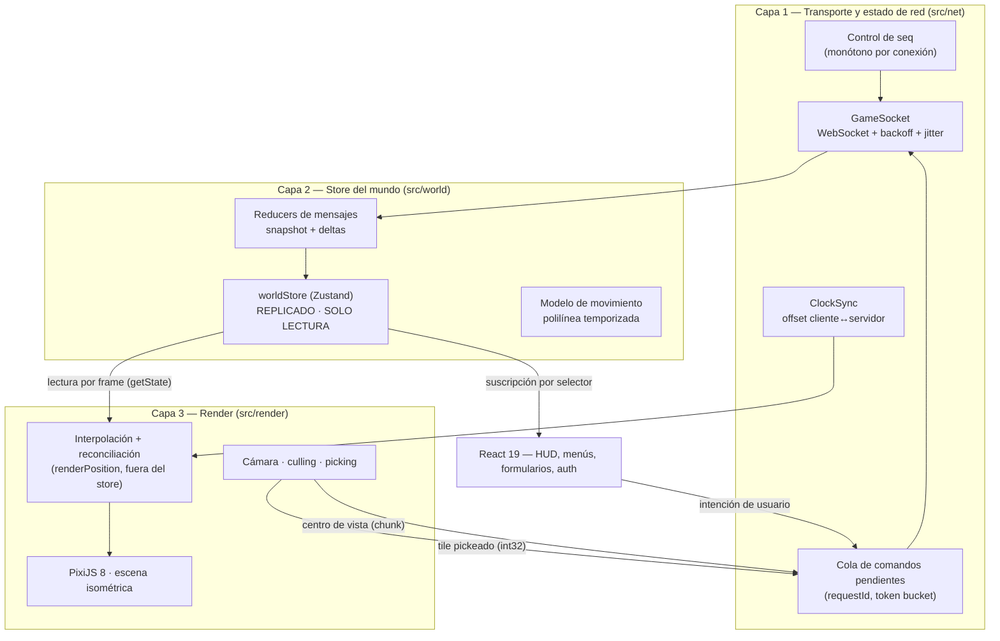

# Arquitectura del cliente (apps/web)

Propósito: definir el diseño objetivo del cliente de **Empires Online** —Next.js 15 (App Router) + React 19 + TypeScript + PixiJS 8— y en particular la separación estricta entre transporte de red, estado replicado del mundo y capa de render, así como el tratamiento del tiempo, la interpolación y las transformaciones de coordenadas.

> **Estado (2026-10-21): `apps/web` existe y este documento mezcla código y diseño objetivo.** El cliente
> real es más pequeño que el árbol de §11 y lo reparte así:
>
> | Fichero | Papel |
> |---|---|
> | `app/page.tsx`, `app/layout.tsx` | Alta, entrada y HUD en una sola página |
> | `src/net/client.ts`, `src/net/auth.ts` | Capa 1: transporte WebSocket, handshake, latido, reconexión con backoff y jitter, desfase de reloj; alta, login y ticket por la cookie de sesión |
> | `src/state/world.ts` | Capa 2: store Zustand, réplica de sólo lectura aplicada desde los mensajes |
> | `src/state/interpolation.ts` | Posición autoritativa e interpolada de una polilínea (§5.1, §5.2) |
> | `src/render/reconciler.ts` | Corrección gradual de las discontinuidades (§5.3) |
> | `src/render/iso.ts`, `src/render/scene.ts`, `src/components/GameCanvas.tsx` | Capa 3: proyección, escena PixiJS y su montaje en React |
> | `src/render/camera.ts`, `src/state/viewSync.ts` | Cámara desplazable y cuándo enviar `session.view` (§7.4.1) |
> | `app/api/auth/*/route.ts`, `src/server/*`, `identity/*`, `instrumentation.ts` | Servidor de Next.js: alta, login, sesión web, emisión del ticket y almacén de identidad ([ADR-018](../decisions/ADR-018-identity-store-and-ticket-issuer.md)) |
>
> Cada sección empieza con una línea **Estado** que dice qué parte es código y qué parte es diseño objetivo,
> comprobada contra `apps/web` el 2026-10-21. En resumen:
>
> | Sección | Estado |
> |---|---|
> | §1 Principio rector, §6.5, §10 | **Se cumplen** en el código. |
> | §2 Las tres capas | Las capas existen con otros nombres (`src/net`, `src/state`, `src/render`, `src/components`); sus módulos internos son objetivo. |
> | §3.1 Envelopes | Existe, con diferencias: el cliente valida con Zod **todo** mensaje también en producción y emite también `unit.garrison` y `unit.ungarrison`. |
> | §3.2 Handshake | **Ajustada al código.** |
> | §3.3–§3.7 Reconexión, `seq`, cola de comandos, errores, reloj | **Objetivo.** Cada una dice qué hace hoy `src/net/client.ts`, que es bastante menos. |
> | §4 Store | Existe en lo esencial (réplica de sólo lectura, snapshot que reemplaza, terreno que se fusiona, mapas estables con la señal `changes` de qué ids tocó cada delta); la forma del estado y los reducers separados son objetivo. |
> | §5 Posición autoritativa y de render | **Ajustada al código.** |
> | §6 Coordenadas | Las fórmulas existen; el anclaje del rombo y el acotado del clic difieren (§6.2, §6.4). |
> | §7.1–§7.2, §7.5–§7.6 Escena, profundidad, picking, presupuesto | **Objetivo**, con lo que existe dicho en cada una; el HUD por selector de valor de §7.6 sí se cumple. |
> | §7.4 Culling | **Ajustada al código** desde 2026-10-27 (`src/render/culling.ts`), con las diferencias que dice su Estado. |
> | §7.4.1 Cámara desplazable y `session.view` | **Ajustada al código** (`EO-122`). |
> | §7.3 Bucle de frame | **Ajustada al código**: la escena recibe sólo lo que cambió y por frame mueve sólo las unidades activas. |
> | §8 React frente a PixiJS | El reparto existe; minimapa, paneles y `next/dynamic` no. |
> | §9 React Query | **No existe**: el cliente no tiene esa dependencia. |
> | §11 Estructura de carpetas | **Objetivo.** El árbol real es el de la tabla de arriba. |
> | §12 Tests | §12.3 **ajustada al código**; las demás, objetivo cubierto en parte por los ficheros reales. |
>
> Los tests reales están en `apps/web/src/**/*.test.ts` (y `identity/*.test.ts`, `scripts/*.test.ts`) y los
> ejecuta la CI.

Documentos relacionados: [`./game-loop.md`](./game-loop.md) · [`./overview.md`](./overview.md) · [`../specs/websocket-protocol.md`](../specs/websocket-protocol.md) · [`../specs/movement.md`](../specs/movement.md) · [`../specs/player.md`](../specs/player.md) · [`../testing/strategy.md`](../testing/strategy.md)

---

## 1. Principio rector

> **Estado: se cumple.** El cliente sólo envía intenciones y dibuja lo que replica. Las que hoy emite la
> interfaz son `unit.move`, `unit.garrison` (clic sobre la zona urbana de una ciudad con una unidad
> seleccionada), `unit.ungarrison` (botón del HUD) y `session.view` (al desplazar la cámara a otro chunk,
> §7.4.1); `GameClient` tiene también `cancelMove`, que ninguna parte de la interfaz llama.

El cliente es un **terminal de observación e intención**. Envía intenciones (`unit.move`, `unit.cancel_move`, `session.view`) y renderiza una réplica de solo lectura de la verdad que emite el Game Server en Go. No calcula posiciones finales, ni HP, ni recursos, ni resultados de combate, ni ETAs, ni paths: *client sends intent, server determines truth*.

La única cosa que el cliente calcula por su cuenta y que el servidor no conoce son **píxeles**. El servidor jamás maneja píxeles; la proyección isométrica es responsabilidad exclusiva del cliente.

Corolario operativo: cualquier función del cliente que produzca un número que después se envíe al servidor debe producir **coordenadas de mundo en tiles enteros** (`int32`), nunca píxeles.

---

## 2. Las tres capas

> **Estado: las capas existen; su forma interna es objetivo.** En el código la capa 1 es `src/net`
> (`client.ts`, `auth.ts`), la 2 es `src/state` (`world.ts`, `interpolation.ts`), la 3 es `src/render`
> (`iso.ts`, `reconciler.ts`, `scene.ts`) y React vive en `app/` y `src/components`. Las reglas de dependencia
> de la tabla se cumplen con esos nombres: `src/state` no importa ni Pixi ni la red, y `src/render` no envía
> nada (la escena devuelve los clics a React por *callbacks*). No existen `ClockSync`, la cola de comandos
> pendientes ni el control de `seq` como piezas separadas: ver §3.3–§3.7. Fuera de las tres capas, el servidor
> de Next.js pone las cabeceras de seguridad de la web —una `Content-Security-Policy` con nonce por petición
> desde `middleware.ts` y las fijas desde `next.config.mjs`— y por eso la página se renderiza en cada petición;
> la política y cómo comprobarla están en
> [../operations/deployment.md](../operations/deployment.md#24-cabeceras-de-seguridad).



Reglas de dependencia, verificadas en revisión de código:

| Capa | Puede importar de | **No** puede importar de |
|---|---|---|
| `src/net` | `@empires-online/protocol`, `src/lib` | `src/world`, `src/render`, `src/ui` |
| `src/world` | `src/net` (tipos), `@empires-online/protocol` | `src/render`, `pixi.js`, cualquier API de DOM |
| `src/render` | `src/world` (lectura), `pixi.js` | `src/net` (nunca envía directamente), `src/ui` |
| `src/ui` (React) | `src/world`, `src/net` (fachada de comandos) | internals de `src/render` |

La capa 2 no conoce píxeles. La capa 3 no conoce WebSockets. La capa 1 no conoce ni tiles ni sprites: solo *envelopes*.

---

## 3. Capa 1 — Transporte y estado de red

### 3.1 Envelopes y versión

> **Estado: existe, con dos diferencias.** `GameClient.handleRaw` valida **todo** mensaje entrante con
> `v1.parseServerMessage` (Zod) también en producción, no sólo el envelope: lo que no valida, incluido un
> `type` desconocido, se descarta y se notifica por `onError` sin cerrar la sesión. Y además de los tipos de
> abajo el cliente emite `unit.garrison` y `unit.ungarrison` (ADR-017).

El cliente habla **protocolo WebSocket v1** sobre WSS, JSON UTF-8, con `"v": 1` explícito en cada mensaje.

- Cliente → servidor: `{ v, type, requestId, payload }`, con `requestId` = UUIDv4 obligatorio en comandos.
- Servidor → cliente: `{ v, type, seq, ts, requestId?, payload }`, con `seq` = uint64 monótono **por conexión** y `ts` = epoch ms del servidor.

Tipos que el cliente **emite** en v1: `session.hello`, `session.ping`, `session.view`, `unit.move`, `unit.cancel_move`. Tipos que el cliente **consume**: `session.welcome`, `session.pong`, `system.error`, `world.snapshot`, `entity.spawn`, `entity.update`, `entity.despawn`, `city.update`, `territory.update`, `unit.move.accepted`, `unit.move.rejected`, `unit.movement.started`, `unit.movement.completed`, `unit.movement.cancelled`. Cualquier `type` desconocido se registra y se descarta sin romper la sesión (compatibilidad hacia adelante).

Los tipos TypeScript y los validadores se importan de `@empires-online/protocol` (Zod es la fuente de verdad del protocolo). El cliente validará con Zod **todo** mensaje entrante en desarrollo (`process.env.NODE_ENV !== 'production'`); en producción validará solo el envelope y confiará en el `type` para el *narrowing*, porque el coste de validar un `world.snapshot` completo por conexión es medible. Las variables `EO_*` son del servidor y **no** llegan al navegador.

Asimetría del protocolo que el cliente debe conocer, porque está implementada así en los esquemas: los mensajes **cliente→servidor son estrictos** (`additionalProperties: false`; un campo de más se rechaza), mientras que los **servidor→cliente no lo son**, para poder añadir campos opcionales sin romper clientes antiguos. Por eso descartar un `type` desconocido es seguro, pero enviar un campo extra no lo es.

### 3.2 Handshake

> **Estado: ajustada al código** (`src/net/client.ts`, `src/net/auth.ts`). Un handshake fallido llega sólo
> como código de cierre, sin `system.error` ([ADR-019](../decisions/ADR-019-handshake-failure-close-code.md)).

1. React pide un **game ticket** (JWT HS256, TTL **60 s**, `aud: "game-server"`). El ticket es de un solo uso: su `jti` se consume en Redis del lado servidor.
2. `GameSocket` abre `<ws|wss>://<host>/ws`.
3. Primer mensaje, **antes de 5 s** o el servidor cierra con `4408`: `session.hello { ticket }`.
4. El servidor responde `session.welcome` con `{ sessionId, playerId, serverTimeMs, tickDurationMs, heartbeatIntervalMs, world: { width, height, chunkSize } }`; a partir de ahí llega `world.snapshot` y luego deltas.

Consecuencia de diseño: **el ticket nunca se cachea**. Con TTL de 60 s, cada intento de (re)conexión pide un ticket nuevo. Un reintento de reconexión es siempre `fetch ticket → open socket → session.hello`.

> **De dónde sale el ticket.** De `apps/web`, en el mismo origen que la página
> ([ADR-018](../decisions/ADR-018-identity-store-and-ticket-issuer.md)). El alta (`POST /api/auth/register`) y el
> login (`POST /api/auth/login`) responden con el primer ticket y dejan una cookie de sesión `HttpOnly`; cada
> reconexión pide el siguiente a `POST /api/auth/ticket`, que sólo necesita esa cookie. El cliente no guarda la
> contraseña: `src/net/auth.ts` (`ticketProvider`) usa el ticket del alta para la primera conexión y la cookie
> para las demás. El código de servidor —almacén de identidad, `scrypt`, firma del ticket— vive en
> `apps/web/src/server/`, bajo `server-only`, y nunca llega al bundle del navegador.

### 3.3 Reconexión: backoff exponencial con jitter

> **Estado: objetivo.** Lo que hace hoy `GameClient` (`src/net/client.ts`), sin módulo `backoff.ts`:
>
> - Retardo del intento `n` = `min(500 · 2^n, 30 000)` ms **más** un jitter uniforme de hasta el 30 % de ese
>   valor (no *full jitter*). Constantes `BASE_BACKOFF_MS = 500` y `MAX_BACKOFF_MS = 30 000`. El contador
>   vuelve a 0 con cada `session.welcome`.
> - Cada intento pide un ticket nuevo (`ticketProvider`: el del alta o el login la primera vez, después
>   `POST /api/auth/ticket` con la cookie). Si pedirlo falla por red o con `429`/`500`, notifica
>   `UNAUTHORIZED` y programa otro intento con el mismo backoff. Si `/api/auth/ticket` responde `401` o `403`
>   —la sesión web caducó o se cerró— el error lleva `code` `UNAUTHORIZED`/`FORBIDDEN` (`AuthError`) y el
>   cliente **no reintenta**: pasa a `closed` y la página vuelve al formulario de entrada con «Tu sesión ha
>   caducado o ya no es válida. Vuelve a entrar.», también si la sesión caduca a mitad de una reconexión.
> - Política por código: un cierre pedido por el propio cliente (`disconnect`) no reconecta; `4401` y `4403`
>   **no reconectan** —el estado pasa a `closed` y la página vuelve al formulario de entrada con el error—;
>   cualquier otro código, incluidos `4400`, `4408`, `4429` y `4500`, reconecta con el backoff normal.
> - No hay `RECONNECT_*` ni `PRESENCE_GRACE_MS`, y `4429` no arranca en el máximo.
>
> Lo que la tabla de abajo pide y el código no hace: reintentar `4401` con un ticket nuevo antes de volver al
> login, un único reintento para `4400` y el arranque de `4429` en el máximo.

Los parámetros de reconexión son constantes del cliente en `src/net/backoff.ts`. **No son valores de gameplay** y por tanto no pertenecen a la superficie de configuración `EO_*`; se eligen anclados a constantes reales del servidor:

| Constante | Valor | Justificación |
|---|---|---|
| `RECONNECT_BASE_MS` | 250 | Suficientemente rápido para que varios intentos quepan dentro de la ventana de gracia de presencia. |
| `RECONNECT_FACTOR` | 2 | Backoff exponencial clásico. |
| `RECONNECT_MAX_MS` | 15000 | Igual al intervalo de ping del servidor (15 s): no tiene sentido reintentar más lento que el latido del transporte. |
| `PRESENCE_GRACE_MS` | 30000 | Espejo de `EO_PRESENCE_TTL_SECONDS = 30`. Reconectar dentro de esta ventana evita la transición a `OFFLINE_PENDING`. |

Retardo del intento `n` (0-indexado), **full jitter**:

```ts
const delayMs = Math.random() * Math.min(
  RECONNECT_MAX_MS,
  RECONNECT_BASE_MS * Math.pow(RECONNECT_FACTOR, attempt),
);
```

El jitter completo (uniforme en `[0, cap]`, no `cap/2 + rand`) es deliberado: evita el *thundering herd* de miles de clientes reconectando en fase tras un reinicio del Game Server.

Política por código de cierre:

| Código | Significado | Acción del cliente |
|---|---|---|
| `1000` / `1001` | Cierre normal / navegación | No reconectar si el cierre lo inició el cliente. |
| `1006` | Cierre anómalo (red) | Reconectar con backoff. |
| `4400` | Mensaje inválido | Bug del cliente. Log en `error`, un solo reintento, y reporte en HUD. |
| `4401` | No autenticado | Ticket expirado o inválido: pedir ticket nuevo y reintentar. Dos fallos seguidos → volver al flujo de login. |
| `4403` | No autorizado | **No** reconectar. Estado terminal, mensaje explícito al usuario. |
| `4408` | Timeout de handshake | Reconectar con backoff (probable ticket llegado tarde). |
| `4429` | Rate limited | Reconectar arrancando el backoff ya en `RECONNECT_MAX_MS`. Indica bug de emisión en el cliente: el servidor **cierra en cuanto se agota el bucket**, sin tolerancia progresiva. Log en `warn`. |
| `4500` | Error interno del servidor | Reconectar con backoff. Causa más probable: **la cola de salida de la sesión se llenó** porque el cliente no consumía al ritmo del servidor (`EO_WS_OUTBOUND_QUEUE_SIZE`, 256 mensajes). Si se repite, el problema es de rendimiento del cliente, no de red. |

Al reconectar, `seq` **se reinicia** (es monótono por conexión, no por jugador): `lastSeq` vuelve a `null` y el store se reemplaza íntegramente con el `world.snapshot` de la nueva sesión.

### 3.4 Control de `seq` y detección de huecos

> **Estado: objetivo.** Hoy `GameClient` guarda el último `seq` como `number` (el esquema Zod lo declara
> `z.number().int().min(0)`, no `bigint`) y **descarta** cualquier mensaje con `seq` menor o igual, salvo
> `session.welcome`, que lo reinicia. No detecta huecos ni resincroniza: un hueco pasaría inadvertido. Al
> reconectar no vacía el store; el `world.snapshot` de la nueva sesión reemplaza unidades, ciudades y
> territorios y fusiona el terreno (§4.3), así que el efecto es el mismo salvo para el terreno, que sigue
> en memoria.

`seq` es monótono creciente por conexión. Como el transporte es TCP/WSS ordenado, un hueco (`seq !== lastSeq + 1n`) no puede deberse a reordenamiento: significa pérdida real de un delta. Un cliente que sigue aplicando deltas sobre un estado con un hueco diverge silenciosamente, que es el peor fallo posible en un sistema autoritativo.

Política MVP: **ante un hueco, resincronizar por reconexión**. El protocolo v1 no define un mensaje de resincronización; el único mecanismo que produce un `world.snapshot` es abrir una sesión. Por tanto el cliente cierra el socket con `1000`, limpia el store y ejecuta el flujo de reconexión inmediatamente (sin backoff en el primer intento, porque no es un fallo de red). El evento se cuenta y se registra: un hueco recurrente es un bug de servidor que debe verse.

Se usa `bigint` para `seq`, no `number`: es `uint64` en el protocolo (`seq` monótono por conexión) y `Number.MAX_SAFE_INTEGER` no lo cubre.

### 3.5 Cola de comandos pendientes y `requestId`

> **Estado: objetivo; no existe cola.** `GameClient.send` genera un `requestId` UUIDv4 nuevo por comando
> (`crypto.randomUUID()`) y lo envía si la sesión está `ready`; si no, **descarta** el comando y lo notifica
> con `INTERNAL_ERROR`, a propósito, para no reproducir órdenes viejas tras reconectar. No correlaciona
> respuestas por `requestId`, no reenvía nada, no tiene *token bucket* ni comprueba el tamaño antes de enviar.
>
> Lo que sí ha cambiado del lado servidor respecto al punto 2: un duplicado del mismo `requestId` **sí** recibe
> la respuesta original cuando la hubo (I-5, `TestUnDuplicadoTrasReconectarRecibeLaRespuestaOriginal`), y
> la reserva en Redis es `SET NX` con TTL de 300 s ([ADR-014](../decisions/ADR-014-command-idempotency.md)).

`PendingCommands` cumple tres funciones:

1. **Correlación.** Cada comando se guarda por `requestId` con su `type`, `payload`, `createdAtMs` y `sentAtMs`. Las respuestas correlacionadas (`unit.move.accepted`, `unit.move.rejected`, `system.error` con `requestId`) resuelven la entrada. Las respuestas del servidor sin `requestId` son deltas de mundo y no tocan la cola.
2. **Idempotencia en reintentos.** Un comando reenviado tras una reconexión conserva **el mismo `requestId`**. El servidor reserva ese `requestId` en Redis con `SET NX` y TTL 300 s antes de ejecutar; si ya estaba reservado, no lo re-ejecuta y le **reemite la respuesta original** si la hubo (I-5). Generar un `requestId` nuevo al reintentar sería un bug: duplicaría órdenes. La contrapartida que el cliente debe asumir: si el original todavía no había respondido, el reenvío no recibe nada, así que la entrada de la cola debe caducar por tiempo, no esperar indefinidamente una confirmación. Y si Redis no responde, el servidor **ejecuta igualmente** el comando: prefiere jugar a bloquear al jugador.
3. **Respeto del rate limit.** El cliente mantiene su propio *token bucket* de **20 msg/s con burst 40**, espejo de `EO_WS_RATE_LIMIT_PER_SECOND` / `EO_WS_RATE_LIMIT_BURST`. Nunca debe provocar un cierre `4429`: si el bucket está vacío, el comando espera en la cola. Igualmente, antes de enviar se comprueba que el JSON serializado no supere **16384 bytes** (`EO_WS_MAX_MESSAGE_BYTES`); un comando que lo supere se rechaza localmente como bug, no se envía.

Reglas de caducidad, distinguiendo dos situaciones:

- **Comandos en vuelo** (ya enviados, sin respuesta cuando cayó el socket): se reenvían tras `session.welcome`, con el mismo `requestId`. Es seguro y necesario: puede que el servidor los ejecutara y perdiéramos la respuesta.
- **Comandos creados con el socket caído**: se encolan y se envían al reconectar **solo si** la reconexión completa dentro de `PRESENCE_GRACE_MS` (30 s). Pasada esa ventana, una orden de movimiento emitida hace medio minuto ya no representa la intención del jugador: se descarta y el HUD lo informa. El invariante "una unidad tiene como máximo un movimiento `ACTIVE`, y una nueva orden cancela la anterior" hace que reproducir órdenes rancias sea semánticamente válido pero jugablemente sorprendente; se prefiere descartar.

Tamaño máximo de la cola: 64 entradas. Al desbordar se descarta la más antigua y se registra en `warn`.

### 3.6 Errores

> **Estado: objetivo.** Hoy `system.error` y `unit.move.rejected` dejan `{ code, message }` en
> `lastError` del store y la página lo muestra tal cual en el pie del HUD; los avisos del transporte
> (`onError`: mensaje que no valida, comando sin conexión, cierre `4401`, ticket rechazado) se muestran en el
> formulario de entrada: un `UNAUTHORIZED` del transporte se traduce a una frase para el jugador («Tu sesión ha
> caducado o ya no es válida. Vuelve a entrar.») y el resto sale con su código. No hay más tratamiento por grupo
> de códigos, ni toasts, ni reversión de feedback optimista (no lo hay).
> Lo que sí se cumple: ninguna decisión del cliente mira el texto del mensaje.

`system.error` llega con `{ code, message, requestId?, details? }`. **La lógica del cliente conmuta siempre sobre `code`, nunca sobre `message`.** El texto humano es para el log y, traducido, para el HUD.

Mapeo de códigos a comportamiento de UI. Son los **22 códigos** del catálogo cerrado que exporta `@empires-online/protocol` y que un contract test en Go verifica contra `internal/protocol/codes.go`:

| Grupo | Códigos | Tratamiento |
|---|---|---|
| Sesión | `UNAUTHORIZED`, `FORBIDDEN` | Terminal: cerrar sesión de juego, volver a login. |
| Protocolo | `INVALID_MESSAGE`, `UNSUPPORTED_VERSION`, `MESSAGE_TOO_LARGE` | Bug del cliente: log `error`, banner de "versión incompatible" para `UNSUPPORTED_VERSION`. |
| Presión | `RATE_LIMITED` | Frenar emisión, no reintentar en bucle. |
| Orden de movimiento | `UNIT_NOT_FOUND`, `UNIT_NOT_OWNED`, `UNIT_NOT_MOVABLE`, `UNIT_DEAD`, `UNIT_GARRISONED`, `INVALID_TARGET`, `TARGET_OUT_OF_BOUNDS`, `TARGET_NOT_WALKABLE`, `PATH_NOT_FOUND`, `PATH_TOO_LONG` | Feedback puntual sobre el cursor/tile; revertir cualquier indicación optimista de la UI. |
| Dominio | `CITY_NOT_FOUND`, `CITY_PROTECTED`, `TREATY_REQUIRED`, `POPULATION_LIMIT_REACHED` | Mensaje contextual en el panel correspondiente. |
| Genéricos | `INTERNAL_ERROR`, `NOT_IMPLEMENTED` | Toast genérico; `NOT_IMPLEMENTED` además oculta el control que lo provocó. |

### 3.7 Sincronización de reloj

> **Estado: objetivo.** Hoy `GameClient` mantiene un único `clockOffsetMs` sobre `Date.now()` (no sobre el
> reloj monótono): lo fija el `session.welcome` (`serverTimeMs − now`) y lo recalcula cada `session.pong` con
> el estimador de medio RTT (`serverTimeMs + rtt/2 − now`), sin ventana de muestras, sin elegir la de RTT
> mínimo y sin suavizado. Envía `session.ping` cada `heartbeatIntervalMs` del `welcome` (10 s por defecto,
> `EO_PRESENCE_HEARTBEAT_SECONDS`), sin ráfaga inicial. `serverTimeMs()` es lo que reciben la escena y el
> reconciliador; no hay `quality()` y se interpola desde el primer frame. Los saltos que produce un cambio de
> desfase los absorbe el reconciliador (§5.3).

Todo instante del dominio viaja en **epoch milliseconds del servidor**: el `ts` del envelope, el `start_time_ms` y el `arrival_time_ms` de los movimientos, los `tMs` de la polilínea. El reloj de pared del cliente (`Date.now()`) puede estar desviado minutos y además salta (ajustes NTP, suspensión). Interpolar contra él produce unidades que van adelantadas o atrasadas de forma permanente.

`ClockSync` mantiene un **offset estimado** entre el reloj monótono local y el reloj del servidor:

```ts
// t0: monotónico local al enviar session.ping
// t1: envelope.ts del session.pong (epoch ms del servidor)
// t2: monotónico local al recibir
const rttMs    = t2 - t0;
const offsetMs = t1 - (t0 + t2) / 2;   // estimador NTP simple
```

- Base monotónica: `performance.timeOrigin + performance.now()`, no `Date.now()`. Así el offset no salta si el usuario cambia la hora del sistema.
- Se mantiene una ventana deslizante de 8 muestras y se adopta el `offsetMs` de la muestra con **RTT mínimo** (el mínimo RTT es el menos contaminado por encolado). Ese valor se aplica con suavizado exponencial para no producir saltos visuales.
- Frecuencia de muestreo: `session.ping` cada **15 s**, alineado con el ping del transporte; ráfaga de 3 pings al arrancar la sesión para converger rápido.
- Cada mensaje servidor→cliente lleva `ts`, así que además se usa como límite inferior: `serverNow()` nunca puede quedar por detrás del `ts` del último mensaje recibido.

API expuesta a la capa de render:

```ts
interface ClockSync {
  serverNowMs(): number;  // epoch ms del servidor, estimado, monótono
  rttMs(): number;
  offsetMs(): number;
  quality(): 'UNSYNCED' | 'COARSE' | 'GOOD';
}
```

Mientras `quality() === 'UNSYNCED'` (antes del primer `session.pong`), el render dibuja las unidades en su `authoritativePosition` discreta, sin interpolar. Interpolar con un offset desconocido es peor que no interpolar.

---

## 4. Capa 2 — Store del mundo

### 4.1 Naturaleza del store

> **Estado: existe en lo esencial.** `useWorldStore` (`src/state/world.ts`, Zustand) es una réplica de sólo
> lectura que sólo cambia por `applyServerMessage` (y `applyWelcome` / `applySnapshot`, que ella llama), y no
> hay predicción de movimiento. Diferencias: también guarda la selección (`selectedUnitId`, `selectUnit`) y el
> último error (`lastError`), porque no hay `uiStore` separado; y `reset()` existe pero la reconexión no lo
> llama (§3.4). Desde 2026-10-27 **un delta cuesta lo que cambia**: los mapas de entidades son de referencia
> estable y se mutan en sitio, cada entidad es un objeto inmutable que se reemplaza entero, y cada `set` que
> toca el mundo publica en `changes` qué ids tocó (§4.2). Antes, cada `entity.update` copiaba el `Map` de
> unidades entero.

`worldStore` (Zustand) contiene **estado autoritativo replicado y de solo lectura**. Su única vía de escritura es el reductor que consume mensajes del servidor:

```ts
// src/world/worldStore.ts
export const useWorldStore = create<WorldState>()(/* ... */);

// ÚNICA función que muta el store. No se exportan setters granulares.
export function applyServerMessage(msg: ServerEnvelope): void;
export function resetWorld(reason: ResetReason): void;   // reconexión / hueco de seq
```

No existe `setUnitPosition`, ni `moveUnitLocally`, ni ninguna forma de predicción del lado cliente que escriba estado del mundo. El MVP **no hace predicción de movimiento**: al pulsar sobre un tile no se mueve nada hasta que llega `unit.move.accepted` + `unit.movement.started`. Con `baseMsPerTile = 600 ms` para `VILLAGER` y un tick de 100 ms, la latencia percibida de arranque es aceptable y evita toda la complejidad de rollback. Predicción optimista: **Fuera de MVP**.

El estado *de interfaz* (selección de unidades, panel abierto, hover) vive en un store distinto, `uiStore`. Mezclarlos haría imposible el `resetWorld` limpio de la reconexión.

### 4.2 Forma del estado

> **Estado: objetivo en la forma; ajustado en el terreno.** El estado real es `{ playerId, sessionId, world,
> tick, units, cities, territories, terrain, changes, selectedUnitId, lastError }`: sin `connection` (el estado
> de la conexión lo lleva `GameClient` y la página) ni `view`. Cada unidad es un `UnitView` con `x`, `y` (la
> posición autoritativa consolidada), `movement`, `cityId` y `garrisonCityId`; el terreno es un `Map` por
> clave `"cx:cy"` con los bytes ya decodificados. Lo que dicen los dos párrafos sobre cómo llega el terreno —una
> vez por sesión (`NeedsTerrain` / `MarkTerrainSent`), fusionado y nunca borrado por un snapshot— es exacto.
>
> Los cuatro mapas se exponen como `ReadonlyMap` y son **los mismos objetos durante toda la pestaña**: un
> snapshot o un `reset` los vacían y rellenan en sitio. Por eso su referencia no sirve para detectar cambios;
> lo que se compara es `changes: WorldChanges` —`revision` creciente, `all` (snapshot, welcome, reset), los
> ids de `units`, `cities` y `territories` tocados (en `units`, también la unidad que entra y la que sale de la
> selección) y `terrain` (llegaron chunks)—, que se reemplaza en cada `set` que toca el mundo y no en los que
> sólo dejan `lastError`. Medido en `src/state/world.perf.test.ts` (informativo, 2 000 unidades y 1 000
> `entity.update`): unos 4 µs por delta frente a 133–145 µs cuando se copiaba el mapa.

Los identificadores siguen los tipos del paquete de protocolo: `EntityId` es un **entero positivo** (`number`, acotado a `Number.MAX_SAFE_INTEGER`) para unidades, ciudades, movimientos y territorios; `Uuid` es un **string** y se usa para `playerId` y `sessionId`. No hay ids de entidad como cadena.

```ts
type UnitStatus = 'IDLE' | 'MOVING' | 'GARRISONED' | 'HIDDEN' | 'DEAD';

type EntityId = number;   // entero >= 1
type Uuid = string;

interface Waypoint { readonly x: number; readonly y: number; readonly tMs: number }

interface ActiveMovement {
  readonly movementId: EntityId;
  readonly startTimeMs: number;    // epoch ms del servidor
  readonly arrivalTimeMs: number;  // epoch ms del servidor
  readonly waypoints: readonly Waypoint[];  // [0] = origen con tMs = 0
}

interface UnitState {
  readonly id: EntityId;
  readonly ownerId: Uuid;
  readonly unitType: 'VILLAGER';
  readonly status: UnitStatus;
  readonly hp: number;
  /** Verdad del servidor: tile entero. Nunca se escribe desde el render. */
  readonly authoritativePosition: { readonly x: number; readonly y: number };
  readonly movement: ActiveMovement | null;
}

interface WorldState {
  readonly connection: {
    status: 'IDLE' | 'AUTHENTICATING' | 'CONNECTING' | 'HANDSHAKING' | 'READY' | 'RECONNECTING' | 'FATAL';
    attempt: number;
    lastSeq: bigint | null;
    lastCloseCode: number | null;
  };
  readonly self: { sessionId: Uuid; playerId: Uuid; cityId: EntityId | null } | null;
  readonly world: { width: number; height: number; chunkSize: number } | null;  // de session.welcome
  readonly units: ReadonlyMap<EntityId, UnitState>;
  readonly cities: ReadonlyMap<EntityId, CityState>;        // incluye presenceState
  readonly territories: ReadonlyMap<EntityId, TerritoryState>;
  readonly chunks: ReadonlyMap<number, ChunkTerrain>;       // clave = chunkId
  readonly view: { centerX: number; centerY: number };      // tiles, no píxeles
}
```

`ChunkTerrain` guarda los **1024 bytes** de un chunk 32×32, con `TerrainType` como `uint8` (`GRASSLAND` 0, `FOREST` 1, `HILL` 2, `MOUNTAIN` 3, `WATER` 4, `ROAD` 5). Disposición fila-mayor; índice dentro del chunk: `(y % chunkSize) * chunkSize + (x % chunkSize)`. Identificación: `chunkX = x / chunkSize`, `chunkY = y / chunkSize`, `chunkId = chunkY * chunksPerRow + chunkX`, con `chunksPerRow = width / chunkSize = 16` en la configuración por defecto (512 / 32), 256 chunks en total. El `chunkSize`, el ancho y el alto llegan en `session.welcome.payload.world`: el cliente **no** los codifica como constantes ni asume desplazamientos de bits sobre 32.

**Cómo llega el terreno, con exactitud.** El protocolo v1 sí transporta terreno: `world.snapshot.payload` es `{ serverTimeMs, tick, chunks[], terrain[], units[], cities[], territories[] }`, y cada entrada de `terrain[]` lleva sus `chunkSize*chunkSize` bytes **codificados en base64**. Dos consecuencias para el cliente:

- El terreno de un chunk se envía **una sola vez por sesión**. El servidor recuerda qué chunks ya lo recibieron (`NeedsTerrain` / `MarkTerrainSent`) y los filtra de los snapshots siguientes, porque el terreno es inmutable. Por tanto un `world.snapshot` posterior puede traer `terrain: []` y eso **no** significa que el terreno haya desaparecido: el reducer debe **conservar** los `ChunkTerrain` ya conocidos y reemplazar solo entidades. Es la única excepción a la regla "un snapshot reemplaza" de §4.3.
- Tras una reconexión el servidor no recuerda nada, así que el primer snapshot de la nueva sesión vuelve a traer todo el terreno del área. Como `resetWorld` vacía los chunks, el cliente queda coherente sin trabajo extra.

Volumen: con `EO_INTEREST_RADIUS_CHUNKS = 2` el área son 5×5 = 25 chunks = 25 600 bytes en crudo, unos 34 KB en base64. Eso excede `EO_WS_MAX_MESSAGE_BYTES` (16384), pero ese límite se aplica a los mensajes **entrantes** al servidor, no a los que él emite, así que el snapshot inicial viaja entero. El diseño del cliente es en cualquier caso independiente del troceado: `ChunkTerrain` se llena chunk a chunk y el render reacciona a cada chunk completo que llega. Ver [`../specs/websocket-protocol.md`](../specs/websocket-protocol.md).

### 4.3 Reducers

> **Estado: el efecto de cada mensaje existe; los reducers separados, no.** Un único `switch` en
> `applyServerMessage` hace lo que dice la tabla para el snapshot, `entity.*`, `city.update`,
> `territory.update` (que trae el territorio completo y por eso **añade** uno desconocido) y
> `unit.movement.*`. Diferencias: `entity.update` sobre una entidad desconocida se ignora sin contarse; no hay
> cola que resolver, así que `unit.move.accepted` no hace nada y `unit.move.rejected` y `system.error` sólo
> dejan `lastError`; `unit.movement.cancelled` deja además la unidad en `IDLE`; y `session.pong` lo consume
> `GameClient`, no el store. Cada caso muta su entrada del mapa y publica en `changes` el id tocado (§4.2); un
> delta sobre una entidad desconocida no publica nada. Tests: `src/state/world.test.ts` (también qué ids
> señala cada mensaje y que el mapa y las entidades no tocadas conservan su objeto).

Un reducer puro por familia de mensajes, todos con firma `(state, payload, envelope) => state`:

| Mensaje | Efecto sobre el store |
|---|---|
| `session.welcome` | Fija `self` (`sessionId`, `playerId`), guarda `tickDurationMs`, `heartbeatIntervalMs` y las dimensiones del mundo (`width`, `height`, `chunkSize`), pasa `connection.status` a `READY` y resetea `lastSeq`. |
| `world.snapshot` | **Reemplaza** unidades, ciudades y territorios del área de interés: no hace *merge*, un snapshot es una verdad completa del área. Los chunks de terreno son la excepción: se **fusionan**, porque el servidor envía el terreno de cada chunk una sola vez por sesión (§4.2). |
| `entity.spawn` | Inserta la entidad. Si ya existía, la reemplaza (idempotencia). |
| `entity.update` | Aplica campos cambiados. Si la entidad no existe, **se ignora** y se cuenta: es señal de un hueco o de una entidad fuera del área de interés. |
| `entity.despawn` | Elimina la entidad. Elimina también su registro de render (la capa 3 lo detecta por diferencia). El `reason` (`OUT_OF_INTEREST`, `DEAD`, `GARRISONED`, `HIDDEN`, `REMOVED`) distingue "salió de mi vista" de "murió": solo el segundo justifica un efecto visual. |
| `city.update` | Actualiza la ciudad, incluido `presence_state` (`ONLINE` / `OFFLINE_PENDING` / `PROTECTED`). El cliente solo observa; nunca decide el estado. |
| `territory.update` | Actualiza el rectángulo (`min_x`, `min_y`, `max_x`, `max_y`) y su control. |
| `unit.move.accepted` | Resuelve el `requestId` en la cola. **No** cambia posiciones. |
| `unit.move.rejected` | Resuelve el `requestId` con el `code` de error. Revierte feedback optimista de UI. |
| `unit.movement.started` | Fija `unit.movement` con `{ movementId, path, startTimeMs, arrivalTimeMs, target }` y pasa `status` a `MOVING`. |
| `unit.movement.completed` | Fija `authoritativePosition` a `finalPosition`, limpia `movement`, `status` a `IDLE`. |
| `unit.movement.cancelled` | Limpia `movement` y fija `authoritativePosition` a `stoppedAt`. El `reason` (`REPLACED`, `CANCELLED_BY_PLAYER`, `PATH_BLOCKED`, `UNIT_DEAD`, `SERVER`) decide si se avisa al jugador: `REPLACED` es rutina —su propia orden nueva canceló la anterior— y no merece toast. |
| `session.pong` | No toca el mundo: alimenta `ClockSync`. |
| `system.error` | No toca el mundo salvo por la resolución de la cola de comandos. |

Los reducers son funciones puras en módulos sin dependencias de DOM ni de Pixi: son la parte del cliente más barata de testear y la que más se rompe en refactors.

---

## 5. Posición autoritativa frente a posición de render

> **Estado: ajustada al código** (`src/state/interpolation.ts`, `src/render/reconciler.ts`, y sus tests).
> En la tabla, «`worldStore`» es `useWorldStore`, y la posición autoritativa de una unidad quieta son sus
> `x`, `y`.

Esta distinción es el corazón del cliente y no admite atajos.

| | `authoritativePosition` | `renderPosition` |
|---|---|---|
| Tipo | Tile entero (`int32`, `int32`) | Coordenada de mundo continua (`float`, `float`) |
| Origen | Servidor (mensajes) o derivación analítica de la polilínea | Interpolación + suavizado local |
| Dónde vive | `worldStore` | Registro mutable en `src/render`, **fuera del store** |
| Frecuencia de cambio | ≤ 10 Hz (tasa de deltas) | Cada frame (hasta 60 Hz) |
| Uso | Lógica, HUD, destino de comandos, distancias | Únicamente `sprite.position` |
| ¿Se envía al servidor? | Sí (como target de `unit.move`) | **Jamás** |

`renderPosition` no está en Zustand a propósito: escribir 60 veces por segundo en un store al que React está suscrito provoca un torrente de renders. La capa 3 lee el store con `useWorldStore.getState()` dentro del `ticker` de Pixi (lectura sin suscripción) y mantiene sus propios registros mutables por entidad.

### 5.1 Reconstrucción analítica de la posición

El servidor define la posición autoritativa en el instante `T` como *el último waypoint con `tMs <= (T - startTimeMs)`* (`movement.PositionAt`, con búsqueda binaria; antes de 0 → origen, después del último `tMs` → destino). Eso es exactamente reproducible en el cliente, sin replay de ticks (`src/state/interpolation.ts`):

```ts
/** Posición AUTORITATIVA en un instante: el último waypoint alcanzado. */
export function authoritativePosition(movement: ActiveMovement, serverTimeMs: number): RenderPosition {
  const elapsed = serverTimeMs - movement.startTimeMs;
  // antes del inicio → origen; tras el último tMs → destino
  const wp = movement.path[waypointIndexAt(movement.path, elapsed)];   // búsqueda binaria
  return { x: wp.x, y: wp.y };
}
```

### 5.2 Interpolación sub-tile (visual)

La interpolación sub-tile es **exclusivamente visual**. El servidor razona en tiles; el cliente dibuja el tramo intermedio.

```ts
/** Posición INTERPOLADA para dibujar: entre el waypoint alcanzado y el siguiente. */
export function renderPosition(movement: ActiveMovement, serverTimeMs: number): RenderPosition {
  const elapsed = serverTimeMs - movement.startTimeMs;
  const index = waypointIndexAt(movement.path, elapsed);
  const from = movement.path[index];
  const to = movement.path[index + 1];
  if (!to) return { x: from.x, y: from.y };
  const segmentMs = to.tMs - from.tMs;
  const alpha = segmentMs > 0 ? (elapsed - from.tMs) / segmentMs : 1;   // sin división por cero
  return { x: from.x + (to.x - from.x) * alpha, y: from.y + (to.y - from.y) * alpha };
}
```

(Abreviado: el código real resuelve antes los extremos —antes del inicio y tras la llegada— igual que
`authoritativePosition`.)

Notas de implementación:

- Los segmentos son siempre entre tiles **adyacentes en 8 direcciones**, así que `b - a` está en `{-1, 0, 1}` por eje. La interpolación lineal es correcta; no hace falta *spline*.
- La duración de segmento la fija el servidor con aritmética entera: `ms = (baseMsPerTile*costUnits + 5) / 10` y, si el paso es diagonal, `ms = (ms*1414214 + 500000) / 1000000` — es decir, **se redondea cada segmento al milisegundo más cercano y solo después se acumula**. El cliente **no recalcula** esa fórmula; lee los `tMs` que vienen en la polilínea. Duplicarla en el cliente crearía una segunda fuente de verdad que se desviaría en el primer cambio de balance. Ver [`../specs/movement.md`](../specs/movement.md).
- `waypointIndexAt` hace una búsqueda binaria en cada llamada, `O(log L)` con `L` ≤ 256 waypoints. Un cursor por unidad que la evite en régimen normal es una optimización **no hecha** y sin medición que la pida.
- Con `elapsed` posterior al último `tMs` la función devuelve el último waypoint. Ese es también el comportamiento correcto tras una recuperación de caída del servidor: si el movimiento venció mientras el servidor estaba abajo, `simulation.Hydrate` coloca la unidad en el destino y cierra el movimiento como `COMPLETED`, y el cliente ya está dibujando ahí.

### 5.3 Reconciliación suave

La posición dibujada es continua mientras nada cambie: es `renderPosition` evaluada en el reloj del
servidor. Pero el objetivo puede **saltar** entre dos frames, y dibujar el salto tal cual se ve como un
tirón. Las discontinuidades que el cliente corrige, y el delta o el hecho que las produce:

| Discontinuidad | Origen | Tamaño típico |
|---|---|---|
| Una orden nueva sustituye a la que estaba en curso | `unit.movement.started` (con su `unit.movement.cancelled` de `reason: REPLACED`) | Menos de un tile hacia atrás: la ruta nueva parte del último tile alcanzado, y el dibujo iba ya camino del siguiente |
| Cancelación | `unit.movement.cancelled` (`CANCELLED_BY_PLAYER`, `PATH_BLOCKED`, `SERVER`…) | Ídem: `stoppedAt` es el último waypoint alcanzado |
| Llegada anunciada antes de que el reloj local la alcance | `unit.movement.completed` | Unos milisegundos de trayecto, si el desfase de reloj estimado va por detrás |
| Posición corregida sin movimiento | `entity.update` con `x`/`y` o `movement` (la unidad que una ciudad nueva aparta de su muralla, `RN-CITY-022`) | Uno o dos tiles |
| Reconexión | `world.snapshot`, que reemplaza el estado y trae la posición resuelta a `now` | Lo que haya avanzado la unidad mientras tanto |
| Corrección del reloj | `session.pong`, que recalcula el desfase | Decenas de ms de trayecto |
| La pestaña vuelve del segundo plano | El *ticker* de Pixi acota cada frame a 100 ms; el reloj del servidor no | Lo que avanzó la unidad con la pestaña oculta |

**Mecanismo: un desfase que decae, no una persecución.** Por cada unidad dibujada, un registro mutable fuera
del store (`RenderReconciler`, en `src/render/reconciler.ts`, sin Pixi ni DOM) guarda las entradas con las
que se dibujó el frame anterior —`x`, `y` y `movement`— y un **desfase** `(ox, oy)`. En cada frame:

1. **Continuidad.** Se calcula dónde estaría la unidad si nada hubiera cambiado: las entradas anteriores
   evaluadas en `tAnterior + dt`, más el desfase anterior. `dt` es el del *ticker*, no la diferencia de
   relojes: así una corrección del reloj o un salto por la pestaña oculta cuentan como discontinuidad.
2. **Objetivo.** Las entradas de ahora, evaluadas en el reloj del servidor de ahora (`t`).
3. El desfase pasa a ser `continuidad − objetivo`. Si nada cambió, es el anterior: el dibujo sigue la
   interpolación **exactamente**, sin retraso, aunque la unidad se mueva.
4. El desfase decae hacia cero con `reconcile(desfase, 0, 1 − e^(−dt/τ), RECONCILE_SNAP_TILES)`.
5. Se dibuja en `objetivo + desfase`.

Constantes de render, exportadas por `src/render/reconciler.ts` y ancladas al período de tick de 100 ms
(`EO_TICK_RATE_HZ = 10`):

| Constante | Valor | Justificación |
|---|---|---|
| `RECONCILE_TAU_MS` | 60 | Constante de tiempo del decaimiento exponencial: ~95 % de convergencia en 180 ms, menos de 2 ticks. |
| `RECONCILE_MAX_MS` | 300 | Cota dura (3 ticks): un desfase que lleva 300 ms corrigiéndose se anula de golpe. «Suave» nunca significa «indefinido»; con τ = 60 ms lo que queda entonces de un desfase de 2 tiles es 0,013 tiles, menos de un píxel. |
| `RECONCILE_SNAP_TILES` | 2 | Una discontinuidad de más de 2 tiles en algún eje (distancia de Chebyshev, la de un grid de 8 direcciones) no es un desfase de render: es una corrección grande o una recuperación. Deslizar ahí la unidad la haría atravesar terreno intransitable; se salta. |
| `RECONCILE_EPS_TILES` | 0,01 | Sub-píxel a zoom 1 (0,01 tile = 0,64 px en X). Un desfase por debajo se anula y el registro deja de corregir. |

El uso de `1 − e^(−dt/τ)` en lugar de un factor fijo por frame es deliberado: con un factor fijo la velocidad
de convergencia dependería de los FPS, y el juego se vería distinto en un portátil que en una máquina de
escritorio.

**Por qué un desfase y no perseguir el objetivo.** El diseño anterior de esta sección suavizaba la posición
dibujada hacia el objetivo en cada frame. Con una unidad en marcha eso deja el dibujo permanentemente
retrasado —a 600 ms por tile y τ = 60 ms, una décima de tile— y el error nunca baja de `EPS`, así que la cota
de 300 ms provocaba un salto cada 300 ms durante todo el trayecto: el tirón que la reconciliación existe para
evitar. Con el desfase, el movimiento normal no se suaviza porque no hay nada que suavizar, y sólo las
discontinuidades entran en la cota.

Casos donde el *teleport* visual es correcto y esperado, y que el registro produce por construcción: la
**primera vez** que se dibuja una unidad (`entity.spawn`, primer `world.snapshot`) no hay continuidad
de la que partir; una unidad que deja de dibujarse —`entity.despawn`, guarnecida u oculta— pierde su registro,
así que **reaparece** donde diga el servidor; y una discontinuidad de más de `RECONCILE_SNAP_TILES`, como la
de un `unit.movement.completed` tras una recuperación de caída del servidor, se salta.

El picking (§7.5) usa la posición **dibujada**, la que el jugador ve.

---

## 6. Coordenadas: mundo, isométrico, pantalla

### 6.1 Las tres representaciones

> **Estado de §6: las fórmulas existen; el anclaje y el acotado, no como aquí.** `src/render/iso.ts` tiene
> `worldToIso`, `isoToWorld`, `isoToTile`, `worldToScreen` y `screenToTile` con las fórmulas de §6.2–§6.4, y
> la cámara se aplica como `position` + `scale` del contenedor raíz. Tres diferencias con lo que sigue: el
> rombo de un tile se dibuja **centrado** en `worldToIso(x, y)` —no colgado de su vértice superior—, por eso
> `isoToTile` redondea (`floor(w + 0.5)`) en lugar de truncar; el zoom está fijo en 1 y la cámara la mueve el
> `CameraController` de §7.4.1, con su centro en tiles; y el tile pulsado **no** se acota al mundo antes de enviarlo. §6.5 se cumple.
> Tests: `src/render/iso.test.ts` (fórmulas, inversa, redondeo, picking con zoom), sin el recorrido
> exhaustivo de 512×512 de §12.1.

```
 MUNDO (tiles, int32)        ISOMÉTRICO (px de escena)        PANTALLA (px de viewport)
 x: 0..511 este                                                depende de cámara, zoom,
 y: 0..511 sur                origen fijo, sin cámara           tamaño de ventana y DPR
        |                              |                                 |
        |  proyección isométrica       |   cámara + zoom + centrado      |
        +----------------------------->+-------------------------------->+
        <-----------------------------+<--------------------------------+
                inversa (picking)                inversa de cámara
```

### 6.2 Mundo → isométrico

Fórmulas de proyección, con `TILE_W = 64` y `TILE_H = 32` (píxeles CSS, no de dispositivo):

```ts
export const TILE_W = 64;
export const TILE_H = 32;

export function worldToIso(x: number, y: number): Vec2 {
  return {
    x: (x - y) * (TILE_W / 2),   // (x - y) * 32
    y: (x + y) * (TILE_H / 2),   // (x + y) * 16
  };
}
```

Convención de anclaje: `worldToIso(x, y)` devuelve el **vértice superior** del rombo del tile `(x, y)`. El rombo ocupa entonces `[isoX - 32, isoX + 32]` en X y `[isoY, isoY + 32]` en Y. Los sprites de tile se dibujan con `anchor = (0.5, 0)`; los sprites de entidad, con el pie sobre el centro del rombo, es decir con `anchor = (0.5, 1)` y desplazamiento `+TILE_H/2` en Y.

Estas fórmulas aceptan `x`, `y` **continuos**: se aplican tanto a la `authoritativePosition` entera como a la `renderPosition` fraccionaria, sin caso especial.

### 6.3 Isométrico → mundo (inversa, para picking)

Despejando el sistema `isoX = (x - y)·32`, `isoY = (x + y)·16`:

```
x - y = isoX / (TILE_W/2)
x + y = isoY / (TILE_H/2)
=>  x = isoX / TILE_W + isoY / TILE_H
    y = isoY / TILE_H - isoX / TILE_W
```

```ts
export function isoToWorld(isoX: number, isoY: number): Vec2 {
  const a = isoX / TILE_W;   // = (x - y) / 2
  const b = isoY / TILE_H;   // = (x + y) / 2
  return { x: a + b, y: b - a };
}

export function isoToTile(isoX: number, isoY: number): { x: number; y: number } {
  const w = isoToWorld(isoX, isoY);
  return { x: Math.floor(w.x), y: Math.floor(w.y) };
}
```

Verificación rápida (debe estar en los tests): el centro del rombo del tile `(0,0)` está en `iso = (0, 16)`; `isoToWorld(0, 16) = (0.5, 0.5)`, cuyo `floor` es `(0, 0)`. El tile `(1, 0)` ancla en `iso = (32, 16)` y `isoToWorld(32, 16) = (1.0, 0.0)`. La composición `isoToTile(worldToIso(x, y) + (0, TILE_H/2)) === (x, y)` para todo tile del mundo es una propiedad testeable exhaustivamente sobre 512×512.

Tras el `floor`, el tile resultante se **acota al mundo** (`0 <= x < EO_WORLD_WIDTH`, `0 <= y < EO_WORLD_HEIGHT`) antes de usarse. Si el clic cae fuera, no se envía comando: se evita provocar `TARGET_OUT_OF_BOUNDS` desde el cliente cuando es trivialmente detectable en local. El cliente **no** replica las validaciones de transitabilidad más allá de un aviso visual: aunque conozca el terreno, la decisión de rechazar con `TARGET_NOT_WALKABLE` es del servidor.

### 6.4 Cámara: isométrico → pantalla

```ts
interface Camera { isoX: number; isoY: number; zoom: number }   // centro de la cámara en px de escena

function isoToScreen(cam: Camera, vw: number, vh: number, isoX: number, isoY: number): Vec2 {
  return { x: (isoX - cam.isoX) * cam.zoom + vw / 2, y: (isoY - cam.isoY) * cam.zoom + vh / 2 };
}

function screenToIso(cam: Camera, vw: number, vh: number, sx: number, sy: number): Vec2 {
  return { x: (sx - vw / 2) / cam.zoom + cam.isoX, y: (sy - vh / 2) / cam.zoom + cam.isoY };
}
```

En PixiJS esto se implementa como transformación del contenedor raíz del mundo (`position` + `scale`), no recalculando cada sprite. Rango de zoom: 0.5 a 2.0, con paso discreto; fuera de ese rango los atlas se ven mal y el culling deja de compensar.

Pipeline completo de un clic:

```
pointerdown (clientX, clientY)
   → coordenadas locales del canvas (restar bounding rect, dividir por DPR si procede)
   → screenToIso(camera, vw, vh)
   → isoToTile()
   → clamp a [0, EO_WORLD_WIDTH) × [0, EO_WORLD_HEIGHT)
   → tile entero (int32, int32)  ← ÚNICO valor que puede cruzar hacia la capa 1
   → unit.move { unitId, target: { x, y } }
```

### 6.5 Por qué las coordenadas de pantalla nunca son estado

1. **Son derivadas y volátiles.** Dependen de la cámara, el zoom, el tamaño de la ventana y el *device pixel ratio*. Un `resize` o una rueda del ratón las invalida todas a la vez. Guardarlas equivale a mantener una caché sin invalidación.
2. **Crean una segunda fuente de verdad.** Si un panel del HUD dibuja distancias en píxeles y la lógica razona en tiles, las dos divergen en cuanto cambia el zoom.
3. **El servidor no las entiende.** El servidor nunca maneja píxeles: razona en tiles enteros. Un píxel que llegara al servidor sería un error de protocolo, no una unidad válida.
4. **Rompen el determinismo del testeo.** Los tests de coordenadas deben poder ejecutarse sin DOM ni canvas; si los píxeles fueran estado, testear implicaría un navegador.

Regla práctica: los píxeles nacen en la capa 3, viven un frame y mueren en la capa 3. La única excepción es el instante del picking, donde se convierten **inmediatamente** a tiles antes de tocar cualquier otra capa.

---

## 7. Capa 3 — Render con PixiJS 8

### 7.1 Grafo de escena

> **Estado: objetivo.** El grafo real (`IsoScene`, `src/render/scene.ts`) es `Application` (`antialias: true`,
> `resolution = devicePixelRatio`, `autoDensity`) → `root` (la cámara) → `terrainLayer`, `territoryLayer` (el
> overlay de territorios, entre el suelo y las entidades) y `entityLayer` (ciudades y unidades). No hay `fxLayer`
> ni overlay de safe zones, tile resaltado o ruta prevista. El terreno es un `Graphics` **por chunk** a la
> vista —los rombos de sus `size × size` tiles en un solo objeto de escena, construido cuando el chunk entra en
> la caja de tiles visible y retirado cuando queda a más de un chunk de ella (§7.4)—, no una `RenderTexture`
> por chunk: Pixi lo tesela y lo pinta en pocos *draw calls*, pero sigue siendo geometría, no una textura
> cacheada.

```
Application (canvas WebGL, resolution = devicePixelRatio, antialias = false)
└── worldRoot          Container   ← cámara: position + scale
    ├── terrainLayer   Container   ← un Sprite por chunk, textura cacheada
    ├── overlayLayer   Container   ← territorios, safe zones, tile resaltado, path previsualizado
    ├── entityLayer    Container   ← sortableChildren = true (unidades, edificios)
    └── fxLayer        Container   ← selección, indicadores de destino
uiRoot (DOM, React)                ← HUD por encima del canvas, fuera de Pixi
```

El terreno se rasteriza **por chunk**: cuando llega un `ChunkTerrain` completo, se compone su rombo 32×32 en una `RenderTexture` y se añade como un único `Sprite` al `terrainLayer`. Redibujar 25 600 tiles individuales cada frame es inviable; con este esquema el terreno cuesta 25 draw calls, no 25 600.

### 7.2 Orden de dibujado (depth sorting)

> **Estado: objetivo; existe la versión simple.** `depthOf(x, y) = x + y` sobre la posición **dibujada**; la
> ciudad usa la suya y la unidad la suya más 0,5, y la escena ordena `entityLayer.children` por `zIndex` en cada
> frame. No hay `LAYER_BIAS`, ni sub-pasos, ni desempate por `id`.

En proyección isométrica el orden de pintado *es* la profundidad. Un objeto tapa a otro si está "más al frente", y en esta proyección eso se ordena por `x + y` ascendente: cuanto mayor es `x + y`, más abajo/adelante en pantalla y más tarde debe dibujarse.

```ts
const LAYER_BIAS = { DECOR: 0, BUILDING: 1, UNIT: 2, FX: 3 } as const;

/** rx, ry son renderPosition (continuos), no la posición autoritativa. */
function depthIndex(rx: number, ry: number, bias: number): number {
  // 64 sub-pasos por tile: suficiente para que el orden cambie de forma continua
  // durante la interpolación sin producir parpadeos por redondeo.
  return Math.round((rx + ry) * 64) * 4 + bias;
}
sprite.zIndex = depthIndex(rec.x, rec.y, LAYER_BIAS.UNIT);
```

Cota superior: `(511 + 511) * 64 * 4 + 3 = 261 635`, holgadamente dentro de `int32`.

Detalles que importan:

- El sorting usa `renderPosition`, no `authoritativePosition`. Con la posición discreta, una unidad que cruza por delante de un edificio "saltaría" de detrás a delante en el instante del cambio de tile.
- Empates (`x + y` idéntico): el `bias` de capa los resuelve de forma estable; entre unidades de la misma capa y misma profundidad se desempata por `id` para que el orden sea determinista entre frames y no titile.
- `sortableChildren = true` reordena el contenedor cada frame en O(n log n). Con las cantidades del MVP (unas pocas decenas de entidades por área de interés) es irrelevante; si crece, la mitigación es un *bucket sort* por `x + y` incremental, ya que entre frames casi ningún elemento cambia de posición relativa. Optimización: **Fuera de MVP**.

### 7.3 Bucle de frame

> **Estado: ajustada al código.**

Dos caminos, con costes distintos: **por cambio del store** y **por frame**.

Por cambio (`useWorldStore.subscribe` en `GameCanvas`, sólo cuando `changes` es otro, §4.2): la proyección
pura `projectChanges` (`src/render/projection.ts`) convierte **únicamente los ids señalados** en `SceneUnit`,
`SceneCity` y `SceneTerritory` —una unidad guarnecida o despawneada va en `removedUnits`— y
`IsoScene.apply(SceneUpdate)` crea, actualiza o retira esos sprites y nada más; con `changes.all` (snapshot,
reconexión, primera vez) la proyección es completa y la escena retira lo que no venga. La unidad tocada entra
en el conjunto de **activas**; una ciudad tocada actualiza posición, opacidad (`presenceState`), etiqueta
(`name`) y color (propia o no) comparando con lo último aplicado, como hace la firma de los territorios: antes
la etiqueta y el color se fijaban al crear el sprite y un `city.update` con `name` no se veía.

Por frame, lo que hace hoy `IsoScene.draw` (`src/render/scene.ts`), registrado en el `ticker` de Pixi:

```
ticker (hasta 60 fps; deltaMS acotado a 100 ms por Pixi)
  1. cámara: position + scale del contenedor raíz
  2. reconciler.frame(serverTimeMs(), ticker.deltaMS)           // un instante del servidor por frame
  3. culling (§7.4): rectángulo de tiles de la cámara; SÓLO si cambió o llegó terreno,
       chunks de terreno que entran y salen, y `visible` de unidades y ciudades
  4. por cada unidad ACTIVA (en movimiento, recién cambiada o con desfase por corregir):
       pos = reconciler.position(unit.id, { x, y, movement })    // interpolación + corrección (§5.3)
       sprite.position = worldToIso(pos.x, pos.y)
       sprite.zIndex   = depthOf(pos.x, pos.y) + 0.5
       quieta y ya en su sitio → deja de ser activa hasta su próximo delta
  5. ordenar entityLayer por zIndex, sólo si algún zIndex cambió o entró un sprite
```

Una unidad quieta no cuesta nada por frame; las ciudades y los territorios sólo se tocan en `apply`. El reloj
sí se evalúa en cada frame, a través de la función `serverTimeMs` que la escena recibe al construirse. Medido
en `src/state/world.perf.test.ts` (informativo, 2 000 unidades): store + proyección + selector del HUD cuestan
16–17 µs por `entity.update` (el store, 4; la mayor parte del resto es el selector del HUD, que recorre las
unidades sin reservar memoria), y ninguno re-renderiza React. Si algún día esa cuenta importa, el selector
puede mantenerse incremental con los ids de `changes`.

Diseño objetivo que el bucle real **todavía no** hace: el terreno compuesto por chunk en una `RenderTexture`
(hoy es un `Graphics` por chunk, §7.1), el `depthIndex` con *bias* de capa de §7.2, el *bucket sort* cuando
cientos de unidades se muevan a la vez (hoy, si alguna activa cambia de profundidad, se reordena todo el
`entityLayer`) y el seguimiento de cámara con inercia. Lo que sí hace, desde `EO-122`, es avanzar la cámara
con el `deltaMS` del *ticker* al principio de cada frame (`CameraController.step`) y entregar su centro a la
página (`onCameraFrame`), que decide si envía `session.view` (§7.4.1). Tampoco evita asignar un `{ x, y }` por
unidad activa y frame; no se ha medido que importe.

### 7.4 Área de interés, culling y `session.view`

> **Estado:** la cámara desplazable y el envío de `session.view` están **implementados** tal como dice §7.4.1
> (`EO-122`). El culling existe desde 2026-10-27 (`src/render/culling.ts`, puro, con `culling.test.ts`): en
> cada frame la escena calcula el rectángulo de tiles que cubre el viewport a partir de sus cuatro esquinas
> (`visibleWorldRect`: la caja envolvente del rombo visible, que lo dobla) y **sólo si cambió** —la cámara
> cruzó un tile, cambió el zoom o el tamaño— o llegó terreno, crea los chunks de terreno que entran en esa caja,
> retira los que quedan a más de un chunk de ella y decide `visible` de unidades y ciudades por su anclaje
> contra el viewport en píxeles de escena con 128 px de holgura (`visibleIsoRect`, exacto); una unidad activa
> lo reevalúa al moverse. Diferencias con lo que sigue: los chunks fuera se destruyen y se reconstruyen en
> lugar de marcarse `renderable = false` (son `Graphics`, no sprites con textura, y construir uno cuesta una
> vez por entrada en vista); el margen de entidades es en píxeles, no en tiles; y los territorios no se
> recortan, porque son pocos y grandes. Antes, cada frame recorría el cuadrado de tiles del viewport creando
> una clave por tile y un `Graphics` por tile, y ninguna entidad se descartaba por visibilidad.

El servidor ya limita lo que envía: suscripción **por chunk**, radio por defecto **2 chunks** (`EO_INTEREST_RADIUS_CHUNKS = 2`), es decir 5×5 chunks = 160×160 tiles alrededor del centro de vista. Eso no basta como culling de render: a zoom 1 en un viewport de 1920×1080 son visibles del orden de 30×34 tiles (unos 1000 tiles), frente a los 25 600 del área de interés. El cliente hace por tanto **su propio culling**:

- Terreno: se calcula el rectángulo de mundo visible a partir de las cuatro esquinas del viewport pasadas por `screenToIso` + `isoToWorld`, se expande un chunk de margen y se marcan `renderable = false` los sprites de chunk fuera de él.
- Entidades: mismo rectángulo con margen de 2 tiles (una unidad cuyo pie está fuera puede tener el sprite dentro).
- El culling se recalcula solo cuando la cámara se mueve o cambia el zoom, no cada frame.

`session.view` está sujeto a rate limit en el servidor. El cliente lo emite **solo cuando el centro de la cámara cruza a otro chunk**, y como máximo una vez por segundo (muy por debajo de los 20 msg/s permitidos). El centro se envía en tiles enteros. Al conectar no se envía nada: el servidor centra la vista en la ciudad del jugador.

#### 7.4.1 Cámara desplazable (`EO-122`)

Especificación de la cámara y del envío de `session.view`, decidida el 2026-10-21 antes de implementarla y
**ajustada al código** que la implementa (`src/render/camera.ts`, `src/state/viewSync.ts`, `GameCanvas.tsx`,
`app/page.tsx`). Las referencias de mecánica son las del RTS clásico: desplazar con el teclado o arrastrando, y
una tecla que vuelve al centro urbano.

**Estado de la cámara.** Un `CameraController` (`src/render/camera.ts`, sin Pixi ni DOM) guarda el **centro en
coordenadas de mundo continuas** (tiles fraccionarios), no en píxeles: así el recorte a los límites del mundo y
el cálculo del chunk son aritmética de tiles. El zoom sigue fijo en 1. La cámara se construye a partir de ese
centro en cada frame (`worldToIso`), y el picking usa la misma cámara del frame.

| Regla | Valor |
|---|---|
| Posición inicial | La **primera vez** que el store conoce la ciudad propia, la cámara se centra en ella. Después nada la recentra sola: ni un snapshot, ni una reconexión, ni un `city.update` |
| Teclado | Flechas y `W`/`A`/`S`/`D` desplazan la cámara **en pantalla** (arriba es arriba en la pantalla, no `-y` del mundo) a `CAMERA_PAN_PX_PER_S` = 900 px/s a zoom 1, mientras la tecla esté pulsada. El desplazamiento usa el `deltaMS` del *ticker*, así que no depende de los FPS |
| Arrastre | Botón **derecho** o **central** sobre el lienzo: el mapa sigue al cursor (la cámara se mueve en sentido contrario al arrastre). El botón izquierdo conserva seleccionar y ordenar; el menú contextual del navegador se suprime sobre el lienzo |
| Recentrar | `H` vuelve a centrar la cámara en la ciudad propia (en la referencia, la tecla del centro urbano). La cámara **recuerda** la ciudad desde la primera vez que la ve: lejos de casa, el snapshot del área ya no la trae y el store no la tiene |
| Límites | El centro se recorta a `[0, width − 1] × [0, height − 1]` en tiles, con las dimensiones del `session.welcome` |
| Foco | El teclado se ignora si el foco está en un `input`, `textarea` o `select`, o con `Ctrl`/`Meta`/`Alt` pulsados: no se roban los atajos del navegador |

**Envío de `session.view`.** Lo decide un `ViewSync` (`src/state/viewSync.ts`, puro), que la página consulta en
cada frame con el centro de la cámara y el reloj monótono local, y que devuelve el tile que hay que enviar o
nada. La página llama a `GameClient.setView` con ese tile; la escena nunca envía nada.

| Regla | Detalle |
|---|---|
| Qué se envía | El centro de la cámara redondeado hacia abajo a tile entero y recortado al mundo: `{ x, y }` enteros, nunca píxeles |
| Cuándo | Sólo cuando el **chunk** de ese tile (`floor(x / chunkSize)`, `floor(y / chunkSize)`) es distinto del chunk del último centro que conoce el servidor |
| Cadencia | Como mucho uno cada `VIEW_MIN_INTERVAL_MS` = 1000 ms. Si la cámara cruza de chunk antes de que pase el segundo, se envía al cumplirse, con el centro de ese momento (y nada si para entonces ha vuelto al chunk ya conocido) |
| Qué cuenta como «conocido por el servidor» | Al empezar una sesión, el centro en que el servidor sirvió el snapshot inicial: la ciudad propia, o el centro del mundo si el jugador no la tiene. Después, el último centro enviado |
| Sesión | Entre un `session.welcome` y su snapshot inicial no se envía nada; tras un cierre, nada hasta la siguiente sesión. Así una reconexión **restaura la vista**: si la cámara estaba lejos de la ciudad, el primer frame después del snapshot inicial envía su centro |
| Respuesta | El servidor responde con un `world.snapshot` del área nueva con el `requestId` del comando, que reemplaza unidades, ciudades y territorios del store y conserva el terreno ya recibido (§4.3). La unidad seleccionada que queda fuera del área se deselecciona |

Una cámara que el jugador arrastra deprisa cruza varios chunks por segundo; con la cadencia de 1 s se envía a
lo sumo un `session.view` por segundo, y cada uno lleva el centro más reciente. El coste en el servidor es un
`RequestSnapshot` por segundo y jugador en el peor caso, muy por debajo del *token bucket* de 20/s.

Lo que esta sección **no** hace, a propósito: zoom, desplazamiento por el borde de la pantalla, minimapa, y
`entity.spawn` / `entity.despawn` incrementales al cambiar de área (el servidor responde con un snapshot,
[../specs/websocket-protocol.md](../specs/websocket-protocol.md) §7.3). Consecuencia visible: lejos de casa, el
HUD cuenta sólo las unidades propias que hay en el área, porque el store sólo replica el área. Una unidad que
entra en el área ya observada sí aparece sin esperar al siguiente snapshot: desde 2026-10-26 el servidor emite
`entity.spawn` —con su polilínea— a quien gana el chunk y `entity.despawn OUT_OF_INTEREST` a quien lo pierde
([networking.md](./networking.md) §4.3), y el reducer ya los aplica (§12.4).

**Tests.** `src/render/camera.test.ts` (dirección en pantalla, independencia de los FPS, arrastre, recorte, ciudad
recordada, teclas) y `src/state/viewSync.test.ts` (sin envíos fuera de sesión ni antes del snapshot inicial,
cambio de chunk, cadencia de 1 s con el centro más reciente, recorte, restauración tras reconectar); quince
mutaciones de sus guardas, todas muertas. Verificado en el navegador contra un servidor vivo sobre
`empires_test`: el arrastre envía un `session.view` con el centro en tiles enteros y el servidor responde con el
snapshot del área nueva (con el `requestId` y terreno sólo de los chunks nuevos); el centro se recorta al borde
del mundo; y una reconexión forzada restaura la vista sin esperar.

### 7.5 Picking

> **Estado: objetivo; existe una versión por tile.** Un único `pointerdown` **del botón izquierdo** en el
> `stage` traduce el punto a tile (`screenToTile`) con la cámara del frame —el derecho y el central arrastran la
> cámara, §7.4.1—; si alguna unidad se **dibuja** en ese tile (su posición del reconciliador,
> redondeada), es un clic sobre ella —la página sólo selecciona unidades propias—; si no, es un clic sobre el
> tile. Con una unidad seleccionada, un clic sobre el 3 × 3 de una ciudad es `unit.garrison` y cualquier otro
> tile es `unit.move`. No hay `hitArea` por sprite, ni orden con clic derecho (el derecho arrastra la cámara), ni
> tecla de cancelación, ni resaltado del tile bajo el cursor.

Dos niveles, resueltos en este orden:

1. **Entidad**: `eventMode = 'static'` en los sprites de `entityLayer`, con `hitArea` rectangular ajustada al cuerpo del sprite. Pixi resuelve el impacto respetando el orden de dibujado, de modo que la entidad "más al frente" (mayor `x + y`) gana, que es exactamente lo que espera el jugador.
2. **Tile**: si ningún sprite captura el evento, se aplica el pipeline de la sección 6.4 sobre el `overlayLayer`, que actúa como plano de suelo.

Interacción MVP: clic izquierdo sobre unidad propia = seleccionar; clic derecho (o clic izquierdo con unidad seleccionada) sobre tile = `unit.move { unitId, target: { x, y } }`; tecla de cancelación = `unit.cancel_move { unitId }`. El comando lleva un `requestId` UUIDv4 nuevo generado en la capa 1.

El tile bajo el cursor se resalta continuamente en `overlayLayer` usando la misma función de picking; ese resaltado es el mejor test manual de que la inversa de coordenadas es correcta.

### 7.6 Presupuesto de rendimiento

> **Estado: objetivo en el presupuesto; cumplido en React.** No hay atlas de texturas (todo es `Graphics`), el
> antialias está activo y nadie ha medido el presupuesto por fase en el navegador. Sí se cumplen: React no se
> re-renderiza por frame ni por delta ajeno —la página se suscribe con un **selector memorizado por valor**
> (`createHudSelector`, `src/state/selectors.ts`: unidades propias, guarnecidas y ciudad propia; misma vista ⇒
> misma referencia, test en `selectors.test.ts`), la escena recibe sólo los ids cambiados (§7.3) y la posición
> interpolada nunca llega a React—, y `resolution: devicePixelRatio` con `autoDensity`. La fila «lectura de
> store + diff de entidades» es hoy la proyección por ids de §7.3; la fila «sorting y culling» sigue sin medir.

Objetivo: **60 fps sostenidos**, es decir **16.67 ms por frame**. Presupuesto orientativo:

| Fase | Presupuesto |
|---|---|
| Lectura de store + diff de entidades | ≤ 1 ms |
| Interpolación + reconciliación + escritura de transformaciones | ≤ 3 ms |
| Sorting y culling | ≤ 2 ms |
| Render de Pixi (draw calls) | ≤ 8 ms |
| Margen para React/HUD y GC | ≥ 2 ms |

Con un tick de 100 ms hay **6 frames por tick**: el render tiene que inventar visualmente 5 de cada 6 frames. Esto no es opcional, es la razón de ser de la capa de interpolación.

Medidas concretas:

- **Sprite batching**: un único atlas de texturas para terreno y unidades. Cambiar de textura base rompe el lote; cambiar de `blendMode` o aplicar filtros también. Los filtros por sprite están prohibidos en el camino caliente; el resaltado de selección se hace con un sprite adicional, no con un filtro.
- **Sin re-render de React por frame.** El HUD se suscribe con selectores estrechos y comparación por igualdad; los valores que cambian a ritmo de frame (posición interpolada) no se exponen a React en absoluto. Un contador de FPS, si se muestra, se actualiza como máximo 2 veces por segundo.
- `antialias: false` y `roundPixels: true` en sprites de terreno: el arte isométrico con bordes duros se ve peor con AA y cuesta más.
- `resolution: devicePixelRatio` con `autoDensity: true`; `TILE_W`/`TILE_H` siguen siendo píxeles CSS.
- Pestaña en segundo plano: el `ticker` de Pixi se pausa, pero el WebSocket sigue vivo (la presencia depende de él). Al volver, la reconciliación detecta un error grande y hace *snap*, que es el comportamiento correcto.

---

## 8. React frente a PixiJS: reparto de responsabilidades

> **Estado: el reparto existe; buena parte de las piezas, no.** React tiene el formulario de alta y entrada, el
> HUD de una línea (conexión, ciudad, era, población, presencia, botones para sacar unidades guarnecidas) y el
> último error; Pixi, el terreno, los territorios, las ciudades y las unidades. No hay selección de
> civilización, paneles, minimapa, tratados ni indicador de destino. `GameCanvas.tsx` monta y destruye la
> `Application` dentro de un efecto, con el montaje y la destrucción encadenados para el doble montaje de
> *Strict Mode*; no usa `next/dynamic`, porque es un componente de cliente que sólo toca WebGL dentro del
> efecto. React → Pixi es `scene.apply(update)` con sólo lo que cambió, desde una suscripción al store (§7.3);
> Pixi → React, los *callbacks* `onTileClick` y `onUnitClick`.

| Va en **React** (DOM) | Va en **PixiJS** (canvas) |
|---|---|
| Landing, login, registro, selección de civilización | Terreno, chunks, rejilla |
| HUD: paneles de unidad y de ciudad, recursos, era, límite de población | Unidades, edificios, ciudad |
| Estado de conexión, avisos de reconexión, toasts de `system.error` | Overlays de territorio y safe zones |
| Menús, ajustes, formularios, diálogos de tratados | Resaltado de tile, indicador de destino, selección |
| Minimapa (SVG/canvas 2D separado, datos del store) | Cámara, paneo, zoom, picking |

Frontera técnica: un único componente `GameCanvas.tsx` monta la `Application` de Pixi en un `<div>` y la destruye al desmontar. Se carga con `next/dynamic({ ssr: false })` porque WebGL no existe en el servidor. React **no** renderiza nodos de Pixi: no se usa ningún reconciliador React↔Pixi. La comunicación es:

- React → Pixi: llamadas imperativas a una fachada (`camera.focusOn(tile)`, `selection.set(ids)`).
- Pixi → React: escritura en `uiStore` (selección, hover), a la que React sí se suscribe. Esas escrituras ocurren en respuesta a eventos de puntero, no cada frame.

---

## 9. React Query: dónde sí y dónde no

> **Estado: no existe.** `apps/web` no depende de React Query ni sirve catálogos: el alta y el login son un
> `fetch` directo (`src/net/auth.ts`) y no hay ruta `catalog`. La regla de esta sección sigue siendo la que
> aplica el día que haga falta HTTP de referencia.

React Query se usa **solo para datos HTTP que no pertenecen a la simulación en tiempo real**:

| Uso permitido | Naturaleza |
|---|---|
| Alta y login del jugador, que devuelven el game ticket | Mutación, `staleTime: 0`, sin caché (TTL de 60 s, un solo uso) |
| Catálogo de `civilizations` (`ROMAN`, `BYZANTINE`, `PERSIAN`, `NORSE`, con sus `traits`) | Datos de referencia, casi inmutables |
| Catálogo de `factions` (`ORDER` / `CHAOS` / `NEUTRAL`) | Datos de referencia |
| Catálogo de `eras` con su `population_cap` (`STONE_AGE` 20, `BRONZE_AGE` 50, `IRON_AGE` 100, `CASTLE_AGE` 150) | Datos de referencia (las eras se definen en tabla, no en código) |
| Perfil del jugador fuera de partida | Lectura puntual |

Uso **prohibido**: `units`, `unit_movements`, `cities`, `territories`, `territory_control`, `world_chunks`, presencia, y cualquier otro estado que el protocolo WebSocket ya replica. Motivos:

1. Duplicaría la fuente de verdad del cliente: una caché HTTP y un store de deltas divergirían de inmediato.
2. El *refetch* periódico es *polling*, exactamente lo que el diseño de snapshot + deltas existe para evitar.
3. Rompería la ventana de interés: un endpoint HTTP no conoce la suscripción por chunk del jugador.

Regla mnemotécnica: **si el dato cambia por un tick del Game Server, llega por WebSocket; si cambia por una migración o un `INSERT` administrativo, puede llegar por HTTP.**

---

## 10. Por qué la simulación autoritativa jamás vive dentro de Next.js

Es una consecuencia directa del reparto de capas de estado (PostgreSQL durable, Redis transitorio, **RAM del Game Server** para la simulación activa), pero conviene explicitar los motivos técnicos:

1. **La simulación necesita un proceso único, largo y con estado en RAM.** El game loop es un bucle a 10 Hz con fases ordenadas y estado vivo entre ticks. Next.js tiene un modelo de ejecución por petición y despliegues multiinstancia; no hay "el" proceso donde vivan las unidades.
2. **El determinismo es obligatorio.** El dominio Go tiene prohibido llamar a `time.Now()` y a `math/rand`: se inyectan `clock.Clock` y `clock.RandomSource`. Ese contrato ya está implementado y permite tests de simulación con `FakeClock`. Un route handler no puede sostenerlo.
3. **El mundo persiste sin jugadores conectados.** Ningún estado durable depende de un WebSocket vivo ni de que alguien tenga la web abierta. Un mundo que solo avanza cuando hay peticiones HTTP no es un mundo persistente.
4. **El cliente es hostil por definición.** Todo lo que se ejecuta en el navegador es modificable. Si la validación de un movimiento viviera en el cliente, el juego no tendría reglas.
5. **Frontera de secretos.** `EO_POSTGRES_URL`, `EO_REDIS_URL`, `EO_AUTH_JWT_SECRET` y `EO_IDENTITY_POSTGRES_URL` nunca cruzan hacia el navegador. Next.js no toca ni `EO_POSTGRES_URL` ni `EO_REDIS_URL`; en el servidor, y sólo allí, lee `EO_AUTH_JWT_SECRET` para firmar el ticket y el token de fundación, `EO_IDENTITY_POSTGRES_URL` para su propio almacén de identidad y `EO_GAME_SERVER_INTERNAL_URL` para fundar jugadores ([ADR-018](../decisions/ADR-018-identity-store-and-ticket-issuer.md)). Los módulos que las leen importan `server-only`, y la CI comprueba que ninguna llega al bundle (`INV-SEC-006`).

Lo que Next.js **sí** hace: servir la aplicación, autenticar al usuario contra su almacén de identidad, mantener la sesión web, emitir el game ticket y pedir al Game Server que funde a cada jugador nuevo. Exponer catálogos de referencia sería lo siguiente (§9); hoy no lo hace. Nada más.

> **Estado de §10: se cumple.** La simulación no tiene ni una línea en `apps/web`.

---

## 11. Estructura de carpetas prevista para `apps/web`

> **Estado: objetivo.** `apps/web` existe con la forma de la tabla del principio de este documento, que es
> más pequeña: de este árbol sólo existen tal cual `app/layout.tsx`, `app/page.tsx` y las cuatro rutas de
> `app/api/auth/`. El árbol se conserva como destino del reparto en capas de §2, para que quien parta los
> módulos actuales no tenga que reinventarlo.

```
apps/web/
├── app/                                  # Next.js 15 App Router
│   ├── layout.tsx
│   ├── page.tsx                          # landing
│   ├── login/page.tsx
│   ├── play/page.tsx                     # monta GameCanvas (dynamic, ssr:false)
│   └── api/
│       ├── auth/{register,login,ticket,logout}/route.ts   # EXISTEN (ADR-018); ver §3.2
│       └── catalog/route.ts              # civilizations / factions / eras
├── src/
│   ├── net/                              # CAPA 1 — sin tiles, sin píxeles
│   │   ├── GameSocket.ts                 # ciclo de vida, handshake, cierres
│   │   ├── backoff.ts                    # exponencial + full jitter
│   │   ├── pendingCommands.ts            # requestId, reintento idempotente, token bucket
│   │   ├── rateLimiter.ts                # 20 msg/s, burst 40
│   │   ├── clockSync.ts                  # offset cliente ↔ ts del servidor
│   │   ├── seqTracker.ts                 # seq uint64, detección de huecos
│   │   └── commands.ts                   # fachada: moveUnit(), cancelMove(), setView()
│   ├── world/                            # CAPA 2 — puro, sin DOM, sin Pixi
│   │   ├── worldStore.ts                 # Zustand, escritura solo vía applyServerMessage
│   │   ├── uiStore.ts                    # selección, hover, paneles (NO replicado)
│   │   ├── reducers/
│   │   │   ├── session.ts  entity.ts  city.ts  territory.ts  movement.ts  snapshot.ts
│   │   ├── movement/
│   │   │   ├── polyline.ts               # authoritativeTileAt, lastIndexWithTMsLTE
│   │   │   └── interpolate.ts            # interpolatedPositionAt
│   │   ├── chunks.ts                     # chunkId, índice de tile, TerrainType
│   │   └── selectors.ts
│   ├── render/                           # CAPA 3
│   │   ├── PixiApp.ts                    # Application, layers, ticker
│   │   ├── constants.ts                  # TILE_W, TILE_H, RECONCILE_*
│   │   ├── coords.ts                     # worldToIso, isoToWorld, isoToTile
│   │   ├── camera.ts                     # isoToScreen, screenToIso, paneo, zoom
│   │   ├── depth.ts                      # depthIndex, LAYER_BIAS
│   │   ├── reconcile.ts                  # renderPosition, suavizado y snap
│   │   ├── picking.ts                    # pointer → tile, pointer → entidad
│   │   ├── culling.ts                    # rectángulo visible + margen
│   │   ├── layers/
│   │   │   ├── TerrainLayer.ts           # RenderTexture por chunk
│   │   │   ├── EntityLayer.ts            # sprites de unidad, sorting
│   │   │   └── OverlayLayer.ts           # territorios, safe zones, resaltado
│   │   └── assets/atlas.ts
│   ├── ui/                               # React
│   │   ├── GameCanvas.tsx
│   │   ├── hud/{UnitPanel,CityPanel,EraPanel,ConnectionBadge,ErrorToasts}.tsx
│   │   ├── minimap/Minimap.tsx
│   │   └── query/{client.ts,hooks/}      # React Query, solo HTTP no realtime
│   └── lib/{uuid.ts,log.ts,assert.ts}
├── tests/                                # Vitest
│   ├── unit/{coords,interpolate,reconcile,reducers,backoff,clockSync,depth}.test.ts
│   └── integration/{socketLifecycle,commandQueue}.test.ts
├── public/assets/
├── next.config.ts
├── tsconfig.json
├── vitest.config.ts
└── package.json
```

El paquete es `@empires-online/web` y está en el workspace. Sus scripts (task runner = **pnpm scripts**, no Makefile):

```bash
pnpm run web:dev                                  # = pnpm --filter @empires-online/web run dev
pnpm run web:build
pnpm --filter @empires-online/web run test        # Vitest; la CI lo ejecuta
pnpm --filter @empires-online/web run typecheck
```

No hay tests de integración cliente↔servidor en Vitest: el recorrido de punta a punta contra el Game Server y
la web vivos es `pnpm run smoke` (`scripts/smoke.mjs`). Lo que sí corre contra PostgreSQL real es la suite del
almacén de identidad, `src/server/store.integration.test.ts`, en local contra el cluster propio y en la CI.

---

## 12. Tests previstos del cliente

Runner: **Vitest**, el mismo que usa `packages/protocol`. Esta sección es la batería **objetivo**; la real
está en `apps/web/src/**/*.test.ts` —coordenadas (`iso.test.ts`), interpolación (`interpolation.test.ts`),
reconciliación (`reconciler.test.ts`), store (`world.test.ts`), cliente WebSocket (`client.test.ts`) y el
servidor de Next.js (`src/server/*.test.ts`, `identity/password.test.ts`)— y la ejecuta la CI. Sólo §12.3 está reconciliado con su fichero real y lo dice en el título; los demás
apartados son objetivo, aunque parte de lo que piden ya lo cubran esos ficheros. Todo lo que sigue es *unit* salvo indicación
contraria; nada de esto necesita navegador, canvas ni servidor, que es precisamente el objetivo de la
separación en capas.

### 12.1 Transformaciones de coordenadas (`coords.test.ts`)

> **Estado:** cubre parte `src/render/iso.test.ts` (valores conocidos, inversa exacta y fraccionaria, redondeo
> al tile, cámara y picking con zoom). Faltan el recorrido exhaustivo de 512×512, los vértices del rombo y el
> acotado del clic, que tampoco existe (§6).

- Valores conocidos: `worldToIso(0,0) = (0,0)`, `worldToIso(1,0) = (32,16)`, `worldToIso(0,1) = (-32,16)`, `worldToIso(1,1) = (0,32)`.
- **Round-trip exhaustivo**: para los 262 144 tiles del mundo 512×512, `isoToTile(worldToIso(x,y).x, worldToIso(x,y).y + TILE_H/2) === (x,y)`.
- Round-trip de propiedades con coordenadas continuas aleatorias: `isoToWorld(worldToIso(p))` ≈ `p` dentro de 1e-9.
- Puntos frontera del rombo: los cuatro vértices del tile `(x,y)` caen en el tile esperado tras el `floor`, sin ambigüedad de ±1.
- `camera`: `screenToIso(isoToScreen(p))` ≈ `p` para zoom en `{0.5, 1, 2}` y viewports asimétricos.
- Clamping: un clic fuera del mundo produce un tile acotado y **no** genera comando.

### 12.2 Interpolación y polilínea (`interpolate.test.ts`)

> **Estado:** cubre casi todo `src/state/interpolation.test.ts`: la autoritativa reproduce la del servidor y es
> entera, la interpolada coincide en los waypoints, es lineal y monótona, se queda en el destino, empieza en el
> origen, no se aleja más de un tile y no divide por cero. Falta la prueba del cursor, que no existe (§5.2).

- Polilínea de un solo waypoint (`tMs = 0`): la posición es constante para cualquier `t`.
- `t <= startTimeMs` → primer waypoint; `t >= arrivalTimeMs` → último waypoint; `t` muy posterior (simulando pestaña en segundo plano) → último waypoint, sin extrapolación.
- Punto medio exacto de un segmento ortogonal y de uno diagonal: posición continua esperada.
- **El ejemplo numérico canónico**, el mismo que verifica el test de `internal/domain/movement` en Go, escrito como fixture del cliente. Con `VILLAGER` (`baseMsPerTile = 600`): `(0,0)→(1,0)` GRASSLAND ortogonal 600 ms; `(1,0)→(2,1)` GRASSLAND diagonal 849 ms; `(2,1)→(3,1)` FOREST ortogonal 960 ms; `(3,1)→(4,1)` ROAD ortogonal 360 ms, con la polilínea acumulada `[{0,0,0}, {1,0,600}, {2,1,1449}, {3,1,2409}, {4,1,2769}]`. La posición en cada `tMs` clave debe coincidir exactamente. Compartir el mismo ejemplo entre cliente y servidor es lo que hace que una desviación de redondeo se detecte en un test, no en el juego.
- `authoritativeTileAt` coincide siempre con la definición del servidor (último waypoint con `tMs <= rel`) y **nunca** devuelve un tile fraccionario.
- Coherencia: `floor(interpolatedPositionAt)` está en el tile de `authoritativeTileAt` o en el siguiente del path, nunca en otro.
- Monotonía del cursor: llamadas con `t` creciente no reevalúan la búsqueda binaria (test de rendimiento con contador de comparaciones).

### 12.3 Reconciliación (`src/render/reconciler.test.ts`, existe)

- Sin discontinuidades, el dibujo es la interpolación **exacta** durante todo el trayecto: ni retraso ni saltos.
- Cancelación a mitad de segmento, orden que sustituye a otra y llegada anunciada antes de tiempo: el primer
  frame sigue cerca de lo dibujado, el error decrece sin oscilar ni pasarse de largo y llega a cero.
- Discontinuidad por encima de `RECONCILE_SNAP_TILES` en un eje → salto en ese frame; exactamente en el
  umbral, todavía se desliza.
- Desfase por debajo de `RECONCILE_EPS_TILES` → se anula sin suavizar.
- Cota dura: el desfase se anula al pasar `RECONCILE_MAX_MS` y no antes, también con un objetivo que salta en
  cada frame.
- **Independencia de la tasa de frames**: tras 100 ms simulados, la posición a 30, 60 y 144 fps coincide
  dentro de 0,03 tiles.
- Una corrección del reloj y la vuelta de una pestaña oculta cuentan como discontinuidad: la primera se
  suaviza, la segunda salta si la unidad avanzó más de 2 tiles.
- Una unidad que deja de dibujarse pierde su registro y reaparece sin deslizarse; el picking ve la posición
  dibujada.

### 12.4 Reducers de deltas (`reducers.test.ts`)

> **Estado:** cubre parte `src/state/world.test.ts`: el snapshot reemplaza y conserva el terreno, el delta
> sobre una entidad desconocida se ignora, `entity.spawn`/`update`/`despawn` (también la guarnición), el ciclo
> del movimiento, `city.update` de presencia y el rechazo expuesto con su código. Faltan el contador de
> anomalías, los objetos congelados y `resetWorld`, que no se usa al reconectar (§3.4).

- `world.snapshot` **reemplaza**: entidades presentes antes del snapshot y ausentes en él desaparecen.
- `entity.spawn` duplicado es idempotente.
- `entity.update` sobre entidad inexistente no crea la entidad y sí incrementa el contador de anomalías.
- `entity.despawn` de una entidad con movimiento activo limpia el movimiento.
- `unit.movement.started` → `status = MOVING` y polilínea instalada; `unit.movement.completed` → `status = IDLE`, `authoritativePosition` = último waypoint, `movement = null`; `unit.movement.cancelled` → `movement = null` y posición la del mensaje.
- Un `unit.movement.started` que llega para una unidad que ya tenía movimiento activo lo sustituye (invariante: **un solo movimiento `ACTIVE` por unidad**).
- `city.update` propaga `presence_state` en las tres transiciones (`ONLINE`, `OFFLINE_PENDING`, `PROTECTED`) sin que el cliente las derive por su cuenta.
- `resetWorld` deja el store vacío y no arrastra entidades entre sesiones.
- Los reducers no mutan el estado de entrada (comprobación con objetos congelados).

### 12.5 Conexión y cola de comandos (`socketLifecycle.test.ts`, `commandQueue.test.ts`)

> **Estado:** `src/net/client.test.ts` cubre el handshake (`session.hello` primero, `ready` con el `welcome`, un
> ticket nuevo por conexión), los comandos (sólo intención, sólo los campos del contrato, `requestId` distinto,
> nada sin conexión), la validación de lo que llega (contrato, versión, JSON malformado, `seq` fuera de orden),
> que `4401` no reintenta en bucle, que un cierre inesperado reconecta y que `disconnect` es definitivo. El
> resto describe la cola y el control de `seq` de §3.4–§3.5, que no existen.

Con `WebSocket` falso y temporizadores falsos de Vitest:

- Handshake feliz: `session.hello` sale como primer mensaje; `session.welcome` pasa `connection.status` a `READY`.
- `session.hello` no enviado a tiempo → cierre `4408` → reconexión.
- Secuencia de backoff: los retardos generados están en `[0, min(MAX, BASE·2^n)]` y el cap se alcanza donde toca; con `Math.random` fijado, la secuencia es exactamente la esperada.
- Cada intento de reconexión pide un **ticket nuevo** (el de 60 s no se reutiliza).
- Cierre `4403` → estado `FATAL`, cero reintentos. Cierre `4429` → primer retardo ya en el cap.
- Hueco de `seq` (`lastSeq + 2n`) → cierre limpio, `resetWorld` y reconexión inmediata.
- `seq` se maneja como `bigint` y soporta valores por encima de `Number.MAX_SAFE_INTEGER`.
- Comando en vuelo durante una caída → se reenvía con **el mismo `requestId`**.
- Comando creado con el socket caído y reconexión posterior a 30 s → se descarta y se notifica.
- El limitador nunca deja superar 20 msg/s con burst 40, aunque la UI encole 100 comandos de golpe.
- Un comando serializado que superara 16384 bytes se rechaza localmente y no se envía.
- Respuestas correlacionadas: `unit.move.accepted` y `unit.move.rejected` resuelven la entrada correcta por `requestId`; `system.error` sin `requestId` no toca la cola.

### 12.6 Reloj (`clockSync.test.ts`)

> **Estado:** objetivo. `src/net/client.test.ts` sólo comprueba que el desfase se estima contra el reloj del
> servidor (§3.7).

- Con RTT simétrico simulado de 120 ms y un desfase de reloj de +5 000 ms, el offset estimado converge dentro de ±10 ms.
- Una muestra con RTT anómalo (2 s) no desplaza la estimación (se elige la de RTT mínimo).
- `serverNowMs()` es monótona incluso si el reloj de pared del sistema retrocede.
- Antes de la primera muestra, `quality() === 'UNSYNCED'` y el render usa posiciones discretas.

### 12.7 Depth sorting (`depth.test.ts`)

> **Estado:** objetivo. `src/render/iso.test.ts` comprueba que `depthOf` ordena por `x + y`; no hay *bias*.

- Para dos entidades con `x + y` distinto, el `zIndex` respeta el orden isométrico.
- Con `x + y` igual, el `bias` de capa ordena edificio antes que unidad.
- El `zIndex` máximo del mundo 512×512 cabe en `int32`.
- Durante la interpolación de un cruce delante de un edificio, el `zIndex` cambia de forma monótona (sin oscilaciones que produzcan parpadeo).

### 12.8 Contract tests

> **Estado:** objetivo. Los tests del cliente construyen sus mensajes a mano: los de `client.test.ts` pasan,
> como cualquier mensaje entrante, por `v1.parseServerMessage` (Zod), y los de `world.test.ts` se aplican al
> store directamente. Ninguno se valida contra el JSON Schema exportado. Lo que sí está contra
> el JSON Schema es el lado servidor: todo mensaje que emite el Game Server en sus e2e (`EO-056`).

Los tipos y validadores vienen de `@empires-online/protocol`. Los reducers se ejercitan con *fixtures* de mensaje validadas contra el **JSON Schema exportado** por ese paquete, de modo que un cambio de protocolo rompa el test del cliente en compilación o en validación, nunca en producción. Ver [`../testing/strategy.md`](../testing/strategy.md).

---

## 13. Fuera de MVP (no documentar como existente)

- Predicción del lado cliente y rollback de movimiento.
- Mensaje de resincronización parcial sin reconectar.
- Sorting incremental por buckets, *instancing* y LOD de sprites.
- Minimapa con datos del mundo completo (el cliente solo conoce su área de interés).
- Render de combate, animaciones de ataque, efectos de asedio.
- Chat, ranking, marketplace, clanes, rutas comerciales, naval.
- Modo espectador y repetición de partidas.
