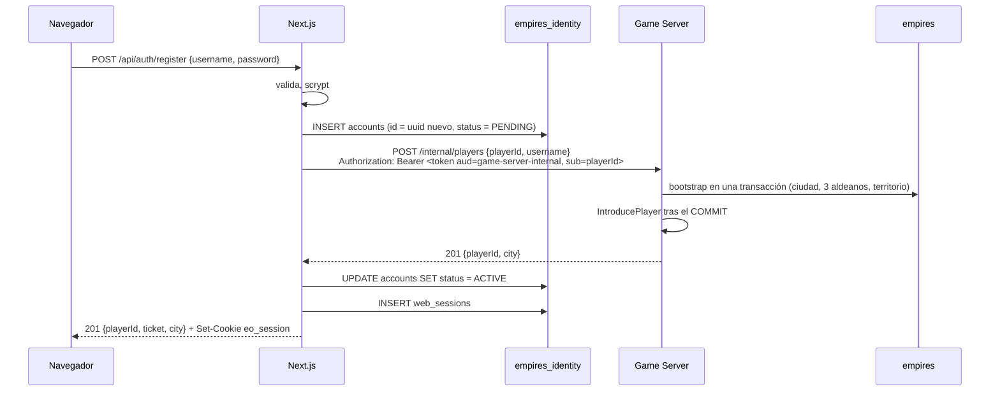

# ADR-018: La identidad vive en Next.js, con su propio almacén; el Game Server sólo funda el mundo

Propósito: fijar dónde viven los usuarios y las contraseñas, cómo emite Next.js el game ticket de ADR-010, qué
mecanismo de sesión web lo respalda, cómo se da de alta un jugador cruzando dos procesos y qué queda de
`internal/httpapi`.

| Campo | Valor |
|---|---|
| **Estado** | **Aceptado** |
| **Fecha** | **2026-10-20** |
| Ámbito | `apps/web` (route handlers, almacén de identidad), `services/game-server/internal/httpapi`, `internal/auth`, `players`, `cmd/devseed`, `scripts/smoke.mjs` |
| Índice | [README.md](README.md) |
| Relacionados | [ADR-010](ADR-010-authentication-game-ticket.md) (lo implementa), [ADR-012](ADR-012-database-migrations.md) (precisa su regla sobre el frontend), [ADR-002](ADR-002-authoritative-server.md), [ADR-004](ADR-004-redis-hot-state.md) |

---

## 1. Contexto

[ADR-010](ADR-010-authentication-game-ticket.md) decidió que **Next.js autentica al usuario y emite el game
ticket**, y que el Game Server nunca gestiona contraseñas. Lo que se construyó fue lo contrario, como
provisional: `internal/httpapi` del Game Server sirve `POST /api/auth/register` y `POST /api/auth/login`, guarda
`players.password_hash` con bcrypt y firma él mismo los tickets (`DEBT-18`). El proceso que no puede
detenerse —el que corre el tick— carga con el cálculo deliberadamente caro de bcrypt, expuesto a cualquiera.

Al intentar moverlo apareció una contradicción entre reglas propias. [migrations.md](../database/migrations.md)
§1.4 y [ADR-012](ADR-012-database-migrations.md) §4.2 prohíben que `apps/web` tenga credenciales de
PostgreSQL o un cliente SQL, y una contraseña sólo se puede verificar donde vive su hash. Pero el **motivo**
de esa regla es más estrecho que su letra: que el esquema del juego tenga un único dueño —el binario del Game
Server— y que el frontend no pueda asumir su forma ni ser autoritativo sobre el mundo. La propia
[migrations.md](../database/migrations.md) §1.4 lo anticipaba: si el frontend necesitara almacenamiento propio
«será una base o un esquema separado con su propio ciclo de migración».

Fuerzas en juego:

- **El alta no puede moverse entera.** Fundar un jugador toca el mundo: elige emplazamiento contra el mapa en
  RAM, bloquea la muralla, reclama territorio y crea ciudad y aldeanos en una transacción
  ([INV-PLAYER-003](../invariants/player.md#inv-player-003)), y el mundo en RAM sólo puede conocerlo tras el
  `COMMIT` ([INV-PLAYER-008](../invariants/player.md#inv-player-008)). Eso es del Game Server. Lo que puede y
  debe salir es la **identidad**: el nombre de acceso, la contraseña y la sesión web.
- **Dos almacenes no comparten transacción.** Si la cuenta vive en un sitio y el jugador en otro, el alta
  cruza dos procesos y puede fallar entre medias. Hace falta un protocolo que nunca deje una cuenta capaz de
  entrar sin mundo, ni un mundo sin dueño que lo pueda recuperar.
- **Cada reconexión necesita un ticket nuevo.** El ticket dura 60 s y es de un solo uso. Hoy el cliente guarda
  la contraseña en memoria y repite el login en cada reconexión; ADR-010 presupone una «sesión web ya
  autenticada» cuyo mecanismo [system-context.md](../architecture/system-context.md) marcaba **TBD**.
- **El juego es pequeño y no tiene usuarios reales.** Las cuentas existentes son de pruebas de humo y de la
  siembra de desarrollo. Migrar identidades no tiene coste de datos; añadir infraestructura sí lo tiene.
- **Dependencias.** Cada librería de autenticación es superficie que hay que fijar por versión y vigilar. Node
  trae en `node:crypto` un KDF con coste de memoria (`scrypt`), HMAC-SHA256 y comparación en tiempo constante.

## 2. Decisión

**La identidad vive en `apps/web`, en un almacén PostgreSQL propio y separado del esquema del juego. Next.js
verifica las contraseñas, mantiene la sesión web con una cookie opaca y emite el game ticket de ADR-010. El
Game Server deja de tocar contraseñas: conserva la verificación del ticket y expone un único endpoint interno,
autenticado, que funda el jugador en el mundo con el `playerId` que le da Next.js.**

### 2.1 Dónde viven usuarios y contraseñas

| Dato | Dónde | Dueño |
|---|---|---|
| `username` de acceso, hash de la contraseña, estado de la cuenta | `accounts` en la base **`empires_identity`** | `apps/web` |
| Sesiones web | `web_sessions` en `empires_identity` (sólo el SHA-256 del token) | `apps/web` |
| Jugador, ciudad, unidades, territorio | Esquema del juego en la base `empires` | Game Server |

- `accounts.id` **es** `players.id`: el mismo `uuid`, generado por Next.js al dar de alta. No hay tabla de
  correspondencia, y el `sub` del ticket es directamente ese id.
- `players.password_hash` **desaparece** del esquema del juego (migración `000005`). El Game Server pierde la
  capacidad de comprobar una contraseña porque deja de tener ninguna.
- `players.username` se conserva como nombre visible y semilla del emplazamiento; su unicidad sigue en
  `players` y se duplica en `accounts`, que es quien la decide primero.
- **Separación de roles.** `empires_identity` pertenece a un rol propio, `empires_identity`, y se retira el
  `CONNECT` público de las bases del juego y de las de identidad: el rol de identidad no puede abrir
  `empires` ni `empires_test`, y lo comprueba un test de integración. En producción el rol del Game Server no es
  superusuario y tampoco puede abrir `empires_identity`. En el cluster de desarrollo, el rol del juego es el
  superusuario que creó el cluster, así que allí el aislamiento es de un solo sentido. Lo impone PostgreSQL,
  no la disciplina.
- **Hash de contraseña:** `scrypt` de `node:crypto` con `N = 2^15`, `r = 8`, `p = 3` (uno de los perfiles
  equivalentes que recomienda OWASP), sal aleatoria de 16 bytes y clave de 32. Se guarda autodescrito,
  `scrypt$15$8$3$<sal>$<hash>`, para poder subir el coste sin migrar.
- **Migraciones del almacén:** SQL versionado en `apps/web`, aplicado por el propio servidor de Next.js al
  arrancar (`instrumentation.ts`) y por `pnpm run identity:migrate`, bajo un *advisory lock*, con su propio
  registro `identity_schema_migrations`. Es el mismo modelo de [ADR-012](ADR-012-database-migrations.md) con
  otro dueño.
- **Cliente SQL:** `pg` (node-postgres), con versión **exacta** en `apps/web/package.json` y fijada por el
  *lockfile*. Un pool pequeño (`max = 5`) por proceso.

### 2.2 Cómo se configura sin meter secretos en el repositorio

- Next.js lee `EO_IDENTITY_POSTGRES_URL` (servidor), `EO_AUTH_JWT_SECRET` (el mismo que ya verifica el Game
  Server), `EO_GAME_SERVER_INTERNAL_URL` y `EO_AUTH_RATE_LIMIT_PER_MINUTE` / `EO_AUTH_RATE_LIMIT_BURST`.
  Ninguna lleva el prefijo `NEXT_PUBLIC_`: no llegan nunca al navegador. Los módulos que las leen importan
  `server-only`, y el build falla si un componente de cliente los importa.
- En desarrollo, `node scripts/pg-local.mjs identity` crea el rol y las dos bases (`empires_identity` y
  `empires_identity_test`) con una **contraseña aleatoria generada en ese momento** y la escribe en el `.env`
  local, que está en `.gitignore`. No hay contraseña del almacén de identidad en ningún fichero versionado.
- En la CI, el servicio de PostgreSQL efímero recibe una contraseña de usar y tirar, como ya hace con la del
  juego.
- En producción, las tres vienen del entorno del despliegue.

### 2.3 Sesión web

- **Cookie opaca**, `eo_session`: 32 bytes aleatorios en base64url, `HttpOnly`, `SameSite=Strict`, `Secure` en
  producción, `Path=/api/auth`, 7 días de vida absoluta. En la base sólo se guarda su SHA-256: una copia de
  `web_sessions` no sirve para entrar.
- `SameSite=Strict` y una ruta que sólo acepta `POST` con cuerpo JSON cierran el CSRF sin token adicional: un
  sitio ajeno no consigue que el navegador envíe la cookie.
- `POST /api/auth/logout` borra la sesión. Las caducadas se borran al crear sesiones nuevas.
- El cliente deja de guardar la contraseña: cada reconexión pide su ticket a `POST /api/auth/ticket`, que sólo
  necesita la cookie.

### 2.4 Cómo emite Next.js el game ticket

Exactamente el contrato de ADR-010, firmado en `apps/web` con `node:crypto` y sin librería JWT:

```
header  = {"alg":"HS256","typ":"JWT"}
payload = {"sub":<playerId>,"jti":<uuid v4 aleatorio>,"aud":"game-server","iat":<s>,"exp":<iat+60>}
firma   = HMAC-SHA256(EO_AUTH_JWT_SECRET, base64url(header) "." base64url(payload))
```

- Se emite en el alta, en el login y en `POST /api/auth/ticket`, nunca se guarda y nunca se registra en un log.
- El Game Server lo verifica como hasta ahora (`auth.Verifier`: algoritmo fijado a HS256, `aud`, `exp`
  obligatorio) y consume el `jti` en Redis (`SET NX EX 120`).
- **Contrato entre lenguajes:** un ticket de referencia generado por el emisor de TypeScript con un secreto y
  un reloj de prueba se versiona como fixture; el test de TypeScript exige que el emisor siga produciendo esos
  bytes exactos y el test de Go exige que el verificador los acepte. Si cualquiera de los dos lados cambia el
  formato, uno de los dos tests falla.

### 2.5 Alta de un jugador entre dos procesos



- **Una cuenta sólo puede entrar si está `ACTIVE`, y sólo pasa a `ACTIVE` después de que el Game Server confirme
  el jugador.** Si la llamada falla por red o por un 5xx, la cuenta queda `PENDING` y el alta responde 503; el
  siguiente login con la contraseña correcta repite la fundación y la activa.
- **La fundación es idempotente por `playerId`.** Si el jugador ya existe con ese id y ese nombre, el Game
  Server responde 200 con su ciudad y no vuelve a introducirlo en el mundo. Si el nombre lo tiene otro id
  (una cuenta anterior a este ADR, sin identidad), responde 409 `USERNAME_TAKEN`.
- **Un rechazo definitivo borra la cuenta `PENDING`** (409 por nombre o por falta de sitio): el nombre queda
  libre y el alta se puede repetir. Un 503 `SITE_CONTENDED` también, porque reintentar es lo que se pide.
- **Autenticación entre servicios sin un secreto nuevo.** El token de fundación es un JWT HS256 firmado con
  `EO_AUTH_JWT_SECRET`, con `aud: "game-server-internal"`, `sub` = el `playerId` que funda, TTL 60 s y `jti` de
  un solo uso consumido en el mismo almacén anti-replay. Las audiencias son **disjuntas**: un ticket de juego
  no funda nada y un token de fundación no abre un WebSocket ([INV-SEC-008](../invariants/security.md#inv-sec-008)).
  El cuerpo debe nombrar el mismo `playerId` que el `sub`.
- El endpoint interno vive en el mismo puerto que `/ws`, porque en el despliegue previsto Next.js lo alcanza
  por la red; lo protege el token, no la topología.

### 2.6 Qué pasa con `internal/httpapi` y con `internal/auth`

| Pieza | Destino |
|---|---|
| `POST /api/auth/register`, `POST /api/auth/login` del Game Server | **Se retiran.** Sus rutas pasan a ser de Next.js, mismos nombres y mismos códigos de error. |
| bcrypt (`golang.org/x/crypto`) | Sale del Game Server. |
| `httpapi.IPLimiter` y su configuración | Se retiran del Game Server. El límite por origen pasa a Next.js, con los mismos nombres de variable. |
| `internal/httpapi` | Se queda con **un** handler, `POST /internal/players`, sin contraseñas. |
| `auth.Verifier`, `auth.Authenticator` | Se quedan: el WebSocket llega directo al Game Server y éste no se fía de que otro haya comprobado nada ([ADR-002](ADR-002-authoritative-server.md)). El verificador gana la audiencia como parámetro. |
| `auth.Issuer` | Deja de usarse en producción. Sobrevive como ayudante de tests, que necesitan acuñar tickets válidos. |
| `cmd/devseed` | Funda los jugadores de desarrollo con ids deterministas (UUID v5 del nombre); `apps/web` crea sus cuentas con los mismos ids. |
| `scripts/smoke.mjs` | Recorre el alta y el ticket a través de Next.js. |

### 2.7 Fuera de esta decisión

- Firma asimétrica (RS256, EdDSA). ADR-010 §4.2 la anticipa; sigue siendo la evolución natural y requerirá su
  propio ADR. Con el emisor ya fuera del Game Server, el cambio queda en dos ficheros.
- OAuth, *magic link*, recuperación de contraseña, verificación de correo: el almacén admite añadirlos sin
  tocar el juego.
- Un límite de tasa compartido entre instancias de Next.js (§4.2).

## 3. Alternativas consideradas

### 3.1 Next.js lee `players.password_hash` del esquema del juego

**Ventajas reales:** cero infraestructura nueva y ninguna migración de datos; un solo almacén, una sola
transacción en el alta si Next.js también escribiera `players`. **Descarte:** hace a `apps/web` dependiente de la
forma del esquema del juego, que es exactamente lo que ADR-012 protege, y pone credenciales del esquema del
mundo en el proceso más expuesto. Un rol de sólo lectura no basta: el alta escribe.

### 3.2 El Game Server conserva la identidad y Next.js sólo hace de proxy

**Ventajas reales:** cambio mínimo, ni base nueva ni protocolo entre procesos. **Descarte:** bcrypt sigue
corriendo en el proceso del tick y el Game Server sigue firmando tickets. Mueve la URL, no la deuda.

### 3.3 Una librería de autenticación completa (`better-auth`, Auth.js)

**Ventajas reales:** OAuth y *magic link* listos, gestión de sesiones probada por mucha gente, menos código
propio. **Descarte para el MVP:** el MVP sólo necesita usuario y contraseña, y estas librerías traen su propio
esquema, adaptadores y un ritmo de versiones que hay que seguir de cerca; su juventud, en el caso de
`better-auth`, se pagaría tarde. El almacén de §2.1 no cierra esa puerta: si llegan OAuth o *magic link*, se
reevaluará en un ADR propio sobre ese mismo almacén.

### 3.4 Esquema `identity` dentro de la base `empires`

**Ventajas reales:** una sola base que respaldar y un solo pool en desarrollo. **Descarte:** dos esquemas en la
misma base con roles distintos se aíslan con `GRANT`s, que son fáciles de equivocar y de olvidar al restaurar
una copia; dos bases se aíslan con `CONNECT`, que es binario. Y las copias de seguridad de la identidad
—datos personales— pueden tener otra política que las del mundo.

### 3.5 Sesión web como JWT firmado en la cookie, sin tabla

**Ventajas reales:** ninguna lectura de base para pedir un ticket; nada que limpiar. **Descarte:** no se puede
revocar una sesión antes de que caduque (cerrar sesión, contraseña comprometida) sin reintroducir una lista
negra, que es una tabla. Pedir un ticket es una operación por conexión, no por mensaje: la lectura cuesta
poco.

### 3.6 Un secreto aparte para la llamada entre servicios

**Ventajas reales:** comprometer uno no compromete el otro. **Descarte:** los dos secretos los tendrían
exactamente los mismos dos procesos, así que la separación no protege de ningún atacante realista y duplica la
rotación. Las audiencias disjuntas dan la separación que importa: un token no vale para el uso del otro.

## 4. Consecuencias

### 4.1 Positivas

- El Game Server no ve contraseñas, no calcula hashes y no firma tickets en producción: cierra `DEBT-18`.
- El esquema del juego no contiene ninguna credencial
  ([INV-PLAYER-007](../invariants/player.md#inv-player-007)).
- El cliente deja de guardar la contraseña en memoria para reconectar.
- La sesión web existe y es revocable; el mecanismo de autenticación ya no es **TBD**.
- Cero dependencias criptográficas nuevas: `scrypt`, HMAC y comparación en tiempo constante salen de
  `node:crypto`.

### 4.2 Negativas (enunciadas sin adornos)

- **Un segundo almacén.** Otra base que respaldar, migrar y vigilar, con su propio ciclo de migración.
- **Un alta que cruza dos procesos.** Hay un estado intermedio, la cuenta `PENDING`, y un protocolo de
  compensación. Una cuenta `PENDING` cuyo dueño nunca vuelve ocupa su nombre hasta que alguien la limpie; esa
  limpieza no existe todavía.
- **Las cuentas anteriores a la migración `000005` pierden el acceso.** Sus jugadores siguen en el mundo, sin
  identidad que los reclame, y su nombre queda ocupado. En desarrollo se resuelve volviendo a sembrar; no hay
  usuarios reales a los que afecte.
- **El límite de tasa es por proceso.** Con varias instancias de Next.js —o en funciones *serverless*—, cada
  una lleva su cuenta. Es suficiente contra un atacante ingenuo desde una dirección y no lo es contra uno
  distribuido.
- **Despliegue serverless.** Funciones efímeras contra PostgreSQL agotan conexiones: desplegar `apps/web` en
  Vercel exige un *pooler* delante de `empires_identity`. Con `next start` en un servidor propio, el pool del
  proceso basta.
- **HS256 sigue siendo simétrico.** El Game Server conserva el secreto, así que todavía podría fabricar
  tickets aunque ya no lo haga.

### 4.3 Neutras

- Dos rutas nuevas de Next.js (`/api/auth/ticket`, `/api/auth/logout`) y un endpoint interno en el Game Server.
- Un rol y dos bases más en el cluster de desarrollo, y un servicio más que preparar en la CI.
- Las variables `EO_AUTH_RATE_LIMIT_*` cambian de proceso, no de nombre.

## 5. Estado

Aceptado. Implementado en el mismo cambio que lo introduce. Precisa la regla de
[ADR-012](ADR-012-database-migrations.md) §4.2 sobre el frontend —que ya no puede leerse como «`apps/web` nunca
tiene base de datos», sino como «`apps/web` nunca toca el esquema del juego»— y completa
[ADR-010](ADR-010-authentication-game-ticket.md), cuyo diseño no cambia. Cierra `EO-041`, `EO-117` y `DEBT-18`.
