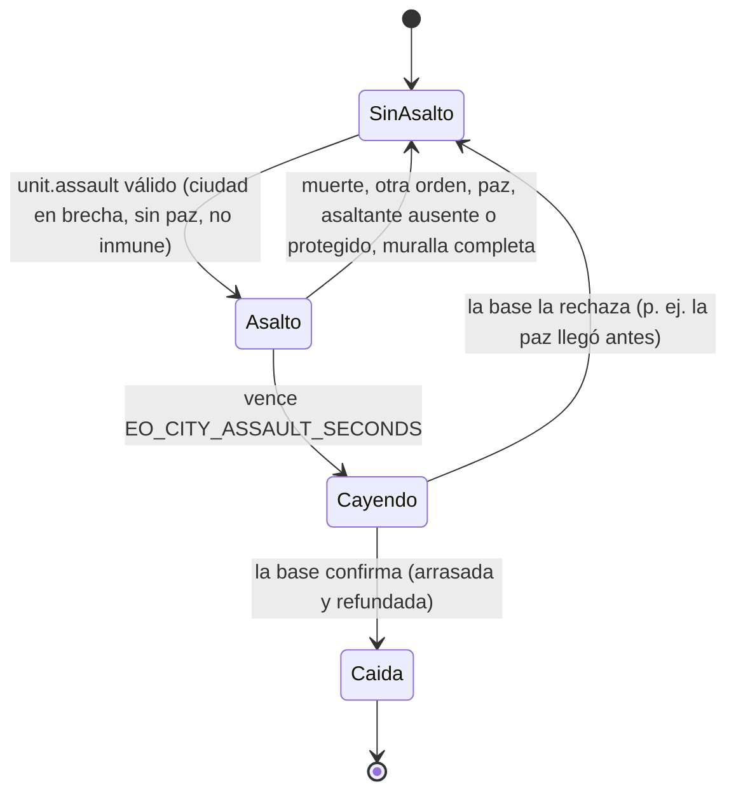

# La caída de una ciudad

Propuesta para que la guerra tenga final: una ciudad **en brecha** puede ser **asaltada** y, si el asalto aguanta,
**cae**. La ciudad caída se arrasa y su dueño **refunda** en otro sitio en la misma transacción, con lo que sabe (era,
tecnologías, civilización, bando, clan, tratados) y sin lo que tenía (edificios, almacén, encargos). Nadie se queda sin
ciudad y nadie tiene dos.

| Campo | Valor |
|---|---|
| Spec ID | `SPEC-CITY-FALL` |
| Estado | Accepted (2026-11-23). Propuesta en `Draft` y aceptada el mismo día con la recomendación de cada pregunta de §10. |
| Milestone | E31 La caída de una ciudad (trigésimo primer slice después de M7) |
| Canon | §9 (protección), §10 (eras y población), §11 (tratados), §12 (persistencia), §13 (protocolo), §16 (errores), §21 (fuera de MVP: asedio y conquista de ciudades) |
| Depende de | [combat-siege.md](combat-siege.md), [siege-engines.md](siege-engines.md), [territory-conquest.md](territory-conquest.md), [city.md](city.md), [player.md](player.md), [presence.md](presence.md), [diplomacy.md](diplomacy.md), [factions.md](factions.md), [clans.md](clans.md), [clan-wars.md](clan-wars.md), [garrison.md](garrison.md), [caravans.md](caravans.md), [trade.md](trade.md), [markets.md](markets.md), [technologies.md](technologies.md), [trade-reach.md](trade-reach.md), [event-log.md](event-log.md), [live-notices.md](live-notices.md), [bots.md](bots.md) |
| Decisiones | [ADR-050](../decisions/ADR-050-city-fall.md): la caída como orden en dos fases cuyo trabajo arrasa la ciudad y funda la nueva en **una** transacción; la ciudad caída como fila que se queda con `fallen_at`; y «una ciudad en pie por jugador» como índice único parcial de la base (§7). Se apoya en [ADR-016](../decisions/ADR-016-foreign-territory-actions.md) (acción hostil), [ADR-028](../decisions/ADR-028-event-log-from-world-events.md) (eventos con el otro jugador), [ADR-029](../decisions/ADR-029-population-over-limit-and-house-destruction.md) (población por encima del límite), [ADR-034](../decisions/ADR-034-territory-claims.md) (la reclamación como encargo durable en dos fases, que el asalto copia), [ADR-045](../decisions/ADR-045-clan-wars.md) (el marcador) y [ADR-048](../decisions/ADR-048-siege-engines-and-wall.md) (en brecha). **Pide migración `000030`** (§7). |
| Reemplaza a | En [city.md](city.md), el «Ownership único e inmutable en MVP» sólo en que una ciudad deja de ser para siempre: el dueño sigue siendo inmutable (`RN-CITY-020` no cambia: la ciudad no cambia de manos, se arrasa); y la nota de «un jugador, una ciudad» de §9, que pasa de regla del dominio a garantía de la base para las ciudades en pie. En [territory-conquest.md](territory-conquest.md), `RN-CONQ-008` en su «lo es para siempre»: la capital deja de serlo cuando su ciudad cae. En [siege-engines.md](siege-engines.md) y [combat-siege.md](combat-siege.md), el «la ciudad no cae» de su §2. |
| Invariantes | Registra [INV-CITY-020](../invariants/city.md#inv-city-020), [INV-CITY-021](../invariants/city.md#inv-city-021) e [INV-COMBAT-010](../invariants/combat.md#inv-combat-010) (§8), sin cobertura hasta la implementación. Reglas nuevas: `RN-SIEGE-009` a `RN-SIEGE-011`, `RN-COMBAT-041` y `RN-CITY-026` a `RN-CITY-029` (§4.5). Precisa [INV-CITY-001](../invariants/city.md#inv-city-001), [INV-PLAYER-003](../invariants/player.md#inv-player-003) e [INV-TERR-011](../invariants/territory.md#inv-terr-011) |

## 1. Objetivo

Desde E8 un asedio derriba casas, desde E23 el castillo dispara, desde E27 el ariete abre la muralla y la ciudad queda
en brecha ([siege-engines.md](siege-engines.md) §4.3); desde E24 dos clanes se declaran la guerra y la puntúan. Pero
ninguna guerra se gana: lo peor que le puede pasar a una ciudad es quedarse sin casas, sin almacén y sin muralla, y
volver a construirlas. La precisión de la fase Sieges de [roadmap.md](../roadmap/roadmap.md) §5 (2026-11-19) lo deja
«para un slice propio», y la Q8 de [siege-engines.md](siege-engines.md) dice por qué no entró allí: cada jugador tiene
una sola ciudad, así que la caída es eliminar a un jugador, y pide decidir qué pasa con todo lo suyo.

Este slice cierra ese hueco con dos ideas que vienen de lo que ya existe:

1. **El asalto copia la reclamación de territorio** (E12, [ADR-034](../decisions/ADR-034-territory-claims.md)): un
   guerrero planta el estandarte junto a una ciudad en brecha y, si aguanta el plazo, la ciudad cae. Es un encargo
   durable, visible para todos y que sólo se rompe matando al que lo sostiene. Ya se sabe explicar, defender y
   recuperar tras un reinicio.
2. **Caer no es cambiar de manos: es arrasar y refundar.** El atacante no se queda con la ciudad, así que «un jugador,
   una ciudad» sigue en pie; el vencido no desaparece, vuelve a empezar con lo que sabía. Ganar una ciudad como
   segunda ciudad es el multiciudad, otro slice (Q3).

### 1.1 Qué impide hoy que una ciudad caiga (lectura del código)

Rutas desde `services/game-server/`:

- **No hay nada que golpear para tumbar la ciudad.** El «Centro Urbano» no es un edificio: no tiene fila, ni tipo, ni
  vida. El catálogo de edificios es `HOUSE`, `WORKSHOP`, `CASTLE`, `MARKET` y `WALL` (`internal/domain/building/building.go`),
  y `CanPlace` reserva el centro con «el centro es del Centro Urbano» salvo para la muralla. `city.City` no tiene vida
  (`internal/domain/city/city.go`). `siege.Check` admite cualquier edificio de una ciudad en brecha
  (`internal/domain/siege/siege.go`), y `destroyHouse` sólo quita un edificio (`internal/game/simulation/siege.go`):
  derribarlo todo deja una ciudad vacía, no una caída.
- **El daño no se acumula.** La vida de los edificios dañados vive en la RAM y se olvida a los 300 s o con un reinicio
  (`siegeState.damage`, `forgetSiegeDamage`, `RN-COMBAT-032`): no hay estado durable sobre el que contar una caída.
- **El dueño es inmutable de verdad.** `cities.owner_player_id` sólo se escribe en el `INSERT` de `CityRepo.Create`
  (`internal/persistence/postgres/cities.go`), que sólo llama el alta (`bootstrap.go`); ningún `UPDATE` lo toca
  (`RN-CITY-020`). No hay evento ni camino de escritura para un cambio de dueño.
- **Todo supone una ciudad por jugador.** `State.AddCity` sobrescribe `cityByOwner[owner]` (gana la última) y `CityOf`
  devuelve una (`internal/game/simulation/state.go`). Lo llaman una veintena de ficheros de la simulación, y algunos
  derivan del jugador lo que en realidad es de la ciudad: la civilización (`civilizationOf`, `civilization.go`), el
  bando (`FactionOf`, `faction.go`), la protección del atacante (`combat.go`, `pillage.go`), el destino de una caravana
  capturada (`caravans.go`) y el centro de la vista (`interest.go`). En la base, `GetByOwner` hace `ORDER BY id LIMIT 1`
  («En el MVP cada jugador tiene una») y los mensajes, el registro y los clanes toman «la de id menor, que es la
  capital» (`messages.go`, `eventlog.go`, `clans.go`). **Un jugador con cero ciudades rompe la facción y la
  civilización; uno con dos, la vista y la protección.** Por eso este slice nunca deja a nadie con cero ni con dos.
- **La capital es intocable.** `territory.IsCapital` y `CheckClaimable` rechazan reclamar el territorio que contiene el
  centro de una ciudad de su dueño (`internal/domain/territory/claim.go`, `ErrCapital`), y la transacción de la captura
  lo vuelve a comprobar (`internal/persistence/postgres/conquest.go`, «INV-TERR-011»). Con las ciudades que no caen,
  `RN-CONQ-008` decía «para siempre».
- **Una ciudad no se puede borrar.** `trade_offers`, `caravans`, `market_offers` y `territory_claims` apuntan a
  `cities (id)` sin `ON DELETE CASCADE` (`000013`, `000017`, `000028`, `000014`): un `DELETE` de una ciudad con historia
  falla. La caída tiene que dejar la fila (§7).
- **El marcador no tiene una categoría para la ciudad.** Suma 1 por baja, 3 por edificio y 10 por territorio
  (`internal/domain/clan/war.go`, `RN-CLANWAR-007`).
- **Los bots no llegan.** El saqueador saquea y luego derriba **casas** (`apps/bots/src/decide.ts`, `raidRule`); no
  entrena arietes ([bots.md](bots.md) Q3), así que no abre una muralla.

## 2. Scope

**Entra.**

- **El asalto** (Q1): `unit.assault { unitId, cityId }`, un guerrero o una unidad de civilización planta el estandarte
  en el anillo de una ciudad **en brecha** y, si aguanta `EO_CITY_ASSAULT_SECONDS`, la ciudad cae. Cuenta atrás visible
  para todos, defensa automática de los guardias, rotura por muerte, por otra orden, por la paz o por la muralla que se
  completa.
- **La caída** (Q2 a Q5): la ciudad se arrasa (`fallen_at`) y su dueño refunda en la misma transacción, lejos del
  vencedor (Q6), con su era y sus tecnologías; lo que estaba en la ciudad se pierde o se resuelve según §4.3.
- **Los límites** (Q7, Q8): la protección offline, la paz (tratados, clan, alianza, Orden), la inmunidad de una ciudad
  recién fundada o refundada y la era mínima.
- **Avisos, registro y marcador** (Q9): el asalto avisa al dueño; la caída, a los dos; el marcador de una guerra de clanes
  suma la caída.
- El cliente: «Asaltar» con una unidad seleccionada junto a una ciudad en brecha, la cuenta atrás sobre la ciudad, la
  ciudad que desaparece y la vista del vencido que salta a su ciudad nueva. `scripts/smoke.mjs --caida`.
- La migración `000030` y ADR-050.

**No entra** (`Fuera de MVP` de este slice):

- Quedarse con la ciudad como segunda ciudad, vasallos o tributos (Q3): el multiciudad es su propio slice.
- Que la ciudad caiga sin asalto (por vida del Centro Urbano, por abandono, por inactividad).
- Botín de la caída para el vencedor (Q5): lo que se quiera llevar, se saquea antes.
- Que un jugador elija dónde refunda o el nombre de su ciudad nueva (Q6).
- Los bots que asaltan (Q10): piden arietes en el decisor.
- Cambios en el saqueo, el derribo, la muralla, el ariete, la respuesta de E3 o el castillo.
- Rankings o recompensas por ciudades tomadas fuera del marcador de una guerra de clanes.

## 3. Actores

| Actor | Papel |
|---|---|
| Asaltante | Abre la brecha (con arietes si la ciudad está amurallada), planta el estandarte con una unidad que derriba y lo escolta hasta que vence el plazo. |
| Asaltado | Recibe el aviso, defiende matando al que sostiene el estandarte o vuelve a levantar la muralla; si cae, refunda. |
| Terceros con la ciudad a la vista | Ven la cuenta atrás y la caída. |
| Miembros de los clanes en guerra | Ven la caída en el marcador. |
| Game Server | Valida la orden, lleva el plazo en la fase 5, decide la caída y la nueva ciudad ([INV-SEC-001](../invariants/security.md#inv-sec-001)). |
| Cola de persistencia | Escribe la caída y la refundación en una transacción (ADR-050). |

## 4. Modelo

### 4.1 El asalto

Un asalto es un encargo de una unidad que derriba (`WARRIOR` o unidad de civilización; no el ariete,
[INV-COMBAT-009](../invariants/combat.md#inv-combat-009)), con la forma de una reclamación de territorio:

- **Dónde.** La unidad tiene que estar en un tile del **anillo** de la ciudad (distancia de Chebyshev 2 al centro), los
  mismos desde los que se derriba cualquier edificio ([siege-engines.md](siege-engines.md) §9, `siegeExtent`). Si está
  lejos, la orden la lleva al más cercano con ruta, como `unit.demolish`, y el asalto empieza al llegar.
- **Qué ciudad.** De otro jugador, **en brecha** (`RN-SIEGE-002`: sin muralla completa con vida), no inmune (Q7), de la
  era mínima (Q8), sin otro asalto activo, y sin paz ni protección entre los dos (§4.4).
- **Mientras dura** (`EO_CITY_ASSAULT_SECONDS`, recomendado 900 s, Q1): la unidad pasa a `CLAIMING` (no se mueve, no
  recolecta, no responde a golpes), la ciudad lleva su asalto en `CityView` para todos los que la ven, y los guerreros
  parados del dueño a ≤ `EO_COMBAT_GUARD_RADIUS_TILES` responden como a un golpe sobre una unidad suya en el centro
  (`RN-COMBAT-037`).
- **Qué lo rompe** (se comprueba en cada tick, en la fase 5, con el mismo predicado que al ordenar): la unidad muere o
  recibe otra orden; nace la paz entre los dos (tratado, clan, alianza, la Orden); el **asaltante** pasa a ausente o a
  `PROTECTED` (`RN-COMBAT-035`); la ciudad **vuelve a estar amurallada** (su muralla se completa: la defensa que se
  puede comprar con piedra, como `RN-SIEGE-006`). La protección del **asaltado** no rompe un asalto ya empezado (Q7).
  Que le peguen no lo rompe: hay que matarlo. La unidad vuelve a `IDLE` donde está.
- **La caída.** Cumplido el plazo, la simulación encola la caída (orden en dos fases, [ADR-034](../decisions/ADR-034-territory-claims.md)
  §3): la RAM la aplica cuando vuelve la transacción. Mientras está en vuelo, la ciudad sigue en pie y no admite órdenes
  nuevas contra ella ni del dueño que la cambien (encargos, construcción); las que llegan responden `INVALID_TARGET`.

### 4.2 La caída: arrasar y refundar

En **una** transacción (ADR-050):

1. **La ciudad se arrasa.** `cities.fallen_at` se escribe; sus edificios pasan a `DESTROYED`; su zona urbana deja de
   estar bloqueada en el overlay y su centro queda libre para otra fundación. La fila se queda: la historia (tratos,
   caravanas, ofertas, reclamaciones, eventos) sigue apuntando a ella.
2. **Su territorio capital queda libre** (`territory_control` sin dueño), y con él deja de ser capital (Q4). Nadie lo
   gana en la caída: el vencedor, si lo quiere, lo reclama como cualquier territorio libre (300 s).
3. **El vencido refunda.** Una ciudad nueva con el mismo nombre, en un sitio que da `founding.FindSite` con las reglas de
   siempre (`RN-CITY-001` a `RN-CITY-006`, `RN-CITY-023` a `RN-CITY-025`) más la distancia mínima de Q6, en la **era de
   la caída**, con el almacén a cero y tres aldeanos nuevos, como un alta (`RN-PLAYER-007`). Hereda `presence_state` y su
   inmunidad empieza (Q7).
4. **Lo demás se resuelve** según §4.3.
5. **Eventos:** `CityFell` (vencido en `player_id`, vencedor en `counterpart_player_id`, `atMs`, la ciudad caída, la
   nueva y, si hay guerra entre sus clanes, `war`) y los de lo que se resuelve (§6). La refundación no escribe
   `PlayerBootstrapped`, el evento del alta (`bootstrap.go`): el jugador ya existía.

La RAM, al volver: quita la ciudad caída (`cities`, `cityByOwner`, overlay, índice por chunk), añade la nueva por el
mismo camino que un alta (`AddCity`, el apartado de unidades de `RN-CITY-022`), reasigna las unidades y aplica §4.3.
En ningún tick el jugador tiene cero ciudades ni dos.

### 4.3 Qué le pasa a lo que tenía (Q2, Q4)

| Qué | De quién es | Qué pasa |
|---|---|---|
| Era | de la ciudad (`cities.era`) | **Se conserva:** la ciudad nueva nace en ella (Q2). |
| Tecnologías | del jugador (`player_technologies`) | Se conservan (no cambian de tabla). |
| Civilización, bando, clan, tratados, mensajes, registro | del jugador | No cambian. La paz y las guerras siguen igual. |
| Edificios | de la ciudad | Se pierden (`DESTROYED`), también los que estaban en obra con lo pagado. |
| Almacén (madera, piedra, bienes) | de la ciudad | Se pierde: arde con la ciudad (Q5). La nueva nace a cero. |
| Encargos en curso (entrenamiento, avance de era, elaboración, investigación) | de la ciudad | Se pierden con lo pagado, como una casa en obra derribada (`RN-COMBAT-033`). |
| Unidades vivas fuera de la ciudad | del jugador, con `city_id` | **Pasan a la ciudad nueva** y cuentan en su población; si queda por encima del límite, no entrena hasta bajar (ADR-029). Siguen donde están. |
| Unidades propias guarnecidas en la ciudad | | Salen por el procedimiento normal de salida ([garrison.md](garrison.md) §6.3) y pasan a la ciudad nueva (Q4). |
| Unidades de otros guarnecidas en la ciudad | de su dueño | Salen como al terminar una alianza (`RN-DIPLO-005`). |
| La unidad que asaltaba | del vencedor | Vuelve a `IDLE` en su tile. |
| Asaltos y reclamaciones del vencido | | Siguen; su bono de territorio, si capturan, va a la ciudad nueva. |
| Caravanas en camino **hacia** la ciudad caída | | Siguen hacia la ciudad nueva del mismo jugador (`to_city_id`), como una caravana capturada cambia de destino. |
| Caravanas en camino **desde** la ciudad caída | | Siguen: su carga ya salió. |
| Tratos `PROPOSED` con la ciudad caída | | `EXPIRED`. |
| Ofertas del mercado `OPEN` de la ciudad caída | | `WITHDRAWN`, y lo que quedaba en custodia va al almacén de la ciudad nueva: no estaba en la ciudad (Q4). |
| Territorios conquistados | del jugador | Se conservan y su bono pasa a la ciudad nueva. El capital, libre (§4.2). Si la nueva nace en un territorio libre, lo gana como en un alta (`RN-TERR-007`). |

### 4.4 Límites

| Límite | Regla |
|---|---|
| Paz | El asalto es **hostil** (ADR-016) y pasa por el mismo predicado que el saqueo y el derribo (`cityAttackBlocked`, `RN-COMBAT-030`): misma ciudad, tratado `NON_AGGRESSION` o `ALLIANCE`, clan común o paz residual (`EO_CLAN_PEACE_GRACE_SECONDS`), alianza entre clanes, la paz de la Orden (`RN-FAC-003`) o la unidad en una Safe Zone, `INVALID_TARGET`. Una guerra de clanes no levanta ninguna paz (`RN-CLANWAR-005`). |
| Protección offline | Una ciudad `PROTECTED` no se asalta (`CITY_PROTECTED`); `OFFLINE_PENDING` no protege. Un asalto ya empezado **no** se rompe porque el asaltado pase a `PROTECTED` (Q7): si no, bastaría desconectarse al ver el estandarte. El asaltante sí tiene que estar presente todo el plazo. |
| Inmunidad | Una ciudad no se asalta durante `EO_CITY_FALL_IMMUNITY_HOURS` (recomendado 72) desde que se fundó o se refundó (Q7). Se le puede saquear y derribar como hoy. |
| Era mínima | Sólo cae una ciudad de la **Edad de Bronce** o posterior (Q8): antes no puede levantar muralla. |
| Una a la vez | Como mucho un asalto activo por ciudad; un jugador puede asaltar varias ciudades a la vez. |

### 4.5 Reglas

Continúan las familias: `RN-SIEGE` para el asalto, `RN-COMBAT` para el predicado y `RN-CITY` para la caída y la
refundación. Viven aquí; `RN-CITY-020` ([city.md](city.md) §6.4) y el §2 de [siege-engines.md](siege-engines.md) remiten a ellas.

| ID | Regla |
|---|---|
| `RN-SIEGE-009` | `unit.assault { unitId, cityId }` sobre una unidad propia, viva, en el mapa, que derriba y no es un ariete; sustituye su tarea y la lleva al tile del anillo más cercano con ruta (empate: menor `y`, menor `x`). |
| `RN-SIEGE-010` | Una ciudad de otro jugador, en brecha, de la Edad de Bronce o posterior, fuera de su inmunidad y sin otro asalto activo. Si no, `INVALID_TARGET` con el motivo. |
| `RN-COMBAT-041` | El asalto pasa por el predicado de `RN-COMBAT-030` al ordenar y en cada tick; la protección del asaltado sólo cuenta al ordenar. |
| `RN-SIEGE-011` | La unidad está `CLAIMING` y la ciudad lleva su asalto; responden los guardias del dueño (`RN-COMBAT-037`). Lo rompen la muerte, otra orden, la paz, el asaltante ausente o protegido y la muralla completa. |
| `RN-CITY-026` | Al vencer el plazo, la ciudad se arrasa y su dueño refunda en una transacción, como orden en dos fases (§4.2, [ADR-050](../decisions/ADR-050-city-fall.md)); su territorio capital queda libre. Mientras la caída está en vuelo, la ciudad no admite órdenes que la cambien. |
| `RN-CITY-027` | La ciudad nueva lleva el nombre de la caída, nace en su era con el almacén a cero y tres aldeanos, a ≥ `EO_CITY_REFOUND_MIN_DISTANCE` de la ciudad caída y de la del vencedor, con las reglas de fundación de siempre. |
| `RN-CITY-028` | **Lo que tenía** (§4.3): la era, las tecnologías y todo lo del jugador se conservan; edificios, almacén y encargos de la ciudad se pierden; las unidades vivas de fuera y las propias guarnecidas pasan a la ciudad nueva, las ajenas guarnecidas salen; las caravanas hacia la ciudad caída siguen hacia la nueva; sus tratos pendientes caducan y sus ofertas del mercado se retiran con la custodia a la ciudad nueva. |
| `RN-CITY-029` | Ninguna ciudad se asalta durante `EO_CITY_FALL_IMMUNITY_HOURS` desde su fundación. |

### 4.6 Qué ve el jugador

- **El asaltante**, con una unidad que derriba seleccionada y una ciudad ajena en brecha a la vista: «Asaltar» en el panel
  de la ciudad, deshabilitado con su motivo («La muralla está en pie», «Ciudad recién fundada: 2 d 4 h», «Edad de
  Piedra», «Estáis en paz»). Durante el asalto, la cuenta atrás sobre la ciudad.
- **El asaltado** recibe el aviso «¡Están asaltando tu ciudad! Cae en 15:00», con la cuenta atrás en la barra de su
  ciudad, y lo ve en el registro aunque no esté.
- **Terceros**: el estandarte y la cuenta atrás sobre la ciudad.
- **La caída**: la ciudad desaparece del mapa para todos. El vencido ve «Tu ciudad cayó ante Villa Norte. Refundada en
  (x, y)» y su vista salta a la ciudad nueva; el vencedor ve «Villa Norte tomó y arrasó Puerto Sur».

## 5. Errores

Sólo códigos que ya existen en el catálogo (canon §16).

| Código | Condición |
|---|---|
| `UNIT_NOT_FOUND`, `UNIT_NOT_OWNED`, `UNIT_DEAD`, `UNIT_GARRISONED` | Los de cualquier orden a una unidad |
| `UNIT_NOT_MOVABLE` | La unidad no derriba (aldeano) o es un ariete |
| `CITY_NOT_FOUND` | La ciudad no existe o ya cayó |
| `INVALID_TARGET` | Ciudad propia; amurallada; antes de Bronce; inmune; con otro asalto activo; en caída; paz entre los dos; unidad en una Safe Zone. El mensaje dice cuál |
| `CITY_PROTECTED` | El asaltado o el asaltante están protegidos al ordenar |
| `PATH_NOT_FOUND`, `PATH_TOO_LONG` | Ningún tile del anillo es alcanzable |

## 6. Eventos y contratos de red

Cliente → servidor, un comando nuevo, estricto y hostil (`actions.go`): `unit.assault { unitId, cityId }`. El catálogo
pasa de 52 a 53 tipos.

Servidor → cliente:

- `CityView.assault`, opcional: `{ playerId, unitId, startedAtMs, endsAtMs }` mientras hay un asalto activo; en
  `city.update` y en el snapshot. `CityView.fallImmuneUntilMs`, opcional, mientras dura la inmunidad.
- La unidad viaja con `status: CLAIMING`, el valor que ya existe para quien sostiene un estandarte: no hace falta uno
  nuevo en el enum estricto.
- `city.fallen { cityId, ownerPlayerId, byPlayerId, atMs }`, mensaje nuevo (`R-VER-3`) para todas las sesiones con la
  ciudad en su área: la ciudad deja de existir para el cliente, como `building.destroyed`. La ciudad nueva llega como
  cualquier ciudad que entra en la vista.
- **Las sesiones del vencido** reciben, tras `city.fallen`, un `world.snapshot` centrado en su ciudad nueva (su vista
  ya no tiene ciudad); el mecanismo concreto lo fija ADR-050.
- `EventLogKind` y `EventLogNoticeKind` ganan `CITY_ASSAULTED` (al asaltado, al empezar), `CITY_LOST` (al vencido) y
  `CITY_TAKEN` (al vencedor). Son valores nuevos de enums estrictos: se estrenan a la vez en el cliente y en el
  servidor (Q9).

Eventos de dominio en `world_events`, con `counterpart_player_id` y `atMs` ([ADR-028](../decisions/ADR-028-event-log-from-world-events.md)):
`CityAssaultStarted` (el asaltado en `player_id`) y `CityFell` (§4.2). Entran en `eventlog.EventTypes`, `Classify`,
`NoticeKinds` y los textos de `apps/web/src/state/eventLog.ts`. Un asalto roto no se escribe ni se registra, como una
reclamación rota.

**Marcador** (Q9): con una guerra `ACTIVE` entre los clanes de los dos, `CityFell` suma `PointsCity` (recomendado 30)
al clan del vencedor, en la transacción de la caída, con su `war` en el payload ([INV-CLAN-009](../invariants/clans.md#inv-clan-009)).

## 7. Persistencia

| Pregunta (canon §12) | Respuesta |
|---|---|
| Autoritativo en RAM | Los asaltos activos y su plazo, cargados con el mundo; la inmunidad, derivada de `cities.created_at` |
| Write-through | El asalto al empezar y al romperse (su fila); la caída y la refundación en una transacción con la clave de la ciudad caída y la del vencedor |
| Dirty-flag | La posición de las unidades, como siempre |
| Reconstruible / no persistido | Nada nuevo: un asalto sobrevive a un reinicio con su plazo, como una reclamación (un plazo vencido con el servidor parado se aplica en el primer tick) |

**Migración `000030`:**

- `cities.fallen_at timestamptz NULL`. `cities_unique_center` pasa a índice único parcial `WHERE fallen_at IS NULL`.
- **Un índice único parcial `cities_one_standing_per_owner` sobre `(owner_player_id) WHERE fallen_at IS NULL`**: «un
  jugador, una ciudad» deja de sostenerse sólo en el dominio para las ciudades en pie, y la transacción de la caída
  tiene que arrasar antes de fundar.
- Sin columna de fundación: la inmunidad se deriva de `cities.created_at` (`000001`), que la ciudad refundada estrena
  porque es una fila nueva.
- Tabla `city_assaults` (`id`, `city_id`, `unit_id`, `player_id`, `started_at`, `ends_at`, `status` `ACTIVE`/`FELL`/`BROKEN`)
  con un único parcial de un `ACTIVE` por ciudad, como `territory_claims` (`000014`). Entra en el `TRUNCATE` de los tests
  de integración y en [schema.md](../database/schema.md).
- Las consultas que toman «la ciudad del jugador» (`GetByOwner`, el `DISTINCT ON` de mensajes, registro y clanes)
  filtran `fallen_at IS NULL`; la carga no mete ciudades caídas en la RAM.

**[ADR-050](../decisions/ADR-050-city-fall.md): la caída de una ciudad.** Tres decisiones estructurales:

1. **Arrasar, no traspasar.** El dueño sigue siendo inmutable (`RN-CITY-020`); la ciudad caída se queda como fila con
   `fallen_at` porque cuatro tablas la referencian sin cascada. Así no hay un cambio de dueño que propagar por los
   `CityOf` que derivan civilización y bando de la ciudad.
2. **Caída y refundación en una transacción**, como orden en dos fases ([ADR-034](../decisions/ADR-034-territory-claims.md)
   §3): la búsqueda del sitio corre fuera del tick (como el alta, `internal/httpapi`) y la RAM aplica todo al volver. El
   jugador nunca está sin ciudad.
3. **Una ciudad en pie por jugador, en la base** (el índice parcial), en lugar de la nota de [city.md](city.md) §9.

Variables `EO_` nuevas: `EO_CITY_ASSAULT_SECONDS` (900), `EO_CITY_FALL_IMMUNITY_HOURS` (72),
`EO_CITY_REFOUND_MIN_DISTANCE` (64), en `internal/config`, `.env.example` y
[configuration.md](../operations/configuration.md).

## 8. Invariantes

**Registra** tres invariantes nuevos, sin cobertura hasta la implementación:

- [INV-CITY-020](../invariants/city.md#inv-city-020) — **Todo jugador tiene exactamente una ciudad en pie.** Ninguna transacción confirmada deja
  a un jugador con cero o con dos ciudades sin `fallen_at`. Lo garantizan el índice parcial y la caída con refundación
  en una transacción.
- [INV-CITY-021](../invariants/city.md#inv-city-021) — **Una ciudad tiene como mucho un asalto activo**, como
  [INV-TERR-010](../invariants/territory.md#inv-terr-010) para las reclamaciones.
- [INV-COMBAT-010](../invariants/combat.md#inv-combat-010) — **Una ciudad sólo cae por un asalto que venció su plazo** sobre una ciudad en brecha,
  de Bronce o posterior, fuera de su inmunidad y sin paz entre los dos en ningún tick del plazo, con el asaltante
  presente.

**Precisa:**

- [INV-CITY-001](../invariants/city.md#inv-city-001): una ciudad, también caída, tiene exactamente un dueño.
- [INV-PLAYER-003](../invariants/player.md#inv-player-003): la refundación nace como un alta (ciudad y tres aldeanos), sin
  crear jugador.
- [INV-TERR-011](../invariants/territory.md#inv-terr-011): la capital es la de la ciudad **en pie**; la de una ciudad
  caída queda libre en la transacción de la caída.

**Cita:** [INV-COMBAT-002](../invariants/combat.md#inv-combat-002) y [INV-COMBAT-005](../invariants/combat.md#inv-combat-005)
(el predicado y el asaltante presente), [INV-COMBAT-009](../invariants/combat.md#inv-combat-009) (el ariete no asalta),
[INV-CITY-002](../invariants/city.md#inv-city-002) (la ciudad nueva por encima del límite con los supervivientes),
[INV-CITY-006](../invariants/city.md#inv-city-006), [INV-CITY-008](../invariants/city.md#inv-city-008) (la ciudad nueva
no pisa ninguna en pie), [INV-CITY-019](../invariants/city.md#inv-city-019) (la nueva nace al alcance de una vecina) e
[INV-CLAN-009](../invariants/clans.md#inv-clan-009) (la caída en el marcador).

## 9. Tests esperados

| Nivel | Qué |
|---|---|
| unit | Validación de `unit.assault` (cada fila de §5); la elección del tile del anillo; inmunidad y era mínima; la tabla de §4.3 como función pura sobre una ciudad y sus dependencias; el sitio de la refundación a ≥ 64 de la caída y del vencedor |
| simulation | Golden «caída»: tres arietes abren la muralla, un guerrero asalta, los guardias responden, el plazo vence en su tick exacto y la ciudad cae; cada causa de rotura, también la muralla que se completa; la protección del asaltado que no lo rompe y la del asaltante que sí; el vencido con sus unidades de fuera en la ciudad nueva y por encima de su límite; una caravana hacia la ciudad caída que llega a la nueva; la guerra de clanes que suma la caída; el catálogo de comandos (53) y de trabajos |
| recovery | Un asalto a medias sobrevive a un reinicio con su plazo; un plazo vencido con el servidor parado cae en el primer tick; una caída en vuelo que se pierde antes del `COMMIT` deja la ciudad en pie, nunca a medias |
| integration | La migración (el índice de una ciudad en pie por dueño, el centro único parcial, `city_assaults`); la transacción de la caída con fallo inyectado (ni ciudad arrasada sin refundación ni dos en pie); tratos, ofertas, caravanas y territorio resueltos según §4.3; las consultas de «la ciudad del jugador» sin las caídas |
| contract / e2e | `unit.assault`, `city.fallen`, `CityView.assault`, `fallImmuneUntilMs` y los tres tipos del registro contra el JSON Schema y Zod; por WebSocket, el asalto, la caída que reciben los dos y el snapshot nuevo del vencido |
| cliente | «Asaltar» con sus motivos; la cuenta atrás; la ciudad que desaparece; el salto de la vista del vencido; los textos del registro y los avisos. `scripts/smoke.mjs --caida` con plazos cortos por entorno (`EO_CITY_ASSAULT_SECONDS`, `EO_CITY_FALL_IMMUNITY_HOURS=0`): `smoke_runner` asalta a `smoke_victim` sin muralla y se comprueba la ciudad nueva; va **la última** en una pasada, porque mueve la ciudad de la víctima |
| mutación | Cada invariante nuevo con su mutación (el índice parcial quitado en la base de tests; la comprobación de brecha o de paz por tick quitada; el único de asaltos quitado) |

### 9.1 Precisiones de la implementación (2026-11-23)

- **`city_assaults` guarda los instantes en milisegundos** (`started_at_ms`, `ends_at_ms`, como `territory_claims`) y
  lleva `from_city_id`, la ciudad del asaltante, que es la otra clave de la caída en la cola. Un trigger más,
  `cities_fallen_is_final`, impide levantar una caída. `cities.created_at` sale desde E31 del reloj del juego al fundar:
  de él se deriva la inmunidad, sin columna nueva (§7).
- **La búsqueda del sitio** es `founding.FindRefoundSite`, que corre en el trabajo de la caída con la capa de madera
  leída de la base, el alcance de E30 y la geometría de los territorios; si ningún sitio cumple la distancia, repite la
  búsqueda del alta. La semilla de la espiral es la del nombre de la ciudad.
- **Lo que resuelve la transacción y lo que resuelve la RAM.** La transacción arrasa (fallen_at, edificios, encargos
  borrados, almacén a cero), libera la capital, funda la nueva con sus tres aldeanos, pasa las unidades vivas, caduca los
  tratos pendientes (sin evento de caducidad: no entran en el registro), retira las ofertas del mercado y redirige las
  caravanas. Dos cosas las aplica la RAM al volver, cada una con su escritura de siempre: la custodia de las ofertas
  retiradas se acredita a la ciudad nueva como un depósito (volcado por dirty-flag) y las guarniciones salen por su
  procedimiento normal (`garrison.leave`). Una caída del servidor justo después del `COMMIT` puede perder esa custodia,
  como cualquier depósito sin volcar.
- **Fallo encontrado en la prueba en vivo (2026-11-23).** La ciudad nueva entraba en la RAM sin civilización ni bando
  (la transacción no los lee: son del jugador), su `CityView` salía con `civilization: ""` y el cliente descartaba el
  snapshot entero del vencido, que veía el mundo vacío. La RAM copia ahora de la caída la civilización, el bando, la
  entrada pendiente en un bando y el clan. Lo reproducen `TestUnAsaltoQueAguantaElPlazoHaceCaerLaCiudad` (la nueva
  conserva civilización y bando) y `TestUnaCiudadCaePorLaRed`, cuyo almacén en memoria ya no rellena la civilización.
- **La población de la ciudad nueva** se escribe como un recuento (`eo.population_recount`, ADR-029 §3): los tres
  aldeanos nacen aunque los supervivientes la dejen por encima de su límite.
- **El camino al anillo** elige el tile más cercano y, a igual distancia, el de menor `y` y después el de menor `x`, como
  el saqueo: desde (30,40), la columna x = 22 empata a 8 y gana (22,38). Una orden nueva (cualquiera que pase por
  `stopWorking`) aparta a la unidad del camino.
- **Mientras la caída espera la base**, la ciudad rechaza construir, entrenar, avanzar de era, investigar y elaborar con
  `INVALID_TARGET` («la ciudad está cayendo»). El mercado y la diplomacia no se bloquean: la transacción resuelve lo
  suyo.
- **La zona urbana de la caída** se desbloquea en el overlay; lo que en su día dejó de ser zona segura al fundarla no se
  vuelve a incluir.
- **El snapshot del vencido** lo manda `websocket.Server.Resnapshot`, que la simulación recibe con `SetResnapshot`: una
  goroutine por sesión pide el snapshot por el canal de comandos, como el handshake. La cámara del cliente no se mueve
  sola (el aviso `CITY_LOST` lleva el «Ir»).
- **El cliente** no pinta el asalto en la escena: la cuenta atrás va en el HUD de quien tiene seleccionada una unidad
  cerca de la ciudad y en la barra de la ciudad propia ([frontend.md](../architecture/frontend.md) §4.25).
- **Tests.** Los de §9 son `TestQueCiudadSePuedeAsaltar` y `TestElPlazoDelAsaltoYLaDistanciaDeLaRefundacion`
  (`internal/domain/cityfall`), `TestLaRefundacionNaceLejosDeLaCaidaYDelVencedor` y
  `TestSinSitioLejosLaRefundacionNaceComoUnAlta` (`internal/game/founding`),
  `TestUnAsaltoQueAguantaElPlazoHaceCaerLaCiudad`, `TestLosRechazosDelAsalto`, `TestLoQueRompeUnAsalto`,
  `TestLaUnidadLejanaVaAlAnilloYAsaltaAlLlegar`, `TestUnAsaltoSobreviveAUnReinicio` y
  `TestUnaCiudadCayendoNoAdmiteEncargos` (simulation), `TestElAsaltoSeEscribeUnaVezYUnoPorCiudad`,
  `TestLaCaidaArrasaYRefundaEnUnaTransaccion`, `TestLaBaseNoDejaDosCiudadesEnPieNiLevantarUnaCaida` y
  `TestUnaCaidaQueFallaNoDejaNadaAMedias` (integration), `TestElComandoDeAsaltoEsElDelEsquema`,
  `TestLaCiudadCaidaEsLaDelEsquema` y `TestElAsaltoYLaInmunidadEstanEnElEsquema` (contract),
  `TestUnaCiudadCaePorLaRed` (e2e), `TestLaCaidaDeUnaCiudadEnElRegistroYEnLosAvisos` (`internal/domain/eventlog`), los de
  `src/state/cityFall.test.ts` (Vitest), los de la caída en `protocol.test.ts` (Zod) y los dos de `--caida` en
  `scripts/smoke.test.mjs`. Las mutaciones están en las fichas de los tres invariantes.

## 10. Decisiones de producto (2026-11-23)

Producto aceptó el 2026-11-23 la recomendación de cada pregunta. Cada fila deja la decisión (en negrita) y las
alternativas que se descartaron. Son decisiones de producto, no de ingeniería: cambiarlas es cambiar la spec.

| # | Pregunta | Decisión |
|---|---|---|
| Q1 | ¿Qué hace caer una ciudad? | **Un asalto: una unidad que derriba planta el estandarte en el anillo de una ciudad en brecha y aguanta 900 s (`EO_CITY_ASSAULT_SECONDS`) sin morir.** Copia la reclamación de territorio, que ya se sabe explicar, defender y recuperar tras un reinicio; la muralla (E27) es el primer obstáculo y el estandarte el segundo; 15 min dejan al dueño conectado tiempo de responder y piden al atacante escoltar. Descartadas: **la vida del Centro Urbano** (un edificio nuevo en el centro, que se derriba con la ciudad en brecha): un número más que bajar, pero hoy el centro no es un edificio (§1.1), el daño se olvida con un reinicio y caer en 30 s de golpes es más brusco que un plazo visible; **guerreros dentro de la brecha sin defensores vivos** (la ciudad cae si en su anillo sólo hay unidades enemigas durante N minutos): más «militar», pero cuenta cabezas en cada tick y se rompe con un aldeano que pasa; **las dos** (derribar el Centro Urbano abre el asalto), más larga y con dos reglas. |
| Q2 | ¿Qué le pasa al jugador que la pierde? | **Refunda en el acto, en la misma transacción, con lo que sabe: su era, sus tecnologías, su civilización, su bando, su clan, sus tratados y sus territorios conquistados; pierde lo que había en la ciudad (edificios, almacén, encargos).** Nadie se queda sin ciudad (§1.1: cero ciudades rompe la facción y la civilización), y perder duele sin echar a nadie del juego. Descartadas: **refunda cuando vuelve a entrar**, eligiendo el momento (deja al jugador sin ciudad mientras tanto, que hoy rompe una veintena de rutas); **vuelve a la Edad de Piedra** (más castigo, pero los avances de Hierro y Castillos piden bienes ajenos: volver a ganarlos es semanas); **eliminado**, la cuenta sin ciudad hasta crear otra (lo más duro, y en un mundo con pocos jugadores, perder a uno). |
| Q3 | ¿Quién se queda la ciudad? | **Nadie: se arrasa.** El vencedor gana la guerra (puntos, un rival que vuelve a empezar, su territorio libre para reclamar), y «un jugador, una ciudad» sigue en pie sin tocar el dueño de ninguna ciudad (`RN-CITY-020`). Descartadas: **el vencedor gana una segunda ciudad**, lo más ambicioso, pero es el multiciudad entero (vista, protección por ciudad, civilización y bando que hoy salen de la ciudad, el cliente con dos ciudades) y merece su slice antes que éste; **el vencedor la recibe a cambio de la suya** (se muda), extraño y sin gran ganancia; **vasallaje** (la ciudad sigue del vencido y paga un tributo), un sistema nuevo. |
| Q4 | ¿Qué pasa con lo que estaba fuera o en marcha? | **Lo de §4.3:** las unidades vivas de fuera y las propias guarnecidas pasan a la ciudad nueva (aunque quede por encima de su límite, ADR-029); las ajenas guarnecidas salen; las caravanas hacia la ciudad caída siguen hacia la nueva; los tratos pendientes caducan; las ofertas del mercado se retiran y su custodia va a la ciudad nueva; el territorio capital queda libre. Es lo que menos estado inventa y no regala nada al vencedor. Descartadas: **las unidades de fuera mueren con la ciudad** (más castigo, y una partida de saqueo lejos de casa desaparecería sin pelear); **la custodia del mercado se pierde** o **va al vencedor**; **el territorio capital pasa al vencedor** (le da 10 puntos más y +5 de población sin reclamarlo). |
| Q5 | ¿Gana algo material el vencedor? | **No: el almacén arde.** Lo que quiera llevarse, lo saquea antes, con las reglas de E5 y su suelo, que ya cuestan viajes y escolta; la caída no crea ni teletransporta recursos ([INV-COMBAT-003](../invariants/combat.md#inv-combat-003)). Descartadas: **una parte del almacén (p. ej. la mitad) al almacén del vencedor**, que premia más pero teletransporta lo que el saqueo obliga a acarrear; **los bienes de civilización al vencedor**, que daría un atajo a Hierro y Castillos ganado guerreando. |
| Q6 | ¿Dónde refunda? | **Donde diga la búsqueda de siempre (con el alcance de E30), a ≥ 64 tiles (`EO_CITY_REFOUND_MIN_DISTANCE`) de la ciudad caída y de la del vencedor, con el mismo nombre.** La espiral arranca en un punto derivado del nombre de usuario, así que sin la distancia mínima volvería al mismo sitio, al lado de quien acaba de tomarla. Descartadas: **en el mismo sitio** (el fénix: muy fácil volver a asaltarla); **lejos de todo el mundo** (seguro, pero sin vecinos ni comercio, lo que E30 evitó); **el jugador elige** entre varios sitios, más interfaz y fuera del tick. |
| Q7 | ¿Qué protege a una ciudad del asalto? | **La paz de siempre (tratados, clan y paz residual, alianza de clanes, la Orden) y la protección offline al empezar; una inmunidad de 72 h (`EO_CITY_FALL_IMMUNITY_HOURS`) tras fundar o refundar; y un asalto empezado no se rompe porque el asaltado se desconecte.** La inmunidad evita que una cuenta nueva caiga el primer día y que la refundada caiga en bucle; no frena el saqueo ni el derribo. Que la protección del asaltado no rompa el asalto cierra la huida de desconectarse al ver el estandarte (con 900 s de plazo y 300 s hasta `PROTECTED`, siempre funcionaría). Descartadas: **la protección del asaltado lo rompe**, como una reclamación (`RN-CONQ-005`), coherente pero con la huida abierta; **el asaltado tiene que estar conectado para empezar** (nadie cae sin poder defenderse, pero desconectarse a tiempo da inmunidad); **sin inmunidad**, o **24 h**. |
| Q8 | ¿Puede caer una ciudad de la Edad de Piedra? | **No: sólo desde la Edad de Bronce.** En Piedra una ciudad no puede levantar muralla, así que su única defensa son sus guerreros; con la inmunidad de 72 h, quien no avanza nada sigue a salvo de la caída (no del saqueo). Descartadas: **cualquier era** (la regla más simple; un saqueador de Piedra podría arrasar a los nuevos al cuarto día); **sólo desde Hierro**, cuando ya hay arietes en juego para los dos. |
| Q9 | ¿Qué se avisa, qué se registra y cómo puntúa? | **El asalto al asaltado, en vivo y en el registro (`CITY_ASSAULTED`); la caída a los dos (`CITY_LOST`, `CITY_TAKEN`); en una guerra de clanes, 30 puntos por ciudad caída (`PointsCity`).** El aviso del asalto es lo que da sentido al plazo; 30 puntos son tres territorios, porque una ciudad es más que un territorio y acaba con la guerra de un rival. Son tres valores nuevos en enums estrictos, que se estrenan juntos en cliente y servidor. Descartadas: **reutilizar `TERRITORY_*`** sin enums nuevos (confuso: no es un territorio); **avisar también a los miembros del clan del asaltado** (más defensa colectiva, más ruido); **la caída gana la guerra** en el acto (demasiado: una guerra entre clanes de veinte no la decide una ciudad); **10 puntos**, como un territorio. |
| Q10 | ¿Los bots asaltan? | **No en este slice.** El saqueador no entrena arietes ([bots.md](bots.md) Q3) y los constructores levantan la muralla, así que asaltar pide antes enseñarles el ariete; y la Q10 de [bots-trade.md](bots-trade.md) pide una regla por spec. Se mide con el humo y la prueba en vivo; los bots asaltantes van a un slice propio (arietes y asalto). Descartadas: **sí, sólo contra ciudades de bots sin muralla y fuera de inmunidad** (mediría pronto cuántas caen, pero con la era mínima casi ninguna estaría a tiro); **sí, con arietes** (el decisor crece mucho). |

## 11. Documentos relacionados

- [combat-siege.md](combat-siege.md) y [siege-engines.md](siege-engines.md): el derribo, la muralla, el ariete y la
  ciudad en brecha que este slice remata.
- [territory-conquest.md](territory-conquest.md) y [ADR-034](../decisions/ADR-034-territory-claims.md): la reclamación
  que el asalto copia y la capital intocable (`RN-CONQ-008`).
- [city.md](city.md) §6.4 (el dueño), §9 (un jugador, una ciudad) y [player.md](player.md) (el alta que la refundación
  repite).
- [presence.md](presence.md) (la protección), [diplomacy.md](diplomacy.md), [factions.md](factions.md),
  [clans.md](clans.md) (la paz) y [clan-wars.md](clan-wars.md) (el marcador).
- [garrison.md](garrison.md), [caravans.md](caravans.md), [trade.md](trade.md), [markets.md](markets.md) (lo que se
  resuelve en la caída) y [trade-reach.md](trade-reach.md) (dónde puede nacer la ciudad nueva).
- [event-log.md](event-log.md) y [live-notices.md](live-notices.md); [bots.md](bots.md) y
  [bots-trade.md](bots-trade.md) (Q10).
- [../roadmap/roadmap.md](../roadmap/roadmap.md) §5, la fase Sieges, de la que éste es el último paso.
