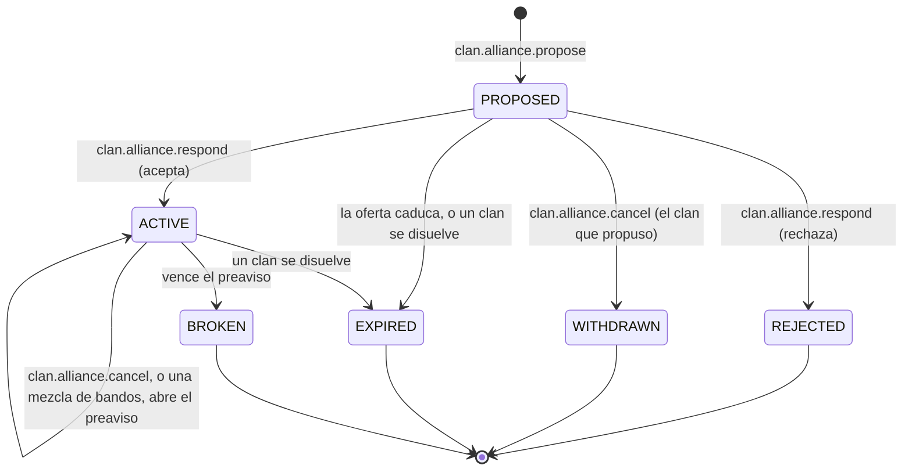

# Alianzas entre clanes: la paz entre dos clanes, firmada por sus líderes

Para que dos clanes puedan aliarse sin juntarse en uno: sus líderes firman una alianza que pone en paz a todos los
miembros de los dos, la rompen con preaviso y cualquiera puede ver quién está aliado con quién.

| Campo | Valor |
|---|---|
| Spec ID | `SPEC-CLAN-ALLIANCES` |
| Estado | Implemented (2026-11-16). Propuesta en `Draft` y aceptada el mismo día, con la recomendación de cada pregunta de §10; en `main` desde la fusión `57690c9`, con la CI en verde. |
| Milestone | E21 Alianzas entre clanes (vigesimoprimer slice después de M7) |
| Canon | §1.5 (determinismo), §11 (diplomacia), §12 (persistencia), §13 (protocolo), §14 (seguridad), §16 (errores) |
| Depende de | [clans.md](clans.md), [clan-governance.md](clan-governance.md), [clan-territories.md](clan-territories.md), [diplomacy.md](diplomacy.md), [factions.md](factions.md), [event-log.md](event-log.md), [live-notices.md](live-notices.md), [websocket-protocol.md](websocket-protocol.md) |
| Decisiones | [ADR-027](../decisions/ADR-027-hot-treaties.md) (tratados en caliente: la RAM decide en dos fases, vencimientos optimistas), [ADR-032](../decisions/ADR-032-trade-offers-and-two-key-jobs.md) (trabajos de dos claves), [ADR-039](../decisions/ADR-039-faction-peace-and-affinity.md) (la Orden como fuente de paz), [ADR-040](../decisions/ADR-040-clans-membership-and-peace.md) (el clan como tercera fuente de paz, con paz residual derivada) y [ADR-041](../decisions/ADR-041-clan-territories.md) (los territorios de clan). [ADR-042](../decisions/ADR-042-clan-alliances.md) (la alianza de clanes como cuarta fuente de paz, una relación entre clanes y no tratados entre jugadores; §7). |
| Reemplaza a | En [clans.md](clans.md) §2, «alianzas entre clanes» del no-scope; lo mismo en [clan-territories.md](clan-territories.md) §2 y en [clan-governance.md](clan-governance.md) §2. Precisa `RN-CLAN-008` (las alianzas activas de un clan son públicas, Q8), `RN-FAC-005` (tampoco se alían clanes con miembros de la Orden y del Caos, Q6) y `RN-CLAN-005` (la paz residual también con los aliados, Q7). |
| Invariantes | Cita [INV-SEC-001](../invariants/security.md#inv-sec-001), [INV-SEC-004](../invariants/security.md#inv-sec-004), [INV-SEC-007](../invariants/security.md#inv-sec-007), [INV-COMBAT-002](../invariants/combat.md#inv-combat-002), [INV-DIPLO-003](../invariants/diplomacy.md#inv-diplo-003), [INV-CLAN-002](../invariants/clans.md#inv-clan-002), [INV-CLAN-003](../invariants/clans.md#inv-clan-003), [INV-CLAN-004](../invariants/clans.md#inv-clan-004), [INV-CLAN-005](../invariants/clans.md#inv-clan-005) e [INV-PERSIST-005](../invariants/persistence.md#inv-persist-005); asigna [INV-CLAN-006](../invariants/clans.md#inv-clan-006) e [INV-CLAN-007](../invariants/clans.md#inv-clan-007) (§8) |

## 1. Objetivo

Un clan es hoy un grupo cerrado de hasta 20 jugadores en paz entre sí. Fuera de él, sólo hay paz de dos en dos: los
tratados de E6, que firma cada jugador por su cuenta, y la Orden (E17). Dos clanes que quieren ir juntos sin fundirse
en uno no tienen manera de hacerlo. Si quisieran la paz entre todos sus miembros, harían falta hasta 400 pactos, y cada
entrada o salida obligaría a firmar o romper una veintena. E20 dejó lista la pieza que faltaba: quién habla en nombre de
un clan.

Este slice trae la **alianza entre clanes**. Es una relación entre dos clanes, no entre jugadores: la firman los
líderes y pone en paz a todos los miembros de los dos mientras dure. Quien entra en uno de los clanes queda en paz con
el aliado en el acto; quien sale, deja de estarlo. Se rompe con el mismo preaviso que un tratado, para que no sirva
para traicionar por sorpresa. Es la diplomacia de los grupos, sobre la misma `AtPeace` que ya usan los tratados, la
Orden y el clan.

## 2. Scope

**Entra.** Proponer, aceptar, rechazar, retirar y romper una alianza entre dos clanes (Q1), con la oferta que caduca,
el límite para insistir tras un rechazo y el preaviso de ruptura de E6 (Q5). La firman los líderes (Q3). Un clan tiene
como mucho `EO_CLAN_MAX_ALLIES` alianzas activas (Q4). La alianza da **paz** entre los miembros de los dos clanes y nada
más (Q2). Dos clanes no se alían si eso juntara a la Orden y al Caos, y si la mezcla aparece después, la alianza
empieza su preaviso (Q6). Al salir de un clan, la paz residual de E18 cubre también a los aliados (Q7). Las alianzas
activas son públicas (Q8). Van al registro y a los avisos de §4.6 (Q9). Entran también la migración `000023`, el
cliente (sección «Alianzas» del panel del clan y «Proponer alianza» en la vista pública de otro clan) y un
`scripts/smoke.mjs --alianza-clan`.

**No entra** (`Fuera de MVP` de este slice): guerras declaradas entre clanes (Q10); guarnición, comercio, almacén o
canal compartidos entre aliados (Q2, Q11); tierra afín del aliado; que los miembros de un clan aliado reclamen juntos
un territorio; alianzas de más de dos clanes como una sola relación; pactos de no agresión de clan distintos de la
alianza; un mapa político o un color de aliado en el mapa (la sigla y la vista pública bastan, Q8); reputación o
castigo por romper; que los oficiales firmen (Q3).

## 3. Actores

- **El líder de cada clan.** Propone, acepta, rechaza, retira y rompe.
- **Los oficiales.** Ven las ofertas de su clan, como las invitaciones enviadas en E20, pero no firman (Q3).
- **Los miembros.** Quedan en paz con los del clan aliado y ven las alianzas en el panel.
- **Cualquier jugador.** Ve las alianzas activas de un clan en su vista pública (Q8).
- **El cliente web.**
- **El Game Server.** La simulación decide cada orden en el tick y calcula la paz, como con los tratados
  ([ADR-027](../decisions/ADR-027-hot-treaties.md), [INV-SEC-001](../invariants/security.md#inv-sec-001)).
- **PostgreSQL.** Guarda la alianza y vuelve a comprobar, con los candados de los dos clanes en orden de `id`, que
  quien firma es el líder y que la relación lo admite.

Redis no participa.

## 4. Modelo

### 4.1 La alianza

Una alianza une a **dos clanes vivos distintos**. Entre dos clanes hay como mucho **una alianza activa y una oferta
pendiente**, y la oferta sólo existe mientras no haya alianza. Es la regla de `INV-DIPLO-002`, sin la escalera de
tipos de E6 y E10, porque aquí hay un solo tipo (Q1).

Su ciclo de vida es el de un tratado ([diplomacy.md](diplomacy.md) §4.2), con los mismos estados:

La alianza es **del clan, no de quien la firmó**. Un cambio de líder, por traspaso o por sucesión (E20), no la toca:
el nuevo líder la hereda, con sus ofertas pendientes. Una oferta la propone un clan y la contesta el otro. Si el líder
que la envió deja de serlo, la oferta sigue en pie y la puede retirar el nuevo líder.

### 4.2 La paz de la alianza

`State.AtPeace` responde hoy «sí» si hay un tratado vigente, si los dos son de la Orden, si son del mismo clan o si les
queda paz residual. Con este slice responde «sí» también cuando **cada uno es miembro de uno de dos clanes con una
alianza `ACTIVE`**, incluida la que está en preaviso. Así las cuatro acciones hostiles (`unit.attack`, también contra
una caravana; `unit.pillage`; `unit.demolish`; y `unit.claim` sobre un territorio con dueño) y la respuesta automática
quedan cubiertas por la regla que ya existe. El rechazo lleva su propio motivo: «vuestros clanes están aliados».

- **Reclamar.** Contra un territorio de un clan aliado, la reclamación se rechaza por la comprobación de E19
  (`clanClaimBlocked`), que ya mira la paz con cada miembro del clan dueño. Una reclamación para el clan contra un
  territorio de un miembro de un clan aliado, igual.
- **Lo que está en curso.** Cuando una alianza pasa a `ACTIVE`, los enfrentamientos, saqueos, derribos, estandartes y
  reclamaciones entre los miembros de los dos clanes terminan en ese tick, como cuando nace un tratado (`RN-COMBAT-008`,
  `RN-COMBAT-025` y la conquista). Lo mismo cuando alguien entra en un clan aliado.
- **Entrar y salir.** Quien entra en un clan queda en paz con los aliados de ese clan cuando se confirma su entrada.
  Quien sale o es expulsado deja de estar en paz con ellos, salvo la paz residual de Q7.
- **No es transitiva.** Si A está aliado con B y B con C, A y C no están en paz por eso.
- **Sólo paz.** No da guarnición, comercio, almacén, canal ni tierra afín (Q2). Para eso siguen los tratados entre
  jugadores, que pueden firmar entre sí como hoy.

### 4.3 Proponer, responder, retirar y romper

Las cuatro órdenes las da sólo el **líder** del clan (Q3), y las cuatro se rechazan en un clan que se está disolviendo
(E19).

- **`clan.alliance.propose { clanId }`.** Propone una alianza al clan `clanId`, que tiene que ser otro clan vivo. Se
  rechaza en estos casos:
  - ya hay una alianza activa o una oferta pendiente entre los dos;
  - cualquiera de los dos clanes tiene ya `EO_CLAN_MAX_ALLIES` alianzas activas (Q4);
  - juntaría a la Orden y al Caos (§4.4);
  - el otro clan rechazó una oferta de este hace menos de `EO_TREATY_RETRY_MINUTES` (Q5).
- **`clan.alliance.respond { allianceId, accept }`.** Sólo el líder del clan que **no** propuso, sobre una oferta
  `PROPOSED`. Aceptar vuelve a comprobar el tope y los bandos, y deja la alianza `ACTIVE`. Rechazar la deja `REJECTED`.
- **`clan.alliance.cancel { allianceId }`.** Sobre una oferta, la retira (`WITHDRAWN`), y sólo puede el líder del clan
  que la propuso. Sobre una alianza `ACTIVE`, la rompe el líder de cualquiera de los dos: empieza el **preaviso**, de
  `EO_TREATY_BREAK_NOTICE_MINUTES` (15). Durante el preaviso la paz sigue entera y, al vencer, la alianza pasa a
  `BROKEN`. Romper no se puede deshacer: volver a aliarse es firmar otra.
- **Caducidad.** Una oferta sin respuesta pasa a `EXPIRED` a las `EO_TREATY_OFFER_HOURS` (24).
- **Disolución.** Cuando un clan se disuelve (sale el último, E18 y E19), sus ofertas y alianzas pasan a `EXPIRED` en
  la misma transacción que la disolución, sin preaviso: ya no queda nadie en ese clan con quien estar en paz. La paz
  residual del último en salir sí cuenta (Q7).

Las cuatro órdenes son **comandos de la simulación, no hostiles**. Ninguna se rechaza por `CITY_PROTECTED`: se puede
proponer a un clan cuyo líder está desconectado, como en E6. Siguen el modelo de los tratados (ADR-027):

- La propuesta, la respuesta y la ruptura van en **dos fases**. La RAM decide en el tick y un trabajo de la cola
  escribe con las dos claves `clan:<a>` y `clan:<b>`, en orden de `id`. La paz nace, y el preaviso empieza, cuando la
  transacción vuelve por el buzón.
- La caducidad de la oferta y el vencimiento del preaviso son **optimistas**: la fase 5 los aplica en la RAM y la cola
  los escribe.

### 4.4 Alianzas y bandos

La paz entre la Orden y el Caos está prohibida (`RN-FAC-005`, [INV-DIPLO-003](../invariants/diplomacy.md#inv-diplo-003)).
Una alianza la daría entre todos los miembros de los dos clanes. Por eso:

- **No se firma una alianza que mezcle.** No se propone ni se acepta si entre los miembros de los dos clanes, contando
  las entradas pendientes en un bando, habría uno de `ORDER` y uno de `CHAOS`. `NEUTRAL` no cuenta.
- **Si la mezcla aparece después, la alianza empieza su preaviso** (Q6), como un tratado con el bando contrario cuando
  alguien entra en un bando (`RN-FAC-006`). Pasa en estos casos:
  - vence la entrada en un bando de un miembro de uno de los clanes, y el otro clan tiene un miembro del bando
    contrario;
  - entra en uno de los clanes alguien de un bando cuyo contrario está en el clan aliado.

  Durante esos 15 minutos sigue la paz, como en un tratado en preaviso. Ni la invitación ni la entrada en un bando se
  rechazan por la composición del clan aliado: lo que un clan decide sobre sus miembros no lo veta otro clan.

### 4.5 Reglas

Dominio: `RN-CLANALLY`.

| ID | Regla |
|---|---|
| `RN-CLANALLY-001` | Entre dos clanes vivos hay como mucho una alianza `ACTIVE` y una oferta `PROPOSED`, y nunca las dos a la vez. Un clan tiene como mucho `EO_CLAN_MAX_ALLIES` alianzas `ACTIVE` (Q1, Q4). **Precisión (2026-11-17, [clan-wars.md](clan-wars.md), [ADR-045](../decisions/ADR-045-clan-wars.md)):** con E24, no se propone ni se acepta una alianza entre dos clanes con una guerra abierta, y la declaración de una guerra expira la oferta pendiente entre los dos (`RN-CLANWAR-003`). |
| `RN-CLANALLY-002` | Sólo el líder de un clan propone, acepta, rechaza, retira y rompe. Responde sólo el líder del clan que no propuso; retira sólo el del que propuso; rompe el de cualquiera de los dos (Q3). |
| `RN-CLANALLY-003` | **La paz de la alianza.** Mientras una alianza está `ACTIVE`, también durante su preaviso, ninguna acción hostil se acepta ni sigue en curso entre un miembro de uno de los clanes y uno del otro (Q2). |
| `RN-CLANALLY-004` | **Preaviso.** Romper deja la alianza `ACTIVE` durante `EO_TREATY_BREAK_NOTICE_MINUTES`; al vencer, pasa a `BROKEN`. Una oferta caduca a las `EO_TREATY_OFFER_HOURS`, y tras un rechazo el mismo clan no vuelve a proponer al otro antes de `EO_TREATY_RETRY_MINUTES` (Q5). |
| `RN-CLANALLY-005` | No se propone ni se acepta una alianza que juntaría a un miembro de `ORDER` con uno de `CHAOS`, contando las entradas pendientes; si la mezcla aparece con la alianza activa, empieza su preaviso (Q6). |
| `RN-CLANALLY-006` | **Paz residual.** Quien sale o es expulsado de un clan sigue en paz durante `EO_CLAN_PEACE_GRACE_SECONDS` también con los miembros de los clanes aliados en el momento de su salida (Q7). |
| `RN-CLANALLY-007` | Las alianzas activas de un clan, con su preaviso, son públicas; las ofertas, sólo para el líder y los oficiales de los dos clanes (Q8). |
| `RN-CLANALLY-008` | Al disolverse un clan, sus ofertas y alianzas pasan a `EXPIRED` en la transacción de la disolución. Un cambio de líder no las toca. |
| `RN-CLANALLY-009` | El rango y el estado que permiten una orden se comprueban en el tick y otra vez en la transacción, con los candados de los dos clanes en orden de `id`. Una orden que llega a la base cuando quien la dio ya no es el líder no escribe nada. |

### 4.6 Qué ve el jugador

- **Panel del clan, sección «Alianzas».**
  - Todos los miembros ven los clanes aliados (nombre y sigla) y, durante un preaviso, la cuenta atrás: «La alianza
    con [TAG] termina en 12 min».
  - El líder y los oficiales ven las ofertas recibidas y enviadas. Sólo el líder ve los botones: «Aceptar» y
    «Rechazar» en las recibidas, «Retirar» en las enviadas, y «Romper» en cada alianza, con una confirmación («Dentro
    de 15 minutos, los miembros de [TAG] podrán atacar a los tuyos»).
  - Una línea recuerda el tope: «[TAG] tiene 1 de 2 alianzas».
- **Vista pública de otro clan** (`clan.lookup`): lleva sus alianzas activas y, para el líder de un clan, «Proponer
  alianza» si se puede. Si no se puede, el botón no sale o sale con el motivo: el tope, la oferta ya enviada o los
  bandos.
- **Ciudad ajena.** La barra de una ciudad de un clan aliado dice «Aliado de [TAG]». El clic de ataque contra ella se
  rechaza con «vuestros clanes están aliados».
- **Registro y avisos** (Q9):
  - Al líder del clan que la recibe le llega una oferta en vivo y queda en su registro: «[TAG] propone una alianza con
    tu clan».
  - Que la acepten o la rechacen va al registro del líder del clan que propuso, y la aceptación se le avisa en vivo.
  - Cuando un líder rompe una alianza, o cuando una mezcla de bandos abre su preaviso, se avisa en vivo y queda en el
    registro de **todos los miembros de los dos clanes**: «La alianza entre [TAG] y [TAG] termina en 15 minutos». Es
    la única que avisa a todos, porque es la que les quita la paz.
  - Que una alianza nazca o venza sólo se ve en el panel.

## 5. Errores

Sólo códigos que ya existen en el catálogo (canon §16).

| Código | Condición |
|---|---|
| `INVALID_MESSAGE` | Un `clanId` o un `allianceId` mal formados, o un `accept` que no es booleano. |
| `INVALID_TARGET` | Pasa en cualquiera de estos casos: dar una orden de §4.3 sin ser el líder o sin clan; proponer al propio clan o a uno que no existe o se disolvió; proponer o aceptar con una relación vigente o pendiente, con el tope lleno o con la mezcla de bandos de §4.4; proponer antes de que pase `EO_TREATY_RETRY_MINUTES` desde un rechazo; responder a la oferta propia o a una que ya no está `PROPOSED`; retirar la ajena; romper una que ya está en preaviso; cualquiera de estas órdenes en un clan que se está disolviendo; y lo que la base rechace por `RN-CLANALLY-009`. El mensaje dice cuál de ellos fue. Una acción hostil entre aliados, con «vuestros clanes están aliados». |
| `INTERNAL_ERROR` | La escritura de una orden no llega a la base tras sus reintentos; la RAM no cambia, porque las órdenes van en dos fases (§7). |

## 6. Eventos y contratos de red

**Cliente → servidor.** Tres comandos nuevos y estrictos (R-VER-3), con la forma de los de E6. Van en `CommandTypes` y
en `actions.go` como **no hostiles**, con su trabajo de la cola de dos claves (`clan:<a>`, `clan:<b>`), que entra en
`simulation.JobNames`. El catálogo pasa de 41 a 44 comandos.

- `clan.alliance.propose { clanId }`.
- `clan.alliance.respond { allianceId, accept }`.
- `clan.alliance.cancel { allianceId }`.

**Servidor → cliente.** No hay tipos nuevos; el catálogo sigue en 31.

- `ClanView` (en `clan.update`) gana `alliances`: una lista obligatoria con
  `{ id, clanId, name, tag, status, proposedByUs, breaksAtMs }`. Lleva las alianzas activas para todos los miembros
  y, además, las ofertas para el líder y los oficiales. Es un campo obligatorio nuevo: hay que tocar los fixtures del
  cliente y del protocolo, y estrenarlo junto en el cliente y el servidor, como los de E19.
- `clan.info` gana `alliances`, con sólo las activas (`{ clanId, name, tag, breaksAtMs }`).
- Cada cambio de una alianza envía un `clan.update` a los miembros de los dos clanes, con el `requestId` a quien dio
  la orden.
- La barra de una ciudad ajena sabe si es de un clan aliado por la sigla de su clan (`CityView.clan`) y por las
  alianzas del propio clan: no hace falta un campo nuevo en `CityView`.

**Eventos de dominio** en `world_events` ([ADR-028](../decisions/ADR-028-event-log-from-world-events.md)). Cada uno
lleva `player_id` (el líder que da la orden, o el del clan que propuso en los optimistas), `counterpart_player_id` (el
líder del otro clan en ese momento), `atMs` y las dos siglas:

- `ClanAllianceProposed`, `ClanAllianceAccepted`, `ClanAllianceRejected`, `ClanAllianceWithdrawn`,
  `ClanAllianceBreakAnnounced` (con `reason`: `CANCEL` o `FACTIONS`), `ClanAllianceBroken` y `ClanAllianceExpired`.
- Van al registro, con `eventlog.EventTypes` y `Classify` según §4.6:
  - `ClanAllianceProposed`, para quien la recibe;
  - `ClanAllianceAccepted` y `ClanAllianceRejected`, para quien propuso;
  - `ClanAllianceBreakAnnounced`, para todos los miembros de los dos clanes.

  Es la primera entrada del registro que no va a dos jugadores sino a dos clanes. Se clasifica por la pertenencia en
  el instante del evento, que da `clan_members` (§7).
- Avisos en vivo (`eventlog.NoticeKinds` y `EventLogNoticeKind` de Zod, que pasa de 29 a 32): la oferta recibida,
  la aceptación y el preaviso.

**Métricas.** `eo_clan_changes_total{kind}` gana `alliance_proposed`, `alliance_accepted`, `alliance_broken` y
`alliance_expired`, todas a cero al arrancar. No hay métrica nueva: [../operations/monitoring.md](../operations/monitoring.md)
§2 sigue en 22.

**Configuración.** `EO_CLAN_MAX_ALLIES` (2, Q4), nueva. Los plazos reutilizan los de los tratados
(`EO_TREATY_OFFER_HOURS`, `EO_TREATY_BREAK_NOTICE_MINUTES`, `EO_TREATY_RETRY_MINUTES`) y la paz residual, la de E18
(`EO_CLAN_PEACE_GRACE_SECONDS`): son las mismas decisiones de producto.

## 7. Persistencia

| Pregunta (canon §12) | Respuesta |
|---|---|
| Autoritativo en RAM | Las alianzas `PROPOSED` y `ACTIVE` de todo el mundo, con su preaviso, y los rechazos recientes, junto a los clanes (`clanRecord`), cargados con el mundo. La paz de la alianza, que se deriva en cada consulta |
| Write-through | Cada transición en su trabajo de la cola, con las dos claves de clan y su `world_events` en la misma transacción. La expiración por disolución, en la transacción de la disolución de E19 |
| Dirty-flag | Nada |
| Reconstruible / no persistido | Quién está en paz por una alianza; la paz residual con los aliados, que se deriva de las estancias de `clan_members` y de las fechas de la alianza |

**Por qué hace falta un ADR ([ADR-042](../decisions/ADR-042-clan-alliances.md)).** Tres decisiones estructurales:

1. **La alianza es la cuarta fuente de paz, entre clanes y no entre jugadores.** `AtPeace` pasa a ser «tratado, o
   los dos de la Orden, o mismo clan, o paz residual, o clanes aliados». Se descarta crear un pacto implícito por cada
   pareja de miembros, por la misma razón que ADR-040 descartó los pactos implícitos dentro de un clan: crecería con el
   producto de los dos clanes (hasta 400 filas) y cada entrada o salida tocaría veinte. La consulta queda en O(1): el
   clan de cada uno en `memberOf` y el par en un mapa de alianzas.
2. **Dos candados de clan en cada orden.** La transacción toma el candado de los dos clanes en orden de `id`
   (`ascendingClans`, como la captura de clan a clan de E19). Dentro comprueba que quien firma es el líder, el tope de
   cada clan y la mezcla de bandos. Comparte cola con las demás escrituras de los dos clanes, con un trabajo de dos
   claves (ADR-032): una entrada en uno de los clanes y la aceptación de la alianza no se cruzan.
3. **La paz residual con los aliados se deriva, no se guarda.** Sale de la hora de salida de la estancia y de si la
   alianza estaba `ACTIVE` en ese instante (sus fechas de aceptación y de cierre). Así la paz residual sigue siendo una
   consulta, como en ADR-040, sin una tabla de «paces pendientes».

**Migración `000023`.**

- Una tabla nueva, `clan_alliances`, con estas columnas:
  - `id` (identidad);
  - `clan_a` y `clan_b`, con FK a `clans`, en orden canónico (`CHECK (clan_a < clan_b)`);
  - `proposed_by_clan` y `proposed_by_player`;
  - `status`, con el `CHECK` de los seis estados;
  - `request_id`;
  - `created_at`, `accepted_at`, `break_effective_at`, `break_reason` y `closed_at`.

  Dos índices únicos parciales por par, uno para `ACTIVE` y otro para `PROPOSED`, como `treaties` en `000009`. Se suma
  al `TRUNCATE` de `testenv_integration_test.go` y a la clasificación de [../database/schema.md](../database/schema.md)
  §1.
- Un trigger rechaza que nazca o se acepte una alianza que junte a la Orden y al Caos (23514), como red de seguridad
  bajo la comprobación del tick ([INV-PERSIST-005](../invariants/persistence.md#inv-persist-005)). La mezcla posterior
  no la rechaza: abre el preaviso (§4.4).
- La siguiente migración libre pasará a ser `000024`.

**Los rechazos recientes** (`RN-CLANALLY-004`) se cargan de la base con su fecha, como los de E6, para que un reinicio
no deje insistir antes de tiempo.

## 8. Invariantes

**Cita:**

- [INV-SEC-001](../invariants/security.md#inv-sec-001) e [INV-SEC-004](../invariants/security.md#inv-sec-004): la
  alianza, su estado y quién la firma los decide el servidor.
- [INV-SEC-007](../invariants/security.md#inv-sec-007): un `requestId` repetido no propone, acepta ni rompe dos veces.
- [INV-COMBAT-002](../invariants/combat.md#inv-combat-002): ningún golpe donde la paz lo prohíbe, ahora también entre
  aliados y durante el preaviso.
- [INV-DIPLO-003](../invariants/diplomacy.md#inv-diplo-003): su espíritu, extendido a las alianzas de clan por
  `RN-CLANALLY-005`.
- [INV-CLAN-002](../invariants/clans.md#inv-clan-002): la regla de bandos dentro de un clan, que no cambia.
- [INV-CLAN-003](../invariants/clans.md#inv-clan-003) e [INV-CLAN-004](../invariants/clans.md#inv-clan-004): la paz
  del clan y la reclamación para el clan, que la alianza amplía sin cambiar.
- [INV-CLAN-005](../invariants/clans.md#inv-clan-005): sólo el rango que lo permite actúa en nombre del clan, aquí el
  líder.
- [INV-PERSIST-005](../invariants/persistence.md#inv-persist-005): la migración `000023`.

**Asigna** dos invariantes nuevos, registrados en [../invariants/clans.md](../invariants/clans.md):

- [INV-CLAN-006](../invariants/clans.md#inv-clan-006), **una alianza bien formada.** Entre dos clanes hay como
  mucho una alianza activa y una oferta pendiente, un clan no supera el tope de alianzas activas, y ninguna alianza
  nace ni se acepta entre clanes que juntarían a la Orden y al Caos. Lo garantizan los índices únicos, el trigger de
  bandos y la transacción con los dos candados.
- [INV-CLAN-007](../invariants/clans.md#inv-clan-007), **la paz de la alianza.** Ningún golpe, robo, derribo,
  avance de estandarte ni reclamación se aplica entre miembros de dos clanes con una alianza activa, ni durante su
  preaviso, ni durante la paz residual de quien salió de uno de ellos. Lo comprueban los tests de la simulación, como
  `INV-CLAN-003`.

## 9. Tests esperados

| Nivel | Qué |
|---|---|
| unit | La máquina de estados de la alianza (cada salto legal y los ilegales). Cada fila de §5 para cada orden. El tope por clan. La mezcla de bandos con entradas pendientes y con `NEUTRAL`. `AtPeace` con una alianza activa, en preaviso, rota, sin transitividad y con la paz residual con los aliados (dentro y fuera del plazo, y con quien entró en el aliado después de la salida) |
| simulation | Golden «alianza de clanes» en Go con los ticks exactos: proponer, aceptar, el enfrentamiento entre dos miembros que termina en el tick en que vuelve la transacción, alguien que entra en un clan y queda en paz con el aliado, la ruptura, el preaviso exacto y el ataque que vuelve a aceptarse en el tick siguiente al vencimiento. Una entrada en un bando que abre el preaviso. Una reclamación contra un territorio del clan aliado, rechazada. La disolución que expira la alianza. Una orden cuyo líder cambió entre el tick y la base, sin escribir. El catálogo de comandos (44) y de trabajos, con las claves de cada trabajo |
| integration | La migración: la tabla, sus `CHECK`, los índices por par y el trigger de bandos. Cada orden con su comprobación de líder, tope y estado bajo los dos candados en orden de `id`. La expiración en la transacción de la disolución. Los eventos con su `counterpart` y el registro de cada lado, y el preaviso en el de todos los miembros de los dos clanes |
| recovery | Las alianzas, las ofertas, los rechazos recientes y un preaviso en curso sobreviven a un reinicio. Un preaviso o una oferta que vencieron con el servidor parado se aplican en el primer tick. La paz residual con un aliado sobrevive a un reinicio |
| contract / e2e | Los tres comandos contra el JSON Schema. `alliances` en `clan.update` y en `clan.info`. Los avisos nuevos. Por WebSocket: dos líderes firman una alianza, un miembro del aliado ve rechazado su ataque y los oficiales ven la oferta; un raso, no |
| cliente | La sección «Alianzas» con su cuenta atrás. Los botones según el rango. «Proponer alianza» en la vista pública con su motivo. «Aliado de [TAG]» en la barra de una ciudad ajena. Los textos del registro y de los avisos. `scripts/smoke.mjs --alianza-clan`: `smoke_clan_b` funda un segundo clan, `smoke_clan_a` (líder de `[HUM]`) le propone la alianza y `smoke_clan_b` la acepta; se comprueba la paz con un ataque rechazado; `smoke_clan_a` la rompe con un preaviso corto (por variable de entorno). Al final `smoke_clan_b` sale de su clan, que se disuelve, para que `--clan` lo siga encontrando sin clan |

**Precisiones (2026-11-16), al implementar.** Ninguna cambia una decisión de §10.

- **Quién responde, también en la base.** La transacción de una orden comprueba además que acepta o rechaza el líder
  del clan que no propuso, y que retira el del clan que propuso («ese clan no puede hacer eso con la oferta»), como
  `INV-DIPLO-001` en los tratados.
- **La mezcla de bandos al entrar en un clan la decide la base.** La transacción de la entrada (`JoinBreaking`) abre el
  preaviso de cada alianza activa del clan cuyo par queda mezclado (`clan_pair_mixes_factions`) y devuelve las alianzas
  rotas, que la RAM aplica al confirmar la entrada. Así no se escapa una alianza aceptada mientras la entrada iba en
  vuelo. La de la entrada en un bando la decide la RAM, como con los tratados (ADR-039 §3), y la base la escribe de
  forma tolerante.
- **La validación de carga** está en la simulación (`State.SetClanAlliances`), no en `internal/game/loadcheck`: lo que
  viola `INV-CLAN-006` no se instala y se registra como `invariant_violation`.
- **La expiración por disolución** escribe `ClanAllianceExpired` con el líder que propuso como `player_id` y no cuenta en
  `alliance_expired`, que sólo cuenta las ofertas que caducan.
- **El registro** pasa de 31 a 35 tipos de entrada.
- **El aviso del preaviso** no lleva `breaksAtMs`, que `event_log.notice` no tiene: el cliente dice «en 15 minutos», y
  la entrada del registro, la hora.
- **El humo** no necesita un preaviso corto: tras romper, la disolución de [ECO] expira la alianza sin esperar a que
  venza. Justo después de `--clan`, que acaba de expulsar a smoke_clan_b de [HUM], su ataque se rechaza por la paz
  residual de esa expulsión («sois del mismo clan»), que se comprueba antes que la de la alianza; el humo lo distingue, y
  con el servidor arrancado con `EO_CLAN_PEACE_GRACE_SECONDS=5` el motivo es el de la alianza. Las dos son paz: el
  orden de los motivos (ADR-042 §2) es el esperado.

## 10. Decisiones de producto (2026-11-16)

Preguntas que la propuesta dejó abiertas; producto aceptó la recomendación de cada una. Son decisiones de producto,
no de ingeniería: cambiarlas es cambiar la spec.

| # | Pregunta | Decisión |
|---|---|---|
| Q1 | ¿Qué relaciones puede haber entre dos clanes? | **Una sola: la alianza, con el ciclo de vida de un tratado (oferta, aceptación, ruptura con preaviso).** Es lo mínimo que hace que dos clanes jueguen juntos, y reutiliza reglas que los jugadores ya conocen de E6. Alternativas: **pacto de no agresión y alianza**, como entre jugadores, pero sin guarnición ni comercio entre clanes (Q2), los dos darían lo mismo; **una escalera** con algo más en la alianza (comercio sin tratado, guarnición), que adelanta Q2. |
| Q2 | ¿Qué da la alianza? | **Sólo paz entre todos los miembros de los dos clanes.** Es lo que no se puede conseguir hoy sin cientos de pactos. Lo demás (guarnición, comercio) ya lo dan los tratados entre jugadores, que los aliados pueden firmar entre sí como hacen los compañeros de clan (Q12 de E18). Alternativas: **paz y tierra afín del aliado**, que mezcla el bono de E17 con la diplomacia sin datos; **paz y guarnición**, que pide decidir quién puede guarnecer dónde entre 40 jugadores. |
| Q3 | ¿Quién firma en nombre del clan? | **Sólo el líder: propone, acepta, rechaza, retira y rompe. Los oficiales ven las ofertas, como las invitaciones, pero no firman.** La alianza compromete a todo el clan y su ruptura le quita la paz a todos: es una decisión del líder. Desde E20, un líder ausente pierde el liderazgo a los 7 días, así que un clan no se queda sin quien firme. Alternativas: **el líder y los oficiales** (más ágil, pero un oficial podría romper una alianza que el líder quiere); **los oficiales proponen y sólo el líder acepta y rompe**. |
| Q4 | ¿Cuántas alianzas puede tener un clan? | **Dos activas** (`EO_CLAN_MAX_ALLIES`). Con el tope de 20 miembros de E18, son hasta 60 jugadores en paz con cada miembro, menos que un bando, y permite un triángulo de tres clanes aliados entre sí. El tope de 20 se eligió para que un clan no fuera un bando paralelo, y sin tope de alianzas ese límite dejaría de tener sentido. Las ofertas no cuentan. Alternativas: **una**, la más cerrada; **sin tope**, que con la Orden y el Caos ya formando bloques grandes haría de las alianzas un tercer bloque sin reglas de bando. |
| Q5 | ¿Qué plazos tiene? | **Los de los tratados de E6: la oferta caduca a las 24 horas, romper tiene 15 minutos de preaviso con la paz entera, y tras un rechazo el mismo clan no insiste en 10 minutos.** Son reglas que el jugador ya conoce, y el preaviso es lo que impide que una alianza sirva para traicionar por sorpresa a 20 personas. Alternativas: **un preaviso más largo** (una hora), porque avisar a 40 jugadores pide más margen que avisar a uno; **plazos propios** en variables nuevas, que separan dos decisiones hoy iguales. |
| Q6 | ¿Cómo encajan las alianzas con los bandos? | **No se firma una alianza que juntaría a la Orden y al Caos, contando las entradas pendientes. Si la mezcla aparece después (alguien entra en un bando o en uno de los clanes), la alianza empieza su preaviso**, como un tratado con el bando contrario (`RN-FAC-006`). Ni invitar ni entrar en un bando se rechaza por la composición del clan aliado: un clan no veta lo que hace otro. Alternativas: **bloquear la mezcla también después**, con la regla de bandos de E18 extendida al clan aliado (más estricto, pero el clan B decidiría a quién puede invitar el clan A); **permitir la mezcla** y que la alianza gane, que deshace la Q5 de E17. |
| Q7 | ¿Hay paz residual con los aliados al salir de un clan? | **Sí: quien sale o es expulsado sigue en paz durante 15 minutos con los miembros de los clanes aliados en ese momento**, como con sus excompañeros (Q6 de E18). Sin ella, salir del clan sería la manera de atacar por sorpresa a un aliado que tienes al lado. Alternativa: **sin paz residual con los aliados**, más simple, pero abre esa traición. |
| Q8 | ¿Son públicas las alianzas? | **Las activas, sí, con su preaviso: en la vista pública del clan y en la barra de sus ciudades («Aliado de [TAG]»). Las ofertas, sólo para el líder y los oficiales de los dos clanes.** Por la misma razón que el clan es público (Q8 de E18): si no sabes quién está en paz con quién, no sabes a quién atacar. Alternativa: **privadas**, como los tratados entre jugadores (Q8 de E6), que esconde quién protege a quién y hace imprevisibles los rechazos. |
| Q9 | ¿Qué entra en el registro y en los avisos? | **La oferta recibida (aviso y registro del líder que la recibe); la aceptación (aviso y registro del líder que propuso) y el rechazo (registro); y el preaviso de ruptura, aviso y registro para todos los miembros de los dos clanes.** El preaviso es la única que cambia la seguridad de cada miembro, así que todos tienen que enterarse; lo demás es trabajo del líder. Alternativas: **todo a todos los miembros**, que llena los avisos de 40 personas; **nada a los miembros**, que les quita los 15 minutos del preaviso si no miran el panel. |
| Q10 | ¿Entran las guerras declaradas entre clanes? | **No en este slice.** Hoy la hostilidad ya es lo normal entre quienes no están en paz, así que una guerra declarada sólo tendría sentido si diera algo: un bono, objetivos, un marcador o una manera de terminarla. Eso es balance sin datos y merece su propia spec, cuando haya jugadores que la pidan. Alternativa: **una guerra declarativa**, sólo visible en la vista pública y en el registro, sin efecto en el combate. |
| Q11 | ¿Comparten los aliados un canal? | **No.** El canal de E18 es del clan y se lee sólo desde la entrada. Un canal de la alianza pide decidir quién lo lee al romperse y abre la estrategia de un clan al otro. Para hablar quedan los mensajes directos de E16. Alternativa: **un canal de la alianza**, con las reglas del canal de clan, que se cierra al vencer el preaviso. |

## 11. Documentos relacionados

- [clans.md](clans.md): la paz del clan, la paz residual, la regla de bandos y el candado del clan.
- [clan-governance.md](clan-governance.md): el líder que firma y la sucesión que garantiza que haya uno.
- [clan-territories.md](clan-territories.md): la reclamación contra un clan (`clanClaimBlocked`) y la disolución en
  dos fases, en la que expiran las alianzas.
- [diplomacy.md](diplomacy.md): el ciclo de vida, los plazos y el preaviso que la alianza de clanes reutiliza.
- [factions.md](factions.md): `RN-FAC-005` y `RN-FAC-006`, la paz prohibida entre la Orden y el Caos.
- [event-log.md](event-log.md) y [live-notices.md](live-notices.md): las entradas y los avisos nuevos.
- [../roadmap/roadmap.md](../roadmap/roadmap.md), la fase Clans: «Quedan las alianzas y las guerras entre clanes».
