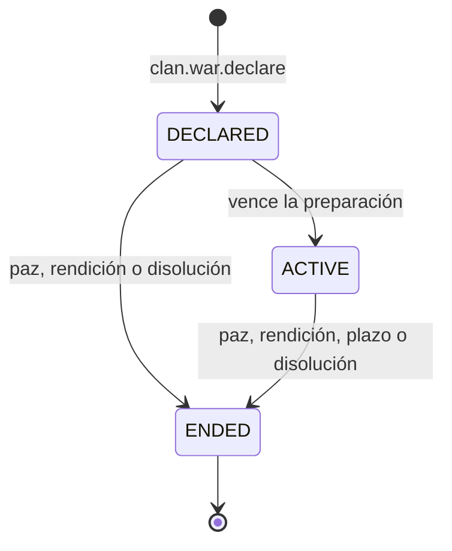

# Guerras entre clanes: la guerra declarada, su marcador y cómo termina

Para que un clan pueda declarar la guerra a otro: el líder la declara, los dos clanes quedan comprometidos
durante un plazo, cada baja, derribo y conquista entre ellos suma en un marcador público, y la guerra termina con una
rendición, una paz de mutuo acuerdo o el plazo, con un resultado que queda en la historia de los dos clanes.

| Campo | Valor |
|---|---|
| Spec ID | `SPEC-CLAN-WARS` |
| Estado | Implemented (2026-11-17). Propuesta en `Draft` y aceptada el mismo día, con la recomendación de cada pregunta de §10; en `main` desde la fusión `66ad94b`, con la CI en verde. |
| Milestone | E24 Guerras entre clanes (vigesimocuarto slice después de M7) |
| Canon | §1.5 (determinismo), §11 (diplomacia), §12 (persistencia), §13 (protocolo), §14 (seguridad), §16 (errores) |
| Depende de | [clans.md](clans.md), [clan-governance.md](clan-governance.md), [clan-territories.md](clan-territories.md), [clan-alliances.md](clan-alliances.md), [diplomacy.md](diplomacy.md), [factions.md](factions.md), [combat-raid.md](combat-raid.md), [combat-siege.md](combat-siege.md), [territory-conquest.md](territory-conquest.md), [castle-age.md](castle-age.md), [event-log.md](event-log.md), [live-notices.md](live-notices.md), [websocket-protocol.md](websocket-protocol.md) |
| Decisiones | [ADR-027](../decisions/ADR-027-hot-treaties.md) (tratados en caliente: dos fases y vencimientos optimistas), [ADR-028](../decisions/ADR-028-event-log-from-world-events.md) (el registro leído de `world_events`), [ADR-032](../decisions/ADR-032-trade-offers-and-two-key-jobs.md) (trabajos de dos claves), [ADR-040](../decisions/ADR-040-clans-membership-and-peace.md) (el clan como fuente de paz, con las estancias de `clan_members`) y [ADR-042](../decisions/ADR-042-clan-alliances.md) (la alianza entre clanes y sus dos candados). [ADR-045](../decisions/ADR-045-clan-wars.md) (la guerra como relación entre clanes que no toca `AtPeace`, el compromiso sobre los tratados y el marcador que viaja en los eventos que puntúan; §7). |
| Reemplaza a | En [clan-alliances.md](clan-alliances.md) §2 y Q10, «guerras declaradas entre clanes» del no-scope; lo mismo en la fase Clans de [../roadmap/roadmap.md](../roadmap/roadmap.md) («Quedan las guerras declaradas entre clanes»). Precisa `RN-CLAN-008` (las guerras abiertas de un clan y su historial son públicos, Q10), `RN-CLANALLY-001` (no hay oferta de alianza entre dos clanes en guerra, Q9) y `RN-DIPLO-001` (no se firma un pacto ni una alianza entre miembros de dos clanes en guerra, Q1). |
| Invariantes | Cita [INV-SEC-001](../invariants/security.md#inv-sec-001), [INV-SEC-004](../invariants/security.md#inv-sec-004), [INV-SEC-007](../invariants/security.md#inv-sec-007), [INV-COMBAT-002](../invariants/combat.md#inv-combat-002), [INV-DIPLO-002](../invariants/diplomacy.md#inv-diplo-002), [INV-DIPLO-003](../invariants/diplomacy.md#inv-diplo-003), [INV-CLAN-005](../invariants/clans.md#inv-clan-005), [INV-CLAN-006](../invariants/clans.md#inv-clan-006), [INV-CLAN-007](../invariants/clans.md#inv-clan-007) e [INV-PERSIST-005](../invariants/persistence.md#inv-persist-005); asigna [INV-CLAN-008](../invariants/clans.md#inv-clan-008), [INV-CLAN-009](../invariants/clans.md#inv-clan-009) e [INV-DIPLO-004](../invariants/diplomacy.md#inv-diplo-004) (§8) |

## 1. Objetivo

Entre dos jugadores que no están en paz la hostilidad ya es lo normal: se atacan, se saquean, se derriban las casas y se
quitan territorios sin declarar nada. Por eso [clan-alliances.md](clan-alliances.md) dejó fuera la guerra declarada:
sólo tendría sentido si diera algo que hoy no existe.

Lo que hoy no existe es **el conflicto entre dos grupos como algo con principio, compromiso y final**. Un clan no
puede comprometerse contra otro: cada miembro sigue con sus pactos de no agresión con los del clan rival, y no hay
manera de saber quién va ganando ni de terminar la pelea más que dejando de pelear. Este slice trae la **guerra
declarada entre clanes**:

- **Principio.** El líder la declara y, tras un plazo de preparación, empieza. La declaración es pública y se avisa a
  todos los miembros de los dos clanes.
- **Compromiso.** Mientras dure, los pactos y alianzas entre miembros de los dos clanes terminan y no se pueden firmar
  otros: nadie hace una paz por separado. No levanta ninguna otra paz ni ninguna protección (Q1, Q8).
- **Marcador.** Cada baja, derribo y conquista entre miembros de los dos clanes suma puntos a su clan (Q3).
- **Final.** Termina con una rendición, una paz de mutuo acuerdo, el plazo máximo o la disolución de uno de los
  clanes, con un vencedor o un empate que queda en el historial público de los dos (Q4, Q5).

## 2. Scope

**Entra.** Declarar la guerra a otro clan (Q1), sólo el líder (Q2), con el plazo de preparación de un preaviso de E6
(Q6) y como mucho `EO_CLAN_MAX_WARS` guerras declaradas abiertas por clan (Q7). La guerra rompe los pactos y alianzas
entre miembros de los dos clanes y prohíbe firmar otros (Q1). Un marcador por bando con los puntos de §4.4 (Q3). Ofrecer
la paz, aceptarla y rendirse; el plazo máximo de `EO_CLAN_WAR_HOURS` y la disolución como finales (Q4). El resultado y
un historial de victorias, derrotas y empates (Q5). Una tregua de `EO_CLAN_WAR_COOLDOWN_HOURS` sin nueva guerra entre
los dos (Q6). Las guerras abiertas, con su marcador, y el historial son públicos (Q10). Registro y avisos (Q11). Entran
también la migración `000026`, el cliente (sección «Guerras» del panel del clan, «Declarar la guerra» en la vista
pública de otro clan y «En guerra con [TAG]» en la barra de una ciudad ajena) y un `scripts/smoke.mjs --guerra-clan`.

**No entra** (`Fuera de MVP` de este slice): bonos de combate, de botín o de conquista por estar en guerra (Q1);
tributo, rescate o cualquier premio material para el vencedor (Q5); levantar la paz de la Orden o la protección offline
entre clanes en guerra (Q8); que los aliados entren solos en la guerra o una «llamada a las armas» (Q9); guerras entre
coaliciones de más de dos clanes; guerras de un clan contra un jugador sin clan o contra un bando; objetivos de guerra
(«toma este territorio») o condiciones de victoria distintas de §4.5; puntos por saqueo o por caravanas (Q3);
reputación, ranking global de clanes o temporadas; un mapa de guerra.

## 3. Actores

- **El líder de cada clan.** Declara, ofrece la paz, la acepta, retira su oferta y se rinde (Q2).
- **Los oficiales.** Ven las ofertas de paz de su guerra, como las ofertas de alianza, pero no deciden (Q2).
- **Los miembros.** Pelean, suman al marcador, pierden sus pactos con el clan rival y ven la guerra en el panel.
- **Cualquier jugador.** Ve las guerras abiertas de un clan, con su marcador, y su historial (Q10).
- **El cliente web.**
- **El Game Server.** La simulación decide cada orden en el tick, lleva el marcador y aplica los plazos
  ([ADR-027](../decisions/ADR-027-hot-treaties.md), [INV-SEC-001](../invariants/security.md#inv-sec-001)).
- **PostgreSQL.** Guarda la guerra y vuelve a comprobar, con los candados de los dos clanes en orden de `id`, que quien
  da la orden es el líder y que la relación la admite.

Redis no participa.

## 4. Modelo

### 4.1 La guerra

Una guerra enfrenta a **dos clanes vivos distintos**: el que la declara (`attacker`) y el que la recibe (`defender`).
Los efectos son simétricos; el sentido sólo dice quién la declaró y cuenta para el tope de Q7. Entre dos clanes hay como
mucho **una guerra abierta** (`DECLARED` o `ACTIVE`), en cualquier sentido.

- **`DECLARED`.** La preparación: dura `EO_TREATY_BREAK_NOTICE_MINUTES` (15, Q6). El marcador no cuenta todavía.
- **`ACTIVE`.** La guerra: dura como mucho `EO_CLAN_WAR_HOURS` (72) desde que empieza. El marcador cuenta.
- **`ENDED`.** Con su motivo (`end_reason`: `SURRENDER`, `PEACE`, `TIMEOUT` o `DISSOLVED`), el clan vencedor o ninguno
  (empate) y el marcador final congelado.

La guerra es **del clan, no de quien la declaró**: un cambio de líder (traspaso o sucesión, E20) no la toca, y el nuevo
líder hereda las ofertas de paz de su lado. Una declaración no se retira: para pararla están la paz y la rendición, que
también valen durante la preparación.

### 4.2 Qué cambia y qué no

La guerra **no es una fuente de paz ni la quita**: `State.AtPeace` no cambia (Q1, Q8). Lo que hace es esto:

- **Rompe los tratados entre miembros.** Al declararse, todo `NON_AGGRESSION` o `ALLIANCE` vigente entre un miembro de
  un clan y uno del otro que no esté ya en preaviso empieza el suyo, como si lo hubiera roto el miembro del clan que
  declara (`RN-FAC-006` hace lo mismo con el bando contrario). Como la preparación dura lo mismo que el preaviso, los
  pactos terminan cuando la guerra empieza. Una alianza entre jugadores que termina saca las guarniciones (E6). El
  `TRADE` no se toca: comerciar con el enemigo no da paz.
- **Prohíbe firmar otros.** Mientras la guerra está abierta, o su declaración espera la base, no se propone ni se acepta
  un `NON_AGGRESSION` ni una `ALLIANCE` entre miembros de los dos clanes (`INVALID_TARGET`, «vuestros clanes están en
  guerra»). Las ofertas pendientes entre ellos pasan a `EXPIRED` al declararse. Un tratado con una orden en vuelo se
  mira en el barrido siguiente, de cada segundo, cuando la orden vuelve (ADR-045 §3).
- **Quien entra en uno de los clanes** durante la guerra entra en ella: sus pactos con los miembros del otro clan
  empiezan su preaviso en el tick en que vuelve su entrada. **Quien sale** deja de estar en guerra en el acto; su paz
  residual con sus excompañeros (E18) sigue como hoy.
- **No toca** la paz de la Orden (dos miembros de `ORDER` siguen sin poder agredirse, aunque sus clanes estén en guerra,
  Q8), la paz del clan ni la residual, la protección offline, las Safe Zones ni ninguna regla de combate. Tampoco da
  bonos: un golpe hace el mismo daño en guerra que fuera de ella (Q1).

### 4.3 Declarar, ofrecer la paz y rendirse

Las tres órdenes las da sólo el **líder** (Q2), y las tres se rechazan en un clan que se está disolviendo (E19).

- **`clan.war.declare { clanId }`.** Declara la guerra al clan `clanId`, que tiene que ser otro clan vivo. Se rechaza en
  estos casos:
  - ya hay una guerra abierta entre los dos, en cualquier sentido;
  - los dos clanes tienen una alianza `ACTIVE`, también en preaviso: primero hay que romperla (Q9);
  - el clan que declara tiene ya `EO_CLAN_MAX_WARS` guerras declaradas abiertas (Q7);
  - los dos clanes terminaron una guerra entre ellos hace menos de `EO_CLAN_WAR_COOLDOWN_HOURS` (Q6).

  Una oferta de alianza pendiente entre los dos pasa a `EXPIRED` en la misma transacción.
- **`clan.war.peace { warId, offer }`.** Con `offer: true`, el líder ofrece la paz en nombre de su clan; si el otro
  clan ya la había ofrecido, la acepta y la guerra termina en **empate** (`PEACE`). Con `offer: false`, retira la oferta
  propia o rechaza la del otro. Una oferta dura mientras la guerra siga abierta y no se retire; no caduca.
- **`clan.war.surrender { warId }`.** El líder rinde a su clan: la guerra termina y **gana el otro** (`SURRENDER`).
  Rendirse no se puede deshacer.
- **El plazo.** Al cumplirse `EO_CLAN_WAR_HOURS` en `ACTIVE`, la guerra termina (`TIMEOUT`): gana el clan con más
  puntos y, si empatan, es empate (Q4).
- **Disolución.** Cuando un clan se disuelve (sale el último, E18 y E19), sus guerras abiertas terminan en la misma
  transacción que la disolución (`DISSOLVED`) y **gana el otro**: disolverse no sirve para escapar sin perder (Q4).

Las órdenes son **comandos de la simulación, no hostiles**: ninguna se rechaza por `CITY_PROTECTED`, y se puede declarar
a un clan cuyo líder está desconectado, como se propone una alianza. Siguen el modelo de las alianzas (ADR-042):

- La declaración, la oferta de paz y la rendición van en **dos fases**. La RAM decide en el tick y un trabajo de la
  cola escribe con las dos claves `clan:<a>` y `clan:<b>`, en orden de `id`. La guerra nace, y los pactos empiezan su
  preaviso, cuando la transacción vuelve por el buzón.
- El paso de `DECLARED` a `ACTIVE` y el plazo son **optimistas**: la fase 5 los aplica en la RAM y la cola los escribe.

### 4.4 El marcador

Cada guerra lleva **un marcador por bando**. Suma, mientras la guerra está `ACTIVE`, lo que un miembro de un clan le
hace a un miembro del otro (o al otro clan, en un territorio de clan), con la pertenencia **en el instante del hecho**
(Q3):

| Hecho | Puntos para el clan del autor | Se lee de |
|---|---|---|
| Una unidad enemiga muerta, de cualquier tipo salvo la caravana, también por la respuesta automática o por el castillo | 1 | `UnitKilled` |
| Un edificio enemigo destruido (cualquiera que se pueda derribar: casa, taller o castillo, en obra o completo) | 3 | `BuildingDestroyed` |
| Un territorio ganado a un miembro del otro clan o al otro clan | 10 | `TerritoryControlChanged` |

No suman el saqueo, las caravanas capturadas, los golpes que no matan ni nada entre miembros que no estaban en guerra en
ese instante (quien salió del clan, quien todavía no había entrado). Los puntos son un catálogo del dominio, no
variables de entorno: son reglas del juego, como los costes de las unidades.

El marcador lo lleva la RAM, que decide los puntos en el tick del hecho y los suma (en la conquista, cuando vuelve la
transacción). El evento que puntúa lleva la guerra, el clan y los puntos en su payload (`war`), escritos en la
transacción del hecho. Al arrancar, el marcador de cada guerra abierta se **recalcula** sumando esos eventos, y la vista
pública usa la misma suma; al terminar la guerra, la RAM lo congela en su fila (§7, ADR-045 §4).

### 4.5 Cómo termina y qué queda

| Final | Motivo | Resultado |
|---|---|---|
| El otro clan acepta una oferta de paz | `PEACE` | Empate |
| Un líder rinde a su clan | `SURRENDER` | Gana el otro |
| Se cumplen `EO_CLAN_WAR_HOURS` en `ACTIVE` | `TIMEOUT` | Gana el de más puntos; con los mismos, empate |
| Un clan se disuelve | `DISSOLVED` | Gana el otro |

Al terminar:

- El vencedor no recibe nada material (Q5). El resultado queda en el **historial** de los dos clanes: victorias,
  derrotas y empates, públicos (Q10).
- Empieza la **tregua**: durante `EO_CLAN_WAR_COOLDOWN_HOURS` ninguno de los dos clanes puede declarar la guerra al
  otro. La tregua **no da paz**: la hostilidad vuelve a ser la de siempre, sin marcador, y los miembros pueden volver a
  firmar pactos entre ellos (Q6).

### 4.6 Reglas

Dominio: `RN-CLANWAR`.

| ID | Regla |
|---|---|
| `RN-CLANWAR-001` | Entre dos clanes vivos hay como mucho una guerra abierta (`DECLARED` o `ACTIVE`), en cualquier sentido. Un clan tiene como mucho `EO_CLAN_MAX_WARS` guerras abiertas declaradas por él; las recibidas no cuentan (Q7). |
| `RN-CLANWAR-002` | Sólo el líder de un clan declara, ofrece la paz, la retira o la rechaza, y se rinde (Q2). |
| `RN-CLANWAR-003` | No se declara la guerra entre dos clanes con una alianza `ACTIVE`, también en preaviso; con una guerra abierta no se propone ni se acepta una alianza entre los dos, y la oferta pendiente caduca al declararse (Q9). |
| `RN-CLANWAR-004` | **Compromiso.** Al declararse, todo `NON_AGGRESSION` o `ALLIANCE` vigente entre miembros de los dos clanes que no esté en preaviso empieza el suyo, y sus ofertas pendientes caducan; mientras la guerra esté abierta no se propone ni se acepta otro. Quien entra en uno de los clanes entra en la guerra: sus pactos con el otro clan empiezan su preaviso al volver su entrada (Q1). |
| `RN-CLANWAR-005` | **La guerra no cambia la paz.** `AtPeace` no la lee: no levanta la paz de la Orden, del clan, de una alianza ni la residual, ni la protección offline, ni las Safe Zones, y no da bonos (Q1, Q8). |
| `RN-CLANWAR-006` | **Plazos.** La preparación dura `EO_TREATY_BREAK_NOTICE_MINUTES`; la guerra, como mucho `EO_CLAN_WAR_HOURS` desde que empieza; tras terminar, ninguno de los dos clanes declara al otro durante `EO_CLAN_WAR_COOLDOWN_HOURS` (Q6). |
| `RN-CLANWAR-007` | **Marcador.** Sólo en `ACTIVE`, y sólo entre quienes son miembros de cada clan en el instante del hecho: 1 punto por unidad enemiga muerta (no caravanas), 3 por edificio destruido, 10 por territorio ganado (Q3). |
| `RN-CLANWAR-008` | **Final.** Paz aceptada, empate; rendición, gana el otro; plazo, gana el de más puntos o empate; disolución, gana el otro. El marcador final se congela en la guerra (Q4). |
| `RN-CLANWAR-009` | Las guerras abiertas de un clan, con su marcador y sus plazos, y su historial de victorias, derrotas y empates son públicos; las ofertas de paz, sólo para el líder y los oficiales de los dos clanes (Q10). |
| `RN-CLANWAR-010` | El rango y el estado que permiten una orden se comprueban en el tick y otra vez en la transacción, con los candados de los dos clanes en orden de `id`. Una orden que llega a la base cuando quien la dio ya no es el líder no escribe nada. Un cambio de líder no toca la guerra. |

### 4.7 Qué ve el jugador

- **Panel del clan, sección «Guerras».**
  - Todos los miembros ven cada guerra abierta: el otro clan (nombre y sigla), quién la declaró, el marcador
    («[HUM] 12 – 7 [NOR]») y la cuenta atrás: «Empieza en 9 min» en la preparación, «Termina en 2 d 4 h» en guerra.
  - El líder y los oficiales ven las ofertas de paz: «[NOR] ofrece la paz» o «Has ofrecido la paz». Sólo el líder ve
    los botones: «Ofrecer la paz», «Retirar la oferta», «Aceptar la paz» y «Rechazar», y «Rendirse», con una
    confirmación («[NOR] ganará la guerra y no podréis declararle otra en 24 h»).
  - Debajo, el historial: «3 victorias, 1 derrota, 2 empates».
- **Vista pública de otro clan** (`clan.lookup`): sus guerras abiertas con el marcador, su historial y, para el líder de
  un clan, «Declarar la guerra» si se puede, con una confirmación que dice el efecto («Los pactos entre vuestros
  miembros terminarán en 15 minutos»). Si no se puede, el botón sale con el motivo: la alianza, la guerra ya abierta, el
  tope o la tregua.
- **Ciudad ajena.** La barra de una ciudad de un clan en guerra con el propio dice «En guerra con [TAG]».
- **Registro y avisos** (Q11):
  - La declaración se avisa en vivo y queda en el registro de **todos los miembros de los dos clanes**: «[HUM] declara
    la guerra a [NOR]: empieza en 15 minutos». Es la que les cambia los pactos.
  - Una oferta de paz se avisa en vivo al líder del otro clan y queda en su registro y en el de sus oficiales: «[NOR]
    ofrece la paz».
  - El final se avisa en vivo y queda en el registro de todos los miembros de los dos clanes, con el resultado y el
    marcador: «La guerra con [NOR] termina: victoria por 31 – 18 (plazo)».
  - El paso a `ACTIVE`, los puntos sueltos y la retirada o el rechazo de una oferta sólo se ven en el panel.

## 5. Errores

Sólo códigos que ya existen en el catálogo (canon §16).

| Código | Condición |
|---|---|
| `INVALID_MESSAGE` | Un `clanId` o un `warId` mal formados, o un `offer` que no es booleano. |
| `INVALID_TARGET` | Pasa en cualquiera de estos casos: dar una orden de §4.3 sin ser el líder o sin clan; declarar al propio clan, a uno que no existe o se disuelve, a uno con el que hay una guerra abierta o una alianza activa, con el tope lleno o durante la tregua; ofrecer la paz o rendirse en una guerra que no es del propio clan o que ya terminó; ofrecer la paz cuando ya se ha ofrecido, o retirar una oferta que no existe; cualquiera de estas órdenes en un clan que se está disolviendo; proponer o aceptar un pacto, una alianza entre jugadores o una alianza de clanes entre los dos lados de una guerra abierta («vuestros clanes están en guerra»); y lo que la base rechace por `RN-CLANWAR-010`. El mensaje dice cuál de ellos fue. |
| `INTERNAL_ERROR` | La escritura de una orden no llega a la base tras sus reintentos; la RAM no cambia, porque las órdenes van en dos fases (§7). |

## 6. Eventos y contratos de red

**Cliente → servidor.** Tres comandos nuevos y estrictos (R-VER-3), con la forma de los de E21. Van en `CommandTypes` y
en `actions.go` como **no hostiles**, con su trabajo de la cola de dos claves (`clan:<a>`, `clan:<b>`), que entra en
`simulation.JobNames`. El catálogo pasa de 44 a 47 comandos.

- `clan.war.declare { clanId }`.
- `clan.war.peace { warId, offer }`.
- `clan.war.surrender { warId }`.

**Servidor → cliente.** No hay tipos nuevos; el catálogo sigue en 31.

- `ClanView` (en `clan.update`) gana dos campos obligatorios:
  - `wars`: `{ id, clanId, name, tag, declaredByUs, status, startsAtMs, endsAtMs, ourScore, theirScore, peaceOfferedByUs, peaceOfferedByThem }`,
    con las guerras abiertas; las dos marcas de la oferta de paz llegan siempre en `false` salvo al líder y los
    oficiales;
  - `warRecord`: `{ won, lost, drawn }`.

  Son campos obligatorios nuevos: hay que tocar los fixtures del cliente y del protocolo, y estrenarlos juntos en el
  cliente y el servidor, como `alliances` en E21.
- `clan.info` gana `wars` (`{ clanId, name, tag, declaredByUs, status, startsAtMs, endsAtMs, ourScore, theirScore }`,
  sin las ofertas) y `warRecord`.
- Cada cambio de una guerra (declaración, comienzo, oferta, final) envía un `clan.update` a los miembros de los dos
  clanes, con el `requestId` a quien dio la orden. El marcador no manda un `clan.update` por punto: va con el siguiente
  cambio, y como mucho uno por clan cada `EO_CLAN_WAR_SCORE_PUSH_SECONDS` mientras cambie.
- La barra de una ciudad ajena sabe si es de un clan en guerra por la sigla de su clan (`CityView.clan`) y por las
  guerras del propio clan: no hace falta un campo nuevo en `CityView`.

**Eventos de dominio** en `world_events` ([ADR-028](../decisions/ADR-028-event-log-from-world-events.md)). Cada uno
lleva `player_id` (el líder que da la orden, o el del clan que declaró en los optimistas), `counterpart_player_id` (el
líder del otro clan en ese momento), `atMs` y las dos siglas:

- `ClanWarDeclared`, `ClanWarStarted`, `ClanWarPeaceOffered`, `ClanWarPeaceWithdrawn` (también el rechazo) y
  `ClanWarEnded` (con `reason`, el clan vencedor o ninguno y los dos marcadores).
- `TreatyBreakAnnounced` gana `reason: WAR` en su payload cuando la abre una guerra, para que el registro diga por qué
  termina el pacto.
- Van al registro, con `eventlog.EventTypes` y `Classify` según §4.7:
  - `ClanWarDeclared` y `ClanWarEnded`, para todos los miembros de los dos clanes, por la pertenencia en el instante
    del evento (como `ClanAllianceBreakAnnounced`);
  - `ClanWarPeaceOffered`, para el líder y los oficiales del clan que la recibe.
- Tipos del registro nuevos (`EventLogKind`, de 37 a 40): `CLAN_WAR_DECLARED`, `CLAN_WAR_PEACE_OFFERED` y
  `CLAN_WAR_ENDED`, con `clanTag`. Los tres se avisan en vivo (`eventlog.NoticeKinds` y `EventLogNoticeKind` de Zod, de
  18 a 21).

**Métricas.** `eo_clan_changes_total{kind}` gana `war_declared` y `war_ended`, a cero al arrancar. No hay métrica nueva:
[../operations/monitoring.md](../operations/monitoring.md) §2 sigue en 22.

**Configuración.** Nuevas: `EO_CLAN_MAX_WARS` (1, Q7), `EO_CLAN_WAR_HOURS` (72, Q6), `EO_CLAN_WAR_COOLDOWN_HOURS` (24,
Q6) y `EO_CLAN_WAR_SCORE_PUSH_SECONDS` (10). La preparación reutiliza `EO_TREATY_BREAK_NOTICE_MINUTES`: es el preaviso
de los pactos que rompe.

## 7. Persistencia

| Pregunta (canon §12) | Respuesta |
|---|---|
| Autoritativo en RAM | Las guerras abiertas de todo el mundo, con sus ofertas de paz, sus plazos y su marcador, y los finales recientes (para la tregua) y los recuentos del historial de cada clan, junto a los clanes (`clanRecord`), cargados con el mundo |
| Write-through | Cada transición en su trabajo de la cola, con las dos claves de clan y su `world_events` en la misma transacción; el final, con el marcador congelado. El final por disolución, en la transacción de la disolución de E19 |
| Dirty-flag | Nada |
| Reconstruible / no persistido | El marcador de una guerra abierta, que se recalcula al arrancar sumando los puntos que llevan sus eventos de `world_events` |

**Por qué hace falta un ADR (ADR-045).** Tres decisiones estructurales:

1. **La guerra es una relación entre clanes que no toca `AtPeace`.** La paz tiene hoy cuatro fuentes (tratado, Orden,
   clan con su residual y alianza con su residual) y la guerra no añade ni quita ninguna. Su efecto sobre la diplomacia
   se expresa con las reglas que ya existen: los pactos entre miembros empiezan su preaviso como cuando alguien entra en
   el bando contrario (`RN-FAC-006`), y las propuestas se rechazan con una comprobación más. Se descarta una «guerra que
   levanta la paz» (que dejaría a dos miembros de la Orden pegarse) porque rompería [INV-DIPLO-003](../invariants/diplomacy.md#inv-diplo-003)
   en su espíritu y convertiría `AtPeace` en una consulta con prioridades.
2. **El marcador viaja en los eventos que puntúan.** Sus tres hechos ya se escriben como eventos durables en la
   transacción del hecho (ADR-028). La RAM decide los puntos en el tick y los añade al evento (`war`); al arrancar se
   recalcula sumándolos, con un índice de expresión; al terminar se congela en la fila. Se descartan un contador con
   dirty-flag, que tras una caída podría no cuadrar con los hechos escritos, un write-through por punto, que metería una
   escritura en cada muerte, y derivar la pertenencia de las estancias de `clan_members`, que no coincidiría con la RAM
   en la ventana de una entrada en dos fases.
3. **Dos candados de clan en cada orden**, como las alianzas (ADR-042 §2): la transacción toma el de los dos clanes en
   orden de `id` y comprueba el líder, el tope, la alianza y la tregua. La ruptura de los pactos entre miembros no va en
   esa transacción: la aplica la RAM con escrituras tolerantes en la clave de cada tratado, al volver la declaración, al
   volver una entrada o una aceptación y en un barrido de cada segundo, porque una aceptación en vuelo con la clave de
   su par de jugadores podría escribirse después de la guerra (ADR-045 §3).

**Migración `000026`.**

- Una tabla nueva, `clan_wars`, con estas columnas:
  - `id` (identidad);
  - `attacker_clan` y `defender_clan`, con FK a `clans` (`CHECK (attacker_clan <> defender_clan)`);
  - `declared_by_player` y `request_id`, únicos juntos;
  - `status`, con el `CHECK` de los tres estados;
  - `declared_at`, `starts_at` y `ends_at` (el plazo);
  - `peace_offered_by_attacker` y `peace_offered_by_defender`;
  - `ended_at`, `end_reason` (con su `CHECK`), `winner_clan` (FK, `NULL` en empate), `attacker_score` y
    `defender_score`, con un `CHECK` que exige los cuatro primeros sólo en `ENDED`.

  Un índice único parcial sobre el par sin orden (`LEAST`, `GREATEST`) para las guerras abiertas, e índices por clan.
  Se suma al `TRUNCATE` de `testenv_integration_test.go` y a la clasificación de
  [../database/schema.md](../database/schema.md) §1.
- Un índice de expresión parcial sobre `world_events` por la guerra del campo `war` del payload, para la suma del
  marcador.
- Tres triggers, como red de seguridad bajo la comprobación del tick
  ([INV-PERSIST-005](../invariants/persistence.md#inv-persist-005)), que rechazan con 23514: que nazca una guerra entre
  dos clanes con una alianza `ACTIVE`; que nazca o se acepte una alianza entre dos clanes con una guerra abierta; y que
  nazca una guerra con un clan disuelto.
- La siguiente migración libre pasa a ser `000027`.

**Los finales recientes** se cargan con su fecha, para que un reinicio no acorte la tregua, y los recuentos del
historial salen de las guerras `ENDED` de cada clan.

## 8. Invariantes

**Cita:**

- [INV-SEC-001](../invariants/security.md#inv-sec-001) e [INV-SEC-004](../invariants/security.md#inv-sec-004): la
  guerra, su estado, su marcador y quién la declara los decide el servidor.
- [INV-SEC-007](../invariants/security.md#inv-sec-007): un `requestId` repetido no declara, ofrece ni rinde dos veces.
- [INV-COMBAT-002](../invariants/combat.md#inv-combat-002): la guerra no abre ningún golpe que la paz prohíba.
- [INV-DIPLO-002](../invariants/diplomacy.md#inv-diplo-002) e [INV-DIPLO-003](../invariants/diplomacy.md#inv-diplo-003):
  los tratados entre jugadores, cuya firma la guerra restringe sin cambiarlos.
- [INV-CLAN-005](../invariants/clans.md#inv-clan-005): sólo el rango que lo permite actúa en nombre del clan, aquí el
  líder.
- [INV-CLAN-006](../invariants/clans.md#inv-clan-006) e [INV-CLAN-007](../invariants/clans.md#inv-clan-007): la alianza
  entre clanes, que no convive con una guerra entre los mismos.
- [INV-PERSIST-005](../invariants/persistence.md#inv-persist-005): la migración `000026`.

**Asigna** tres invariantes nuevos, registrados en [../invariants/clans.md](../invariants/clans.md) y
[../invariants/diplomacy.md](../invariants/diplomacy.md):

- [INV-CLAN-008](../invariants/clans.md#inv-clan-008), **una guerra bien formada.** Entre dos clanes hay como mucho una
  guerra abierta, nunca a la vez que una alianza activa entre ellos, ningún clan supera el tope de guerras declaradas
  abiertas, y sólo el líder declara, ofrece la paz o se rinde. Lo garantizan el índice único, los triggers y la
  transacción con los dos candados.
- [INV-CLAN-009](../invariants/clans.md#inv-clan-009), **el marcador es el de los eventos.** Cada punto del marcador
  lo lleva un evento de `world_events` de un hecho entre miembros de los dos lados con la guerra `ACTIVE`, con los
  puntos de §4.4; al arrancar, el marcador de cada guerra abierta es exactamente la suma de esos eventos.
- [INV-DIPLO-004](../invariants/diplomacy.md#inv-diplo-004), **sin paz por separado.** Mientras dos clanes están en
  guerra abierta, el tick no acepta ningún `NON_AGGRESSION` ni `ALLIANCE` entre miembros de los dos, y todo
  `NON_AGGRESSION` o `ALLIANCE` vigente entre ellos está en preaviso desde la pasada de `enforceWarTreaties` siguiente
  a la declaración, a la entrada o a su aceptación.

## 9. Tests esperados

| Nivel | Qué |
|---|---|
| unit | La máquina de estados de la guerra (cada salto legal y los ilegales). Cada fila de §5 para cada orden. El tope de declaradas y la tregua. El marcador de §4.4 con la pertenencia en el instante (quien entró después, quien salió antes, una caravana, un saqueo, un golpe que no mata). Cada final de §4.5 con su resultado, también el empate a puntos. `AtPeace` igual con y sin guerra, también entre dos miembros de `ORDER` |
| simulation | Golden «guerra de clanes» en Go con los ticks exactos: declarar, el pacto entre dos miembros que empieza su preaviso y termina en el tick en que empieza la guerra, una muerte que suma 1 y un derribo que suma 3, una oferta de paz y su aceptación, el plazo con victoria a puntos. Una conquista que suma 10 cuando vuelve la transacción. Una propuesta de pacto entre los dos lados, rechazada. Alguien que entra en un clan en guerra y cuyo pacto empieza su preaviso. La disolución que da la victoria al otro. Una orden cuyo líder cambió entre el tick y la base, sin escribir. El catálogo de comandos (47) y de trabajos, con las claves de cada trabajo |
| integration | La migración: la tabla, sus `CHECK`, el índice por par y los dos triggers. Cada orden con su comprobación de líder, tope, alianza y tregua bajo los dos candados en orden de `id`. La ruptura de los pactos y la caducidad de las ofertas en la transacción de la declaración. El final en la transacción de la disolución. La consulta que recalcula el marcador desde `world_events` y `clan_members`. Los eventos con su `counterpart` y el registro de cada lado |
| recovery | Una guerra en preparación, una activa con su marcador, una oferta de paz y una tregua sobreviven a un reinicio, y el marcador recalculado coincide con el de antes de parar. Una preparación o un plazo que vencieron con el servidor parado se aplican en el primer tick |
| contract / e2e | Los tres comandos contra el JSON Schema. `wars` y `warRecord` en `clan.update` y en `clan.info`. Los tres tipos nuevos del registro y de los avisos. Por WebSocket: un líder declara, los miembros de los dos clanes reciben el aviso, un raso no puede rendirse y los oficiales ven la oferta de paz |
| cliente | La sección «Guerras» con el marcador y sus cuentas atrás. Los botones según el rango. «Declarar la guerra» en la vista pública con su motivo. «En guerra con [TAG]» en la barra de una ciudad ajena. El historial. Los textos del registro y de los avisos. `scripts/smoke.mjs --guerra-clan`: `smoke_clan_b` funda un segundo clan, `smoke_clan_a` (líder de `[HUM]`) le declara la guerra con una preparación corta (por variable de entorno); se comprueba el marcador tras una muerte entre los dos; `smoke_clan_b` ofrece la paz y `smoke_clan_a` la acepta. Al final `smoke_clan_b` sale de su clan, que se disuelve, para que `--clan` lo siga encontrando sin clan, con la tregua corta para que una pasada siguiente pueda volver a declarar |

**Precisiones de implementación (2026-11-17).**

- **El comienzo y el plazo, en el barrido de cada segundo.** La guerra empieza en el primer barrido desde `startsAtMs`
  y su plazo se cuenta desde `startsAtMs`, no desde el barrido; el final por plazo se fecha en `endsAtMs`. Los pactos
  que rompe la declaración empiezan su preaviso en el tick en que vuelve la declaración, así que terminan, como mucho,
  un barrido después de que empiece la guerra.
- **Quién recibe qué.** La declaración y el final no se cuentan (ni fila ni aviso) a quien dio la orden; el final por
  plazo no lo dio nadie y llega a todos; el de una disolución, sólo al otro clan, porque el que se disuelve ya no tiene
  miembros. Rechazar la oferta del otro clan la retira (`ClanWarPeaceWithdrawn`, fuera del registro).
- **Declarar con una alianza en vuelo.** Además de una alianza activa, la declaración se rechaza mientras una
  aceptación u otra orden de alianza sobre el mismo par espera la base.
- **Caravanas.** Una caravana que mata una unidad se captura (E15) y no pasa por la muerte que puntúa; la que mata un
  castillo muere, pero tampoco puntúa (`RN-CLANWAR-007`).
- **Historial.** Un clan que se disuelve no guarda historial; el vencedor por disolución, sí.
- **La vista pública** (`clan.info`) suma el marcador de los eventos en la base: puede ir un instante por detrás del de
  `clan.update` mientras la cola escribe (ADR-045 §4).
- **El motivo de un rechazo llega al jugador.** La prueba en vivo destapó que el cliente traducía todo `INVALID_TARGET`
  a un texto general de combate, así que «la tregua la dice el servidor» (§4.7) no se veía. Desde E24 el pie muestra el
  motivo del servidor («No se puede: vuestros clanes terminaron una guerra hace poco…») y el texto general queda para
  un rechazo sin motivo.

## 10. Decisiones de producto (2026-11-17)

Preguntas que la propuesta dejó abiertas; producto aceptó la recomendación de cada una. Son decisiones de producto,
no de ingeniería: cambiarlas es cambiar la spec.

| # | Pregunta | Decisión |
|---|---|---|
| Q1 | ¿Qué es una guerra y qué cambia? | **Una relación entre dos clanes, declarada por uno sin que el otro acepte, que compromete a los dos: rompe los pactos y alianzas entre sus miembros (con el preaviso de E6, que coincide con la preparación) y prohíbe firmar otros mientras dure, y lleva un marcador. No da bonos ni quita ninguna otra paz.** Es lo que hoy falta: que un clan se comprometa entero contra otro sin que cada miembro tenga una paz por separado, y saber quién gana. Alternativas: **una guerra declarativa**, con marcador y resultado pero sin tocar los pactos (más suave, pero entonces el clan no se compromete a nada); **una guerra con bono** (más daño, más botín o conquista más rápida contra el enemigo), que es balance sin datos. |
| Q2 | ¿Quién declara, ofrece la paz y se rinde? | **Sólo el líder. Los oficiales ven las ofertas de paz, pero no deciden.** Igual que la alianza (Q3 de E21): la declaración rompe los pactos de todos y la rendición entrega una derrota a todos. Alternativas: **el líder y los oficiales**, más ágil, pero un oficial podría declarar una guerra que el líder no quiere; **los oficiales ofrecen la paz y sólo el líder declara y se rinde**. |
| Q3 | ¿Qué cuenta en el marcador? | **1 punto por unidad enemiga muerta (de cualquier tipo salvo la caravana, también las que matan la respuesta automática y el castillo), 3 por edificio destruido y 10 por territorio ganado, sólo con la guerra activa y entre quienes son miembros de cada clan en ese instante.** Son los tres hechos que ya van al registro y que miden quién está ganando el terreno; el territorio pesa más porque cuesta un estandarte aguantado. Alternativas: **también el saqueo** (1 punto cada 100 de recurso robado) y **las caravanas capturadas**, que premian la economía de guerra pero dan puntos a quien pega a ciudades débiles; **unidades ponderadas por su coste** (un catafracto vale más que un aldeano), más justo pero más difícil de leer. |
| Q4 | ¿Cómo termina una guerra? | **Con una paz que los dos líderes ofrecen (empate), con la rendición de uno (gana el otro), al cumplirse el plazo (gana el de más puntos; con los mismos, empate) o con la disolución de uno de los clanes (gana el otro).** Da una salida pactada, una salida digna para el que va perdiendo y un final seguro para que ninguna guerra dure para siempre; la disolución cuenta como derrota para que no sirva de escapatoria. Alternativas: **sin plazo**, sólo paz o rendición, que deja guerras abiertas de clanes que ya no juegan; **sin paz pactada**, sólo rendición o plazo, que obliga a uno a perder. |
| Q5 | ¿Qué gana el vencedor? | **Nada material: el resultado queda en el historial público de los dos clanes (victorias, derrotas y empates).** El botín de la guerra ya es lo que se saquea, se captura y se conquista mientras dura; un premio al final es balance sin datos. Alternativas: **un tributo** que el perdedor paga en recursos al vencedor (pide decidir cuánto y de qué almacén, entre 20 ciudades); **un bono temporal** para el vencedor (producción, población). |
| Q6 | ¿Qué plazos tiene? | **Preparación de 15 minutos (el preaviso de E6, `EO_TREATY_BREAK_NOTICE_MINUTES`), guerra de 72 horas como mucho (`EO_CLAN_WAR_HOURS`) y tregua de 24 horas sin nueva guerra entre los dos (`EO_CLAN_WAR_COOLDOWN_HOURS`), sin paz durante la tregua.** La preparación coincide con el preaviso de los pactos que rompe, así que nadie se queda con un pacto vivo dentro de la guerra; 72 horas dan tres días de juego a clanes de horarios distintos; la tregua impide declarar otra vez nada más rendirse el otro. Alternativas: **una preparación más larga** (una hora), para reunir a 40 jugadores; **una tregua con paz**, que convierte la rendición en una manera de comprar 24 horas de seguridad; **guerras de una semana**. |
| Q7 | ¿Cuántas guerras puede tener abiertas un clan? | **Una declarada por él a la vez (`EO_CLAN_MAX_WARS`); las que recibe, sin tope.** Así un clan grande no declara la guerra a todos a la vez, y ningún clan se blinda llenando su tope con guerras de mentira con amigos. Alternativas: **un tope total**, contando las recibidas, que abre ese blindaje; **sin tope**. |
| Q8 | ¿Levanta la guerra la paz de la Orden o la protección offline? | **No: dos miembros de la Orden siguen en paz aunque sus clanes estén en guerra, y una ciudad protegida sigue protegida.** La paz de la Orden es la identidad del bando (Q4 de E17) y la protección offline es una promesa del juego a quien no está conectado. Dos clanes de la Orden pueden declararse la guerra, pero sólo puntuarán los miembros `NEUTRAL`. Alternativas: **la guerra levanta la paz de la Orden entre los dos clanes**, que permite guerras civiles dentro del bando; **menos protección contra el clan enemigo** (por ejemplo, la mitad de `EO_CITY_PROTECTION_MAX_HOURS`), que hace la guerra más dura para quien no se conecta. |
| Q9 | ¿Qué pasa con los aliados? | **No entran solos en la guerra, y no se declara la guerra a un clan aliado: primero hay que romper la alianza. Con una guerra abierta, los dos no se pueden aliar.** La alianza es paz y la guerra es compromiso contra el otro: no pueden convivir entre los mismos dos clanes. Los aliados pelean si quieren, pero no puntúan. Alternativas: **una llamada a las armas** con la que un aliado entra en la guerra y puntúa, que convierte las guerras en guerras de bloques; **la declaración rompe la alianza** con su preaviso, en vez de rechazarse. |
| Q10 | ¿Son públicas las guerras? | **Sí: las abiertas, con el marcador y los plazos, y el historial de victorias, derrotas y empates, en la vista pública del clan y en la barra de sus ciudades («En guerra con [TAG]»). Las ofertas de paz, sólo para el líder y los oficiales de los dos clanes.** Por la razón de las alianzas públicas (Q8 de E21): saber quién pelea con quién es parte de decidir a quién atacar, y un historial a la vista es lo único que da el vencer (Q5). Alternativa: **marcador privado** para los dos clanes, con la guerra pública. |
| Q11 | ¿Qué entra en el registro y en los avisos? | **La declaración y el final, aviso y registro para todos los miembros de los dos clanes; la oferta de paz, aviso al líder del otro clan y registro para él y sus oficiales.** La declaración cambia los pactos de todos y el final les dice cómo acabó; lo demás es trabajo del líder. Alternativas: **también el comienzo**, cuando vence la preparación, a todos; **nada a los rasos**, que les quita los 15 minutos para prepararse. |

## 11. Documentos relacionados

- [clans.md](clans.md): la pertenencia con sus estancias, de la que sale quién puntúa, y la disolución.
- [clan-governance.md](clan-governance.md): el líder que declara y la sucesión que garantiza que haya uno.
- [clan-alliances.md](clan-alliances.md): los dos candados de clan, el trabajo de dos claves y la Q10 que dejó fuera
  las guerras.
- [clan-territories.md](clan-territories.md): el territorio de clan que se gana en la guerra y la disolución en dos
  fases, en la que terminan las guerras.
- [diplomacy.md](diplomacy.md): el preaviso de los pactos que la guerra rompe.
- [factions.md](factions.md): `RN-FAC-006`, el modelo de la ruptura, y la paz de la Orden que la guerra no levanta.
- [combat-raid.md](combat-raid.md), [combat-siege.md](combat-siege.md), [territory-conquest.md](territory-conquest.md) y
  [castle-age.md](castle-age.md): los hechos que suman al marcador.
- [event-log.md](event-log.md) y [live-notices.md](live-notices.md): las entradas y los avisos nuevos.
- [../roadmap/roadmap.md](../roadmap/roadmap.md), la fase Clans: «Quedan las guerras declaradas entre clanes».
