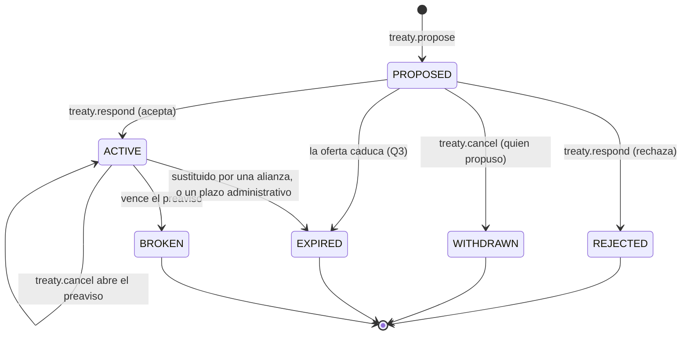

# Diplomacia: tratados en caliente

Que los jugadores firmen y rompan tratados mientras juegan: un pacto de no agresión o una alianza
se proponen, se aceptan o se rechazan desde el cliente, y romperlos avisa con tiempo. Hasta hoy los tratados sólo
existen si alguien los inserta en la base y el servidor los lee al arrancar.

| Campo | Valor |
|---|---|
| Spec ID | `SPEC-DIPLOMACY` |
| Estado | Accepted (2026-11-03; las preguntas de §10 se decidieron ese día con la recomendación de cada una). |
| Milestone | E6 Diplomacia (sexto slice después de M7) |
| Canon | §11, §12 (persistencia), §13, §16 (errores) |
| Depende de | [garrison.md](garrison.md), [combat-raid.md](combat-raid.md), [combat-pillage.md](combat-pillage.md), [presence.md](presence.md), [player.md](player.md) |
| Decisiones | [ADR-016](../decisions/ADR-016-foreign-territory-actions.md) (clasificación de acciones), [ADR-017](../decisions/ADR-017-garrison-commands.md) (guarnición), [ADR-022](../decisions/ADR-022-durable-write-retry-and-loop-inbox.md), [ADR-023](../decisions/ADR-023-economy-stock-deltas-and-two-phase-orders.md) (órdenes en dos fases). [ADR-027](../decisions/ADR-027-hot-treaties.md) (la RAM decide las órdenes, en dos fases; vencimientos optimistas; migración `000009`). |
| Reemplaza a | — (precisa [garrison.md](garrison.md) §6.4, ver Q6) |
| Invariantes | Cita los existentes de §8, asigna `INV-DIPLO-001` e `INV-DIPLO-002` y da enunciado vigente a `INV-GARR-008` ([../invariants/diplomacy.md](../invariants/diplomacy.md)) |

## 1. Objetivo

Que el riesgo de E2 a E5 tenga contrapeso. Desde el saqueo, un pacto de no agresión protege el almacén y una alianza
deja guarnecer en la ciudad del aliado, pero ningún jugador puede firmarlos. Este slice cierra `Q-04` y `DEBT-14` del
backlog: proponer, aceptar, rechazar, retirar y romper, con un preaviso que impide la traición por sorpresa.

## 2. Scope

**Entra.** Los comandos `treaty.propose`, `treaty.respond` y `treaty.cancel`; los tipos `NON_AGGRESSION` y
`ALLIANCE`; la caducidad de las ofertas; la ruptura con preaviso; la expulsión de las guarniciones al terminar una
alianza (lo que [garrison.md](garrison.md) §6.4 dejó pendiente); el aviso a la simulación en caliente; la lista de
tratados propios al conectar y `treaty.update`; un panel mínimo en el cliente.

**No entra** (`Fuera de MVP` de este slice): tratados `TRADE` (no hay comercio), plazos elegidos al firmar, chat o
texto libre (backlog `Q-16`), clanes, tratados entre más de dos jugadores, que terceros vean las alianzas ajenas
(ver Q8), y castigos por romper (reputación, coste).

## 3. Actores

Jugador que propone y jugador que responde, cliente web, Game Server (único autoritativo: estados, plazos y
efectos los decide él, [INV-SEC-001](../invariants/security.md#inv-sec-001)), tick loop (fases 1-2 para los comandos,
fase 5 para los vencimientos), PostgreSQL.

## 4. Modelo

### 4.1 Tipos

| Tipo | Efecto mientras está `ACTIVE` | `allows_garrison` |
|---|---|---|
| `NON_AGGRESSION` | Ninguno de los dos ataca ni saquea al otro (`RN-COMBAT-006`, `RN-COMBAT-020`) | `false` |
| `ALLIANCE` | Lo mismo, y cada uno puede guarnecer en la ciudad del otro ([garrison.md](garrison.md) `RN-GARR-006`) | `true` |

El flag lo fija el tipo (Q1): no es una opción aparte al proponer. Entre dos jugadores hay como mucho **un tratado
vigente y una oferta pendiente**: la oferta sólo puede convivir con un pacto vigente, cuando se propone convertirlo en
alianza, y aceptarla lo sustituye en la misma transacción (el pacto pasa a `EXPIRED`).

### 4.2 Ciclo de vida

`REJECTED` y `WITHDRAWN` son estados nuevos y la oferta que caduca pasa a `EXPIRED`, que hoy sólo admite un tratado
activo: la máquina de estados del dominio (`diplomacy.transicionesPermitidas`) crece y la migración `000009` amplía
el `CHECK`.

### 4.3 Reglas

Dominio: `RN-DIPLO`.

| ID | Regla |
|---|---|
| `RN-DIPLO-001` | `treaty.propose { playerId, type }` exige otro jugador existente, un tipo de §4.1 y que entre los dos no haya ninguna relación vigente o pendiente, salvo un pacto vigente cuando se propone una alianza. |
| `RN-DIPLO-002` | Sólo responde (`treaty.respond { treatyId, accept }`) el jugador que **no** propuso, y sólo a una oferta `PROPOSED`. Aceptar la pasa a `ACTIVE`; rechazar, a `REJECTED`. |
| `RN-DIPLO-003` | `treaty.cancel { treatyId }` sobre una oferta la retira (`WITHDRAWN`), y sólo puede hacerlo quien la propuso. Sobre un tratado `ACTIVE`, cualquiera de los dos lo rompe: empieza el **preaviso**. |
| `RN-DIPLO-004` | **Preaviso.** Durante `EO_TREATY_BREAK_NOTICE_MINUTES` (Q4) el tratado sigue `ACTIVE` con todos sus efectos: la paz se mantiene y las guarniciones siguen dentro. Al vencer, en la fase 5, pasa a `BROKEN`. Romper no se puede deshacer; volver a aliarse es firmar otro. |
| `RN-DIPLO-005` | **Fin de una alianza.** Cuando una alianza deja de estar `ACTIVE` (al vencer su preaviso, o por la caducidad de un tratado administrativo con `expires_at`), las unidades de cada uno guarnecidas en la ciudad del otro salen en ese tick por el procedimiento normal de salida ([garrison.md](garrison.md) §6.3), con el reintento de `RN-GARR-014` si la ciudad está rodeada (Q6). |
| `RN-DIPLO-006` | **La simulación se entera en el acto.** Un tratado que nace, termina o empieza su preaviso actualiza la paz de la RAM en el tick en que su transacción vuelve por el buzón; los enfrentamientos y saqueos entre los dos terminan por `RN-COMBAT-008` y `RN-COMBAT-025`. |
| `RN-DIPLO-007` | **Caducidad de la oferta.** Una oferta sin respuesta pasa a `EXPIRED` a las `EO_TREATY_OFFER_HOURS` (Q3). |
| `RN-DIPLO-008` | **Insistir tiene un límite.** Tras un rechazo, quien propuso no puede volver a proponer al mismo jugador durante `EO_TREATY_RETRY_MINUTES` (Q5). |
| `RN-DIPLO-009` | La protección y la presencia no cuentan: se puede proponer a un jugador desconectado o protegido, que verá la oferta al conectar (Q7). |
| `RN-DIPLO-010` | Los tres comandos **no son hostiles** (ADR-016): ninguno se rechaza por `CITY_PROTECTED`. |

## 5. Errores

Sólo códigos existentes del catálogo (canon §16), como hizo E2 con los tratados.

| Código | Condición |
|---|---|
| `INVALID_TARGET` | Jugador inexistente o propio; tipo no proponible (`TRADE`); relación ya vigente o pendiente; tratado inexistente, ajeno o en un estado que no admite la orden; responder a la oferta propia; retirar la ajena; proponer otra vez dentro de `RN-DIPLO-008`. El mensaje dice cuál. |

## 6. Eventos y contratos de red

Cliente → servidor, tres comandos nuevos y estrictos, aditivos en v1 como los de E1, E2 y E5:
`treaty.propose { playerId, type }`, `treaty.respond { treatyId, accept }` y `treaty.cancel { treatyId }`.

Servidor → cliente: `treaty.update { treaty }`, tipo nuevo (R-VER-3), a las sesiones de **los dos** jugadores en cada
cambio; y `treaties[]`, campo opcional de `world.snapshot` (R-VER-2), con los tratados `PROPOSED` y `ACTIVE` del
jugador: el snapshot lo construye la simulación, que es quien los tiene, y como el resto de lo que trae reemplaza
la lista del cliente (ADR-027 §5). La vista: `{ id, otherPlayerId, otherCityId, otherCityName, type, status, proposedByMe, breaksAtMs }`
(`breaksAtMs` sólo durante un preaviso). Nadie más los recibe (Q8).

Eventos de dominio en `world_events`: `TreatyProposed`, `TreatyAccepted`, `TreatyRejected`, `TreatyWithdrawn`,
`TreatyBreakAnnounced`, `TreatyBroken` y el `TreatyExpired` que ya existe.

Cliente: un clic en una ciudad ajena **sin** unidad seleccionada abre un panel con «Proponer pacto» y «Proponer
alianza»; el HUD lista las ofertas recibidas con «Aceptar» y «Rechazar», las enviadas con «Retirar» y los tratados
vigentes con «Romper» y, en preaviso, la cuenta atrás.

## 7. Persistencia

| Pregunta (canon §12) | Respuesta |
|---|---|
| Autoritativo en RAM | Los tratados `PROPOSED` y `ACTIVE` de todo el mundo, con su preaviso, y los rechazos recientes: la RAM decide cada orden en el tick (dos fases, como un encargo de [ADR-023](../decisions/ADR-023-economy-stock-deltas-and-two-phase-orders.md) §2) y aplica los vencimientos de forma optimista (ADR-027 §3) |
| Write-through | Cada transición, en una transacción con su `world_events`; la sustitución de un pacto por una alianza, en la misma |
| Dirty-flag | Nada |
| Reconstruible | Nada: al arrancar se cargan de la base los tratados `PROPOSED` y `ACTIVE`, y los vencimientos que pasaron durante la caída se aplican en el primer tick |

Migración `000009` ([ADR-027](../decisions/ADR-027-hot-treaties.md) §4): `treaties.proposed_by` (hoy no se sabe quién propuso, porque el par se guarda en
orden canónico), `request_id`, `break_effective_at` y `closed_at`; los estados `REJECTED` y `WITHDRAWN` en
`treaties_status_valid`; y dos índices únicos parciales por par, uno para `ACTIVE` y otro para `PROPOSED`.

## 8. Invariantes

Cita [INV-GARR-004](../invariants/diplomacy.md#inv-garr-004) (guarnecer en ciudad ajena exige tratado activo) y
[INV-COMBAT-002](../invariants/combat.md#inv-combat-002) (ningún golpe donde un tratado lo prohíbe, también durante
el preaviso). Asigna [INV-DIPLO-001](../invariants/diplomacy.md#inv-diplo-001) (una oferta sólo la acepta o la
rechaza el jugador que no la propuso) e [INV-DIPLO-002](../invariants/diplomacy.md#inv-diplo-002) (entre dos jugadores,
como mucho un tratado `ACTIVE` y una oferta `PROPOSED`), y da enunciado vigente a
[INV-GARR-008](../invariants/diplomacy.md#inv-garr-008), que estaba reservado: cuando una alianza deja de estar
`ACTIVE`, ninguna unidad de uno queda guarnecida en la ciudad del otro, salvo la que espera un tile de salida
(`RN-GARR-014`). Con la decisión de Q6 no necesita columna de gracia.

## 9. Tests esperados

| Nivel | Qué |
|---|---|
| unit | Máquina de estados ampliada (cada salto legal y los ilegales); validación de cada orden (cada fila de §5); preaviso; caducidad de la oferta; reintento tras un rechazo |
| simulation | Golden «alianza»: propuesta, aceptación, guarnición en la ciudad del aliado, ruptura, preaviso exacto y expulsión al vencer; un pacto que nace a mitad de un saqueo lo termina; sustitución de un pacto por una alianza |
| recovery | Reinicio durante un preaviso y durante una oferta pendiente: los vencimientos llegan en su instante absoluto |
| integration | Cada transición con fallo inyectado; el índice único de la relación; la idempotencia de cada orden |
| contract / e2e | Los tres comandos, `treaty.update` y `treaties[]` contra el JSON Schema; un tratado de punta a punta por WebSocket con dos jugadores |
| cliente | Panel de propuesta, lista de ofertas y tratados, cuenta atrás del preaviso; `scripts/smoke.mjs --diplomacia` |

## 10. Decisiones de producto (2026-11-03)

Preguntas que la propuesta dejó abiertas; producto aceptó la recomendación de cada una. Son decisiones de
producto, no de ingeniería: cambiarlas es cambiar la spec.

| # | Pregunta | Decisión |
|---|---|---|
| Q1 | ¿Qué tipos se pueden proponer, y la guarnición es una opción aparte? | `NON_AGGRESSION` y `ALLIANCE`, con la guarnición fijada por el tipo (la alianza la permite, el pacto no). `TRADE` no hace nada mientras no haya comercio. Un flag suelto sería una casilla más que explicar. |
| Q2 | ¿Los tratados tienen plazo? | No en este slice: duran hasta que alguien los rompe. Elegir un plazo al firmar es interfaz y casos de borde para algo que el preaviso ya cubre. Los tratados con `expires_at` que cree la vía administrativa siguen caducando. |
| Q3 | ¿Cuánto vive una oferta sin respuesta? | 24 horas (`EO_TREATY_OFFER_HOURS`): da tiempo a quien juega una vez al día y limpia las olvidadas. |
| Q4 | Romper, ¿es inmediato? | No: 15 minutos de preaviso (`EO_TREATY_BREAK_NOTICE_MINUTES`) en los que la paz sigue. Sin preaviso, un aliado rompe y saquea en el mismo segundo; con él, el traicionado ve venir el golpe y saca sus unidades. |
| Q5 | ¿Se puede insistir tras un rechazo? | Sí, pero no al mismo jugador antes de 10 minutos (`EO_TREATY_RETRY_MINUTES`). Sin chat, la oferta repetida es el único spam posible. |
| Q6 | Al terminar una alianza, ¿qué pasa con las unidades guarnecidas en la ciudad del otro? | Salen al terminar, por el procedimiento normal de salida. [garrison.md](garrison.md) §6.4 eligió una gracia aparte para que romper no fuera un arma; con el preaviso de Q4 esa gracia ya existe, y no hace falta otra columna ni otro plazo. Hoy se quedan dentro para siempre, que la misma spec descartó. |
| Q7 | ¿Se puede proponer a un jugador desconectado o protegido? | Sí: la oferta le espera y la ve al conectar. Proteger es contra la agresión, no contra la diplomacia (`RN-DIPLO-010`). |
| Q8 | ¿Ven los demás jugadores quién está aliado con quién? | No en este slice: cada tratado lo ven sólo sus dos firmantes. Hacerlo público es una decisión de diseño de juego (alianzas visibles, mapas políticos) que merece su propia spec. |
| Q9 | ¿Hay un límite de tratados por jugador? | No por ahora. Sin datos de jugadores sería un número inventado, y el índice de una relación por par ya impide los duplicados. |

## 11. Documentos relacionados

- [garrison.md](garrison.md) §6 (autorización y ruptura con la unidad dentro), [../invariants/diplomacy.md](../invariants/diplomacy.md).
- [combat-raid.md](combat-raid.md) `RN-COMBAT-006` y [combat-pillage.md](combat-pillage.md) `RN-COMBAT-020` (lo que la paz impide).
- [../roadmap/backlog.md](../roadmap/backlog.md): `Q-04`, `DEBT-14`, `Q-16`.
