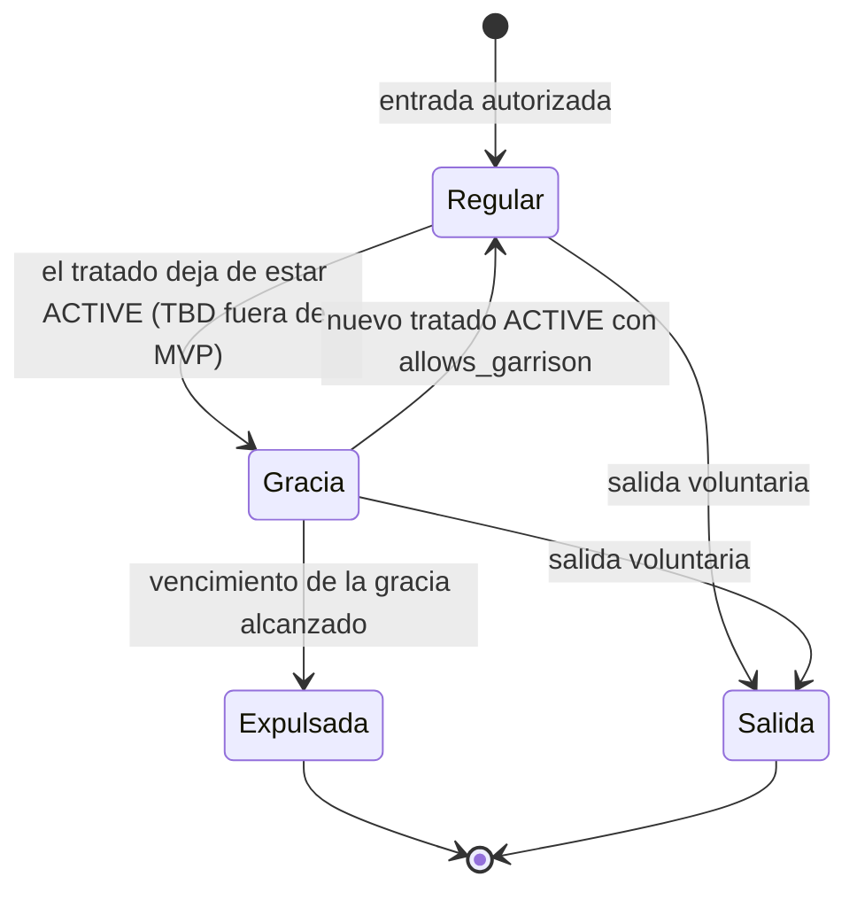

# Garrison

Especificación de la guarnición de unidades en ciudades: quién puede entrar, qué implica el estado
`GARRISONED`, cómo se sale y qué ocurre cuando el tratado que autorizaba la estancia deja de estar
vigente.

| Campo | Valor |
|---|---|
| Spec ID | `SPEC-GARRISON` |
| Estado | Implementado (entrada y salida); expulsión diferida fuera de MVP |
| Milestone | M6 Territory, Safe Zones & Diplomacy |
| Canon | §10, §11, §12, §13, §16 |
| Depende de | [unit.md](unit.md), [city.md](city.md), [movement.md](movement.md) |
| Decisiones | [ADR-017](../decisions/ADR-017-garrison-commands.md) (comandos, `units.city_id`, visibilidad), [ADR-016](../decisions/ADR-016-foreign-territory-actions.md) (territorio ajeno) |
| Reemplaza a | — |

## 1. Objetivo

Guarnecer es meter una unidad **dentro** de una ciudad: la unidad abandona el tablero, deja de ser
visible y deja de ser ordenable hasta que salga. Es la primera pieza de juego que depende de la
diplomacia, porque alojar unidades de otro jugador exige un `Treaty` vigente entre ambos.

**Estado: implementado de extremo a extremo.** El dominio decide (`internal/domain/garrison`), la
simulación aplica (`internal/game/simulation/garrison.go`), la persistencia ejecuta de forma transaccional
(`postgres.GarrisonRepo`) y los jugadores lo alcanzan con dos comandos de red, `unit.garrison` y
`unit.ungarrison` ([ADR-017](../decisions/ADR-017-garrison-commands.md)). Lo que sigue fuera es la
expulsión diferida al romperse un tratado (§6.4).

## 2. Scope

**Dentro de MVP**

- Comandos de red `unit.garrison { unitId, cityId }` y `unit.ungarrison { unitId }` (§12).
- Tablas `garrisons` y `treaties`, creadas por la migración `000001_initial_schema` (canon §11:
  entidades creadas en el MVP con la lógica completa diferida).
- El valor `GARRISONED` del dominio de `units.status` (`CHECK units_status_valid`) y del enum
  `UnitStatus` de `packages/protocol`.
- El valor `GARRISONED` de `entity.despawn.payload.reason`, ya presente en el protocolo v1.
- Los códigos de error `TREATY_REQUIRED` y `UNIT_GARRISONED`, ya presentes en el catálogo de
  `packages/protocol/src/v1/errors.ts`.

**Fuera de MVP**

- Diplomacia completa: proponer, aceptar, rechazar, renegociar o romper tratados desde el cliente;
  caducidad automática; notificaciones de diplomacia.
- **Expulsión diferida por ruptura de tratado: `TBD (fuera de MVP)`.** La decisión está tomada (§6.4)
  pero `garrisons` **no tiene** columna de vencimiento en la migración `000001`: implementarla exige
  una migración aditiva. Ver §10.
- Visibilidad de la composición de la guarnición para el jugador anfitrión: `city.update` no
  transporta hoy ningún campo de guarnición (§12). **TBD (fuera de MVP)**.
- Capacidad máxima de guarnición por ciudad: **TBD (fuera de MVP)**. El canon no define ningún límite
  ni variable `EO_` para ello y aquí no se inventa uno.
- Efectos defensivos de la guarnición (bonos de defensa, disparo desde murallas): dependen del
  combate, que está fuera de scope.
- Guarnición en edificios que no sean ciudades.

## 3. Actores

| Actor | Rol |
|---|---|
| Player propietario de la unidad | Ordena entrar y salir. Conserva el ownership en todo momento. |
| Player anfitrión (dueño de la ciudad) | Autoriza implícitamente vía tratado. |
| Game Server | Valida, muta el estado y decide expulsiones. Autoridad única. |
| Terceros | No ven nada de la guarnición. |

## 4. Inputs

| Input | Origen | Tipo | Nota |
|---|---|---|---|
| `unitId` | `unit.garrison` / `unit.ungarrison` | `int64` (`units.id`) | Unidad a guarnecer o a sacar. |
| `cityId` | `unit.garrison` | `int64` (`cities.id`) | Ciudad anfitriona. |
| `requesterID` | Sesión autenticada | `uuid` (`players.id`) | Debe coincidir con `units.player_id`. |
| `tickTime` | `Clock` inyectado del game loop | `int64` epoch ms | Instante de simulación. Nunca `time.Now()` en el dominio. |
| Estado de `treaties` | PostgreSQL | filas | Consultado en el momento de la entrada, no cacheado por unidad. |
| Capa de ocupación del mundo | RAM (`world.SetBlocked`) | overlay | Sólo murallas: las unidades no la ocupan (§7.1). Decide el tile de reentrada. |

## 5. Outputs

| Output | Destino | Cuándo |
|---|---|---|
| Fila `garrisons (unit_id, city_id, entered_at)` | PostgreSQL | Entrada. Se borra al salir. |
| `units.status` (entrada); `units.status`, `units.x`, `units.y`, `units.chunk_x`, `units.chunk_y` (salida) | PostgreSQL | En la misma transacción que la fila. `units.city_id` **no** se escribe (§7.1). |
| `entity.update` con el `requestId` del comando | Propietario | Entrada y salida. |
| `entity.despawn { reason: "GARRISONED" }` | Terceros del chunk | Entrada. |
| `entity.spawn` | Terceros del chunk de reentrada | Salida. |
| `system.error { code, requestId }` | Solicitante | Rechazo. |
| Filas `UnitGarrisoned` / `UnitUngarrisoned` de `world_events` | PostgreSQL | Entrada y salida, en la misma transacción. |
| Log `warn` "sin tile de reentrada" | Logs | Salida imposible por ciudad rodeada (§6.3). |

## 6. Reglas de negocio

### 6.1 Condiciones de entrada

```
puede_entrar(u, c, requester) :=
      u.player_id == requester                       -- ownership, si no UNIT_NOT_OWNED
  AND u.status == IDLE                               -- si no UNIT_NOT_MOVABLE / UNIT_GARRISONED / UNIT_DEAD
  AND existe la ciudad c                             -- si no CITY_NOT_FOUND
  AND es_adyacente(u, c)                             -- si no INVALID_TARGET
  AND ( c.owner_player_id == u.player_id             -- ciudad propia: siempre
        OR hay_tratado_activo_con_garrison(u.player_id, c.owner_player_id) )  -- si no TREATY_REQUIRED
```

| ID | Regla |
|---|---|
| `RN-GARR-001` | Ownership: solo el dueño de la unidad (`units.player_id`) puede guarnecerla o sacarla. El anfitrión nunca adquiere control. |
| `RN-GARR-002` | Solo se entra desde `IDLE`. No existe "entrar en marcha": desde `MOVING` se rechaza con `UNIT_NOT_MOVABLE`. |
| `RN-GARR-003` | La unidad debe ser adyacente a la zona urbana de la ciudad en las 8 direcciones, con la misma noción de vecindad que el movimiento (canon §4). Si no, `INVALID_TARGET`. |
| `RN-GARR-004` | Ciudad propia (`cities.owner_player_id == units.player_id`): la entrada es siempre autorizada. No requiere tratado, ni presencia, ni condición adicional. |
| `RN-GARR-005` | Ciudad ajena: se exige una fila de `treaties` entre ambos jugadores con `status = 'ACTIVE'` y `allows_garrison = true`. Si no, `TREATY_REQUIRED`. |
| `RN-GARR-006` | Lo que autoriza es el **par (`status`, `allows_garrison`)**, no el `treaty_type`. Los tres tipos (`NON_AGGRESSION`, `ALLIANCE`, `TRADE`) autorizan por igual si llevan el flag. `PROPOSED`, `EXPIRED` y `BROKEN` no autorizan nada. |
| `RN-GARR-007` | El par de jugadores de `treaties` es **canónico y ordenado**: el `CHECK treaties_canonical_pair` impone `player_a_id < player_b_id`. Toda consulta debe ordenar el par antes de buscar (`LEAST`/`GREATEST`), nunca hacer un `OR` de las dos direcciones. |
| `RN-GARR-008` | El tratado es **simétrico** en MVP: una única fila cubre ambas direcciones. Guarnición unilateral (A puede alojar en B pero no al revés) es **TBD (fuera de MVP)**. |
| `RN-GARR-009` | La protección offline de la ciudad anfitriona (`presence_state = 'PROTECTED'`) **no** bloquea la entrada de unidades del propio dueño ni de aliados con tratado: la protección es contra agresión, no contra logística. No se emite `CITY_PROTECTED` por guarnecer. |
| `RN-GARR-020` | La entrada se decide en dos fases ([ADR-017](../decisions/ADR-017-garrison-commands.md) §2.2). El tick comprueba todo lo que está en RAM —unidad, propiedad, estado, ciudad y adyacencia— y responde en el mismo tick cualquier rechazo de esa parte. Si pasa, la unidad queda **entrando** y la transacción de la cola de persistencia comprueba el tratado contra el estado actual de `treaties` y escribe la entrada; su resultado vuelve al loop, que aplica la entrada o responde el rechazo. Mientras está entrando, la unidad sigue `IDLE` pero rechaza `unit.move`, `unit.garrison` y `unit.ungarrison` con `UNIT_NOT_MOVABLE`. |
| `RN-GARR-021` | Guarnecer y salir **no cambian `units.city_id`**: es la ciudad de origen, y la unidad sigue contando en su población (`RN-CITY-012`). La ciudad anfitriona es `garrisons.city_id`. |

Consulta canónica del tratado autorizante, con el par ya ordenado:

```sql
SELECT 1
  FROM treaties
 WHERE player_a_id = LEAST($1::uuid, $2::uuid)
   AND player_b_id = GREATEST($1::uuid, $2::uuid)
   AND status = 'ACTIVE'
   AND allows_garrison
 LIMIT 1;
```

### 6.2 Flujo Player A → Treaty → Player B → unidad guarnecida

```mermaid
sequenceDiagram
    participant A as Player A (dueño de la unidad)
    participant S as Game Server
    participant T as treaties
    participant B as Player B (dueño de la ciudad)

    A->>S: Propone tratado con B (fuera de MVP en el protocolo v1)
    S->>T: INSERT treaty {status: PROPOSED, allows_garrison: true}
    B->>S: Acepta (fuera de MVP en el protocolo v1)
    S->>T: UPDATE treaty SET status = 'ACTIVE'
    Note over T: Solo ACTIVE + allows_garrison habilitan la guarnición

    A->>S: Entrar unidad U en la ciudad C de B
    S->>S: tick: ownership(U, A) · U.status == IDLE · adyacencia(U, C)
    Note over S: U queda «entrando»; la cola ejecuta la transacción
    S->>T: SELECT tratado ACTIVE entre A y B con allows_garrison (en la transacción)
    alt No hay tratado válido
        S-->>A: system.error { code: "TREATY_REQUIRED" }
    else Tratado válido
        S->>S: U.status = GARRISONED · INSERT garrisons {unit_id, city_id, entered_at}
        Note over S: el resultado vuelve al loop
        S-->>A: entity.update (status GARRISONED, garrisonCityId C)
        Note over S: Terceros reciben entity.despawn { reason: "GARRISONED" }
    end
```

Diagrama estructural de la autorización:

```
   Player A                     Treaty                      Player B
  ┌────────┐          ┌────────────────────────┐          ┌────────┐
  │ unit U │          │ status = ACTIVE        │          │ city C │
  │ owner=A│──────────│ allows_garrison = true │──────────│ owner=B│
  └────────┘          │ {A, B} canónico A < B  │          └────────┘
       │              └────────────────────────┘               │
       │                          │                            │
       └──────── U entra ─────────┴──────── U alojada en C ─────┘
                                  │
                 A conserva el ownership de U en todo momento.
                 B NUNCA puede ordenar a U (UNIT_NOT_OWNED).
```

### 6.3 Salida de la guarnición

| ID | Regla |
|---|---|
| `RN-GARR-010` | La salida siempre la ejecuta el servidor y produce `GARRISONED → IDLE`. |
| `RN-GARR-011` | Tile de reentrada: el primer tile transitable y desocupado del anillo exterior de la zona urbana, recorrido en orden estable ascendente por `(y, x)`. El mismo criterio de desempate determinista que usa el pathfinder (canon §8), para que la salida sea reproducible en tests. |
| `RN-GARR-012` | Se escriben `units.x`, `units.y`, `units.chunk_x`, `units.chunk_y` con ese tile y `status = 'IDLE'`. La salida la decide y la aplica el tick; si su escritura falla de forma definitiva, la unidad vuelve a la ciudad en la RAM ([ADR-017](../decisions/ADR-017-garrison-commands.md) §2.3). |
| `RN-GARR-013` | La fila de `garrisons` se **borra** (`DELETE ... WHERE unit_id = `). La tabla del MVP no tiene columna de cierre: `garrisons.unit_id` es la PRIMARY KEY y solo modela guarniciones **abiertas**. El historial está en `world_events`: `UnitGarrisoned` al entrar y `UnitUngarrisoned` al salir. |
| `RN-GARR-014` | Si **no hay ningún tile de reentrada disponible** (ciudad completamente rodeada), la salida no falla con error: queda **pendiente**, se reintenta en la fase 5 de cada tick y se registra un log de nivel `warn`. La unidad permanece `GARRISONED` y la respuesta al comando llega cuando sale. Se prefiere el reintento silencioso a inventar un código de error nuevo o a colocar la unidad en un tile arbitrario, que rompería `INV-UNIT-001`. |

### 6.4 Ruptura del tratado con la unidad dentro — decisión

**Problema.** Una unidad de A está guarnecida en una ciudad de B gracias a un tratado. El tratado
pasa a `BROKEN` o `EXPIRED`. La condición que autorizaba la estancia ya no se cumple, pero la unidad
sigue dentro.

Tres políticas posibles:

| Política | Descripción | Por qué se descarta / se elige |
|---|---|---|
| Expulsión inmediata | Al cambiar el status del tratado, todas las unidades afectadas salen en el mismo tick. | **Descartada.** Convierte la ruptura de tratado en un arma: B rompe el tratado y vomita las unidades de A en tiles a su elección, potencialmente rodeadas. Además exige colocar N unidades a la vez, con riesgo de no encontrar tiles y de un pico de trabajo dentro del tick. |
| Permanencia indefinida | La unidad se queda hasta que su dueño decida salir. | **Descartada.** Vacía de sentido el requisito de tratado: bastaría con firmar un tratado un instante para alojar unidades para siempre. |
| **Expulsión diferida con periodo de gracia** | El tratado deja de estar `ACTIVE`, la guarnición se marca como *en gracia*, y al vencer el plazo el servidor la expulsa por el procedimiento normal de salida. | **Elegida.** |

**Decisión adoptada: expulsión diferida con periodo de gracia. Implementación `TBD (fuera de MVP)`.**

Mecánica del diseño objetivo:

| ID | Regla |
|---|---|
| `RN-GARR-015` | Cuando un tratado sale de `ACTIVE`, el servidor localiza las guarniciones abiertas entre esos dos jugadores y las marca *en gracia*. **No** cambia el estado de las unidades. |
| `RN-GARR-016` | Durante la gracia la unidad sigue `GARRISONED` con todos sus efectos: invisible, no ordenable. Su dueño puede sacarla voluntariamente en cualquier momento, y esa es la vía esperada. |
| `RN-GARR-017` | En la fase 5 de cada tick, toda guarnición en gracia con vencimiento `<= tickTime` se resuelve con el procedimiento de salida de §6.3. Si no hay tile libre, se reintenta cada tick: la expulsión es una intención persistente, no un evento de una sola oportunidad. |
| `RN-GARR-018` | La autorización se **recalcula siempre contra el estado actual de `treaties`**, nunca contra el id de un tratado antiguo. Si vuelve a existir un tratado `ACTIVE` con `allows_garrison` entre los dos jugadores, la gracia se cancela. Esto es también lo que permite que `garrisons` no necesite columna `treaty_id`. |
| `RN-GARR-019` | La guarnición en **ciudad propia** nunca entra en gracia: no depende de ningún tratado. |

**Por qué está fuera del MVP.** La tabla `garrisons` de la migración `000001` tiene exactamente tres
columnas (`unit_id`, `city_id`, `entered_at`) y **no hay dónde persistir el vencimiento de la
gracia**. Sin persistirlo, un reinicio olvidaría la expulsión. Habilitar esta mecánica exige una
migración aditiva que añada una columna de vencimiento (por ejemplo `eviction_deadline_ms bigint
NULL`), y hasta entonces la política queda documentada pero no implementada.

**Duración del periodo de gracia: TBD (fuera de MVP).** El canon §17 no define ninguna variable de
configuración para este plazo y esta spec no inventa una. Cuando se fije, debe ser un valor de
configuración con prefijo `EO_` y no una constante en el código (canon §17), y el servicio de dominio
debe aceptarlo como parámetro explícito para poder testearlo con `FakeClock`.

## 7. Estados y transiciones

La guarnición no introduce un estado nuevo: reutiliza `GARRISONED` de `units.status`, cuyo dominio
cerrado es `IDLE | MOVING | GARRISONED | HIDDEN | DEAD` (`CHECK units_status_valid`).

| Origen | Destino | Disparador | Fase del tick |
|---|---|---|---|
| `IDLE` | `GARRISONED` | Entrada autorizada (§6.1) | Fase 2 (comandos) |
| `GARRISONED` | `IDLE` | Salida voluntaria del propietario | Fase 2 (comandos) |
| `GARRISONED` | `IDLE` | Expulsión al vencer la gracia (`TBD (fuera de MVP)`) | Fase 5 (timers) |
| `GARRISONED` | `GARRISONED` | Salida solicitada sin tile de reentrada libre: se reintenta | Fase 5 (timers) |

Transiciones prohibidas: `MOVING → GARRISONED`, `HIDDEN → GARRISONED`, `GARRISONED → MOVING`,
`GARRISONED → HIDDEN`. Ver la máquina completa en [unit.md](unit.md).

Ciclo de vida de la propia guarnición (fila de `garrisons`), incluida la parte diferida:



### 7.1 Efectos del estado GARRISONED

| Efecto | Regla |
|---|---|
| **No ocupa tile del mundo** | Sale del mapa: nadie la ve en su tile y no se le pueden dar órdenes de movimiento. En el MVP las unidades no entran nunca en la capa de ocupación —la colisión entre unidades está fuera de alcance ([movement.md](movement.md))—, así que guarnecer no la toca. `units.x`/`units.y` conservan el último tile exterior, que es donde su dueño la encuentra en el snapshot, pero **no** representan una posición en el mapa: `INV-UNIT-003` excluye a las unidades guarnecidas. |
| **Invisible para terceros** | Al entrar se emite `entity.despawn { reason: "GARRISONED" }` a los demás observadores del chunk —el anfitrión incluido—. Mientras esté guarnecida no aparece en el `world.snapshot` de nadie más que su dueño, ni en ningún delta dirigido a terceros. Es el mismo filtro por destinatario que el de una unidad `HIDDEN`. |
| **Visible para su propietario** | Vía `entity.update`, con `status = "GARRISONED"` y `garrisonCityId` de la ciudad anfitriona, y en su `world.snapshot`, donde sigue apareciendo en el chunk de su último tile exterior. La visibilidad para el anfitrión es `TBD (fuera de MVP)`: `city.update` no transporta la composición de la guarnición (§12). |
| **No recibe órdenes de movimiento** | `unit.move` y `unit.cancel_move` se rechazan con `UNIT_GARRISONED`. No hay excepción: no existe "mover hacia la salida". La unidad debe salir primero. |
| **No se oculta ni se revela** | La fase 5 del tick ignora las unidades `GARRISONED`; el interior de una ciudad no es Safe Zone (ver [safe-zones.md](safe-zones.md)). |
| **Cuenta para la población de su ciudad de origen** | `units.city_id` no cambia (`RN-GARR-021`): sigue contando contra el `population_limit` de su ciudad, no del anfitrión. Guarnecer no es una vía para esquivar el cap, ni para consumir el de un aliado. Como nada de la ciudad cambia, guarnecer no emite `city.update`. |
| **Sobrevive al offline** | El mundo persiste (canon §1.2). Desconectarse no expulsa unidades ni las devuelve al mapa. |
| **Conserva el ownership** | El anfitrión no adquiere ningún control. Cualquier comando de B sobre U devuelve `UNIT_NOT_OWNED`. |

## 8. Errores

Todos los códigos son del catálogo estable de `packages/protocol/src/v1/errors.ts` (canon §16). Esta
spec no introduce ninguno.

| Código | Cuándo |
|---|---|
| `UNIT_NOT_FOUND` | No existe `units.id`. |
| `UNIT_NOT_OWNED` | El solicitante no es `units.player_id`. Incluye el caso del anfitrión intentando mover unidades alojadas. Se comprueba **antes** que el estado. |
| `UNIT_DEAD` | `units.status = 'DEAD'`. |
| `UNIT_GARRISONED` | Cualquier comando de movimiento sobre una unidad guarnecida, o segunda entrada de una unidad ya dentro. |
| `UNIT_NOT_MOVABLE` | La unidad no está `IDLE` (típicamente `MOVING` o `HIDDEN`) al intentar entrar; o está **entrando** (`RN-GARR-020`) y recibe cualquier orden; o se pide sacar una unidad que no está guarnecida. |
| `CITY_NOT_FOUND` | La ciudad destino no existe. |
| `INVALID_TARGET` | La unidad no es adyacente a la zona urbana de la ciudad. |
| `TREATY_REQUIRED` | Entrada en ciudad ajena sin `Treaty` `ACTIVE` con `allows_garrison = true` entre ambos jugadores. |
| `INTERNAL_ERROR` | Fallo definitivo de la transacción de entrada, o cola de comandos llena (canon §13). |

Códigos que deliberadamente **no** se emiten:

- `CITY_PROTECTED`: la protección offline no bloquea la entrada de unidades autorizadas
  (`RN-GARR-009`).
- `POPULATION_LIMIT_REACHED`: guarnecer no crea unidades. Se documenta para descartar la confusión.

## 9. Invariantes

Familia `INV-GARR-xxx`. El registro es [../invariants/diplomacy.md](../invariants/diplomacy.md); esta tabla
sólo cita los IDs.

| ID | Invariante | Dónde se verifica |
|---|---|---|
| `INV-GARR-001` | Una unidad tiene como máximo una guarnición abierta. | `garrisons.unit_id` es PRIMARY KEY (garantía física de la base de datos) + test de integración |
| `INV-GARR-002` | `units.status = 'GARRISONED'` ⟺ existe una fila de `garrisons` para esa unidad. | Misma transacción en entrada y salida + test de integración |
| `INV-GARR-003` | **DEROGADO** por [ADR-017](../decisions/ADR-017-garrison-commands.md): `units.city_id` es la ciudad de origen y no coincide con la anfitriona. | — |
| `INV-GARR-004` | Guarnición en ciudad ajena (`units.player_id <> cities.owner_player_id`) ⟹ existía un `Treaty` `ACTIVE` con `allows_garrison = true` entre ambos en el instante de la entrada. | Test de simulación en el momento de la entrada |
| `INV-GARR-005` | Ninguna unidad `GARRISONED` figura en la capa de ocupación del mundo. | Test de simulación |
| `INV-GARR-006` | Ninguna unidad `GARRISONED` aparece en un delta dirigido a un jugador distinto de su propietario. | Test de integración de visibilidad |
| `INV-GARR-007` | El ownership (`units.player_id`) de una unidad guarnecida no cambia al entrar ni al salir. | Unit test |
| `INV-GARR-009` | Entrar y salir de la guarnición no cambian `units.city_id`. | Test de integración |

`INV-GARR-008` está **reservado** para la coherencia entre gracia y tratado vigente, que no se puede
verificar hasta que la gracia tenga columna donde vivir (§6.4).

## 10. Persistencia

Respuesta a las cuatro preguntas del canon §12.

| Dato | Autoritativo en | Estrategia |
|---|---|---|
| Entrada y salida de guarnición (`garrisons` + `units.status` + `units.x/y/chunk_x/chunk_y` + `world_events`) | PostgreSQL | **Write-through transaccional**: la fila de `garrisons`, la mutación de `units` y el evento van en la **misma transacción**; un estado a medias violaría `INV-GARR-002`. La transacción se **encola** en la cola de persistencia con la clave de la unidad y la ejecuta un worker fuera del tick: el tick nunca hace I/O contra PostgreSQL. Las dos son idempotentes por construcción: repetir una entrada ya escrita, o una salida ya escrita, no escribe un segundo evento. |
| Estado de los tratados (`treaties`) | PostgreSQL | Write-through transaccional por el mismo camino. |
| Índice en RAM unidad → ciudad anfitriona | RAM | **Reconstruible** al arrancar leyendo `garrisons`, la misma lectura que usa la validación de carga. No se persiste. |
| Unidades **entrando** (`RN-GARR-020`) | RAM | **Volátil**: una caída entre la orden y el resultado la pierde, y el arranque carga lo que la transacción haya dejado. |
| Tile de reentrada | — | **No se persiste**: se calcula al salir, contra el estado real de ocupación. |
| Vencimiento de la gracia | — | **No existe columna en el MVP** (§6.4). Mientras no exista, un reinicio no puede recordar una expulsión pendiente, y por eso la mecánica está `TBD (fuera de MVP)` en lugar de implementada a medias. |

Nada de este subsistema usa dirty-flag + flush: una guarnición a medio escribir es un estado
inconsistente observable, no una magnitud que tolere perder unos segundos.

DDL real de la migración `000001_initial_schema` (el DDL canónico completo vive en
[../database/schema.md](../database/schema.md)):

```sql
CREATE TABLE garrisons (
    unit_id    bigint      PRIMARY KEY REFERENCES units (id) ON DELETE CASCADE,
    city_id    bigint      NOT NULL REFERENCES cities (id) ON DELETE CASCADE,
    entered_at timestamptz NOT NULL DEFAULT now()
);

CREATE INDEX garrisons_city_idx ON garrisons (city_id);
```

Consecuencias que esta spec asume y que no debe contradecir:

- `unit_id` es la PRIMARY KEY: modela **guarniciones abiertas**, una como máximo por unidad
  (`INV-GARR-001`), y no hay fila para guarniciones cerradas.
- El instante de entrada es `entered_at timestamptz`, no un `*_time_ms`. La aritmética del juego no
  depende de él en MVP; cuando dependa, la migración aditiva deberá añadir su `entered_time_ms`.
- No hay `treaty_id`, ni `owner_player_id`, ni `host_player_id`: el propietario se obtiene por join
  con `units.player_id` y el anfitrión con `cities.owner_player_id`. La autorización se recalcula
  contra `treaties` (`RN-GARR-018`), no se congela en la fila.
- El borrado de una unidad o de una ciudad arrastra la guarnición (`ON DELETE CASCADE`).

`treaties`, campos relevantes aquí:

| Campo | Valores / forma |
|---|---|
| `player_a_id`, `player_b_id` | `uuid REFERENCES players (id)`, con `CHECK treaties_canonical_pair (player_a_id < player_b_id)` y `CHECK treaties_distinct_players (player_a_id <> player_b_id)` |
| `treaty_type` | `NON_AGGRESSION` \| `ALLIANCE` \| `TRADE` (`CHECK treaties_type_valid`) |
| `status` | `PROPOSED` \| `ACTIVE` \| `EXPIRED` \| `BROKEN` (`CHECK treaties_status_valid`) |
| `allows_garrison` | `boolean NOT NULL DEFAULT false` |
| `proposed_at`, `accepted_at`, `expires_at`, `broken_at` | `timestamptz`; solo `proposed_at` es `NOT NULL` |

Índice `treaties_one_active_per_pair_and_type` (único parcial sobre
`(player_a_id, player_b_id, treaty_type) WHERE status = 'ACTIVE'`): como máximo un tratado vigente de
cada tipo entre dos jugadores. Solo `ACTIVE` habilita la guarnición; el resto del ciclo de vida del
tratado pertenece a la diplomacia, diferida.

## 11. Eventos

Eventos de dominio (canon §15, hechos en pasado): `UnitGarrisoned` (`{unitId, cityId, cancelledMovement}`)
y `UnitUngarrisoned` (`{unitId, x, y}`), escritos en `world_events` en la misma transacción que el cambio,
con el tick del loop y el `player_id` del dueño. Son el historial que `garrisons` no conserva
(`RN-GARR-013`). `GarrisonEvictionScheduled` y `UnitEvicted` pertenecen a la mecánica de gracia y son
**TBD (fuera de MVP)**.

## 12. Contratos de red

Los payloads los fija Zod en `packages/protocol/src/v1/` y son la autoridad.

Mensajes cliente→servidor ([ADR-017](../decisions/ADR-017-garrison-commands.md) §2.1):

| Mensaje | Payload | Efecto |
|---|---|---|
| `unit.garrison` | `{ unitId, cityId }` | Entrar en la ciudad (§6.1, `RN-GARR-020`). |
| `unit.ungarrison` | `{ unitId }` | Salir de la ciudad en la que esté (§6.3). |

Entran por el mismo camino de validación e idempotencia que `unit.move`: payload estricto y `requestId`
reservado en Redis antes de encolar. Sus efectos durables son idempotentes por construcción (§10), así que
no guardan el `requestId` en `garrisons` ([ADR-014](../decisions/ADR-014-command-idempotency.md)).

Mensajes servidor→cliente:

| Situación | Propietario (con el `requestId` del comando) | Terceros del chunk |
|---|---|---|
| Entrada | `entity.update { id, status: "GARRISONED", garrisonCityId }` | `entity.despawn { id, reason: "GARRISONED" }` |
| Salida | `entity.update { id, status: "IDLE", x, y, garrisonCityId: null }` | `entity.spawn { unit }` |
| Comando rechazado | `system.error { code: "TREATY_REQUIRED" \| "UNIT_GARRISONED" \| …, requestId }` | — |

Precisiones que el protocolo v1 impone y esta spec acata:

- `entity.despawn.payload.reason` tiene el valor `GARRISONED` en el enum
  (`OUT_OF_INTEREST | DEAD | GARRISONED | HIDDEN | REMOVED`). No se usa `OUT_OF_INTEREST`, que sería
  semánticamente falso, ni `DEAD`, que haría al cliente reproducir efectos de destrucción.
- `entity.spawn.payload` es `{ unit }` y **no lleva campo `reason`**: la reaparición al salir de la
  guarnición es indistinguible, para el cliente, de una entrada en el área de interés. Añadir un
  motivo de spawn sería un cambio de protocolo, `TBD (fuera de MVP)`.
- `city.update.payload` es `{ id, name?, population?, populationLimit?, presenceState?,
  protectionUntilMs? }`: **no transporta la guarnición**. Que el anfitrión vea qué unidades aloja
  exige un campo o un mensaje nuevo, `TBD (fuera de MVP)`.
- `garrisonCityId` está en `UnitView` (siempre, `null` fuera de una guarnición) y en `entity.update`
  (cuando cambia). **No** se usa `cityId`, que es la ciudad de origen de la unidad en todos los mensajes
  (`RN-GARR-021`).
- Los ids durables (`unitId`, `cityId`, `garrisonCityId`) viajan como **número** JSON: `EntityId` es
  `z.number().int().min(1).max(Number.MAX_SAFE_INTEGER)`.

Detalle del transporte en [websocket-protocol.md](websocket-protocol.md).

## 13. Tests

Todos existen y pasan. Los de integración corren contra PostgreSQL y Redis reales (`EO_INTEGRATION=1`), en
la CI y en la máquina de desarrollo contra el cluster propio del puerto 5433
([../operations/local-development.md](../operations/local-development.md) §3-bis).

**Unit — reglas (`internal/domain/garrison`, `internal/domain/diplomacy`)**

- Ciudad propia sin tratado (`RN-GARR-004`): `TestEnCiudadPropiaSeEntraSinTratado`.
- Ciudad ajena: sin tratado, con tratado y flag, sin flag, propuesto, con otro jugador (`RN-GARR-005`,
  `RN-GARR-006`): `TestEnCiudadAjenaSinTratadoSeRechaza`, `TestEnCiudadAjenaConTratadoActivoYFlagSeEntra`,
  `TestUnTratadoActivoSinElFlagNoAutoriza`, `TestUnTratadoPropuestoConElFlagNoAutoriza`,
  `TestUnTratadoConOtroJugadorNoAutoriza`; la tabla completa de estados × flag y los tres tipos,
  `TestSoloUnTratadoActivoConElFlagAutorizaGuarnicion` y `TestLosTresTiposAutorizanPorIgualSiLlevanElFlag`.
- El par se ordena antes de buscar (`RN-GARR-007`): `TestFindAuthorizingEncuentraElTratadoEnCualquierOrdenDelPar`.
- La protección offline no bloquea (`RN-GARR-009`): `TestLaProteccionOfflineDelAnfitrionNoBloqueaLaEntrada`.
- Propiedad y orden de las comprobaciones (`RN-GARR-001`): `TestSoloElDuenoPuedeGuarnecerSuUnidad`,
  `TestElOrdenDeComprobacionNoFiltraInformacionSobreTratados`, `TestSoloElDuenoSacaSuUnidad`.
- Sólo desde `IDLE` (`RN-GARR-002`): `TestSoloSeEntraDesdeIdle`, `TestUnaUnidadSinVidaMarcadaIdleTampocoEntra`.
- Adyacencia en ocho direcciones (`RN-GARR-003`): `TestLaAdyacenciaCubreLasOchoDirecciones`,
  `TestUnaUnidadDemasiadoLejosNoEsAdyacente`, `TestUnTileDentroDeLaZonaUrbanaNoCuentaComoAdyacente`.
- Tile de reentrada (`RN-GARR-011`, `RN-GARR-014`): `TestElTileDeReentradaEsElMenorEnOrdenYX`,
  `TestElTileDeReentradaSaltaLosOcupados`, `TestElTileDeReentradaEsDeterminista`,
  `TestUnaCiudadCompletamenteRodeadaDejaLaSalidaPendiente`, `TestElAnilloNoSeSaleDelMundo`.

**Simulation (`internal/game/simulation`)**

- Entrada en dos fases en la ciudad propia, sin cambiar la ciudad de origen ni la población y sin
  `city.update` (`RN-GARR-020`, `RN-GARR-021`): `TestGuarnecerEnLaCiudadPropiaEnDosFases`.
- Los rechazos del tick, con su código y su `requestId`, sin llegar a la base: `TestRechazosDeGuarnicion`.
- El rechazo por tratado vuelve de la transacción como `TREATY_REQUIRED`:
  `TestLaCiudadAjenaSinTratadoSeRechazaEnLaTransaccion`.
- Una unidad entrando no acepta órdenes y el volcado la aplaza:
  `TestMientrasEntraLaUnidadNoAceptaOrdenesNiSeVuelca`; un fallo definitivo responde `INTERNAL_ERROR`,
  `TestUnFalloDefinitivoDeLaEntradaRespondeInternalError`.
- Salida al anillo en orden y su difusión: `TestSalirDeLaGuarnicionVuelveAlAnilloEnOrden`,
  `TestElPrimerTileDeReentradaIntransitablePasaAlSiguiente`.
- Ciudad rodeada: salida pendiente, reintento y respuesta diferida (`RN-GARR-014`):
  `TestUnaCiudadRodeadaDejaLaSalidaPendienteYLaReintenta`.
- Compensación de una salida que no se pudo escribir: `TestUnaSalidaQueNoSePuedeEscribirDevuelveLaUnidadALaCiudad`.
- Sólo el dueño saca su unidad, y sólo si está guarnecida: `TestSoloSePuedeSacarUnaUnidadGuarnecidaPropia`.
- Visibilidad en el snapshot (`INV-GARR-006`): `TestUnaUnidadGuarnecidaSoloLaVeSuDuenoEnElSnapshot`.
- Las acciones están clasificadas y ninguna es hostil ([ADR-016](../decisions/ADR-016-foreign-territory-actions.md)):
  `TestTodaAccionDelCatalogoEstaClasificada`, `TestNingunaAccionDelMVPEsHostilNiSeRestringePorTerritorio`.

Cada guarda nueva de la simulación se verificó por mutación: quitarla hace fallar su test.

**Integration (`internal/persistence/postgres`)**

- Entrada con tratado y sin él, flag, tratado roto, ciudad propia y unidad en marcha:
  `TestGuarnecerConTratadoActivoDejaLaUnidadGarrisonedYPersistida`, `TestGuarnecerEnCiudadAjenaSinTratadoSeRechaza`,
  `TestUnTratadoSinElFlagNoHabilitaGuarnicion`, `TestUnTratadoRotoDejaDeHabilitarGuarnicionesNuevas`,
  `TestEnCiudadPropiaSeGuarneceSinNingunTratado`, `TestGuarnecerUnaUnidadEnMovimientoCancelaSuMovimiento`.
- Salida (`RN-GARR-012`, `RN-GARR-013`): `TestSalirDeLaGuarnicionDevuelveLaUnidadAlMapaYBorraLaFila`.
- Idempotencia de la entrada y de la salida: `TestUnaEntradaRepetidaEsIdempotenteYNoDuplicaElEvento`,
  `TestUnaSalidaRepetidaEsIdempotenteYNoDuplicaElEvento`.
- Ciudad de origen, dueño y `treatyId` del evento (`INV-GARR-004`, `INV-GARR-007`, `INV-GARR-009`):
  `TestGuarnecerYSalirNoCambianLaCiudadDeOrigenNiElDueno`.
- Clave primaria y `ON DELETE CASCADE` (`INV-GARR-001`): `TestUnaUnidadNoPuedeTenerDosGuarnicionesAbiertas`.
- Reinicio: `TestTratadosYGuarnicionesSobrevivenAUnReinicio`; reconciliación de carga,
  `TestLaCargaReparaYAuditaLoQueElEsquemaNoGarantiza`.

**Contract (`internal/protocol`)**

- Los dos comandos tienen exactamente los campos del esquema: `TestLosComandosDeGuarnicionSonLosDelEsquema`.
- `garrisonCityId` en `UnitView` y en `entity.update`: `TestUnitViewLlevaLaCiudadAnfitrionaSiempre`,
  `TestEntityUpdateDistingueEntradaSalidaYSinCambio`; el motivo `GARRISONED`, `TestEntityDespawnAdmiteElMotivoGarrisoned`.

**E2E de transporte (`internal/websocket`)**

- Dos jugadores conectados: respuesta correlacionada, despawn al tercero, duplicado reproducido, snapshots
  filtrados y spawn al salir: `TestLaGuarnicionPorLaRedSoloLaVeSuDueno`.
- Ciudad ajena sin tratado y unidad ajena por la red: `TestGuarnecerEnUnaCiudadAjenaSinTratadoLlegaComoTreatyRequired`.

**Pendientes con su mecánica**

- Expulsión diferida (`RN-GARR-015..019`): pendiente de la migración aditiva de §6.4.

## 14. Documentos relacionados

- [unit.md](unit.md) — máquina de estados, ownership y transiciones prohibidas.
- [safe-zones.md](safe-zones.md) — la otra vía de invisibilidad y por qué no se componen.
- [city.md](city.md) — zona urbana, adyacencia y protección offline.
- [movement.md](movement.md) — por qué una unidad guarnecida no tiene origen de path.
- [websocket-protocol.md](websocket-protocol.md) — envelopes, límites e idempotencia.
- [../database/schema.md](../database/schema.md) — DDL de `garrisons` y `treaties`.
- [../invariants/diplomacy.md](../invariants/diplomacy.md) — registro de la familia `INV-GARR-*`.
