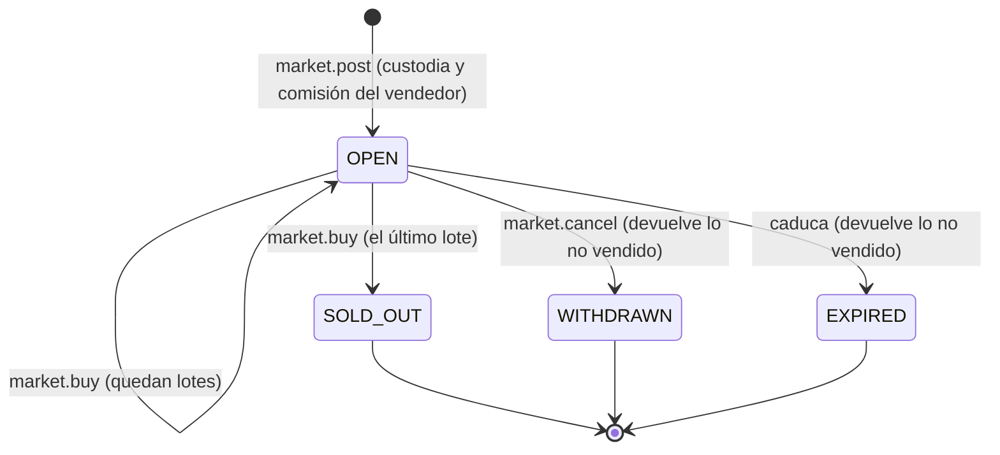

# Mercados: comprar y vender a cualquiera sin un trato entre dos

Propuesta para que una ciudad con mercado pueda **publicar una oferta abierta a todo el mundo** («vendo lotes de 20 de
piedra a 30 de madera cada uno») y **comprar lotes de las ofertas de otros**, sin tratado ni negociación entre las dos
partes. Lo que se vende queda en custodia desde que se publica, el mercado se queda una comisión, y cada compra viaja
en dos caravanas, como un trato.

| Campo | Valor |
|---|---|
| Spec ID | `SPEC-MARKETS` |
| Estado | Accepted (2026-11-18). Propuesta en `Draft` y aceptada ese mismo día con la recomendación de cada pregunta de §10. |
| Milestone | E26 Mercados (vigesimosexto slice después de M7) |
| Canon | §9 (unidades), §11 (catálogos), §12 (persistencia), §13 (protocolo), §16 (errores) |
| Depende de | [trade.md](trade.md), [caravans.md](caravans.md), [civilization-goods.md](civilization-goods.md), [economy-wood.md](economy-wood.md), [economy-stone.md](economy-stone.md), [combat-siege.md](combat-siege.md), [combat-pillage.md](combat-pillage.md), [civilizations.md](civilizations.md), [factions.md](factions.md), [clan-wars.md](clan-wars.md), [event-log.md](event-log.md), [websocket-protocol.md](websocket-protocol.md) |
| Decisiones | [ADR-013](../decisions/ADR-013-persistence-pipeline.md) (cola ordenada por clave), [ADR-023](../decisions/ADR-023-economy-stock-deltas-and-two-phase-orders.md) (deltas de stock y órdenes en dos fases), [ADR-028](../decisions/ADR-028-event-log-from-world-events.md) (el registro sale de `world_events`), [ADR-032](../decisions/ADR-032-trade-offers-and-two-key-jobs.md) (la oferta y el trabajo de dos claves), [ADR-036](../decisions/ADR-036-civilization-goods.md) (el taller como modelo de edificio), [ADR-037](../decisions/ADR-037-caravans-as-units.md) (la caravana que carga en lugar de acreditar). [ADR-047](../decisions/ADR-047-markets.md) (§7): la custodia fuera del almacén, la compra como trabajo de dos claves que no toca la ciudad del vendedor, el cierre optimista, la comisión como único sumidero del comercio y el tablón leído de la base; migración `000028`. |
| Reemplaza a | En [mvp-scope.md](../product/mvp-scope.md), lo que queda de `OUT-08` («Marketplace»): los mercados; las rutas permanentes siguen fuera. Abre la fase Trade de [roadmap.md](../roadmap/roadmap.md) en su parte de mercados. Sustituye las tablas de diseño `markets` y `trade_transactions` de [schema.md](../database/schema.md) §17.2 por otras (§7). Precisa, en [caravans.md](caravans.md), `RN-CARAVAN-001` (también una compra en el mercado crea caravanas) y, en [trade.md](trade.md) §2, el «mercados públicos» de su no-scope. |
| Invariantes | Cita [INV-ECON-001](../invariants/economy.md#inv-econ-001), [INV-ECON-002](../invariants/economy.md#inv-econ-002), [INV-SEC-001](../invariants/security.md#inv-sec-001), [INV-SEC-007](../invariants/security.md#inv-sec-007), [INV-TRADE-005](../invariants/trade.md#inv-trade-005), [INV-TRADE-006](../invariants/trade.md#inv-trade-006), [INV-UNIT-005](../invariants/units.md#inv-unit-005) e [INV-PERSIST-005](../invariants/persistence.md#inv-persist-005); precisa [INV-TRADE-001](../invariants/trade.md#inv-trade-001) e [INV-TRADE-007](../invariants/trade.md#inv-trade-007); asigna [INV-TRADE-008](../invariants/trade.md#inv-trade-008), [INV-TRADE-009](../invariants/trade.md#inv-trade-009) e [INV-TRADE-010](../invariants/trade.md#inv-trade-010) (§8) |

## 1. Objetivo

Hoy sólo se comercia **con alguien**: hace falta un tratado con esa persona, una oferta dirigida a ella y que la
acepte ([trade.md](trade.md)). Es un buen primer paso, pero el comercio que pide el juego no cabe en él. Desde E14 la
Edad de Hierro pide 60 bienes que sólo elaboran otras civilizaciones, la de Castillos 120 y desde E25 cada tecnología de
esas eras 30 o 60 más ([civilization-goods.md](civilization-goods.md), [technologies.md](technologies.md)). Quien no
conoce a un persa, o no se fía de firmar nada con él, no tiene por dónde conseguir especias. Y quien elabora vino de
sobra no tiene dónde ofrecerlo, salvo escribir a cada vecino de uno en uno.

El mercado es el **sitio común**. Publicas lo que vendes y lo que pides a cambio, y cualquiera con un mercado puede
comprarte una parte sin hablar contigo. El pilar 4 de [game-pillars.md](../product/game-pillars.md) (nadie es
autosuficiente) sigue intacto, porque el mercado no fabrica nada: todo lo que se vende lo puso otro jugador. El pilar
5 tampoco se toca, porque cada compra viaja en caravanas que recorren el mapa y se pueden capturar
([caravans.md](caravans.md)). Y el tratado conserva su valor: comerciar con un socio sigue siendo gratis, y en el
mercado se paga comisión.

## 2. Scope

**Entra.** El edificio **mercado** (Q3); la **oferta pública** en lotes, «doy tanto de un recurso por lote, pido
tanto de otro» (Q1, Q2, Q5); la **custodia** de lo ofrecido desde que se publica (Q4); comprar uno o varios lotes de
la oferta de otro; la **comisión** (Q6); retirar una oferta propia y la caducidad, que devuelven lo no vendido; la
entrega de cada compra en **dos caravanas**, como un trato (Q7); los comandos `market.post`, `market.buy`,
`market.cancel` y la consulta `market.list`; `market.update`, `market.listing` y `marketOffers[]` en el snapshot; las
ventas y las caducidades en el registro (Q11); la migración `000028`; en el cliente, el botón «Mercado» al construir y
el panel «Mercado» con el tablón, el formulario de venta y las ofertas propias; `scripts/smoke.mjs --mercado`.

**No entra** (`Fuera de MVP` de este slice): un mercado del sistema que compre o venda por su cuenta, con precios
fijos o que se muevan (Q1); una moneda o un recurso nuevo (Q2); el cruce automático de órdenes de compra y de venta
(Q1); órdenes de compra («compro seda a tanto»), que serían la otra mitad de un libro de órdenes; ofertas con más de
un recurso por lado (Q2); precios de referencia, historial o gráficas (Q12); rutas comerciales permanentes y envíos
sin contrapartida ([caravans.md](caravans.md) Q12); ofertas dirigidas a un jugador concreto (eso es un trato de
[trade.md](trade.md)); que el tablón se actualice solo mientras está abierto; avisos en vivo de las ventas (Q11);
mercados de clan o de región; cambios en el trato directo de E10, que sigue igual.

## 3. Actores

Jugador que vende (publica, retira, recibe lo que paga el comprador), jugador que compra (lee el tablón y compra
lotes), cliente web, Game Server (único que decide si alcanza, cuánto se cobra, la ruta y la entrega,
[INV-SEC-001](../invariants/security.md#inv-sec-001)), tick loop (fases 1-2 para las órdenes, 3 a 5 para las
caravanas, 5 para las caducidades), la conexión de cada jugador (lee el tablón de la base, §7), cola de persistencia,
PostgreSQL.

## 4. Modelo

### 4.1 El mercado

Un edificio de la zona urbana, como el taller ([civilization-goods.md](civilization-goods.md) §4.2), con estos
valores (Q3, Q13):

- Se construye con `city.build { type: "MARKET" }` en un tile libre de la zona urbana.
- Pide la **Edad de Bronce**, la misma que el taller: es cuando aparecen los bienes.
- **Uno por ciudad** en pie (en obra o completo); si se derriba, se puede volver a construir.
- Cuesta **150 de madera y 100 de piedra** y tarda **60 s**, con el rasgo `production.speed` de la civilización y de
  las tecnologías ([technologies.md](technologies.md) §4.4).
- No da población. Tiene **200 de vida**, como el taller, y se derriba con un asedio como cualquier edificio
  ([combat-siege.md](combat-siege.md)).

Publicar y comprar piden un mercado **completo**. Retirar una oferta propia, no: es recuperar lo que es tuyo.
Derribar el mercado no toca las ofertas que ya estaban publicadas: siguen en el tablón, se pueden comprar y llegan a
su caducidad o se retiran como siempre. Lo que está en custodia no está en el edificio (§4.4).

### 4.2 La oferta

Una oferta la publica una ciudad con `market.post { give, want, lots }`:

- `give` es **un** recurso y la cantidad que da cada lote; `want`, **otro** recurso y la cantidad que pide cada lote
  (Q2). Cualquiera de los seis recursos de `economy.Resources()` en cualquiera de los dos lados, también el bien propio
  y los ajenos.
- `lots` es cuántos lotes ofrece, de 1 a 100 (Q5, Q10). El total de un lado (`lots × cantidad por lote`) no pasa de
  1 000 000, la cota técnica de los tratos de E10.
- Como mucho **3 ofertas abiertas por jugador** (Q10). Cada una vive `EO_MARKET_OFFER_HOURS` (24 h por defecto) y
  luego caduca.
- No hay tope de proporción: el precio lo pone quien vende (como la Q3 de E10).

Un ejemplo, que usa el resto de la spec: smoke_runner publica **3 lotes de 20 de piedra por 30 de madera**.

### 4.3 La comisión

El mercado se queda **la décima parte de lo que da cada parte en cada lote, redondeada hacia arriba** (Q6), y esa
parte desaparece del mundo: es el único sumidero del comercio.

- **El vendedor** la paga al publicar, por todos los lotes, en el recurso que da. En el ejemplo, cada lote de 20 de
  piedra paga 2: la publicación cuesta 60 de piedra en custodia más 6 de comisión, 66 en total. La comisión **no se
  devuelve** si la oferta se retira o caduca: es lo que cuesta ocupar el tablón, y lo que impide usar el mercado como
  escondite (§4.4).
- **El comprador** la paga al comprar, en el recurso que da. Comprar 2 lotes del ejemplo cuesta 60 de madera más 2 × 3
  de comisión, 66.
- Cada parte recibe exactamente lo anunciado: el comprador, 40 de piedra; el vendedor, 60 de madera.

Redondear cada lote hacia arriba encarece los lotes diminutos (un lote de 1 paga 1, el 100 %), que es a propósito: el
tablón es para lotes que valgan la pena, y la regla se explica en una frase.

### 4.4 La custodia

Lo que se ofrece **sale del almacén al publicar** (Q4) y queda en custodia en la oferta hasta que se vende, se retira o
caduca. Es el cambio de fondo respecto de E10, donde ofrecer no apartaba nada y la aceptación podía fallar ([trade.md](trade.md)
Q2):

- En un tablón público, una oferta que falla al comprarla porque el vendedor ya gastó lo que ofrecía es basura que
  nadie puede filtrar. Con la custodia, **toda oferta del tablón se puede comprar** (si hay ruta, §4.6).
- La custodia no está en el almacén, así que ni el saqueo ni el suelo del saqueo la ven
  ([combat-pillage.md](combat-pillage.md), `RN-COMBAT-021`), ni sirve para pagar una obra. Como la comisión del vendedor
  no se devuelve, esconder madera en una oferta absurda cuesta un 10 % cada 24 horas.
- Retirar la oferta, o que caduque, devuelve al almacén lo que quede en custodia (los lotes no vendidos) en el tick de
  la confirmación. La comisión ya pagada no vuelve.

### 4.5 Comprar

`market.buy { offerId, lots }` la da el dueño de una ciudad con mercado completo. Se acepta si la oferta está `OPEN`,
no es suya, le quedan al menos `lots` lotes, el almacén del comprador cubre `lots × lo que pide cada lote` más su
comisión, y hay ruta entre los depósitos de las dos ciudades (§4.6). Es una orden en dos fases
([ADR-023](../decisions/ADR-023-economy-stock-deltas-and-two-phase-orders.md)): el tick reserva lo que paga el comprador
y los lotes de la oferta, y la transacción debita el almacén del comprador, descuenta los lotes de la custodia, crea las
dos caravanas y escribe la compra, todo o nada ([INV-ECON-002](../invariants/economy.md#inv-econ-002)).

No hace falta tratado ni que el vendedor esté conectado. Se compra a cualquiera salvo a uno mismo: también entre la
Orden y el Caos, entre clanes en guerra y a alguien que te ha bloqueado los mensajes (Q8). La protección offline no
cuenta: ni comprar ni publicar son acciones hostiles.

### 4.6 La entrega

Cada compra viaja en **dos caravanas** (Q7), como un trato desde E15 ([caravans.md](caravans.md) §4.2): una sale del
depósito del vendedor (`RN-ECON-004`) con los lotes comprados, sacados de la custodia, y va al depósito del comprador;
la otra sale del depósito del comprador con lo que paga, sin la comisión, y va al del vendedor. Las dos caravanas son
iguales a las de un trato en todo lo demás: la ruta (la misma, una al revés de la otra), la vida y la velocidad, la
llegada, la captura, quién ve la carga y el registro de las llegadas y las capturas.

La ruta se busca al comprar, con los límites del pathfinding (`EO_PATHFINDING_MAX_DISTANCE`, 256 tiles de Chebyshev, y
50 000 nodos). Sin ruta, la compra se rechaza (`PATH_NOT_FOUND`, `PATH_TOO_LONG`) y la oferta queda como estaba. En un
mundo de 512 × 512 eso hace que **el mercado sea regional**: cada uno compra a quien tiene a su alcance. El tablón
enseña a todo el mundo, con la distancia, y marca «Fuera de alcance» lo que está a más de 256 tiles (§4.8).

### 4.7 Reglas

Dominio: `RN-MARKET`.

| ID | Regla |
|---|---|
| `RN-MARKET-001` | El mercado es un edificio de la zona urbana: Edad de Bronce, uno en pie por ciudad, 150 de madera y 100 de piedra, 60 s con `production.speed`, 200 de vida, sin población, derribable con un asedio. |
| `RN-MARKET-002` | `market.post { give, want, lots }` pide un mercado completo en la ciudad del jugador; un recurso por lado y distinto en cada uno; cantidades por lote mayores que 0; de 1 a 100 lotes; menos de 3 ofertas abiertas del jugador; y un almacén que cubra `lots × give` más la comisión de §4.3. |
| `RN-MARKET-003` | **Custodia.** Publicar debita del almacén, en una transacción con la creación de la oferta, lo que dan todos los lotes y la comisión del vendedor. Lo que está en custodia no es stock de la ciudad: no se saquea, no cuenta para el suelo y no paga nada. |
| `RN-MARKET-004` | `market.buy { offerId, lots }` pide un mercado completo en la ciudad del comprador, una oferta `OPEN` de otro jugador con al menos `lots` lotes, un almacén que cubra `lots × want` más la comisión del comprador, y una ruta entre los depósitos de las dos ciudades. No pide tratado (Q8). |
| `RN-MARKET-005` | **Compra.** Una compra aceptada debita al comprador, descuenta los lotes de la custodia y crea las dos caravanas de §4.6 en una sola transacción; si se compran los últimos lotes, la oferta pasa a `SOLD_OUT`. Todo o nada. |
| `RN-MARKET-006` | **Comisión.** Por cada lote, cada parte paga la décima parte de lo que da, redondeada hacia arriba: el vendedor al publicar, el comprador al comprar. Desaparece, y no se devuelve nunca. |
| `RN-MARKET-007` | `market.cancel { offerId }` sólo sobre la oferta propia y `OPEN`, con o sin mercado en pie: la pasa a `WITHDRAWN` y devuelve al almacén lo que queda en custodia. |
| `RN-MARKET-008` | **Caducidad.** Una oferta `OPEN` pasa a `EXPIRED` a las `EO_MARKET_OFFER_HOURS` de publicarse y devuelve al almacén lo que queda en custodia. Derribar el mercado no cierra ninguna oferta. |
| `RN-MARKET-009` | **Compras a la vez, retirada sola.** Cada compra reserva sus lotes en el tick, así que varias compras de la misma oferta conviven mientras queden lotes sin reservar; en el mismo tick se atienden en orden de llegada y la que ya no cabe se rechaza. Retirar una oferta con una compra sin confirmar se rechaza con `INVALID_TARGET`, y la caducidad espera al primer tick sin ninguna. |
| `RN-MARKET-010` | Publicar, comprar y retirar **no son hostiles** (ADR-016): ninguno se rechaza por `CITY_PROTECTED`, ni por un avance de era o una investigación en curso. |

### 4.8 Qué ve el jugador

- **Al construir**, «Mercado» junto a «Taller» y «Castillo», con su coste, deshabilitado con su motivo («Desde la
  Edad de Bronce», «Ya hay un mercado»).
- **El panel «Mercado»**, que abre un clic en el mercado propio o un botón del HUD, con tres pestañas:
  - **Comprar**: el tablón con las ofertas abiertas de los demás, filtrado por lo que quieres recibir o por lo que
    puedes pagar; cada fila con la ciudad, su civilización y su distancia, lo que da y lo que pide por lote, los lotes
    que quedan y la caducidad. Elegir cuántos lotes enseña el total a pagar con la comisión; «Comprar» se deshabilita
    con su motivo («Falta madera», «Fuera de alcance», «Sin mercado»). El tablón se pide al abrir el panel y con
    «Actualizar»; si una oferta se agotó entretanto, la compra se rechaza con su motivo y el tablón se refresca.
  - **Vender**: qué das por lote, qué pides por lote y cuántos lotes, con el total que sale del almacén y la comisión
    que no vuelve; deshabilitado con su motivo («Tienes 3 ofertas abiertas», «Falta piedra»).
  - **Mis ofertas**: las abiertas, con los lotes vendidos y los que quedan, la caducidad y «Retirar».
- **Lo comprado y lo vendido** aparece en «Caravanas en camino», como un trato.

## 5. Errores

Sólo códigos que ya existen en el catálogo (canon §16).

| Orden | Condición | Código |
|---|---|---|
| `city.build` `MARKET` | La ciudad no es propia | `CITY_NOT_FOUND` |
| | Antes de la Edad de Bronce, o ya hay un mercado en pie, o el tile no es libre o no es de la zona urbana | `INVALID_TARGET` |
| | Falta madera o piedra | `INSUFFICIENT_RESOURCES` |
| `market.post` | Sin mercado completo; el mismo recurso en los dos lados; ya hay 3 ofertas abiertas | `INVALID_TARGET` (el mensaje dice cuál) |
| | El almacén no cubre lo ofrecido más la comisión | `INSUFFICIENT_RESOURCES` |
| | Una cantidad fuera de rango, un número de lotes fuera de 1 a 100, un total por encima de 1 000 000 o un recurso fuera del catálogo | `INVALID_MESSAGE` (el esquema estricto, antes del tick; el total, el servidor) |
| `market.buy` | Sin mercado completo; la oferta no existe, es propia, no está `OPEN` o no le quedan tantos lotes sin reservar | `INVALID_TARGET` |
| | El almacén no cubre lo que se paga más la comisión | `INSUFFICIENT_RESOURCES` |
| | Sin ruta entre los dos depósitos | `PATH_NOT_FOUND` / `PATH_TOO_LONG` |
| `market.cancel` | La oferta no existe, es ajena o no está `OPEN`; hay una compra suya sin confirmar | `INVALID_TARGET` |
| Cualquiera | `requestId` repetido | la misma respuesta, sin segundo cobro ([INV-SEC-007](../invariants/security.md#inv-sec-007)) |

## 6. Eventos y contratos de red

**Cliente → servidor**, cuatro mensajes nuevos y estrictos, aditivos en v1 (R-VER-3); el catálogo pasaría de 48 a 52
tipos:

- `market.post { give: { resource, amount }, want: { resource, amount }, lots }`.
- `market.buy { offerId, lots }`.
- `market.cancel { offerId }`.
- `market.list { receive?, pay? }`: la consulta del tablón, con un filtro opcional por el recurso que se quiere
  recibir o el que se quiere pagar. Como `eventlog.fetch` o `message.list`, la contesta la conexión leyendo la base
  (§7), no el tick.

**Servidor → cliente:**

- `market.listing { offers[] }`, la respuesta a `market.list`: hasta 100 ofertas `OPEN` de **otros** jugadores, las
  más recientes primero. Cada una: `{ id, playerId, cityId, cityName, civilization, cityX, cityY, give, want,
  lotsLeft, lotsTotal, expiresAtMs }`. La distancia la calcula el cliente con la posición de su ciudad: el depósito
  no está en la base, difiere en un par de tiles y la ruta del tick decide ([ADR-047](../decisions/ADR-047-markets.md) §6).
- `market.update { offer }`, tipo nuevo, a las sesiones del **vendedor** en cada cambio de una oferta suya (publicada,
  lotes vendidos, retirada, caducada), y a quien dio la orden con su `requestId` (también al comprador). La vista
  propia añade `lotsSold` y `status` a la de `market.listing`.
- `marketOffers[]`, campo opcional de `world.snapshot` (R-VER-2), con las ofertas `OPEN` del jugador; reemplaza la
  lista del cliente, como `tradeOffers[]`.
- `BuildingType` suma `MARKET`. Es un enum estricto, así que se estrena a la vez en el cliente y en el servidor.
- `EventLogKind` suma `MARKET_SOLD` y `MARKET_EXPIRED` (Q11). Ningún `EventLogNoticeKind` nuevo.
- Los almacenes cambian por el `city.update` de siempre, y las caravanas viajan con `caravan.update`, `caravans[]` y
  `entity.*`, como las de un trato.

**Eventos de dominio** en `world_events`, con `counterpart_player_id` y `atMs` cuando implican a dos jugadores
([ADR-028](../decisions/ADR-028-event-log-from-world-events.md)):

- `MarketOfferPosted`: el vendedor, con lo que dio a la custodia y la comisión.
- `MarketPurchase`: jugador el vendedor y contraparte el comprador, con los lotes, lo que va en cada sentido, las dos
  comisiones y los dos `caravanIds`.
- `MarketOfferWithdrawn` y `MarketOfferExpired`: el vendedor, con lo devuelto al almacén.

**Registro** ([event-log.md](event-log.md)), sin lo que ordenó el propio jugador (`RN-LOG-001`): al vendedor, la venta
de lotes (quién compró, cuántos lotes y qué recibirá) y la caducidad (qué volvió al almacén). La compra propia y la
retirada propia no entran. Las llegadas y capturas de las caravanas entran como las de un trato. `MarketPurchase` y
`MarketOfferExpired` se suman a `eventlog.EventTypes()` y a `Classify`.

## 7. Persistencia

| Pregunta (canon §12) | Respuesta |
|---|---|
| Autoritativo en RAM | Las ofertas `OPEN` de todo el mundo, con su custodia y sus lotes; la reserva de una compra o de una retirada mientras su transacción no vuelve |
| Write-through | Publicar (débito y oferta), comprar (débito, lotes, caravanas y compra), retirar y caducar (cierre y devolución), cada una en una transacción con su `world_events` |
| Dirty-flag | Nada nuevo |
| Reconstruible / no persistido | Nada: al arrancar se cargan las ofertas `OPEN`, y las que caducaron durante la caída se cierran en el primer tick |

**Migración `000028`:**

- `market_offers`: `id`, `player_id` y `city_id` con FK, `give_resource` y `give_per_lot`, `want_resource` y
  `want_per_lot`, `lots_total` y `lots_left`, `status` con `CHECK` de los cuatro estados de §4.2, `request_id` con
  único `(player_id, request_id)`, `created_at`, `expires_at` y `closed_at`. `CHECK`: los dos recursos del catálogo
  (el mismo que `city_stocks`) y distintos, cantidades mayores que 0, `0 <= lots_left <= lots_total <= 100`,
  `lots_left > 0` en una oferta `OPEN` y `lots_left = 0` en una `SOLD_OUT`. Al retirarse o caducar, `lots_left` guarda
  los lotes devueltos. La custodia de una oferta abierta es `lots_left × give_per_lot`, y la de una cerrada, cero: no
  se guarda aparte, así que no puede descuadrar.
- `market_purchases`: `id`, `offer_id` con FK, `buyer_player_id` y `buyer_city_id`, `lots`, `paid_per_lot`, las dos
  comisiones, `request_id` con único `(buyer_player_id, request_id)` y `occurred_at`.
- `caravans`: `offer_id` pasa a admitir nulos y se suma `market_purchase_id`, con un `CHECK` de que la caravana viene
  de exactamente uno de los dos.
- El `CHECK` del tipo de edificio suma `MARKET`.
- Toma el lugar de `markets` y `trade_transactions`, las tablas de diseño de [schema.md](../database/schema.md)
  §17.2, que imaginaban un mercado por ciudad y recurso con su precio. Las dos tablas nuevas se suman al `TRUNCATE` de
  los tests de integración; un recurso nuevo tocará también sus `CHECK`. Una variable nueva, `EO_MARKET_OFFER_HOURS`.

**[ADR-047](../decisions/ADR-047-markets.md).** Cuatro decisiones estructurales:

1. **La custodia es un débito con su efecto**, la oferta ([INV-ECON-002](../invariants/economy.md#inv-econ-002)), y
   vive en `market_offers`, fuera de `city_stocks`. Devolverla es un crédito con el delta versionado de siempre, por la
   clave de la ciudad del vendedor.
2. **La compra es un trabajo de dos claves**, `city:<comprador>` y `market:<id>`
   ([ADR-032](../decisions/ADR-032-trade-offers-and-two-key-jobs.md)). No toca el almacén del vendedor (lo que vende
   ya salió de él al publicar), así que no espera a la partición de su ciudad; la retirada y la caducidad, optimistas, van por
   `city:<vendedor>` y `market:<id>`, y el orden de la clave de la oferta impide que una compra y una retirada
   se crucen.
3. **La comisión es el único sumidero del comercio.** [INV-TRADE-001](../invariants/trade.md#inv-trade-001) dice hoy
   que un trato nunca crea ni destruye recursos salvo la caravana capturada sin ruta; con el mercado, lo que desaparece
   en una compra o en una publicación es exactamente su comisión.
4. **El tablón se lee de la base desde la conexión**, como el registro ([ADR-028](../decisions/ADR-028-event-log-from-world-events.md))
   y los mensajes: la conexión nunca lee la RAM de la simulación. Puede ver una oferta con milisegundos de retraso; la
   compra se valida en el tick contra la RAM, y la que llega tarde se rechaza con su motivo.

Alternativas descartadas que el ADR dejaría escritas, entre otras: **sin custodia**, como E10, con ofertas del tablón
que fallan al comprarlas; **el tablón en la RAM**, consultado a través del buzón del loop, que mete una lectura de
hasta 100 filas en el tick por cada jugador que abre el panel; **una caravana del vendedor que sale al publicar** hacia
un mercado neutral, que duplica los viajes y necesita lugares de mercado en el mapa.

## 8. Invariantes

**Cita:**

- [INV-ECON-001](../invariants/economy.md#inv-econ-001) e [INV-ECON-002](../invariants/economy.md#inv-econ-002):
  publicar y comprar nunca dejan un almacén en negativo y debitan con su efecto (la custodia, las caravanas).
- [INV-SEC-001](../invariants/security.md#inv-sec-001) e [INV-SEC-007](../invariants/security.md#inv-sec-007): el
  servidor decide cuánto se cobra y se mueve, y un `requestId` repetido no cobra dos veces.
- [INV-TRADE-005](../invariants/trade.md#inv-trade-005), [INV-TRADE-006](../invariants/trade.md#inv-trade-006) e
  [INV-UNIT-005](../invariants/units.md#inv-unit-005): las caravanas de una compra son las de siempre.
- [INV-PERSIST-005](../invariants/persistence.md#inv-persist-005): la migración `000028`.

**Precisa:**

- [INV-TRADE-001](../invariants/trade.md#inv-trade-001): el comercio nunca crea recursos, y sólo destruye la comisión
  del mercado y la carga de una caravana capturada sin ruta.
- [INV-TRADE-007](../invariants/trade.md#inv-trade-007): toda caravana nace de un trato aceptado o de una compra en el
  mercado, y cada uno tiene exactamente dos.

**Asigna** tres invariantes nuevos de la familia `INV-TRADE`, registrados en [../invariants/trade.md](../invariants/trade.md):

- [INV-TRADE-008](../invariants/trade.md#inv-trade-008) — **La custodia cuadra.** Lo que guarda una oferta es exactamente sus lotes restantes por lo que da cada lote; sale
  sólo en las caravanas de una compra o de vuelta al almacén del vendedor al retirarla o caducar, y nunca dos veces.
- [INV-TRADE-009](../invariants/trade.md#inv-trade-009) — **Ninguna oferta vende más de lo que publicó.** Los lotes de sus compras más los que le quedan (o los que devolvió
  al cerrarse) suman siempre los publicados, y una compra nunca toma más lotes de los que quedan. Lo garantizan la simulación al reservar y los `CHECK` de la base.
- [INV-TRADE-010](../invariants/trade.md#inv-trade-010) — **Nadie se compra a sí mismo.** Toda compra la hizo un jugador distinto del
  que publicó la oferta. Lo garantizan la simulación al validar y un trigger de la base.

## 9. Tests esperados

| Nivel | Qué |
|---|---|
| unit | La comisión por lote con su redondeo (lotes de 1, de 10 y de 20; el ejemplo de §4.3); la validación de cada fila de §5; la custodia como `lots_left × give_per_lot`; el mercado en el catálogo de edificios; `Classify` de `MarketPurchase` y `MarketOfferExpired` para el vendedor y el comprador; la cola: una compra y una retirada de la misma oferta quedan en orden |
| simulation | Golden `mercado`: construir el mercado, publicar (custodia y comisión en el tick exacto), comprar 2 de 3 lotes (débito del comprador y las dos caravanas), la llegada de las dos, y la caducidad que devuelve el lote que queda; dos compras de la misma oferta en el mismo tick (las dos caben, y la segunda que ya no cabe); una retirada con una compra sin confirmar; comprar los últimos lotes (`SOLD_OUT`); retirar; derribar el mercado con una oferta abierta (sigue a la venta); un saqueo que no toca la custodia; el catálogo de comandos (52) y de trabajos |
| recovery | Reinicio con una oferta abierta: caduca en su instante absoluto y devuelve lo suyo una vez. Reinicio con una compra reservada y sin confirmar: o no se movió nada, o se movió todo y salieron las dos caravanas |
| integration | La migración con sus `CHECK` y el de `caravans`; la publicación, la compra y la retirada con fallo inyectado (todo o nada); la idempotencia de cada orden por `requestId`; la lectura del tablón desde la conexión (sólo `OPEN`, sólo ajenas, el filtro) |
| contract / e2e | Los cuatro comandos, `market.listing`, `market.update`, `marketOffers[]`, `MARKET` y los dos `EventLogKind` contra el JSON Schema; por WebSocket, dos jugadores: uno publica, el otro lee el tablón y compra, los dos reciben su `market.update` y sus caravanas, en el mismo commit que `market.update` |
| cliente | El panel con sus tres pestañas, el total con la comisión, cada motivo deshabilitado y la distancia; `scripts/smoke.mjs --mercado`: smoke_runner y smoke_victim, en Bronce y con mercado (si no lo tienen, lo construyen), uno publica y el otro compra un lote; los almacenes y las caravanas, y el registro del vendedor |

## 10. Decisiones de producto (2026-11-18)

Producto aceptó el 2026-11-18 la recomendación de cada pregunta. Cada fila deja la decisión (en negrita) y las
alternativas que se descartaron. Son decisiones de producto, no de ingeniería: cambiarlas es cambiar la spec.

| # | Pregunta | Decisión |
|---|---|---|
| Q1 | ¿Qué es un mercado? | **Un tablón público de ofertas entre jugadores, sin contraparte del sistema y con compra a mano.** El mercado no fabrica nada: todo lo que se vende lo puso otro jugador, así que el pilar 4 sigue en pie. Alternativas: **un mercado del sistema** que compra y vende con precios que suben y bajan con el volumen; es la opción más fluida y no depende de que haya jugadores, pero vender bienes desde el sistema rompe la exclusividad de las civilizaciones (cualquiera compraría seda), y limitado a madera y piedra apenas aporta. **Un libro de órdenes con cruce automático** (órdenes de compra y de venta que el servidor empareja): es un mercado de verdad, pero necesita una moneda común (Q2) y mucha más gente de la que hay. |
| Q2 | ¿Con qué se paga? | **Trueque: un recurso por otro, uno en cada lado.** Cualquier recurso de los seis por cualquier otro, y el precio sale de la proporción («20 de piedra por 30 de madera»). Alternativas: **la madera como moneda**, con todos los precios en madera: más fácil de comparar, pero cambiar piedra por seda pide dos operaciones y dos caravanas. **Varios recursos por lado**, como los tratos: más flexible, pero el tablón no se puede ordenar por precio. **Una moneda nueva (oro)**: pide decidir de dónde sale y tocar todos los `CHECK` de recursos; sería su propio slice. |
| Q3 | ¿Hace falta un edificio? | **Sí: el mercado, uno por ciudad desde la Edad de Bronce, 150 de madera y 100 de piedra, 60 s y 200 de vida, derribable.** Sin mercado completo no se publica ni se compra, pero derribarlo no cierra las ofertas publicadas. Así el tratado sigue siendo la vía de la Edad de Piedra y del que empieza, el mercado tiene un coste de entrada, y el asedio un blanco con sentido. Alternativas: **sin edificio, desde la Edad de Bronce**, como la investigación de E25 (una orden más de la ciudad), que ahorra una silueta y una regla de asedio; **sin edificio y desde el principio**, que deja al tratado de comercio sin ventaja. |
| Q4 | ¿Se aparta lo que se ofrece? | **Sí: la custodia sale del almacén al publicar y vuelve si la oferta se retira o caduca.** Es lo contrario de la Q2 de E10, y por una razón: en un trato la otra parte ve que falla y lo vuelve a intentar, pero en un tablón público una oferta que no se puede pagar es basura para todos. La custodia no se saquea, y la comisión que no vuelve (Q6) impide usarla de escondite gratis. Alternativa: **sin custodia**, comprobando al comprar como E10, más simple pero con ofertas que fallan y sin forma de saber cuáles. |
| Q5 | ¿Se compra la oferta entera o por partes? | **Por lotes: el vendedor decide el tamaño del lote y cuántos ofrece (hasta 100), y cada comprador se lleva los que quiera.** Las cuentas son enteras (cada lote tiene su precio exacto) y una oferta grande la pueden comprar varios. Cada compra son dos caravanas. Alternativa: **entera**, más simple (una oferta, una compra), pero una oferta grande espera a un comprador grande. |
| Q6 | ¿Cuánto cobra el mercado? | **El 10 % de lo que da cada parte en cada lote, redondeado hacia arriba; el vendedor lo paga al publicar y no se devuelve, el comprador al comprar.** Es el precio de no necesitar tratado: comerciar con un socio sigue siendo gratis. Es además el único sumidero del comercio y el coste de ocupar el tablón (ofertas absurdas, custodia como escondite). Alternativas: **sólo al vender**, más amable con el vendedor pero gratis para esconder madera y para llenar el tablón; **sin comisión**, que deja el tratado de comercio sin ventaja. |
| Q7 | ¿Cómo llega lo comprado? | **En dos caravanas, como un trato desde E15, con la ruta y la distancia máxima de siempre; el mercado es por eso regional.** Lo que está a más de 256 tiles se ve en el tablón como «Fuera de alcance». Alternativas: **entrega en el acto**, que contradice la Q1 de E15 (todo trato viaja) y quitaría al mercado el riesgo del camino; **un mercado neutral en el mapa** al que el vendedor manda la mercancía y del que sale hacia el comprador, que duplica los viajes y pide colocar mercados en el mundo. |
| Q8 | ¿Con quién se puede comerciar en el mercado? | **Con cualquiera salvo uno mismo, sin tratado: también entre la Orden y el Caos, entre clanes en guerra y con quien te ha bloqueado los mensajes.** El mercado es impersonal, y la Orden y el Caos ya pueden firmar `TRADE` (Q5 de E17). La guerra sigue costando por el camino: las caravanas del enemigo se capturan. Alternativas: **excluir a los clanes en guerra**, que el tablón tendría que filtrar para cada jugador; **excluir a quien te ha bloqueado**, que convierte el bloqueo de mensajes en un embargo. |
| Q9 | ¿Qué se ve de una oferta en el tablón? | **La ciudad (nombre, civilización y posición), lo que da y pide por lote, los lotes que quedan y la caducidad; nadie ve quién compró.** La caravana delata de todas formas de dónde sale, y la distancia decide si te llega. Alternativa: **anónima**, que se puede pedir pero no cumplir: la caravana sale de la ciudad del vendedor a la vista de todos. |
| Q10 | ¿Cuántas ofertas y cuánto viven? | **3 abiertas por jugador, de 1 a 100 lotes cada una, durante 24 h** (`EO_MARKET_OFFER_HOURS`). Con pocos jugadores, el tablón cabe en una pantalla; volver a publicar cuesta otra comisión. Alternativas: **más ofertas o más vida** (p. ej. 5 ofertas o 72 h), que llenan el tablón cuando nadie compra; **sin caducidad**, con ofertas olvidadas para siempre. |
| Q11 | ¿Qué entra en el registro y qué se avisa en vivo? | **Registro: al vendedor, cada venta de lotes y la caducidad de su oferta; sin aviso en vivo.** Quien compra tus lotes mientras no estás manda una caravana con lo que pagó, y eso tiene que salir en «Mientras no estabas», como el trato aceptado de E10. No es hostil, así que no merece aviso. Alternativa: **un aviso en vivo por venta**, útil para el que comercia mucho y ruidoso para el resto. |
| Q12 | ¿Se enseña un precio de referencia? | **No en este slice.** Sin historial, sin «último precio» y sin gráficas: con pocos jugadores, un precio de referencia sale de dos compras. Las compras quedan en `market_purchases` para enseñarlo cuando haya datos. Alternativa: **el último precio de cada par** en el tablón, barato de hacer pero engañoso con pocas compras. |
| Q13 | ¿Los valores (coste y vida del mercado, comisión, límites) son los de §4? | **Sí, como punto de partida, ajustables sin cambiar el modelo.** Son números sin datos de jugadores, como los de E25. Alternativa: proponer otros antes de aceptar. |

## 11. Documentos relacionados

- [trade.md](trade.md) (el trato directo, que no cambia) y [caravans.md](caravans.md) (las caravanas de cada compra) e
  [../invariants/trade.md](../invariants/trade.md).
- [civilization-goods.md](civilization-goods.md) (el taller y los bienes que se comercian),
  [technologies.md](technologies.md) y [castle-age.md](castle-age.md) (lo que piden los bienes ajenos).
- [combat-siege.md](combat-siege.md) (el derribo de un edificio) y [combat-pillage.md](combat-pillage.md) (el saqueo,
  que no ve la custodia).
- [factions.md](factions.md) (Q5, el comercio entre bandos) y [clan-wars.md](clan-wars.md).
- [../roadmap/roadmap.md](../roadmap/roadmap.md) (la fase Trade), [../product/mvp-scope.md](../product/mvp-scope.md)
  (`OUT-08`), [../product/game-pillars.md](../product/game-pillars.md) (pilares 4 y 5) y
  [../database/schema.md](../database/schema.md) §17.2 (las tablas de diseño que sustituye).
