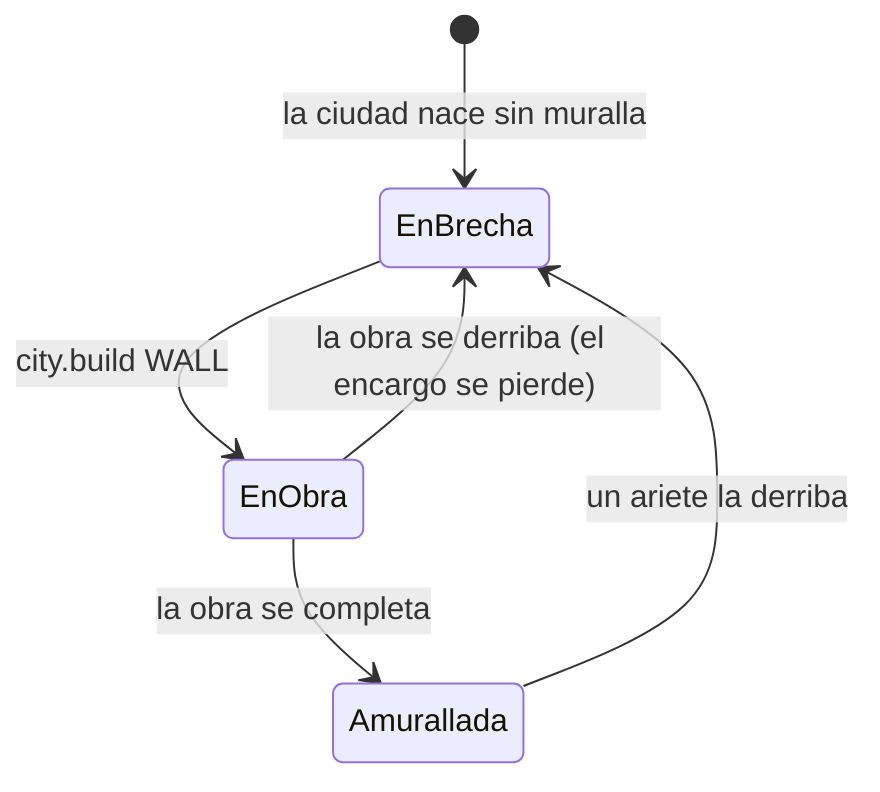

# Asedio: el ariete y la muralla de piedra

Propuesta para que una ciudad pueda **levantar una muralla de piedra** que proteja sus edificios, y para que el
atacante tenga con qué abrirla: el **ariete**, la primera máquina de asedio. Con la muralla en pie sólo el ariete daña
la ciudad, y sólo a la muralla; derribada, la ciudad queda en brecha y sus edificios se derriban como hoy. La ciudad
sigue sin caer.

| Campo | Valor |
|---|---|
| Spec ID | `SPEC-SIEGE-ENGINES` |
| Estado | Accepted (2026-11-19). Propuesta en `Draft` y aceptada el mismo día con la recomendación de cada pregunta de §10. |
| Milestone | E27 Arietes y murallas (vigesimoséptimo slice después de M7) |
| Canon | §9 (protección), §10 (eras), §11 (catálogos), §12 (persistencia), §16 (errores), §21 (fuera de MVP: asedio) |
| Depende de | [combat-siege.md](combat-siege.md), [combat-raid.md](combat-raid.md), [combat-response.md](combat-response.md), [combat-pillage.md](combat-pillage.md), [castle-age.md](castle-age.md), [civilization-units.md](civilization-units.md), [economy-stone.md](economy-stone.md), [technologies.md](technologies.md), [territory-conquest.md](territory-conquest.md), [city.md](city.md), [event-log.md](event-log.md), [live-notices.md](live-notices.md), [websocket-protocol.md](websocket-protocol.md) |
| Decisiones | [ADR-016](../decisions/ADR-016-foreign-territory-actions.md) (acción hostil), [ADR-024](../decisions/ADR-024-combat-simultaneous-resolution.md) (fase 4), [ADR-029](../decisions/ADR-029-population-over-limit-and-house-destruction.md) (la escritura de la destrucción), [ADR-044](../decisions/ADR-044-castle-shooting.md) (el castillo dispara a quien derriba), [ADR-048](../decisions/ADR-048-siege-engines-and-wall.md) (la muralla como edificio del centro y un solo predicado de asedio). |
| Reemplaza a | En [combat-siege.md](combat-siege.md), `RN-COMBAT-029` en lo que toca a quién derriba (también el ariete) y a qué (también la muralla), y el «Fuera de MVP» de §2 en lo que toca a las máquinas de asedio y a atacar la muralla. En [city.md](city.md), el «Murallas con perímetro, interior y puertas son `TBD`» de `RN-CITY-009` sólo en lo que toca a que la muralla tenga vida; el 3 × 3 sigue entero `BLOCKED`. |
| Invariantes | Cita los de combate y de economía que ya cubren el asedio; asigna [INV-COMBAT-008](../invariants/combat.md#inv-combat-008) e [INV-COMBAT-009](../invariants/combat.md#inv-combat-009) (§8) |

## 1. Objetivo

Hoy la defensa de una ciudad son sus guerreros parados (E3), su castillo (E23) y la protección offline (M5). Su
inversión de largo plazo, las casas y los edificios, cae ante cualquier guerrero que llegue a la muralla (E8), y la
«muralla» del 3 × 3 es un bloque sin vida que nadie puede atacar ni reforzar. La fase **Sieges** de
[roadmap.md](../roadmap/roadmap.md) pide asedios de ciudades amuralladas con máquinas de asedio con coste, y E8 dejó
fuera las dos cosas.

Este slice las mete juntas porque una sin la otra no tiene sentido: una muralla que nada puede romper hace invulnerable
a la ciudad, y un ariete sin muralla es un guerrero más fuerte. Juntas dan al defensor algo en qué invertir piedra y
al atacante una decisión de verdad: un asedio pide preparar una máquina lenta, cara y frágil, llevarla hasta la ciudad
y protegerla mientras golpea.

## 2. Scope

**Entra.** El edificio **muralla** (`WALL`), uno por ciudad, desde la Edad de Bronce (Q3); la unidad **ariete**
(`RAM`), desde la Edad de Hierro (Q1, Q2); la regla de quién daña qué (Q4): con la muralla completa en pie sólo el
ariete daña la ciudad, y sólo a la muralla; derribada, la ciudad queda **en brecha** y cualquiera derriba sus edificios,
como hoy (Q6); el ariete en `unit.demolish`; los golpes del ariete en la fase 4, con la defensa de E3 y el castillo de
E23; el derribo de la muralla en el registro y en los avisos (Q10); `WALL` y `RAM` en los catálogos, los `CHECK` y Zod;
la migración `000029`; en el cliente, «Muralla» al construir, «Ariete» al entrenar, sus siluetas y la vida de la
muralla; `scripts/smoke.mjs --asedio`.

**No entra** (`Fuera de MVP` de este slice): que la ciudad caiga, cambie de dueño o se destruya (Q8; la capital sigue
intocable, `RN-CONQ-008`); otras máquinas (catapulta, torre de asedio, trabuquete) y que una máquina dañe unidades
(Q1, Q7); murallas por niveles o con puertas, interior o perímetro propio (`RN-CITY-009` sigue igual); que la muralla
frene el saqueo (Q4); reparar con aldeanos o con piedra un daño que no derribó (Q5); que el ariete entre en guarnición,
recolecte, saquee, reclame territorio o transporte unidades; tecnologías nuevas que afecten al asedio; cambios en el
balance de la respuesta de E3 o del castillo.

## 3. Actores

Jugador atacante (entrena el ariete y ordena el derribo) y atacado (levanta la muralla y la defiende), cliente web,
Game Server (único que decide alcance, vida, quién daña qué y la destrucción,
[INV-SEC-001](../invariants/security.md#inv-sec-001)), tick loop (fase 4 para los golpes, fase 5 para la obra y el
entrenamiento), cola de persistencia, PostgreSQL.

## 4. Modelo

### 4.1 La muralla

Un edificio de la ciudad, con el ciclo de la casa, el taller y el castillo (obra, completo, derribado), pero **sin
hueco** en la zona urbana: su fila va en el tile del centro, que ningún otro edificio ocupa ([ADR-048](../decisions/ADR-048-siege-engines-and-wall.md) §1). Valores (Q3,
Q9):

- Se construye con `city.build { type: "WALL", x, y }`, con `x, y` el centro de la ciudad; cualquier otro tile es
  `INVALID_TARGET`.
- Pide la **Edad de Bronce**: es cuando la ciudad ya extrae piedra ([economy-stone.md](economy-stone.md)).
- **Una por ciudad** en pie (en obra o completa); derribada, se puede volver a construir.
- Cuesta **200 de piedra y 100 de madera** y tarda **120 s**, con el rasgo `production.speed` de la civilización y de
  las tecnologías ([technologies.md](technologies.md) §4.4).
- Tiene **1 500 de vida** y no da población. El daño vive en la RAM y se olvida como el de una casa (`RN-COMBAT-032`,
  Q5).
- En el mapa no cambia nada de la ocupación: el 3 × 3 ya es `BLOCKED` (`RN-CITY-009`). El cliente la dibuja como un
  anillo de piedra alrededor del 3 × 3, con grietas según su vida.

**Protege sólo completa.** Una muralla en obra es un edificio más: no protege nada y se derriba como una casa en obra,
con lo que su encargo se pierde (`RN-COMBAT-033`).

### 4.2 El ariete

Una unidad de la ciudad, entrenada con `city.train { type: "RAM" }` como el guerrero (Q2, Q9):

| Parámetro | Ariete | Guerrero, para comparar |
|---|---|---|
| Era | Hierro | Piedra |
| Coste y tiempo | 150 de madera y 75 de piedra, 40 s | 60 de madera, 25 s |
| Población | 2 | 1 |
| Vida | 250 | 60 |
| Velocidad | 1 800 ms por tile | 600 ms por tile |
| Golpe contra edificios | 40 cada 3 000 ms, alcance 1 | 8 cada 1 500 ms, alcance 1 |
| Golpe contra unidades | Ninguno (Q7) | 8 cada 1 500 ms |
| Botín | Ninguno | 20 |

Con estos números, un ariete solo abre una muralla entera en 38 golpes (114 s pegado a ella) y tres en 13 (≈ 39 s);
una casa cae en 4 golpes (12 s) y un castillo en 25 (75 s). Un guerrero tarda ≈ 47 s en matar un ariete, y cinco
≈ 9 s. Ni guerrero ni ariete tienen ventaja de tipo: el ariete es frágil porque no se defiende.

El ariete sólo sabe derribar: `unit.demolish`. No ataca unidades, no saquea, no reclama, no recolecta y no entra en
guarnición. Es una unidad como las demás en todo lo demás: se mueve con `unit.move`, se le puede atacar, la respuesta
automática de E3 lo toma por objetivo y el castillo le dispara cuando derriba (`RN-CASTLE-004`). No es una unidad de
civilización: la entrenan todas.

### 4.3 Quién daña qué

Una ciudad está **amurallada** mientras tiene una muralla completa con vida, y **en brecha** en cualquier otro caso
(sin muralla, en obra o derribada). La regla, para cada golpe de asedio (Q4):

| La ciudad está… | El guerrero (y las unidades de civilización) | El ariete |
|---|---|---|
| Amurallada | No puede derribar nada | Sólo puede golpear la muralla |
| En brecha | Cualquier edificio, como hoy | Cualquier edificio |

El saqueo no cambia: se saquea por encima del suelo, con o sin muralla (Q4). La respuesta de E3 tampoco: un golpe a
la muralla cuenta como un golpe en el centro de la ciudad (`RN-COMBAT-037`).

El mismo predicado decide al dar la orden y en cada golpe ([ADR-048](../decisions/ADR-048-siege-engines-and-wall.md) §2): si la muralla se completa a mitad de un
derribo, el guerrero que derribaba una casa termina su asedio en ese tick y queda `IDLE`; si la muralla cae, nada
cambia de por sí para los demás asedios, y cada uno se vuelve a ordenar.

### 4.4 Reglas

Dominio: `RN-SIEGE`.

| ID | Regla |
|---|---|
| `RN-SIEGE-001` | La muralla es un edificio de la ciudad que va en el tile del centro: Edad de Bronce, una en pie por ciudad, 200 de piedra y 100 de madera, 120 s con `production.speed`, 1 500 de vida, sin población. Cobra al confirmarse el encargo, con su efecto, como cualquier edificio (`RN-ECON-008`). |
| `RN-SIEGE-002` | Una ciudad está **amurallada** si y sólo si tiene una muralla `COMPLETE` con vida; en cualquier otro caso está **en brecha**. |
| `RN-SIEGE-003` | El ariete es una unidad que se entrena en una ciudad de la Edad de Hierro con los valores de §4.2. Sólo acepta `unit.move`, `unit.cancel_move` y `unit.demolish`; las demás órdenes de unidad responden `UNIT_NOT_MOVABLE`, como las de un aldeano que no ataca. |
| `RN-SIEGE-004` | **Quién daña qué.** Contra una ciudad amurallada sólo el ariete golpea, y sólo a la muralla; contra una en brecha, el guerrero, las unidades de civilización y el ariete golpean cualquier edificio. Lo comprueba la orden (`INVALID_TARGET` con su motivo) y cada golpe. |
| `RN-SIEGE-005` | **El golpe del ariete** vence en la fase 4 como un golpe de asedio (`RN-COMBAT-031`), con su daño y su ritmo, y en el mismo orden: después de los golpes a unidades y de los de saqueo, por `id` de la unidad, cada uno sobre la vida que dejó el anterior. Sin azar. |
| `RN-SIEGE-006` | **Cambio de estado a mitad de un asedio.** Cuando una ciudad pasa a amurallada, todo asedio en curso contra uno de sus edificios que la regla ya no admite termina en ese tick, y su unidad queda `IDLE` donde está (`RN-COMBAT-036`). |
| `RN-SIEGE-007` | **Derribo de la muralla.** El golpe que deja su vida en 0 la destruye como a una casa (`RN-COMBAT-033`): pasa a `DESTROYED`, sin cambiar `population_limit`, y la ciudad queda en brecha. Se puede volver a construir cuando la destrucción está confirmada. |
| `RN-SIEGE-008` | La muralla y el ariete no cambian el resto del asedio: es hostil y pasa por el predicado de `RN-COMBAT-030`, exige al atacante presente (`RN-COMBAT-035`), termina como `RN-COMBAT-036`, lo defienden los guerreros (`RN-COMBAT-037`) y el castillo (`RN-CASTLE-004`), y avisa con `besiegedAtMs` (`RN-COMBAT-038`). |

### 4.5 Qué ve el jugador

- **Al construir**, «Muralla» junto a «Castillo» y «Mercado», con su coste, deshabilitada con su motivo («Desde la Edad
  de Bronce», «Ya hay una muralla»); no pide elegir tile.
- **Al entrenar**, «Ariete» con su coste y su población, deshabilitado antes de la Edad de Hierro.
- **En el mapa**, el anillo de piedra de la muralla alrededor del 3 × 3, con su barra de vida cuando está dañada, y la
  silueta del ariete. Una ciudad ajena amurallada lleva un icono de escudo.
- **Con un ariete seleccionado**, un clic sobre la muralla o un edificio ajeno es derribarlo; sobre un edificio de una
  ciudad amurallada, el cursor dice «Primero, la muralla». Con un guerrero, el mismo clic dice «La muralla está en
  pie».
- **El atacado** ve el aviso de asedio de siempre («¡Están derribando tus casas!» pasa a «¡Están asediando tu
  ciudad!») y, si cae la muralla, el aviso y la entrada del registro de §6.

## 5. Errores

Sólo códigos que ya existen en el catálogo (canon §16).

| Orden | Condición | Código |
|---|---|---|
| `city.build` `WALL` | La ciudad no es propia | `CITY_NOT_FOUND` |
| | Antes de la Edad de Bronce, ya hay una muralla en pie, o el tile no es el centro | `INVALID_TARGET` |
| | Falta piedra o madera | `INSUFFICIENT_RESOURCES` |
| `city.train` `RAM` | Antes de la Edad de Hierro | `INVALID_TARGET` |
| | Falta madera o piedra; sin plaza de población | `INSUFFICIENT_RESOURCES`, `POPULATION_LIMIT_REACHED` |
| `unit.demolish` | Un guerrero contra una ciudad amurallada; un ariete contra un edificio que no es la muralla de una ciudad amurallada | `INVALID_TARGET` (el mensaje dice cuál) |
| | El resto, como en E8 | los de [combat-siege.md](combat-siege.md) §5 |
| `unit.attack`, `unit.pillage`, `unit.claim`, `unit.gather`, `unit.garrison` | La unidad es un ariete | `UNIT_NOT_MOVABLE` |

## 6. Eventos y contratos de red

**Sin mensajes nuevos.** El catálogo de cliente → servidor se queda en 52 tipos:

- `UnitType` suma `RAM` y `BuildingType` suma `WALL` (también en `city.build` y `city.train`). Son enums estrictos:
  se estrenan a la vez en el cliente y en el servidor.
- La muralla viaja como cualquier edificio: `building.spawn`, `building.update { hp }` y `building.destroyed`, y en
  `BuildingView` con `hp` y `maxHp` del snapshot. No hace falta un campo en `CityView`: que la ciudad está amurallada se
  deduce de su muralla.
- El ariete viaja como cualquier unidad (`entity.*`, `unit.movement.*`), con `status: ATTACKING` mientras golpea.
- `EventLogEntry` gana `buildingType` (opcional, `R-VER-2`) en `HOUSE_LOST` y `HOUSE_DESTROYED`, para que el cliente
  diga «derribó tu muralla» en vez de «tus casas» (Q10). Sin `EventLogKind` ni `EventLogNoticeKind` nuevos.

**Eventos de dominio** en `world_events`: el derribo de la muralla es un `BuildingDestroyed` más, con su tipo, la
unidad y su tipo, `counterpart_player_id` y `atMs` ([ADR-028](../decisions/ADR-028-event-log-from-world-events.md)).
Los golpes que no destruyen no se escriben (SPEC-EVENT-LOG Q1).

**Registro y avisos** (Q10): el derribo de la muralla entra al atacado como `HOUSE_LOST` y al autor como
`HOUSE_DESTROYED`, con `buildingType: "WALL"`, y se avisa en vivo al atacado conectado como hoy se avisa del derribo de
una casa ([live-notices.md](live-notices.md)).

## 7. Persistencia

| Pregunta (canon §12) | Respuesta |
|---|---|
| Autoritativo en RAM | La vida de la muralla dañada y el instante de su último golpe, como las casas; los asedios en curso de los arietes |
| Write-through | La muralla (su encargo, su compleción y su derribo) y el ariete (su entrenamiento y su muerte), por los caminos de siempre |
| Dirty-flag | La posición del ariete, como la de cualquier unidad |
| Reconstruible / no persistido | El daño de la muralla (un reinicio la deja entera, Q5), los asedios en curso y `ATTACKING` |

**Migración `000029`:**

- `buildings_type_valid` suma `WALL`, y un único parcial `buildings_one_wall_per_city` sobre `(city_id) WHERE type =
  'WALL' AND status <> 'DESTROYED'`, como el del mercado de `000028`.
- `CHECK`: una muralla sólo en el tile del centro de su ciudad. Cruza `buildings` con `cities`, así que va en un trigger
  (`buildings_wall_at_center`), como el de `market_purchases_not_own`.
- `units_type_valid` y `city_productions_unit_type_valid` suman `RAM`.
- Sin tablas nuevas, sin variables `EO_` nuevas. La siguiente libre pasará a ser `000030`.

**[ADR-048](../decisions/ADR-048-siege-engines-and-wall.md): la muralla como edificio del centro y un solo predicado de
asedio.** Tres decisiones estructurales:

1. **La muralla es una fila de `buildings` en el tile del centro.** Así hereda sin código nuevo el encargo en dos fases
   ([ADR-023](../decisions/ADR-023-economy-stock-deltas-and-two-phase-orders.md)), la obra con `production.speed`, la
   vida y el olvido del daño (`RN-COMBAT-032`), la destrucción escrita con su evento (ADR-029) y los mensajes
   `building.*`. El centro es el único tile del 3 × 3 sin hueco, así que no compite con ningún edificio.
2. **Un solo predicado decide quién daña qué** (`siege.CanDamage(unidad, edificio, amurallada)` en el dominio), y lo
   llaman la orden y cada golpe de la fase 4. Es la única forma de que `RN-SIEGE-006` (la muralla que se completa a
   mitad de un derribo) no dependa de que alguien se acuerde de comprobarlo en dos sitios.
3. **El ariete es una unidad con un golpe sólo contra edificios.** El catálogo de unidades gana el daño y el ritmo
   contra edificios (`SiegeDamage`, `SiegeIntervalMs`) separados de los de combate, y el ariete tiene a cero los de
   combate: `CanAttack()` es falso y todas las rutas que eligen objetivos de unidades (respuesta, `unit.attack`,
   `unit.pillage`, `unit.claim`) lo excluyen sin un caso especial; `unit.demolish` pasa a preguntar `CanDemolish()`.

Alternativas descartadas que el ADR dejaría escritas: **la muralla como columnas de `cities`** (`wall_hp`,
`wall_status`), que duplica el ciclo de un edificio y su mensaje; **la muralla como `BLOCKED` con vida por tile**, que
pide que cada tile del anillo tenga su vida y abre la puerta a brechas parciales que el 3 × 3 no tiene; **el ariete
como orden de la ciudad** (un «asalto» sin unidad), que quita al defensor el blanco que defender.

## 8. Invariantes

**Cita:**

- [INV-COMBAT-002](../invariants/combat.md#inv-combat-002): el derribo con ariete pasa por el mismo predicado de
  agresión que el saqueo.
- [INV-CITY-002](../invariants/city.md#inv-city-002): la muralla no da población; su derribo no toca el límite.
- [INV-ECON-001](../invariants/economy.md#inv-econ-001) e [INV-ECON-002](../invariants/economy.md#inv-econ-002): la
  muralla y el ariete se cobran con su efecto y nunca dejan un almacén en negativo.
- [INV-SEC-001](../invariants/security.md#inv-sec-001): el servidor decide la vida, el alcance y quién daña qué.
- [INV-PERSIST-005](../invariants/persistence.md#inv-persist-005): la migración `000029`.

**Asigna** dos invariantes nuevos de la familia `INV-COMBAT`, registrados sin cobertura en la aceptación:

- [INV-COMBAT-008](../invariants/combat.md#inv-combat-008) — **La muralla protege.** Mientras una ciudad está amurallada, ningún golpe de una unidad que no sea un ariete resta
  vida a uno de sus edificios, y ningún golpe de ariete resta vida a otro edificio que su muralla. Lo garantizan el
  predicado único de ADR-048 §2, en la orden y en cada golpe.
- [INV-COMBAT-009](../invariants/combat.md#inv-combat-009) — **El ariete no hiere ni roba.** Un ariete nunca resta vida a una unidad, nunca carga botín y nunca captura una
  caravana o un territorio. Lo garantizan su catálogo (sin daño de combate ni botín) y el predicado de cada orden.

«Una muralla por ciudad, y en su centro» no es un invariante propio: lo cubren `RN-SIEGE-001`, el único parcial y el
trigger de `000029`, como el mercado de E26.

## 9. Tests esperados

| Nivel | Qué |
|---|---|
| unit | La muralla y el ariete en sus catálogos (coste, era, vida, golpe, población); `siege.CanDamage` con cada fila de §4.3 (guerrero, unidad de civilización y ariete, contra la muralla, una casa, un taller y un castillo, con la ciudad amurallada, con la muralla en obra y en brecha); `CanAttack()` falso para el ariete; el centro como único tile válido de la muralla |
| simulation | Golden `asedio`: levantar la muralla (120 s × rasgo, el cobro en el tick exacto); un guerrero que ya no puede derribar una casa; tres arietes que abren la muralla en sus golpes exactos (38 golpes repartidos por `id`, cada 3 000 ms); la ciudad en brecha y el guerrero que ahora sí derriba; la muralla que se completa a mitad de un derribo (`RN-SIEGE-006`); la respuesta de los guerreros y el disparo del castillo contra el ariete; el ariete rechazado en `unit.attack`, `unit.pillage`, `unit.claim`, `unit.gather` y `unit.garrison`; el olvido del daño a los 300 s; el catálogo de comandos (52) y de trabajos |
| recovery | Un reinicio deja la muralla dañada entera y la derribada derribada; un ariete en camino sigue su polilínea y retoma el asedio sólo si se le vuelve a ordenar |
| integration | La migración: `WALL` y `RAM` en sus `CHECK`, una muralla en pie por ciudad y el trigger del centro; el derribo de la muralla con su evento y sin tocar `population_limit`; el encargo de la muralla y el entrenamiento del ariete con su débito |
| contract / e2e | `WALL` y `RAM` en los enums contra el JSON Schema y Zod; `buildingType` en el registro; por WebSocket, el ariete que derriba la muralla y los `building.update` y `building.destroyed` que reciben los dos jugadores |
| cliente | «Muralla» y «Ariete» con sus motivos deshabilitados; el clic de derribar con el ariete y el motivo del guerrero; la entrada del registro con la muralla; `scripts/smoke.mjs --asedio`: smoke_victim levanta la muralla y smoke_runner, en Hierro, entrena un ariete, lo lleva y golpea la muralla hasta que su vida baja; se comprueba la vida y el aviso (abrirla entera tarda 114 s con un solo ariete; el humo se queda en el primer golpe salvo `--asedio-completo`) |

**Precisiones de implementación (2026-11-19).**

- **La muralla se golpea desde el anillo de fuera.** Su fila está en el centro, pero el 3 × 3 entero es `BLOCKED` y un
  alcance de 1 desde el centro no deja ningún tile transitable. El alcance de un golpe contra la muralla se mide contra
  el 3 × 3 (`siegeExtent`): se golpea desde los tiles a distancia 2 del centro, los mismos desde los que se golpea
  cualquier otro edificio de la ciudad, y el ariete lejano va al más cercano de ellos.
- **El golpe del tick en que se completa la muralla aún cae.** Los golpes van en la fase 4 y la obra se completa en la
  5: el derribo de una casa que coincide con ese tick recibe su golpe, y desde el siguiente la regla lo corta
  (`RN-SIEGE-006`), como fija ADR-048 §2.
- **Sin `units_type_valid`.** `units.unit_type` no tiene `CHECK` de tipo desde `000001` (lo valida la carga,
  `INV-UNIT-009`), así que `000029` sólo suma `RAM` a `city_productions_unit_type_valid`; §7 y el ADR lo daban por
  existente.
- **El aviso del derribo de la muralla va al atacante.** Como el de una casa: `HOUSE_DESTROYED` con `buildingType: WALL`
  al dueño del ariete; el asediado se entera por `besiegedAtMs`, que salta también con los golpes a la muralla, y por
  su entrada `HOUSE_LOST` del registro. Un aviso en vivo al asediado habría sido un tipo nuevo en `EventLogNoticeKind`,
  que Q10 descartó.
- **`buildingType` va en todos los derribos**, no sólo en el de la muralla: es el tipo del edificio que cayó (`HOUSE`,
  `WORKSHOP`, `CASTLE`, `MARKET` o `WALL`), y forma parte de la clave del grupo del registro y de los avisos.
- **El ariete y la guarnición.** Las órdenes de combate lo rechazan por `CanAttack()` y la recolección por
  `CanGather()`, sin código nuevo; la guarnición, con una comprobación propia (`IsSiegeEngine`), porque `CanEnter` no
  mira el tipo. El golpe del ariete no lleva el rasgo de daño (Q11); el del guerrero, sí.
- **El humo** es `--ariete` (y `--ariete-completo`, que espera a abrir la muralla), no `--asedio`, que ya es el derribo
  de E8.
- **«Muralla»** se ve desde la Edad de Bronce siempre, deshabilitada con «La ciudad ya tiene una muralla» si la hay, y
  no pide elegir tile; con un guerrero, el clic sobre una casa de una ciudad amurallada no manda la orden y dice «La
  muralla está en pie: sólo un ariete la derriba».

## 10. Decisiones de producto (2026-11-19)

Producto aceptó el 2026-11-19 la recomendación de cada pregunta. Cada fila deja la decisión (en negrita) y las
alternativas que se descartaron. Son decisiones de producto, no de ingeniería: cambiarlas es cambiar la spec.

| # | Pregunta | Decisión |
|---|---|---|
| Q1 | ¿Qué máquinas de asedio entran? | **Sólo el ariete: lento, frágil, que sólo golpea edificios desde el tile de al lado.** Es la máquina más simple de explicar y de equilibrar, y obliga a escoltarla. Alternativas: **también la catapulta**, que golpea a distancia (edificios y unidades): pide reglas de alcance y de daño en área que el combate aún no tiene; **una sola máquina genérica** con un rasgo por civilización, que mezcla este slice con el balance de las civilizaciones. |
| Q2 | ¿Desde qué era y dónde se entrena el ariete? | **Desde la Edad de Hierro, en la ciudad, como cualquier unidad, sin edificio nuevo.** La muralla llega en Bronce: entre las dos eras el defensor tiene una ventaja, que es lo que la piedra le compra. Alternativas: **desde Bronce**, a la vez que la muralla, que deja a la muralla sin tiempo de ventaja; **en un taller de asedio** (un edificio nuevo), que da otro blanco pero otro hueco de la zona urbana, que ya está casi llena con casas, taller, castillo y mercado; **desde los Castillos**, demasiado tarde: casi nadie llegaría. |
| Q3 | ¿Qué es la muralla y cómo se consigue? | **Un edificio que la ciudad levanta desde la Edad de Bronce, uno por ciudad, en el centro, sin ocupar hueco; las ciudades no nacen con ella.** Así nada cambia para las ciudades de hoy hasta que la construyen, y la muralla es una inversión. Alternativas: **todas las ciudades la tienen desde el principio**, con lo que E8 deja de funcionar hasta que alguien tenga arietes; **murallas por niveles** (empalizada de madera, luego de piedra), más progresión y el doble de reglas. |
| Q4 | ¿Qué protege la muralla en pie? | **Los edificios: con la muralla completa sólo el ariete daña la ciudad, y sólo a la muralla. El saqueo no cambia.** El saqueo es el ataque cotidiano y ya tiene su suelo; la muralla protege la inversión de largo plazo. Alternativas: **también frena el saqueo** (sin saqueo, o con el suelo más alto, mientras está en pie), que hace la muralla casi obligatoria y deja a los guerreros sin uso contra una ciudad amurallada; **sólo reduce el daño** (p. ej. a la mitad) sin bloquearlo, más suave pero sin la decisión de «primero la muralla». |
| Q5 | ¿El daño de la muralla dura? ¿Se repara? | **Como el de una casa: vive en la RAM, se olvida a los 300 s sin golpes y con un reinicio; derribada, se reconstruye pagando su coste.** Una regla que ya existe y se explica en una frase; un asedio a medias que se abandona no deja secuelas. Alternativas: **daño durable con reparación** pagando piedra (o con aldeanos), más realista pero con una escritura nueva en cada golpe o en cada volcado y una orden de reparar; **daño durable sin reparación**, que castiga para siempre un asedio que no prosperó. |
| Q6 | ¿Qué pasa al derribar la muralla? | **La ciudad queda en brecha hasta que la vuelve a levantar: sus edificios se derriban como hoy.** El atacante gana lo que fue a buscar, y el defensor recupera la protección pagando y esperando 120 s, sin otra regla. Alternativas: **la muralla vuelve sola** (p. ej. a los 30 min), que no castiga perderla; **la brecha da un bono** al atacante (saqueo sin suelo), que mezcla el saqueo con el asedio. |
| Q7 | ¿El ariete hace algo contra unidades? | **No: no ataca, no saquea, no reclama, no recolecta y no entra en guarnición.** Su única defensa es la escolta, que es el sentido del asedio. Alternativas: **un golpe débil contra unidades**, que lo convierte en una unidad de combate lenta; **guarnición**, que dejaría esconder arietes en la ciudad propia sin riesgo. |
| Q8 | ¿Cae la ciudad? | **No en este slice.** La capital sigue intocable (`RN-CONQ-008`) y cada jugador tiene una sola ciudad: que caiga es eliminar a un jugador, y pide decidir qué pasa con sus unidades, su clan, su facción y sus ofertas. Merece su propia spec, que este slice prepara. Alternativas: **la ciudad en brecha con el Centro Urbano derribado cambia de dueño**; **la ciudad en brecha pierde un territorio** a favor del atacante, sin conquista. |
| Q9 | ¿Los valores de §4.1 y §4.2 son el punto de partida? | **Sí, ajustables sin cambiar el modelo**: muralla de 1 500 de vida, 200 de piedra y 100 de madera, 120 s; ariete de 250 de vida, 150 de madera y 75 de piedra, 40 s, población 2, 1 800 ms por tile, 40 cada 3 000 ms. Un ariete solo abre la muralla en ≈ 2 min; tres, en ≈ 40 s. Alternativa: proponer otros antes de aceptar. |
| Q10 | ¿Qué entra en el registro y qué se avisa? | **El derribo de la muralla, a los dos, como el de una casa (`HOUSE_LOST` y `HOUSE_DESTROYED` con `buildingType: "WALL"`), y el aviso en vivo al atacado; los golpes, con el aviso de asedio de siempre.** Sin tipos nuevos en enums estrictos. Alternativas: **tipos propios** (`WALL_LOST`, `WALL_DESTROYED`), más claros en el registro pero valores nuevos de un enum estricto; **sin aviso en vivo**, que deja al defensor enterarse al volver. |
| Q11 | ¿Las tecnologías y las civilizaciones tocan el asedio? | **No en este slice**: el ariete y la muralla usan sólo `production.speed` (la obra y el entrenamiento), como cualquier edificio y unidad. Alternativas: **una tecnología de mampostería** que sume vida a la muralla, o **un rasgo de civilización** para los arietes, que piden datos de partidas para equilibrarse. |

## 11. Documentos relacionados

- [combat-siege.md](combat-siege.md) (el derribo de E8, que este slice amplía), [combat-response.md](combat-response.md)
  (la defensa con guerreros) y [castle-age.md](castle-age.md) (el castillo que dispara a quien derriba).
- [city.md](city.md) (`RN-CITY-009`, la zona urbana `BLOCKED`) y [economy-stone.md](economy-stone.md) (la piedra que
  paga la muralla).
- [territory-conquest.md](territory-conquest.md) (`RN-CONQ-008`, la capital intocable, Q8).
- [event-log.md](event-log.md) y [live-notices.md](live-notices.md) (Q10).
- [../roadmap/roadmap.md](../roadmap/roadmap.md) (la fase Sieges) y [../invariants/combat.md](../invariants/combat.md).

**Por qué este slice y no los otros dos candidatos.** Los **objetivos globales de los bandos** (Q10 de
[factions.md](factions.md)) se aparcaron a la espera de saber cuántos jugadores elige cada bando, y ese dato aún no
existe: equilibrarlos hoy sería inventar números. Las **rutas comerciales permanentes** (Q12 de
[caravans.md](caravans.md)) automatizan lo que el trato y el mercado ya permiten y reabren el problema de los regalos
entre multicuentas que la Q3 de E10 cerró a propósito. El asedio es la única de las tres fases que cambia lo que un
jugador decide en partida (en qué invertir la piedra, qué escoltar), y reutiliza casi todo lo que ya existe (el
derribo de E8, la respuesta de E3, el castillo de E23, el ciclo de los edificios).
