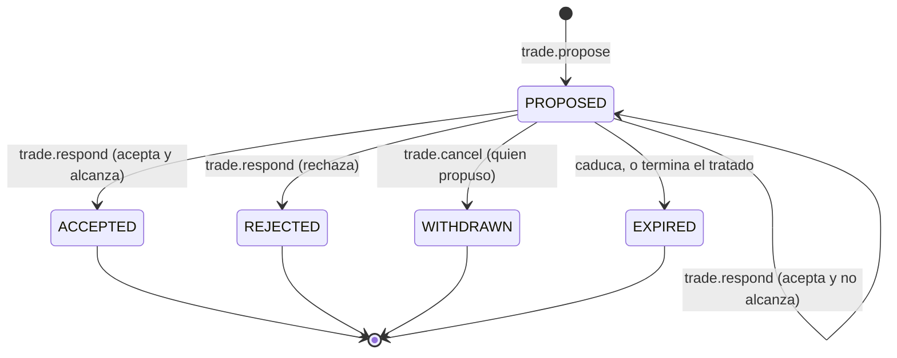

# Comercio: tratos entre dos ciudades

Propuesta del comercio entre jugadores: un trato «doy esto, pido aquello» entre dos ciudades con un tratado vigente,
que el otro acepta o rechaza y que, aceptado, mueve los recursos de los dos almacenes en el acto. Las caravanas que
viajan por el mapa y se pueden interceptar quedan para su propia fase.

| Campo | Valor |
|---|---|
| Spec ID | `SPEC-TRADE` |
| Estado | Draft (2026-11-04). Propuesta: **prohibido implementar** hasta que las preguntas de §10 estén decididas y la spec pase a `Accepted`. |
| Milestone | E10 Comercio (décimo slice después de M7) |
| Canon | §11 (tratados), §12 (persistencia), §13 (protocolo), §16 (errores) |
| Depende de | [diplomacy.md](diplomacy.md), [economy-wood.md](economy-wood.md), [economy-stone.md](economy-stone.md), [combat-pillage.md](combat-pillage.md), [event-log.md](event-log.md), [websocket-protocol.md](websocket-protocol.md) |
| Decisiones | [ADR-013](../decisions/ADR-013-persistence-pipeline.md) (cola ordenada por clave), [ADR-016](../decisions/ADR-016-foreign-territory-actions.md) (clasificación de acciones), [ADR-022](../decisions/ADR-022-durable-write-retry-and-loop-inbox.md) (toda escritura declara compensación), [ADR-023](../decisions/ADR-023-economy-stock-deltas-and-two-phase-orders.md) (stock por deltas versionados, órdenes en dos fases), [ADR-027](../decisions/ADR-027-hot-treaties.md) (la RAM decide las órdenes de los tratados), [ADR-028](../decisions/ADR-028-event-log-from-world-events.md) (el registro sale de `world_events`), [ADR-030](../decisions/ADR-030-stone-layer-and-era-advance.md) (costes en varios recursos). Un ADR nuevo (`ADR-032`, el trabajo de la cola con dos claves y el trato como orden en dos fases) acompañará a la aceptación: ver §7. |
| Reemplaza a | Los «tratados `TRADE` (no hay comercio)» del no-scope de [diplomacy.md](diplomacy.md) §2 y su Q1; `OUT-08` de [mvp-scope.md](../product/mvp-scope.md), sólo en las transacciones entre dos jugadores (sin mercados ni caravanas). Responde a la Q8 de [economy-stone.md](economy-stone.md), que dejó para E10 decidir si la piedra se saquea. |
| Invariantes | Cita [INV-ECON-001](../invariants/economy.md#inv-econ-001), [INV-ECON-002](../invariants/economy.md#inv-econ-002) (lo amplía), [INV-DIPLO-002](../invariants/diplomacy.md#inv-diplo-002) (precisa su enunciado con la escalera) e [INV-SEC-001](../invariants/security.md#inv-sec-001); propone una familia nueva, `INV-TRADE`, que se registrará al aceptar (§8) |

## 1. Objetivo

Que la geografía de E9 se pueda negociar. La piedra sólo está en siete manchas de colina: quien vive cerca la
consigue en minutos y quien vive lejos manda expediciones de una sesión ([economy-stone.md](economy-stone.md) §4.1).
Hoy sólo hay dos formas de conseguir lo que no tienes: ir a por ello o robarlo. Este slice añade la tercera, que es
pedírselo a quien lo tiene a cambio de algo que le falte. Es el pilar 4 de
[game-pillars.md](../product/game-pillars.md) (interdependencia), con la geografía como el complemento que aceptó la
Q2 de E9, y da al tratado `TRADE`, que está en el esquema desde M7, algo que hacer.

## 2. Scope

**Entra.** Proponer el tratado `TRADE` desde el cliente, con la escalera de tratados de §4.1; los comandos
`trade.propose`, `trade.respond` y `trade.cancel`; ofertas de madera por piedra o de piedra por madera; la caducidad
de las ofertas y su cierre cuando termina el tratado; el trato aceptado como una sola transacción que mueve los dos
almacenes; el trabajo de la cola que ordena dos ciudades a la vez (§7); `trade.update` y `tradeOffers[]` en el
snapshot; los tratos en el registro; en el cliente, «Proponer comercio», el formulario de la oferta y la lista de
ofertas recibidas y enviadas; `scripts/smoke.mjs --comercio`.

**No entra** (`Fuera de MVP` de este slice): caravanas, rutas y mercancía que viaja por el mapa (la fase Caravans de
[roadmap.md](../roadmap/roadmap.md)); mercados públicos, ofertas abiertas a cualquiera y subastas (`markets`);
precios de referencia o fijados por el sistema; contraofertas (se rechaza y se propone otra); tratos entre más de dos
jugadores; impuestos o comisión; saquear piedra (Q8); que terceros vean los tratos (Q9); avisos en vivo del
registro; recursos nuevos.

## 3. Actores

Jugador que ofrece y jugador que responde, cliente web, Game Server (único que decide si hay tratado, si alcanzan los
recursos y qué se mueve, [INV-SEC-001](../invariants/security.md#inv-sec-001)), tick loop (fases 1-2 para las
órdenes, fase 5 para las caducidades), cola de persistencia, PostgreSQL.

## 4. Modelo

### 4.1 Qué tratado deja comerciar: la escalera

Entre dos jugadores hay como mucho un tratado vigente ([INV-DIPLO-002](../invariants/diplomacy.md#inv-diplo-002)), y
lo garantiza un índice único de la base. Un `TRADE` aparte no podría convivir con un pacto o una alianza, y dos
aliados no podrían comerciar. La propuesta (Q1) es una **escalera** en la que cada escalón incluye lo del anterior:

| Tipo | Comercio | Paz | Guarnición |
|---|---|---|---|
| `TRADE` | Sí | No | No |
| `NON_AGGRESSION` | Sí | Sí | No |
| `ALLIANCE` | Sí | Sí | Sí |

- `TRADE` pasa a ser proponible. Comerciar no da paz: se puede comerciar con quien te saquea. La paz que lee el
  combate ya excluye `TRADE` (`Treaty.GivesPeaceAt`) y no cambia.
- **Subir** se hace como hoy se pasa de pacto a alianza: la oferta del escalón superior convive con el vigente y,
  aceptada, lo sustituye en la misma transacción (el anterior pasa a `EXPIRED`). Hoy sólo existe el salto de pacto a
  alianza; con `TRADE` se suman los de `TRADE` a pacto y de `TRADE` a alianza.
- **Bajar** no existe: se rompe, con su preaviso, y se firma otro. Proponer un tipo igual o inferior al vigente se
  rechaza.
- El resto de [diplomacy.md](diplomacy.md) no cambia: la oferta de tratado caduca a las 24 h, romper tiene 15
  minutos de preaviso con todos los efectos (también el comercio) y el reintento tras un rechazo espera 10 minutos.

### 4.2 La oferta

Una oferta va de una ciudad a otra (en el MVP cada jugador tiene una): **doy** una lista de `(recurso, cantidad)` y
**pido** otra.

- Cada recurso de `economy.Resources()` aparece como mucho una vez y en un solo lado (Q4). Con dos recursos, eso es
  madera por piedra o piedra por madera; las listas admiten más recursos cuando los haya.
- Cantidades enteras mayores que 0 en los dos lados (Q3): no hay regalos.
- Una oferta pendiente por par, en cualquier dirección (Q5). Vive `EO_TRADE_OFFER_HOURS` y caduca.
- Proponer no reserva nada (Q2): se comprueba que quien ofrece tiene lo que da al proponer, y otra vez al aceptar.
  Mientras tanto puede gastarlo, y se lo pueden saquear.

### 4.3 Reglas

Dominio: `RN-TRADE`.

| ID | Regla |
|---|---|
| `RN-TRADE-001` | `trade.propose { playerId, give, want }` exige otro jugador existente; un tratado `ACTIVE` entre los dos, de cualquier escalón y también en preaviso; ninguna oferta pendiente entre los dos en ninguna dirección; las listas de §4.2; y que la ciudad de quien ofrece tenga en ese tick todo lo que da. No reserva nada. |
| `RN-TRADE-002` | Sólo responde (`trade.respond { offerId, accept }`) el jugador que **no** propuso, y sólo a una oferta `PROPOSED`. Rechazar la pasa a `REJECTED`. |
| `RN-TRADE-003` | **Aceptar** exige el tratado todavía `ACTIVE` y que alcancen en ese tick **las dos partes**: quien propuso tiene todo lo que da, y quien acepta todo lo que se le pide. Si alguna no alcanza, la aceptación se rechaza con `INSUFFICIENT_RESOURCES`, el mensaje dice de qué lado falta, y la oferta sigue pendiente (Q2). |
| `RN-TRADE-004` | **Entrega en el acto.** Un trato aceptado se mueve entero en una transacción: lo que da cada uno sale de su almacén y entra en el del otro, la oferta pasa a `ACCEPTED` y se escribe su evento. Se mueve todo o nada, en las dos ciudades a la vez. La distancia entre las ciudades no cuenta (Q7). |
| `RN-TRADE-005` | `trade.cancel { offerId }` sólo sobre la oferta propia y `PROPOSED`: la retira (`WITHDRAWN`). |
| `RN-TRADE-006` | **Caducidad.** Una oferta sin respuesta pasa a `EXPIRED` a las `EO_TRADE_OFFER_HOURS`. Cuando el tratado del par deja de estar `ACTIVE` sin sustituto (vence su preaviso, o caduca), sus ofertas pendientes pasan a `EXPIRED` en ese mismo tick (Q6). Subir de escalón no las cierra. |
| `RN-TRADE-007` | **Una orden a la vez.** Mientras no ha vuelto la transacción de una orden sobre una oferta, cualquier otra orden sobre ella, y cualquier oferta nueva del mismo par, se rechaza con `INVALID_TARGET`, como las órdenes de tratado ([ADR-027](../decisions/ADR-027-hot-treaties.md) §2). |
| `RN-TRADE-008` | La presencia y la protección no cuentan: se ofrece y se acepta con el otro desconectado o protegido. Los tres comandos **no son hostiles** (ADR-016) y ninguno se rechaza por `CITY_PROTECTED`, como `RN-DIPLO-009` y `RN-DIPLO-010`. Un avance de era en curso no impide comerciar. |
| `RN-TRADE-009` | Lo que llega por un trato es stock como cualquier otro: el saqueo se lleva la madera que esté por encima del suelo (`RN-COMBAT-021`), recogida o comprada. |

## 5. Errores

Sólo códigos que ya existen en el catálogo (canon §16).

| Código | Condición |
|---|---|
| `INVALID_TARGET` | Jugador inexistente o propio; oferta inexistente, ajena o fuera de `PROPOSED`; responder a la oferta propia; retirar la ajena; ya hay una oferta pendiente entre los dos; otra orden en curso (`RN-TRADE-007`); un recurso repetido o en los dos lados. En `treaty.propose`, un tipo igual o inferior al tratado vigente (§4.1). El mensaje dice cuál. |
| `TREATY_REQUIRED` | Proponer o aceptar sin un tratado `ACTIVE` entre los dos. Existe desde M7 con el mismo sentido: la orden necesita un tratado que no hay. |
| `INSUFFICIENT_RESOURCES` | Al proponer, la ciudad de quien ofrece no tiene lo que da; al aceptar, alguna de las dos partes no alcanza (`RN-TRADE-003`). |
| `INVALID_MESSAGE` | Una lista vacía, una cantidad que no es un entero positivo o un recurso fuera del catálogo: lo rechaza el esquema estricto antes de llegar al tick. |

## 6. Eventos y contratos de red

Cliente → servidor, tres comandos nuevos y estrictos, aditivos en v1 como los de E1 a E9:
`trade.propose { playerId, give: [{ resource, amount }], want: [{ resource, amount }] }`,
`trade.respond { offerId, accept }` y `trade.cancel { offerId }`. El tratado `TRADE` se propone con el
`treaty.propose { playerId, type: "TRADE" }` que ya existe. El catálogo pasa de 19 a 22 tipos.

Servidor → cliente: `trade.update { offer }`, tipo nuevo (R-VER-3), a las sesiones de **los dos** jugadores en cada
cambio, con el `requestId` sólo para quien dio la orden; y `tradeOffers[]`, campo opcional de `world.snapshot`
(R-VER-2), con las ofertas `PROPOSED` del jugador, que reemplaza la lista del cliente como `treaties[]`
([ADR-027](../decisions/ADR-027-hot-treaties.md) §5). La vista: `{ id, otherPlayerId, otherCityId, otherCityName,
give, get, status, proposedByMe, expiresAtMs }`, con `give` y `get` desde el punto de vista de quien la recibe: lo
que saldría de su almacén y lo que entraría. Nadie más las recibe (Q9). El catálogo pasa de 21 a 22 tipos. Los
almacenes cambian por el `city.update` de siempre, al chunk de cada ciudad.

Eventos de dominio en `world_events`, todos con `counterpart_player_id` y `atMs`
([ADR-028](../decisions/ADR-028-event-log-from-world-events.md)): `TradeProposed`, `TradeAccepted` (con lo que se
movió en cada sentido), `TradeRejected`, `TradeWithdrawn` y `TradeExpired` (con el motivo: el plazo o el fin del
tratado).

Registro ([event-log.md](event-log.md)): los tratos entran como los tratados y, como ellos, sin lo que ordenó el
propio jugador (`RN-LOG-001`): la oferta recibida, la propia aceptada (con lo que diste y lo que recibiste), la propia
rechazada, la recibida que el otro retiró y la que caducó (Q10). Son cinco tipos de entrada nuevos en
`eventlog.Kinds()` y en el enum del protocolo, y los cinco eventos se suman a `eventlog.EventTypes()`.

Cliente: el panel que abre un clic en una ciudad ajena sin unidad seleccionada ([diplomacy.md](diplomacy.md) §6) suma
«Proponer comercio» cuando no hay tratado, y «Ofrecer un trato» cuando hay uno vigente: qué das y qué pides, cada uno
con su recurso y su cantidad, y el botón deshabilitado con su motivo si no tienes lo que das. El HUD lista las
ofertas recibidas con «Aceptar» y «Rechazar» y las enviadas con «Retirar», cada una con su caducidad.

## 7. Persistencia

| Pregunta (canon §12) | Respuesta |
|---|---|
| Autoritativo en RAM | Las ofertas `PROPOSED` de todo el mundo, y la reserva de un trato aceptado mientras su transacción no vuelve |
| Write-through | Cada transición de una oferta, en una transacción con su `world_events`; el trato aceptado, en una sola transacción con los deltas versionados de los dos almacenes |
| Dirty-flag | Nada nuevo |
| Reconstruible / no persistido | Nada: al arrancar se cargan las ofertas `PROPOSED`, y las que caducaron durante la caída se cierran en el primer tick |

**El trato aceptado es una orden en dos fases**, como un encargo
([ADR-023](../decisions/ADR-023-economy-stock-deltas-and-two-phase-orders.md) §2,
[ADR-030](../decisions/ADR-030-stone-layer-and-era-advance.md) §3). El tick valida contra la RAM y **reserva**: resta
de cada almacén lo que da esa parte, se lleva los depósitos sin volcar de los recursos que el trato toca en las dos
ciudades y marca la oferta como ocupada. La transacción aplica en cada ciudad, por recurso, el delta versionado
«depósitos − lo que da + lo que recibe», pasa la oferta a `ACCEPTED` (condicionado a `PROPOSED`, idempotente por el
`requestId` de la aceptación) y escribe `TradeAccepted`. El resultado vuelve por el buzón: con éxito, la RAM suma a
cada ciudad lo que recibe y difunde `trade.update` y `city.update`; con un rechazo o un fallo definitivo, devuelve lo
reservado y los depósitos. Lo que recibe una ciudad no se puede gastar hasta que la base lo confirma: nada se
anuncia antes de existir.

**Por qué hace falta un ADR (`ADR-032`).** La cola ordena los trabajos por clave y manda cada clave a una partición
([ADR-013](../decisions/ADR-013-persistence-pipeline.md) §2.2): todo lo que escribe el almacén de una ciudad va por
`city:<id>` y se ejecuta en el orden en que se encoló. Ese orden es lo que hace seguros los deltas versionados
([ADR-026](../decisions/ADR-026-pillage-two-phase-stock-debit.md) §3) y lo que evita un débito que la base todavía no
puede cubrir (los rechazos espurios de ADR-023). Un trato escribe dos almacenes, y en general las dos ciudades caen
en particiones distintas. La propuesta es **un trabajo con dos claves**: la cola lo pone en las dos particiones y lo
ejecuta cuando llega a la cabeza de las dos; la que llega antes espera a la otra. No puede haber un bloqueo cruzado
porque todos los trabajos los encola el loop, uno detrás de otro: dos tratos que comparten ciudades quedan en el
mismo orden en las dos particiones. El precio es que un worker espera mientras el otro llega, y con tratos de vez en
cuando no se nota. El ADR dejará escritas tres alternativas descartadas:

1. **Dos transacciones, una por ciudad**, con un estado intermedio durable. Una caída entre las dos deja recursos
   pagados y sin entregar, y el arranque tiene que terminar el trato y rehacer las reservas.
2. **Reservar al proponer.** Ofertas que nunca fallan, pero stock apartado durante horas que el saqueo, los encargos
   y el suelo del saqueo tendrían que conocer (Q2).
3. **Bloqueos en Redis con concurrencia optimista**, que es lo que preveía [roadmap.md](../roadmap/roadmap.md) para
   Trade. Con un solo escritor que decide en la RAM no hacen falta.

**Migración `000013`.** La tabla `trade_offers` (`id`, `proposer_id` y `target_id` con FK a `players`, sus dos
ciudades, `status` con `CHECK` de los cinco estados de §4.2, `request_id` con único parcial
`(proposer_id, request_id)`, `accepted_request_id`, `created_at`, `expires_at` y `closed_at`) y sus líneas,
`trade_offer_lines (offer_id, side, resource, amount)`, con `side` en `GIVE` o `WANT`, `amount > 0`, el mismo `CHECK`
de recurso que `city_stocks` y la PK `(offer_id, resource)`, que impide un recurso en los dos lados. Un índice único
parcial con `status = 'PROPOSED'` sobre `(least(proposer_id, target_id), greatest(proposer_id, target_id))`: una
oferta pendiente por par. `treaties` no cambia (admite `TRADE` desde `000001`) y `world_events.event_type` no tiene
`CHECK`. Las dos tablas se suman al `TRUNCATE` de los tests de integración. Un recurso nuevo tocará también el `CHECK`
de las líneas. La siguiente migración libre pasará a ser `000014`.

## 8. Invariantes

**Amplía** [INV-ECON-002](../invariants/economy.md#inv-econ-002), todo débito ocurre en la misma transacción que su
efecto: el efecto de un trato es el crédito en la otra ciudad, y un trato se paga entero o no se paga, en las dos
ciudades a la vez.

**Cita** [INV-ECON-001](../invariants/economy.md#inv-econ-001) (ningún almacén queda negativo, tampoco el de quien
acepta) e [INV-SEC-001](../invariants/security.md#inv-sec-001) (el cliente nunca decide cuánto se mueve).

**Precisa** [INV-DIPLO-002](../invariants/diplomacy.md#inv-diplo-002): una oferta de tratado sólo convive con un
tratado vigente si es de un escalón superior (§4.1), no sólo «si éste es un pacto y la oferta es una alianza».

**Propone** una familia nueva, `INV-TRADE`, con su registro en `docs/invariants/trade.md` al aceptar:

- Un trato nunca crea ni destruye recursos: para cada recurso, lo que sale de una ciudad es exactamente lo que entra
  en la otra, en la misma transacción.
- Toda oferta `ACCEPTED` se aceptó con un tratado `ACTIVE` entre los dos, de cualquier escalón.
- Entre dos jugadores hay como mucho una oferta `PROPOSED`.
- Una oferta sólo la acepta o la rechaza el jugador que no la propuso, y sólo la retira quien la propuso.

## 9. Tests esperados

| Nivel | Qué |
|---|---|
| unit | La escalera (cada subida legal; bajar y repetir, rechazados); la validación de cada fila de §5; las dos partes de `RN-TRADE-003`; la vista desde cada lado (`give` y `get`); `Classify` de los cinco eventos para los dos jugadores; la cola: un trabajo de dos claves espera a las dos particiones, respeta el orden con los volcados de cada ciudad y no se bloquea con dos tratos cruzados |
| simulation | Golden `comercio`: tratado `TRADE`, oferta, aceptación y los dos almacenes en el tick exacto; aceptar sin alcanzar, de cada lado, deja la oferta pendiente; subir de pacto a alianza conserva la oferta; el fin del preaviso la cierra; dos aceptaciones en el mismo tick (la segunda, `INVALID_TARGET`); un saqueo entre la oferta y la aceptación |
| recovery | Reinicio con una oferta pendiente: caduca en su instante absoluto. Reinicio con un trato reservado y sin confirmar: o no se movió nada y la oferta sigue pendiente, o se movió todo y está `ACCEPTED` |
| integration | La transacción del trato con fallo inyectado en cada delta (todo o nada); la idempotencia de cada orden por `requestId`; el índice de una oferta pendiente por par; el `CHECK` de recurso y la PK de las líneas |
| contract / e2e | Los tres comandos, `trade.update` y `tradeOffers[]` contra el JSON Schema; un trato de punta a punta por WebSocket con dos jugadores, en el mismo commit que `trade.update` |
| cliente | El formulario de la oferta con su motivo cuando está deshabilitado, la lista de ofertas y su caducidad; `scripts/smoke.mjs --comercio` |

## 10. Preguntas de producto

Cada pregunta lleva la recomendación de diseño. Son decisiones de producto: hasta que se decidan, la spec sigue en
`Draft`.

| # | Pregunta | Recomendación |
|---|---|---|
| Q1 | ¿Qué tratado deja comerciar? | **La escalera de §4.1**: `TRADE`, pacto y alianza dejan comerciar, y `TRADE` sólo no da paz. Alternativas: **un eje aparte**, con `TRADE` conviviendo con un pacto o una alianza, obliga a cambiar `INV-DIPLO-002` y su índice y a explicar dos tratados y dos preavisos por par; **comerciar sin tratado** con cualquiera es lo más simple, pero `TRADE` seguiría sin hacer nada y la diplomacia perdería su primer escalón. Comerciar sin paz es a propósito: puedes comprarle piedra a quien te saquea, que es el riesgo de Argentum. |
| Q2 | ¿Se reserva lo que se ofrece? | **No.** Se comprueba al proponer y al aceptar; si al aceptar no alcanza, la aceptación falla y la oferta sigue pendiente. Reservar daría ofertas que nunca fallan, pero apartaría stock durante horas: el saqueo, las casas y el avance tendrían que saber qué parte del almacén está comprometida, y el suelo del saqueo (50) dejaría de significar lo que dice. |
| Q3 | ¿Se puede regalar (pedir 0)? | **No: más de 0 en los dos lados**, y sin tope de proporción ni de volumen. Un tope sería un número inventado sin datos, y la proporción justa la deciden los jugadores. El regalo encubierto («doy 1000, pido 1») sigue siendo posible y es el riesgo de las multicuentas: queda entero en `world_events` para auditarlo y decidir con datos. |
| Q4 | ¿Qué se puede ofrecer? | **Madera y piedra, cada recurso en un solo lado.** Con dos recursos, eso es madera por piedra o piedra por madera. Las listas ya admiten más recursos cuando los haya; dar y pedir lo mismo no tiene sentido. |
| Q5 | ¿Cuántas ofertas, y cuánto viven? | **Una pendiente por par, en cualquier dirección, durante 24 h** (`EO_TRADE_OFFER_HOURS`), como las ofertas de tratado. Varias abiertas con la misma persona son una negociación por escrito sin chat (`Q-16`); con una sola, contraofertar es rechazar y proponer otra. |
| Q6 | ¿Qué pasa con las ofertas cuando termina el tratado? | **Caducan cuando el tratado deja de estar `ACTIVE`**, al vencer el preaviso. Durante el preaviso se sigue comerciando, como sigue la paz (`RN-DIPLO-004`): romper no corta el comercio por sorpresa. Subir de escalón no las toca. |
| Q7 | ¿Entrega instantánea, a cualquier distancia? | **Sí.** Un trato entre dos esquinas del mapa llega en el mismo segundo. Es la tensión con el pilar 5: la colina lejana pesa menos si alguien te vende piedra. La compensación es que hace falta alguien con piedra que quiera tu madera; y las caravanas, cuando lleguen, devolverán la distancia y el riesgo del camino. |
| Q8 | ¿Se saquea la piedra ahora? (La Q8 de E9 lo dejó para cuando la piedra tuviera precio.) | **No en este slice.** El saqueo, su golden y su suelo no cambian. `TradeAccepted` deja en `world_events` lo que vale la piedra en madera entre jugadores; con ese dato se decide cuánto debe dar robarla y con qué suelo. |
| Q9 | ¿Ven los demás los tratos? | **No**: cada oferta la ven sólo sus dos jugadores, como los tratados (Q8 de E6). El almacén ajeno se sigue viendo (Q9 de E5): un tercero puede ver que tu piedra subió, no por qué. |
| Q10 | ¿Entran los tratos en el registro? | **Sí, como los tratados**: la oferta recibida, la propia aceptada (con lo que diste y lo que recibiste), la propia rechazada, la recibida que el otro retiró y la que caducó; no lo que hiciste tú. Quien acepta tu oferta mientras no estás cambia tu almacén, y eso tiene que salir en «Mientras no estabas». |

## 11. Documentos relacionados

- [diplomacy.md](diplomacy.md) (el tratado, su preaviso y la sustitución de un pacto por una alianza) e
  [../invariants/diplomacy.md](../invariants/diplomacy.md).
- [economy-stone.md](economy-stone.md) §4.1 (dónde está la piedra) y §10 (Q2, la geografía como fuente de
  dependencia; Q8, el saqueo de la piedra).
- [combat-pillage.md](combat-pillage.md) (`RN-COMBAT-021`, el suelo del saqueo) y [event-log.md](event-log.md).
- [../roadmap/roadmap.md](../roadmap/roadmap.md) (las fases Trade y Caravans) y
  [../roadmap/backlog.md](../roadmap/backlog.md) (`DEBT-04`, que las caravanas reabren; `Q-16`).
- [../product/game-pillars.md](../product/game-pillars.md) (pilar 4 y la tensión «4 vs. 5»).
